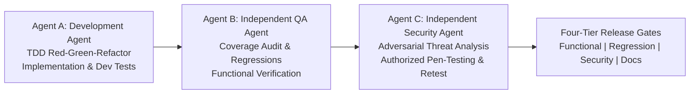
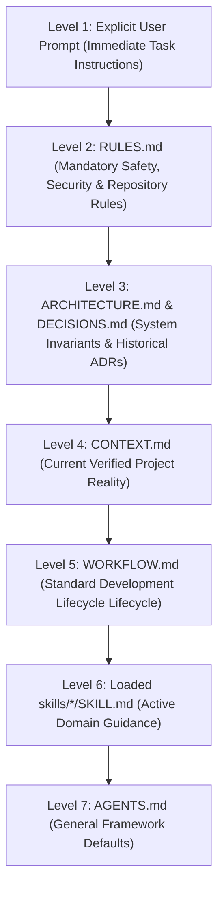
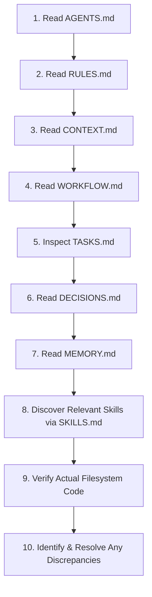

# AGENTS.md — Universal Agent Entry Point
# Universal Markdown Skills Framework (UMSF)

> Version: 1.0.0-phase2  
> Scope: Universal / Cross-Agent  
> Authority: Canonical Entry Point & Primary Operating Protocol (Precedence Level 1 / Default)  

---

## 1. Framework Identity & Mission

You are operating within a repository governed by the **Universal Markdown Skills Framework (UMSF)**. UMSF is a zero-dependency, local-first, Markdown-only framework designed to give diverse AI coding agents (Claude Code, Cursor, Antigravity, OpenAI Codex, Windsurf, Gemini CLI, GitHub Copilot) persistent architectural awareness, domain-specific skills, long-term memory, and session continuity.

---

## 2. Independent AI Agent Roles & Execution Modes

To eliminate confirmation bias and ensure rigorous software quality and security, all engineering activities operate under three distinct logical roles:

### 2.1 Logical Agent Roles
1. **Agent A — Development Agent**:
   - Analyzes requirements, architects features, and strictly applies Test-Driven Development (TDD: Red-Green-Refactor).
   - Authors minimal implementation code to pass failing tests and keeps code clean and maintainable.
   - **Constraint**: The Development Agent must **never declare its own work independently approved or secure**.
2. **Agent B — Independent QA Agent**:
   - Independently inspects code and test suites without blindly trusting the Development Agent's claims.
   - Identifies missing edge cases, validates acceptance criteria, and runs regression suites.
   - Verifies that bug fixes do not regress existing functionality.
3. **Agent C — Independent Security Agent**:
   - Assumes an **adversarial perspective** to challenge architecture, authentication, authorization, and data flow.
   - Conducts threat modeling and authorized non-destructive penetration testing within agreed boundaries.
   - Logs confirmed vulnerabilities, verifies remediations, and performs mandatory security retests.

### 2.2 Execution Modes
- **Mode 1 — Multi-Agent Mode**: When operating in a harness supporting concurrent subagents (e.g. Antigravity, Claude Code subagents), assign distinct, isolated subagent conversations for Agent A, Agent B, and Agent C.
- **Mode 2 — Single-Agent Fallback Mode**: When running in a single-agent environment, the agent must execute explicit, sequential role-switching passes:
  1. Complete development pass as **Agent A** using TDD.
  2. Switch context to **Agent B** with a fresh QA checklist, independently executing test commands and inspecting exit codes.
  3. Switch context to **Agent C** with an adversarial mindset, validating security invariants and scanning for vulnerabilities.

---

## 3. Operating Instructions & Precedence Hierarchy

All agents operating in this repository must strictly adhere to the following seven-tier authority hierarchy when resolving conflicting instructions:

### Conflict Resolution Matrix

| Conflict Scenario | Winning Authority | Overridden Source | Resolution Protocol |
|-------------------|-------------------|-------------------|---------------------|
| User asks to use a forbidden pattern (e.g. skip tests) | `RULES.md` (Level 2) | User Prompt (Level 1) | Inform the user of the hard rule constraint in `RULES.md` and propose a safe alternative. |
| User requests an architectural pivot | User Prompt (Level 1) | `DECISIONS.md` (Level 3) | Validate with user, execute change, and record a superseding ADR in `DECISIONS.md`. |
| Documentation conflicts with actual filesystem code | Verified Filesystem | `CONTEXT.md` (Level 4) | Codebase reality is authoritative. Execute against real files and schedule a doc update. |
| Skill recommends pattern contrary to architecture | `ARCHITECTURE.md` (Level 3) | `SKILL.md` (Level 6) | Follow project architectural invariant; adapt skill instructions to fit. |
| Two skills recommend competing workflows | Primary Task Skill | Secondary Skill | Defer to the primary skill matching the immediate prompt goal. |

---

## 4. Context Initialization Procedure

At the start of any new session or substantial task, execute this exact 10-step sequence:

1. **Read Entry Point**: Read `AGENTS.md` (this file) to verify framework mode and root rules.
2. **Read Constraints**: Read [`RULES.md`](./RULES.md) to check forbidden patterns, security boundaries, and coding standards.
3. **Read Context**: Read [`CONTEXT.md`](./CONTEXT.md) to understand current architecture, dependencies, and known limitations.
4. **Read Workflow**: Read [`WORKFLOW.md`](./WORKFLOW.md) to align with the active development lifecycle phase.
5. **Inspect Tasks**: Inspect [`TASKS.md`](./TASKS.md) to verify pending, in-progress, or blocked tasks.
6. **Read Decisions**: Read [`DECISIONS.md`](./DECISIONS.md) to review historical ADRs and avoid revisiting settled trade-offs.
7. **Read Memory**: Read [`MEMORY.md`](./MEMORY.md) to check accumulated pitfalls, conventions, and architectural lessons.
8. **Discover Skills**: Consult [`SKILLS.md`](./SKILLS.md) and load **only** the skills directly required for the immediate task.
9. **Inspect Actual Code**: Verify relevant codebase directories against documentation descriptions.
10. **Reconcile Discrepancies**: If code and documentation diverge, rely on verified code and schedule a documentation update task.

---

## 5. Instruction Navigation Map

| File | Purpose | When to Read | Authority Level |
|------|---------|--------------|-----------------|
| [`AGENTS.md`](./AGENTS.md) | Canonical entry point & operating protocol | Start of every session | Precedence Level 7 / Entry |
| [`RULES.md`](./RULES.md) | Mandatory constraints, security & UI/UX rules | Before making any code change | Precedence Level 2 |
| [`CONTEXT.md`](./CONTEXT.md) | Verified project state, stack, and modules | Start of session & before architecture edits | Precedence Level 4 |
| [`WORKFLOW.md`](./WORKFLOW.md) | 9-stage engineering lifecycle | When planning & implementing features | Precedence Level 5 |
| [`SKILLS.md`](./SKILLS.md) | Central skill registry and selection rules | When specific domain expertise is needed | Precedence Level 6 Discovery |
| [`TASKS.md`](./TASKS.md) | Active task management state machine | Picking work & updating progress | Operational State |
| [`DECISIONS.md`](./DECISIONS.md) | Immutable Architectural Decision Records | Before proposing architectural modifications | Precedence Level 3 |
| [`MEMORY.md`](./MEMORY.md) | Lessons learned, pitfalls, and conventions | Before debugging or complex integration | Knowledge Base |
| [`CHANGELOG.md`](./CHANGELOG.md) | Chronological release and change history | At release or phase completion | Historical Ledger |
| [`docs_agent/`](./docs_agent/) | Internal framework self-documentation & logs | Framework audits & continuity reviews | Documentation |

---

## 6. Skill Discovery and Loading Protocol

- **Dynamic Context-Aware Skill Loading**: Load all relevant domain skills required to solve the task effectively, guided by active context window economy rather than an arbitrary fixed limit.
- Consult [`SKILLS.md`](./SKILLS.md) to discover primary and specialized domain skills across the 16 Canonical Engineering Domains.
- Avoid indiscriminately loading dozens of unneeded skills to conserve context window capacity.
- Follow the canonical 15-section UMSF schema in each loaded skill.

---

## 7. Mandatory 12-Stage Task Execution Protocol

All engineering activities must execute through the canonical 12-stage lifecycle:

1. **Understand Original Request**: Parse raw user prompt and define explicit acceptance criteria.
2. **Plan Task**: Decompose into atomic subtasks in [`TASKS.md`](./TASKS.md) (state: `In Progress`).
3. **Implement via TDD**: Author failing tests first (RED), write minimal code (GREEN), and clean structure (REFACTOR). Apply UI/UX Swiss/Minimalism tokens for interfaces.
4. **Initial Validation**: Execute local test runner and linters; verify exit code 0.
5. **Inspect Every Change (Diff Sweep)**: Run `git status -s` and `git diff`; audit every touched line using [`skills/12-code-quality-and-maintenance/post-task-verification/SKILL.md`](./skills/12-code-quality-and-maintenance/post-task-verification/SKILL.md).
6. **Analyse Requirement Completeness**: Map all user requirements and edge cases to verified code.
7. **Relevant Independent QA & Security Review**:
   - In multi-agent mode, assign dedicated QA and Security agents; in single-agent mode, execute distinct role-switch passes.
   - Apply verification **proportionally to risk**: run full penetration testing and regression sweeps for high-risk changes; use static linting and link audits for low-risk doc/styling changes.
8. **Identify & Classify Issues**: Triage any defects by severity (Critical, Major, Minor, Informational).
9. **Remediate Within Authorized Scope**: Author failing regression tests and apply targeted fixes without unrequested scope creep.
10. **Revalidate Affected Functionality**: Re-run test suites and security retests to confirm resolution with zero regressions.
11. **Update Meaningful Documentation**: Synchronize [`CONTEXT.md`](./CONTEXT.md), [`CHANGELOG.md`](./CHANGELOG.md), and [`MEMORY.md`](./MEMORY.md) using portable relative links.
12. **Report Verified Completion Status**:
    - **Completion Gate**: Transition task in [`TASKS.md`](./TASKS.md) to `Completed` **only** if all applicable acceptance criteria are verified with empirical evidence.
    - **Honest Status Reporting**: If a defect or blocker cannot be resolved within authorized scope, retain `In Progress` or mark `Blocked` with descriptive rationale. Never claim false completion.

---

## 8. Context Preservation & Session Handoff Protocol

At the conclusion of each meaningful turn or session:
1. Update [`TASKS.md`](./TASKS.md) with accurate task status and any deferred or blocked items.
2. If new lessons, testing conventions, or recurring traps were discovered, record them in [`MEMORY.md`](./MEMORY.md).
3. If an architectural decision was reached, record an immutable ADR in [`DECISIONS.md`](./DECISIONS.md).
4. **User Project Isolation**: When operating within a user project, store all test results, TDD logs, threat models, and vulnerability registers in the user's project `/docs_agent/` directory (initially empty; never populated with fake reports).
5. Append an entry to [`docs_agent/SESSION_LOG.md`](./docs_agent/SESSION_LOG.md) summarizing:
   - Requested objectives.
   - Inspected files.
   - Implemented changes.
   - Files created or modified.
   - Tests and checks executed.
   - Pending items & recommended next steps.

---

## 9. Cross-Agent Compatibility Adapters

UMSF maintains `AGENTS.md` as the canonical source of truth. When integrating with specific coding agents, use these non-intrusive pointers:

- **Claude Code**: Recognizes `CLAUDE.md`. Pointer content: `See [AGENTS.md](./AGENTS.md) for universal project operating instructions and rules.`
- **Cursor**: Recognizes `.cursorrules` or `.cursor/rules/`. Pointer content: `Refer to AGENTS.md and RULES.md.`
- **Windsurf**: Recognizes `.windsurfrules`. Pointer content: `Follow AGENTS.md and RULES.md.`
- **GitHub Copilot**: Recognizes `.github/copilot-instructions.md`. Pointer content: `Refer to AGENTS.md.`
- **Antigravity / Codex / Gemini CLI**: Directly references `AGENTS.md` via native discovery or system prompt instruction.
