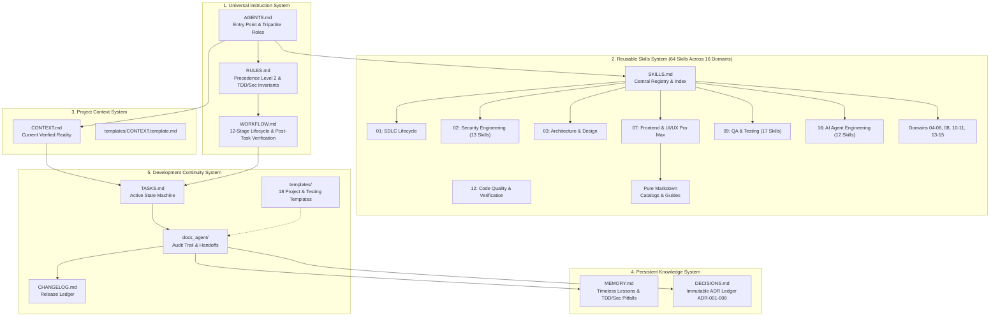

# Project Context: Universal Markdown Skills Framework (UMSF)

> Current Verified System Reality & Architectural State  
> Last Verified: 2026-11-07  
> System Release: v1.7.0 (MVP-First Skills Architecture, Progressive Loading & Global Token Efficiency)  
> Authority: Precedence Level 4 (Current Verified Project Reality)  

---

## 1. Project Overview & Objectives
- **Name**: Universal Markdown Skills Framework (UMSF)
- **Core Mission**: A universal, provider-independent, zero-dependency, local-first Markdown architecture designed to equip diverse AI coding agents (Claude Code, Cursor, Antigravity, OpenAI Codex, Windsurf, Gemini CLI, GitHub Copilot) with persistent architectural awareness, domain-specific skills, long-term memory, and session continuity.
- **Primary Objectives**:
  1. Eliminate context drift and information loss across multi-session AI interactions without external cloud services.
  2. Provide a streamlined, SDLC-comprehensive library of **66 Core Domain Skills** structured across **16 Canonical Engineering Domains** under `skills/` (with dual-path backward compatibility via root symlinks), each standardized with a **Level 1 MVP Summary**, **Level 2 Core Instructions**, and **Level 3 Optional References**:
     - 15 canonical foundational lifecycle skills (authoritatively structured in 15-section UMSF schema with Level 1 MVP contracts).
     - 1 UI/UX Pro Max canonical design intelligence suite skill (`skills/07-frontend-engineering/ui-ux-pro-max/SKILL.md`) with pure Markdown reference catalogs consolidating all styles, palettes, fonts, guidelines, and checklists.
     - 50 advanced testing, security, database optimization, DevOps, and AI agent engineering skills (Category 02 Security, Category 08 Database Query Optimization, Category 09 QA/Testing, Category 16 AI Agent Engineering, etc.).
     - 1 post-task verification delivery gate skill (`skills/12-code-quality-and-maintenance/post-task-verification/SKILL.md`).
     - 1 independent verification subagent architecture skill (`skills/16-ai-agent-engineering/independent-verification-subagent/SKILL.md`).
  3. Formalize and enforce **Test-Driven Development (TDD)** Red-Green-Refactor as the mandatory development invariant for all testable features.
  4. Codify the **Independent Verification Subagent Architecture** (Agent A Primary Development Agent, Agent B Independent Verification Subagent, Agent C Independent Security Agent) with Mode 1 (concurrent isolated subagents) and Mode 2 (sequential single-agent role-switching passes with explicit honest attribution).
  5. Codify **Authorized Penetration Testing Rules** (explicit scope, non-destructive, controlled PoCs, zero credential exfiltration, zero uncontrolled DoS).
  6. Enforce **Four-Tier Release Gates** (Functional, Regression, Security, Documentation) backed by empirical execution evidence.
  7. Provide **18 standardized project templates** in `templates/` (7 core scaffolding templates + 11 testing and security templates), preserving the empty user-project `/docs_agent/` initialization invariant.
  8. Maintain strict zero external runtime dependencies (Python 3 standard library only; no `npm install`, no external pip dependencies, no compiled binaries).
  9. Establish global token efficiency, 4-step progressive context loading (Registry -> Level 1 MVP -> Level 2 Core -> Level 3 References), and conditional risk-based verification across all framework workflows.

---

## 2. Technology Stack & Runtime Environment
*(Verified from filesystem inspection. Zero speculative dependencies.)*

| Layer | Technology | Version | Purpose / Notes |
|---|---|---|---|
| **Specification Format** | CommonMark / GFM Markdown | 1.0.0 | Canonical format for all framework instructions and memory |
| **Metadata Protocol** | YAML Frontmatter | 1.2 | Standardized schema for skill metadata (`skills/*/SKILL.md`) |
| **Diagram Engine** | Mermaid.js | Supported natively | Visual architecture flowcharts, sequence diagrams, state machines |
| **Design Intelligence** | UI/UX Pro Max Markdown Intelligence | Built-in | Pure Markdown reference catalogs of 88 styles, 192 palettes, 74 font pairings, 119 UX guidelines |
| **Search Engine (Auxiliary)** | Python 3 Standard Library | Optional Pure Python 3 | Optional auxiliary CLI `skills/ui-ux-pro-max/scripts/search.py`; zero CLI required for skill usage |
| **Runtime Dependencies** | **None (Zero-Dependency)** | N/A | No `node_modules`, `venv`, or background daemons permitted |
| **Host Environment** | Linux / POSIX Shell | Linux 6.x | Standard workspace environment for AI coding agents |

---

## 3. System Architecture & Component Map

The framework is partitioned into five interoperable subsystems:



### Architectural Invariants
- **Instruction Precedence**: Level 1 (User Prompt) -> Level 2 (`RULES.md`) -> Level 3 (`ARCHITECTURE.md` / `DECISIONS.md`) -> Level 4 (`CONTEXT.md`) -> Level 5 (`WORKFLOW.md`) -> Level 6 (`skills/*/SKILL.md`) -> Level 7 (`AGENTS.md`).
- **UI/UX Standard**: Swiss & Minimalism style, primary `#0F172A`, accent `#22C55E`, background `#020617`, typography IBM Plex Sans + JetBrains Mono, WCAG AA 4.5:1 contrast, 44×44px hit targets, mobile-first breakpoints (375px/768px/1024px/1440px).
- **TDD Invariant**: Mandatory Red-Green-Refactor cycle. Tests written and verified failing before feature code. Zero post-hoc tests.
- **Tripartite Verification**: Agent A (Dev), Agent B (Independent QA), Agent C (Independent Security). Dev cannot approve its own work. Single-agent fallback requires distinct sequential passes.
- **Penetration Testing Boundary**: Testing strictly within explicit authorized scope; non-destructive PoCs; zero data exfiltration; zero DoS.
- **Four-Tier Release Gates**: Functional, Regression, Security, and Documentation gates must be verified before production release.

---

## 4. Directory Structure & Key Modules

```
. (AgenticSkill Root)/
├── AGENTS.md                          # Universal entry point, tripartite roles & 10-step protocol
├── RULES.md                           # Mandatory constraints, TDD, security & UI/UX Pro Max invariants
├── WORKFLOW.md                        # 12-stage engineering lifecycle with post-task verification
├── SKILLS.md                          # Central skill registry (64 skills across 16 domains)
├── CONTEXT.md                         # This file (Current verified codebase reality)
├── MEMORY.md                          # Persistent knowledge base, pitfalls & TDD lessons
├── DECISIONS.md                       # Immutable Architectural Decision Records (ADRs 001-014)
├── TASKS.md                           # Operational task management state machine
├── CHANGELOG.md                       # Chronological release ledger
├── CONTRIBUTING.md                    # Contribution guidelines and standards
├── README.md                          # Framework overview & quickstart
├── LICENSE                            # MIT License
├── implementation.md                  # Master development specification (Preserved locally)
├── Enhance.md                         # Master testing & audit specification (Preserved locally)
│
├── skills/                            # Reusable domain skills library (64 skills across 16 domains)
│   ├── README.md                      # Domain catalog & progressive loading rules
│   ├── 01-software-development-lifecycle/ # SDLC methodologies, planning, requirements
│   ├── 02-security-engineering/       # 13 security skills (pen-testing, threat modeling, auth)
│   ├── 03-software-architecture-and-design/ # Software architecture, design patterns, ADRs
│   ├── 04-requirements-and-business-analysis/ # Requirements intake, scoping, acceptance
│   ├── 05-programming-and-implementation/ # Coding standards, language idioms, clean code
│   ├── 06-backend-engineering/        # Microservices, APIs, database integration
│   ├── 07-frontend-engineering/       # UI/UX Pro Max Engine (1 Core Skill), design systems, styles
│   ├── 08-database-engineering/       # Schemas, migrations, optimization, caching
│   ├── 09-quality-assurance-and-testing/ # 17 testing skills (TDD, unit, integration, regression)
│   ├── 10-devops-and-infrastructure/  # CI/CD, containers, Kubernetes, cloud platforms
│   ├── 11-reliability-and-operations/ # SRE, monitoring, incident response, chaos
│   ├── 12-code-quality-and-maintenance/ # Code review, post-task-verification, static analysis
│   ├── 13-performance-engineering/    # Profiling, latency budgets, load & stress
│   ├── 14-project-and-team-management/ # Agile, task management, sprint planning
│   ├── 15-documentation-and-technical-communication/ # Technical writing, docs, guides
│   ├── 16-ai-agent-engineering/       # 12 agentic skills (independent verification subagent, QA/security agents)
│   └── [64 root symlinks/aliases]     # Flat dual-path compatibility links for all skills
│
├── templates/                         # Complete 18-template scaffolding suite
│   ├── SKILL.template.md              # Canonical 15-section skill template
│   ├── CONTEXT.template.md            # Project reality template
│   ├── MEMORY.template.md             # Long-term memory template
│   ├── DECISIONS.template.md          # ADR authoring template
│   ├── TASKS.template.md              # Task tracking state machine template
│   ├── SESSION.template.md            # Agent session continuity template
│   ├── DEVELOPMENT_REPORT.template.md # Phase & milestone report template
│   ├── TEST_STRATEGY.template.md      # Project test strategy template
│   ├── TDD_LOG.template.md            # Red-Green-Refactor tracking template
│   ├── TEST_RESULTS.md                # Test execution results template
│   ├── REGRESSION_REPORT.md           # Regression verification template
│   ├── QA_ASSESSMENT.md               # Independent QA assessment template
│   ├── SECURITY_TEST_PLAN.md          # Security assessment plan template
│   ├── THREAT_MODEL.md                # STRIDE / Threat model template
│   ├── SECURITY_ASSESSMENT.md         # Independent security assessment template
│   ├── VULNERABILITY_REGISTER.md      # 10-stage vulnerability tracking register
│   ├── PENETRATION_TEST_REPORT.md     # Authorized penetration test report template
│   └── RETEST_REPORT.md               # Vulnerability retesting & verification template
│
├── docs_agent/                        # Internal framework self-documentation & logs
│   ├── README.md                      # Docs engine overview
│   ├── ARCHITECTURE.md                # In-depth architectural specification
│   ├── COMPATIBILITY.md               # Cross-agent validation & link integrity audits
│   ├── IMPLEMENTATION_STATUS.md       # Roadmap tracker (Phases 1-7 + Enhancements Completed)
│   ├── PHASE_HISTORY.md               # Historical phase ledger
│   ├── DEVELOPMENT_LOG.md             # Chronological engineering log
│   ├── CHANGE_HISTORY.md              # Granular change record
│   ├── SESSION_LOG.md                 # Session handoffs and continuity records
│   └── phases/                        # Formal phase & enhancement reports
│
├── ECC/                               # Upstream source repository (Preserved)
└── ui-ux-pro-max-skill/               # Upstream source repository (Preserved)
```

---

## 5. Current Implementation Status

| Milestone / Phase | Focus | Status | Completion Date |
|---|---|---|---|
| **Phase 1** | Foundation & Architecture | **COMPLETED** | 2026-11-02 |
| **Phase 2** | Universal Instruction System | **COMPLETED** | 2026-11-02 |
| **Phase 3** | Reusable Skills System | **COMPLETED** | 2026-11-03 |
| **Phase 4** | Context & Memory System | **COMPLETED** | 2026-11-03 |
| **Phase 5** | Development Continuity System | **COMPLETED** | 2026-11-03 |
| **Phase 6** | Compatibility & Validation | **COMPLETED** | 2026-11-03 |
| **Phase 7** | Release & Final Documentation | **COMPLETED** | 2026-11-03 |
| **Skills Expansion** | UI/UX Pro Max Engine & 313 ECC Skills Integration | **COMPLETED** | 2026-11-03 |
| **Enhancement** | Advanced Testing, TDD & AI Security Engineering (371 Skills, 16 Domains) | **COMPLETED** | 2026-11-03 |
| **Audit & Post-Task** | Framework Audit, Contradiction Resolution & Post-Task Verification Gate | **COMPLETED** | 2026-11-03 |
| **Verification Subagent** | Independent Verification Subagent Architecture & 7-Dimensional Audit Loop | **COMPLETED** | 2026-11-03 |
| **UI/UX Consolidation** | Consolidation of UI/UX Domain to UI/UX Pro Max Engine (351 Skills, 16 Domains) | **COMPLETED** | 2026-11-07 |
| **ECC Integration** | Architectural Integration of High-Value ECC Capabilities & Catalog Streamlining (64 Skills, 16 Domains) | **COMPLETED** | 2026-11-07 |

---

## 6. Pre-Existing Code & Preserved Artifacts
- [`WORKFLOW.md`](./WORKFLOW.md): The user-provided master specification governing UMSF requirements. Preserved verbatim.
- [`master_enhancement.md`](./master_enhancement.md): The master audit, testing, and post-task verification enhancement specification. Preserved verbatim.
- [`enhancement.md`](./enhancement.md): The master specification governing the ECC research, analysis, and architectural integration. Preserved verbatim.
- [`sub_agent_enhancement.md`](./sub_agent_enhancement.md): The user-provided specification for the Independent Verification Subagent Architecture and phase execution. Preserved verbatim.
- [`ui-ux-pro-max-skill/`](./ui-ux-pro-max-skill/): Upstream repository for the UI/UX Pro Max design intelligence suite. Preserved intact.
- [`ECC/`](./ECC/): Upstream repository for Everything Claude Code skills. Preserved intact.

---

## 7. Known Limitations & Technical Constraints
1. **Agent Compliance Model**: The framework relies on LLM prompt parsing and reasoning. Strict adherence to the 10-step initialization procedure in [`AGENTS.md`](./AGENTS.md) ensures context accuracy.
2. **Context Window Protection**: Never load all 64 skills simultaneously. Agents must adhere to dynamic context-aware skill loading, loading only the skills relevant to the active task stage.
3. **Single-Agent Role Switching Overhead**: In single-agent environments (Mode 2), executing sequential role-switching passes (Dev -> QA -> Security) consumes additional conversational turns, which is a conscious and mandatory design trade-off for software correctness and security.
4. **User Project Isolation Invariant**: The user's project `/docs_agent/` directory is initially empty upon framework adoption and is populated strictly as real testing and development events occur; simulated or placeholder test reports are strictly forbidden.
5. **100% Self-Contained Markdown Skills**: All 64 skills operate purely as standard Markdown documentation. Users do not need to install external packages, CLI daemons, or interactive search tools. When UMSF is adopted, all skills function self-contained within `skills/`. Zero external network dependencies.

