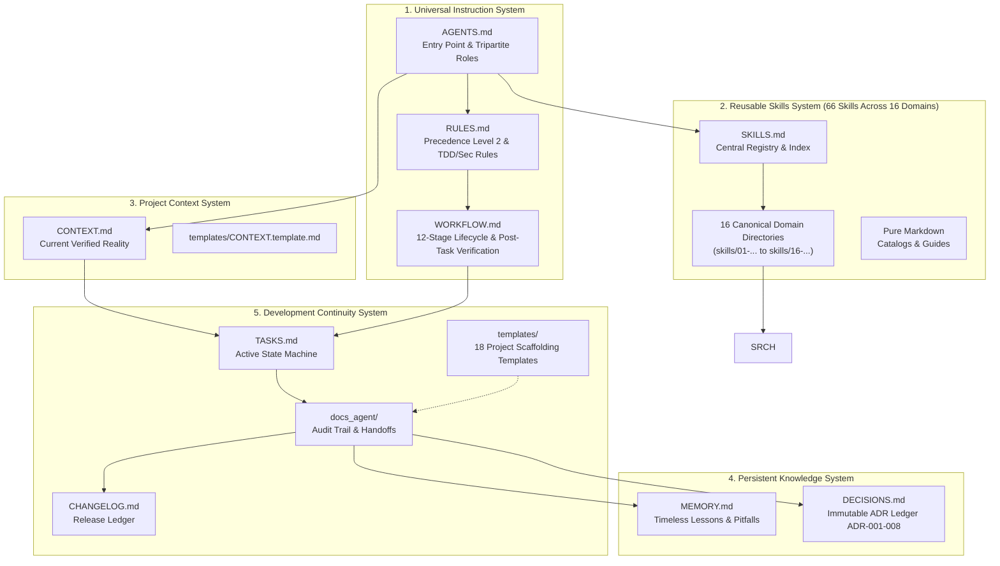

# Universal Markdown Skills Framework (UMSF)

> A universal, provider-independent, zero-dependency, local-first Markdown architecture for AI coding agents.

[](LICENSE)
[](#)
[](#)
[](SKILLS.md)
[](skills/09-quality-assurance-and-testing/test-driven-development/SKILL.md)
[](skills/02-security-engineering/penetration-testing/SKILL.md)
[](docs_agent/COMPATIBILITY.md)
[](skills/07-frontend-engineering/ui-ux-pro-max/SKILL.md)

---

## 1. Executive Overview

The **Universal Markdown Skills Framework (UMSF)** is an open specification and standardized repository architecture that gives AI coding agents persistent architectural context, reusable domain skills, long-term memory, and multi-session continuity—entirely through standard Markdown files.

UMSF introduces **no executable runtimes, no background daemons, no databases, and zero external software dependencies**. It operates purely on the agent's native ability to parse, reason over, and follow structured Markdown documentation stored directly inside the local version control repository.

### Why UMSF?

| Problem in Agentic Development | Traditional Approach | UMSF Solution |
|---|---|---|
| **Context Drift Across Sessions** | Context lost when chat closes | Structured handoffs in `docs_agent/SESSION_LOG.md` & `TASKS.md` |
| **Token Sizing / Context Bloat** | Ingesting all rules into prompt | 66 modular on-demand skills with dynamic context-aware loading (`SKILLS.md`) |
| **Developer Self-Approval Bias** | Dev agent approves its own code | **Tripartite Agent Architecture**: Independent QA & Security review |
| **Post-Hoc / Fake Tests** | Tests written after code to match bugs | **Mandatory TDD Red-Green-Refactor**: Failing tests written first |
| **Superficial Security Scans** | Passive checks or zero security review | **Authorized Penetration Testing** & 10-stage vulnerability lifecycle |
| **Instruction Conflict Paralysis** | Vague, competing instructions | Explicit 7-Tier Precedence Hierarchy & Conflict Resolution Matrix |
| **Premature Production Release** | Releasing on single happy-path run | **Four-Tier Release Gates**: Functional, Regression, Security, Docs |
| **Poor UI / Accessibility Quality** | Inconsistent, unstyled components | Mandatory **UI/UX Pro Max** standards (Swiss style, WCAG AA 4.5:1) |
| **Vendor Lock-in** | Proprietary agent plugins | Universal `AGENTS.md` core with lightweight 1-line provider adapters |
| **Environment Fragility** | Fragile npm/pip CLI daemons | Zero dependencies: 100% pure Markdown (`.md`) |

---

## 2. Five Core Systems



1. **Universal Instruction System** ([`AGENTS.md`](./AGENTS.md), [`RULES.md`](./RULES.md), [`WORKFLOW.md`](./WORKFLOW.md)): Governs entry points, precedence ranking, safety invariants, TDD Red-Green-Refactor, Tripartite roles, and 4-tier release gates.
2. **Reusable Skills System** ([`SKILLS.md`](./SKILLS.md), [`skills/`](./skills/)): 66 on-demand domain capability packages structured into 16 canonical numbered domain directories under `skills/` (with dual-path backward compatibility via root symlinks).
3. **Project Context System** ([`CONTEXT.md`](./CONTEXT.md)): The verified single source of truth describing active stack, modules, and limitations.
4. **Persistent Knowledge and Memory System** ([`MEMORY.md`](./MEMORY.md), [`DECISIONS.md`](./DECISIONS.md)): Preserves architectural lessons, pitfalls, conventions, and immutable ADRs (ADR-001 through ADR-016).
5. **Development Continuity System** ([`TASKS.md`](./TASKS.md), [`CHANGELOG.md`](./CHANGELOG.md), [`templates/`](./templates/), [`docs_agent/`](./docs_agent/)): Operational 5-state task tracker, 18 project templates, and multi-agent session handoffs.

---

## 3. UI/UX Pro Max Design Standard

UMSF directly integrates the design intelligence of the **UI/UX Pro Max** framework into its core architecture and skills:

- **Aesthetic Persona**: **Minimalism & Swiss Style** (clean geometric sans-serif typography, structured grid layout, functional whitespace).
- **Color Token Architecture**:
  ```css
  --color-primary: #0F172A;      /* Slate 900 - Brand / Headings */
  --color-accent: #22C55E;       /* Emerald 500 - Action CTAs / Success */
  --color-background: #020617;   /* Slate 950 - Canvas */
  --color-card: #0E1223;         /* Surface Containers */
  --color-border: #334155;       /* Structural Dividers */
  --color-ring: #38BDF8;         /* Focus Ring */
  ```
- **Typography**: **IBM Plex Sans** (body/display) + **JetBrains Mono** (code/metrics). Base size: 16px (1.5 line height).
- **Accessibility (CRITICAL)**: Strict **WCAG AA 4.5:1** text contrast minimum, visible keyboard focus rings, and **44×44px** minimum interactive touch targets.
- **Iconography**: Strictly **no raw emojis as icons** (e.g. 🔍, ⚙️, ❌). Use accessible SVGs (Lucide, Heroicons) with proper `aria-hidden` attributes.
- **Mobile-First Breakpoints**: Built mobile-first across `375px`, `768px`, `1024px`, and `1440px` with zero horizontal overflow.

---

## 4. Reusable Skills Library (66 Active Skills Across 16 Domains)

The framework features a streamlined, SDLC-comprehensive library of **66 modular skills** structured across **16 Canonical Engineering Domains** under `skills/` (with dual-path backward compatibility via root symlinks):

### The 16 Canonical Engineering Domains

| Domain | Directory Path | Key Capabilities & Highlights |
|---|---|---|
| **01. SDLC** | [`skills/01-software-development-lifecycle/`](./skills/01-software-development-lifecycle/) | Lifecycle frameworks, planning, scoping, delivery tracking |
| **02. Security** | [`skills/02-security-engineering/`](./skills/02-security-engineering/) | **13 Security Skills**: Authorized pen-testing, threat modeling, auth/authz, OWASP |
| **03. Architecture** | [`skills/03-software-architecture-and-design/`](./skills/03-software-architecture-and-design/) | Modular design, ADRs, Clean Architecture, microservices |
| **04. Requirements** | [`skills/04-requirements-and-business-analysis/`](./skills/04-requirements-and-business-analysis/) | User story breakdown, acceptance criteria, intake specs |
| **05. Implementation** | [`skills/05-programming-and-implementation/`](./skills/05-programming-and-implementation/) | Language idioms, clean code, type safety, contracts |
| **06. Backend** | [`skills/06-backend-engineering/`](./skills/06-backend-engineering/) | REST APIs, GraphQL, domain logic, thin controllers |
| **07. Frontend** | [`skills/07-frontend-engineering/`](./skills/07-frontend-engineering/) | **UI/UX Pro Max Engine (1 Core Skill)**, Swiss tokens, 88 styles, 192 product palettes |
| **08. Database** | [`skills/08-database-engineering/`](./skills/08-database-engineering/) | **3 Database Skills**: Normalization, indexing, migrations, **query optimization** |
| **09. QA & Testing** | [`skills/09-quality-assurance-and-testing/`](./skills/09-quality-assurance-and-testing/) | **18 Testing Skills**: Feature Integration, Mandatory TDD, Unit, Integration, E2E, Regression |
| **10. DevOps** | [`skills/10-devops-and-infrastructure/`](./skills/10-devops-and-infrastructure/) | CI/CD pipelines, Docker, Kubernetes, cloud platforms |
| **11. Reliability** | [`skills/11-reliability-and-operations/`](./skills/11-reliability-and-operations/) | SRE metrics, SLI/SLO, alerting, incident response |
| **12. Code Quality** | [`skills/12-code-quality-and-maintenance/`](./skills/12-code-quality-and-maintenance/) | 5-dimension code review, **post-task-verification**, refactoring |
| **13. Performance** | [`skills/13-performance-engineering/`](./skills/13-performance-engineering/) | Profiling, latency budgets, load & stress testing |
| **14. Project Mgmt** | [`skills/14-project-and-team-management/`](./skills/14-project-and-team-management/) | Agile ceremonies, sprint planning, task DAG breakdown |
| **15. Documentation**| [`skills/15-documentation-and-technical-communication/`](./skills/15-documentation-and-technical-communication/) | Technical writing, architectural docs, API references |
| **16. AI Agentic** | [`skills/16-ai-agent-engineering/`](./skills/16-ai-agent-engineering/) | **12 Agentic Skills**: Independent verification subagent, QA agent, Security agent, multi-agent verification |

### Test-Driven Development (TDD) Protocol
Mandatory for all testable features:
1. **RED**: Write failing automated tests first; verify expected failure.
2. **GREEN**: Write minimal code necessary to pass tests.
3. **REFACTOR**: Clean code structure while maintaining passing tests.

### Tripartite Agent Roles & Subagent Verification Architecture
- **Agent A (Primary Development)**: Responsible for implementation following TDD. Cannot approve its own code. Prepares handoff payload.
- **Agent B (Independent Verification Subagent)**: Dispatched in isolated subagent context to independently audit requirements, diffs, raw test exit codes, architecture, code quality, security coordination, and doc sync. Manages defect remediation loop (max 3 iterations).
- **Agent C (Independent Security)**: Responsible for authorized pen-testing, threat modeling, and Security Release Gate.
- **Single-Agent Fallback (Mode 2)**: Sequential role-switching passes with fresh checklists and mandatory honest attribution in reports when running in a single-agent harness.

### Pure Markdown UI/UX Design Intelligence
All design guidance is 100% self-contained in Markdown catalogs (zero CLI tools or external installations required):
- [`styles-and-palettes.md`](./skills/ui-ux-pro-max/references/styles-and-palettes.md): 88 visual styles, 192 product palettes, 74 font pairings, 25 chart types.
- [`quick-reference.md`](./skills/ui-ux-pro-max/references/quick-reference.md): All 10 priority rule categories and 119 UX guidelines with rationale.
- [`pro-rules.md`](./skills/ui-ux-pro-max/references/pro-rules.md): Mobile polish rules and canonical Pre-Delivery Checklist.

> Consult [`SKILLS.md`](./SKILLS.md) for the complete central directory and selection protocols.

---

## 5. Installation & Adoption Guide

UMSF requires **zero package installation**. You can adopt it in minutes:

### Method A: Initializing a New Repository
1. Clone or copy UMSF files into your new project directory:
   ```bash
   cp -r /path/to/universal-markdown-skills/* ./
   ```
2. Open [`CONTEXT.md`](./CONTEXT.md) and update Section 1 with your project name and technology stack.
3. Open your project with your favorite AI coding agent and instruct:
   > *"Read AGENTS.md and follow the 10-step initialization procedure."*

### Method B: Adopting into an Existing Codebase (Non-Destructive)
1. Copy the core files into your project root:
   ```bash
   cp AGENTS.md RULES.md WORKFLOW.md SKILLS.md CONTEXT.md MEMORY.md DECISIONS.md TASKS.md CHANGELOG.md ./
   cp -r skills/ templates/ docs_agent/ ./
   ```
2. Update [`CONTEXT.md`](./CONTEXT.md) to accurately document your existing codebase reality.
3. **Preserve Existing Docs**: If you already have a `README.md` or `CLAUDE.md`, simply append a pointer:
   ```markdown
   ## Agent Operating Instructions
   This repository is governed by UMSF. See [AGENTS.md](./AGENTS.md) for universal agent protocols.
   ```

---

## 6. Multi-Agent Integration Guide

UMSF maintains a single universal core (`AGENTS.md`) while supporting lightweight provider adapters:

- **Claude Code**: Create a 1-line `CLAUDE.md` pointing to `AGENTS.md`.
- **Cursor**: Create `.cursorrules` pointing to `AGENTS.md` and `RULES.md`.
- **Windsurf**: Create `.windsurfrules` pointing to `AGENTS.md` and `WORKFLOW.md`.
- **GitHub Copilot**: Create `.github/copilot-instructions.md` pointing to `AGENTS.md`.
- **Antigravity, OpenAI Codex & Gemini CLI**: Directly native; prompt agent to *"Read AGENTS.md"*.

For complete compatibility analysis and edge-case protocols, see [`docs_agent/COMPATIBILITY.md`](./docs_agent/COMPATIBILITY.md).

---

## 7. Development Roadmap & Verification Status

UMSF has been constructed in seven foundational phases plus major expansion milestones:

- [x] **Phase 1: Foundation and Architecture** ([`docs_agent/phases/PHASE_01_FOUNDATION.md`](./docs_agent/phases/PHASE_01_FOUNDATION.md))
- [x] **Phase 2: Universal Instruction System** ([`docs_agent/phases/PHASE_02_INSTRUCTIONS.md`](./docs_agent/phases/PHASE_02_INSTRUCTIONS.md))
- [x] **Phase 3: Reusable Skills System** ([`docs_agent/phases/PHASE_03_SKILLS.md`](./docs_agent/phases/PHASE_03_SKILLS.md))
- [x] **Phase 4: Context and Memory System** ([`docs_agent/phases/PHASE_04_CONTEXT_MEMORY.md`](./docs_agent/phases/PHASE_04_CONTEXT_MEMORY.md))
- [x] **Phase 5: Development Continuity System** ([`docs_agent/phases/PHASE_05_CONTINUITY.md`](./docs_agent/phases/PHASE_05_CONTINUITY.md))
- [x] **Phase 6: Compatibility and Validation** ([`docs_agent/phases/PHASE_06_COMPATIBILITY.md`](./docs_agent/phases/PHASE_06_COMPATIBILITY.md))
- [x] **Phase 7: Release and Final Documentation** ([`docs_agent/phases/PHASE_07_RELEASE.md`](./docs_agent/phases/PHASE_07_RELEASE.md))
- [x] **Skills Expansion: UI/UX Pro Max Suite & 313 ECC Skills** ([`docs_agent/phases/SKILLS_EXPANSION_REPORT.md`](./docs_agent/phases/SKILLS_EXPANSION_REPORT.md))
- [x] **Enhancement: Advanced Testing, TDD & AI Security Engineering** ([`docs_agent/phases/ENHANCEMENT_REPORT.md`](./docs_agent/phases/ENHANCEMENT_REPORT.md))

---

## 8. Contributing

Contributions are welcomed! Please read [`CONTRIBUTING.md`](./CONTRIBUTING.md) for skill authoring rules, 15-section schema requirements, and pull request guidelines.

---

## 9. License

Released under the [MIT License](LICENSE).
