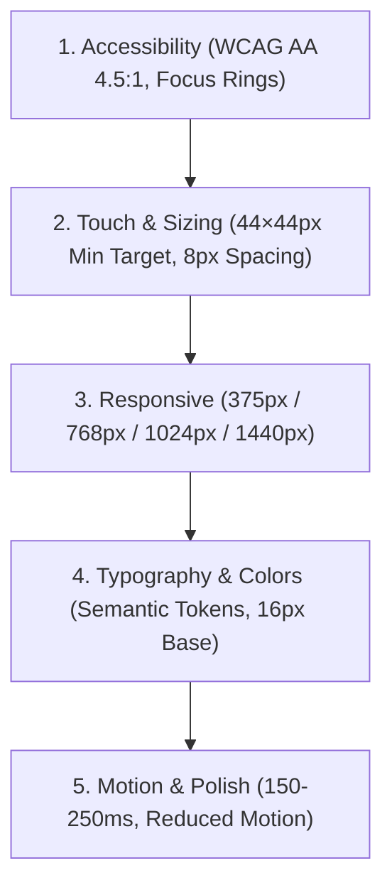
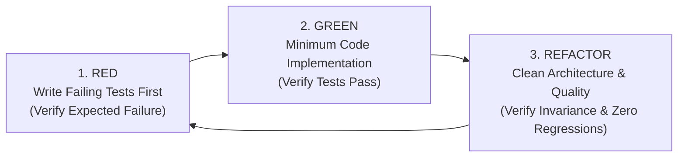

# RULES.md — Mandatory Development Constraints
# Universal Markdown Skills Framework (UMSF)

> Version: 1.7.0  
> Scope: Universal / All Agents & Contributors  
> Authority: Mandatory Repository Constraints (Precedence Level 2)  

---

## 1. Governance & Authority

All AI coding agents, contributors, and automated tooling operating within this repository must adhere strictly to the rules set forth in this document. 

- **Precedence**: These rules rank at **Precedence Level 2**, surpassed only by immediate, explicit instructions provided by the user in the active prompt.
- **Invariance**: No agent or automation may silently bypass, disable, or relax these constraints.
- **Enforcement**: Any generated code, documentation, or architectural modification violating these rules must be rejected or remediated immediately.

### 1.1 Authority Boundary Triad
To resolve conflicting instructions unambiguously, agents must distinguish three tiers of authority:
1. **Tier A — Platform Safety & Security Constraints (Absolute)**:
   - Operating system boundaries, credential protection, network isolation, non-destructive penetration testing limits, zero unauthorized data exfiltration, zero DoS.
   - *These cannot be relaxed or overridden by any prompt, framework rule, or project decision.*
2. **Tier B — Mandatory Framework Invariants (Precedence Level 2)**:
   - Zero-dependency Markdown-only core, local-first sovereignty, strict relative links, TDD Red-Green-Refactor, post-task verification, and evidence-backed task completion.
   - *These govern the software engineering lifecycle and quality guarantees across all projects adopting UMSF.*
3. **Tier C — User-Controlled Project Decisions (Precedence Level 1 / Level 3)**:
   - Application architecture, tech stack selection, domain business models, UI/UX styling themes, and feature prioritization.
   - *The user holds full sovereignty over project decisions. When an explicit prompt requests an architectural pivot, record a formal ADR in `DECISIONS.md`.*

---

## 2. Framework Invariants (Zero-Dependency & Local-First)

1. **Markdown-Only Core**:
   - The UMSF framework itself is implemented strictly in Markdown (`.md`).
   - Do NOT introduce executable engines, Python scripts, Node.js runtimes, Rust binaries, or shell runners into the framework governance layer.
   - Do NOT add `package.json`, `requirements.txt`, `Cargo.toml`, or third-party package manifests to run the framework.
2. **Local-First & Sovereign**:
   - All architecture, skills, context, task history, and memory must live locally inside this repository.
   - External cloud memory services, remote telemetry, and proprietary vector stores are strictly prohibited.
3. **No Fabricated Information**:
   - Never invent or assume dependencies, directory layouts, test results, or completed tasks.
   - Always verify existence against the filesystem before referencing.
   - Explicitly label statements as **Verified**, **Inferred**, or **Unknown**.
4. **Preservation of Existing Work**:
   - When UMSF is embedded into an existing codebase, never delete pre-existing project instructions, configurations, or source code without explicit user confirmation.
5. **Self-Contained Markdown Skills**:
   - Every skill in `skills/` must be 100% self-contained in Markdown.
   - Do NOT assume or require the user to install external plugins, upstream repositories (`ECC/`, `ui-ux-pro-max-skill/`), or interactive CLI search tools.
   - All design intelligence, catalogs, checklists, and engineering protocols must be directly readable and executable as Markdown instructions.
6. **Repository Portability & Relative Links Invariant**:
   - All internal links, cross-references, image embeddings, and directory references within repository markdown documents and skills must be strictly relative (e.g. `./TASKS.md`, `./references/quick-reference.md`, `../../RULES.md`).
   - Hardcoded host system paths (such as `/home/...`, `/Users/...`, `C:\...`, or `file:///...`) are strictly prohibited in tracked repository files.
   - Documents and skills must remain 100% portable across any clone location, operating system, or user directory.
7. **Evidence-Based Task Completion**:
   - No task in `TASKS.md` may transition to `Completed` without verifiable execution evidence (diff inspection, test runner output, exit code 0).
   - If an issue cannot be resolved or requires external authorization, agents must report the blocker honestly and retain `In Progress` or `Blocked` state. Never claim false completion.
8. **Dynamic Context-Aware Skill Loading**:
   - Agents must load all relevant domain skills required by a task, guided by active context window economy rather than an arbitrary fixed limit.
   - Indiscriminately loading dozens of unneeded skills is prohibited to conserve context budget.
9. **Progressive Skill Loading & Token Efficiency Invariants**:
   - All skills in `skills/` must implement the 3-Tier Progressive Loading Architecture (Level 1 MVP Summary, Level 2 Core Instructions, Level 3 Optional References).
   - Agents must prioritize reading Level 1 MVP Summaries before ingesting full skill files.
   - Level 3 references must be loaded strictly on-demand when specialized templates or catalogs are required.
   - Verification procedures must scale conditionally to change risk (low-risk doc/styling changes are exempt from heavy penetration tests or migration suites).
   - Final completion reports must remain token-aware, citing documentation paths rather than duplicating full file contents.

---

## 3. UI/UX Design Standards (UI/UX Pro Max Invariants)

All user interface code, web pages, frontend components, design tokens, and documentation visuals must comply with the **UI/UX Pro Max** design intelligence standards:

### 3.1 Visual Style & Aesthetics
- **Design Persona**: **Minimalism & Swiss Style**.
- Prioritize high functional clarity, generous whitespace, sans-serif typography, and structured grid alignment.
- Reject gratuitous visual noise, unmotivated gradients, or inconsistent borders.
- **Iconography**: Strictly **no raw emojis as user interface icons** (e.g. do not use 🔍, ⚙️, ❌ for buttons). Use accessible, vectorized SVGs (Lucide, Heroicons) with appropriate `aria-hidden="true"` or accessible name attributes.

### 3.2 Accessibility (CRITICAL — WCAG AA Compliance)
- **Text Contrast**: Standard body text must achieve a minimum contrast ratio of **4.5:1** against its background; large text (18pt+ or 14pt+ bold) must achieve at least **3.0:1**.
- **Focus Indicators**: Never suppress keyboard focus rings (`outline: none` without replacement is strictly forbidden). A visible focus ring (`--color-ring`) is mandatory on all interactive elements.
- **Icon Buttons**: Every icon-only button must contain a visible label or an explicit `aria-label` / `aria-labelledby`.
- **Color Independence**: Never use color as the sole indicator of status, error, or system state. Always pair color with text, shape, or iconography.

### 3.3 Touch Targets & Interaction Sizing
- **Minimum Target Size**: All clickable and tappable elements (buttons, links, inputs, checkboxes) must measure at least **44×44px** in interactive hit area.
- **Spacing**: Maintain a minimum gap of **8px** between adjacent interactive targets to prevent mis-clicks.
- **Feedback**: Interactive state changes must provide instant visual feedback on `:hover`, `:active`, and `:focus` states. Loading states must render visible progress feedback.

### 3.4 Responsive Breakpoints & Layout
- Layouts must be built **mobile-first** across standard breakpoints:
  - Mobile: `375px`
  - Tablet: `768px`
  - Desktop: `1024px`
  - Wide: `1440px`
- **Zero Horizontal Scrolling**: Unintended horizontal scrollbars at any standard viewport width are considered severe bugs.
- Container widths must be flexible (`max-width` with percentage or auto margins); never use fixed pixel widths on parent containers.
- Viewport meta tags must never disable user zoom (`maximum-scale=1` and `user-scalable=no` are prohibited).

### 3.5 Semantic Color Tokens & Typography
- **Design Tokens**: Never write raw hardcoded hex codes (`#1e293b`) directly into component style rules. Always reference semantic CSS variables:
  - Backgrounds: `--color-background`, `--color-card`, `--color-muted`
  - Text/Foregrounds: `--color-foreground`, `--color-card-fg`, `--color-muted-fg`
  - Brand & Accents: `--color-primary`, `--color-secondary`, `--color-accent`
  - Boundaries & States: `--color-border`, `--color-destructive`, `--color-ring`
- **Typography**:
  - Base body font size must be at least **16px** (`1rem`) with a line-height of **1.5** (`24px`).
  - Smallest permissible secondary caption text is **12px** (`0.75rem`).
  - Body/Display font: **IBM Plex Sans** (or system sans-serif fallback).
  - Code/Metrics font: **JetBrains Mono** (or monospace fallback).

### 3.6 Animation & Motion
- Durations must stay within **150ms to 250ms** for micro-interactions; never exceed **400ms** for general page transitions.
- Animate only GPU-accelerated properties: `transform` and `opacity`. Animating `width`, `height`, `margin`, or `padding` is prohibited due to layout thrashing.
- Always support `@media (prefers-reduced-motion: reduce)` by disabling non-essential transitions or setting durations to `0.01ms`.

---

## 4. Coding Standards

1. **Clean Code & Modularity**:
   - Adhere to Single Responsibility Principle (SRP) and DRY (Don't Repeat Yourself).
   - Functions and methods must have a single clear purpose and should ideally fit within a single screen view.
   - Avoid deep nesting (maximum 3 levels of indentation inside functions). Prefer early returns / guard clauses.
2. **Explicit Naming**:
   - Variable, function, and file names must be descriptive and self-documenting.
   - Avoid cryptic abbreviations (e.g., use `calculateInvoiceTotal` instead of `calcTot`).
   - Boolean variables must use prefixes denoting state: `isReady`, `hasPermission`, `canSubmit`.
3. **Type Safety & Contracts**:
   - In typed languages (TypeScript, Python with type hints, Go, Rust), provide explicit types for all function signatures, parameters, return values, and data structures.
   - Avoid `any` types in TypeScript and untyped parameters in modern Python.
4. **Documentation & Comments**:
   - Maintain documentation integrity: never delete existing comments, docstrings, or license headers without explicit justification.
   - Comment the *why* (architectural reasoning, edge cases, domain requirements), not the obvious *what*.

---

## 5. Security & Safety Standards

1. **Zero Secret Leaks**:
   - Never hardcode API keys, passwords, bearer tokens, private keys, or credentials into source code, documentation, or test mocks.
   - Load secrets exclusively via environment variables (`.env` files must be included in `.gitignore`).
2. **Input Sanitization & Injection Defense**:
   - Treat all user and external input as untrusted.
   - Use parameterized queries or ORM abstractions for all database operations (zero raw SQL string concatenation).
   - Sanitize and encode user input before rendering to prevent Cross-Site Scripting (XSS).
3. **Authentication & Authorization**:
   - Validate authorization on every endpoint and sensitive operation, not merely at the UI layer.
   - Use industry-standard cryptography; never implement custom encryption or hashing algorithms.
4. **Boundary Verification**:
   - Never defeat, bypass, or mock out security controls, sandboxes, permission checks, or proxy restrictions.
   - If an operation is blocked by security boundaries, report the limitation clearly to the user.

---

## 6. Architecture & System Design Invariants

1. **Separation of Concerns**:
   - Decouple business domain logic from transport layers (HTTP/gRPC/CLI) and storage mechanisms (database/file storage).
   - Domain logic must remain testable without requiring running databases or live network connections.
2. **Immutability of Settled Decisions**:
   - Settled architectural decisions documented in `DECISIONS.md` cannot be silently reversed.
   - Any architectural pivot requires authoring a formal superseding ADR explaining the context, trade-offs, and consequences.
3. **Circular Dependencies**:
   - Circular imports and package dependencies are strictly forbidden. Structure dependencies unidirectionally.

---

## 7. Test-Driven Development (TDD) Mandatory Invariants

Test-Driven Development (TDD) is the mandatory development approach for all testable application features:

1. **Mandatory Red-Green-Refactor Protocol**:
   - **RED Phase**: Before authoring application code, agents must understand requirements, define acceptance criteria (positive, negative, boundary, and edge cases), write automated tests, execute them, and **confirm they fail for the expected reason** (distinguishing expected failure from broken test harness or syntax error).
   - **GREEN Phase**: Implement only the minimum code necessary to make the failing tests pass. Run tests and verify success without modifying unrelated functionality.
   - **REFACTOR Phase**: Clean code structure, eliminate duplication, improve maintainability, verify security posture, and rerun the full test suite to confirm zero regressions.
2. **Absolute TDD Prohibitions**:
   - Never write tests merely to match an already-implemented code path (no post-hoc confirmation bias).
   - Never modify or weaken tests just to make an incorrect implementation pass.
   - Never delete failing tests without documented and authorized architectural justification.
   - Never claim tests passed without actually executing them in the environment and inspecting exit codes and logs.
3. **Documented Exceptions**:
   - TDD exceptions are permitted only for exploratory spike prototypes, legacy code characterization (where characterization tests are written first), or hard infrastructure constraints. All exceptions must be explicitly recorded in `docs_agent/testing/TDD_LOG.md`.

---

## 8. Independent AI Verification Subagent & Quality Assurance Invariants

1. **Role Separation & Subagent Architecture**:
   - The Primary Development Agent (Agent A) must **never declare its own work independently approved or secure**.
   - All meaningful engineering deliverables require independent verification by the **Independent Verification Subagent (Agent B)** ([`skills/16-ai-agent-engineering/independent-verification-subagent/SKILL.md`](./skills/16-ai-agent-engineering/independent-verification-subagent/SKILL.md)), coordinating with the Independent Security Agent (Agent C) for security-sensitive scopes.
2. **Execution Modes & Honest Attribution**:
   - **Mode 1 (Multi-Agent Subagents — Preferred)**: In harnesses supporting concurrent subagents, dispatch dedicated, isolated subagent instances for Agent A, Agent B, and Agent C to eliminate cognitive bias and memory leakage.
   - **Mode 2 (Single-Agent Fallback Mode)**: In single-agent environments, the agent must perform explicit sequential role-switching passes (Dev -> Verification Subagent -> Security).
   - **Mandatory Attribution Invariant**: In Mode 2, reports and session logs must explicitly state: *"Verification was conducted via sequential self-review role-switch, not independent subagent execution."* Claiming single-agent sequential passes are independent subagents is strictly forbidden.
3. **Evidence-Based Acceptance & Compilation Inadequacy**:
   - Neither Agent B nor Agent C may accept conversational claims from Agent A. All verdicts must cite raw terminal commands, diff snippets, and exit code 0.
   - **Compilation Inadequacy Invariant**: Successful compilation alone is strictly insufficient for `VERIFIED` status. Automated test suite execution, assertion validation, and diff sweeps are mandatory.
4. **Remediation Boundedness & Honest Reporting**:
   - The remediation feedback loop between Agent A and Agent B is strictly bounded by a configurable iteration limit (`MAX_VERIFICATION_ITERATIONS = 3`) to prevent unbounded agent ping-pong loops.
   - If Critical or High findings remain unresolved after permitted iterations, agents must halt and report the blocker honestly in `TASKS.md`, retaining `NEEDS REMEDIATION` or `BLOCKED` state. Never silently approve incomplete or defective work to force completion.

---

## 9. Security Engineering, Authorized Penetration Testing & Vulnerability Invariants

1. **Explicit Authorization Boundary (Mandatory)**:
   - Security testing and penetration testing must operate strictly within verified user authorization.
   - Before active penetration testing, agents must verify target scope, permitted endpoints, prohibited resources, and backup availability.
   - Testing must default to local development or isolated staging environments.
   - If authorization is ambiguous or absent, agents must restrict activities to passive code review and static configuration analysis only.
2. **Non-Destructive Testing Invariants**:
   - Always prefer non-destructive testing and controlled proof-of-concept (PoC) demonstrations.
   - Never modify or destroy production or persistent user data.
   - Never perform uncontrolled denial-of-service (DoS) or resource-exhaustion attacks.
   - Never exfiltrate sensitive data or credentials.
   - Never attack unrelated third-party systems or external dependencies.
3. **Vulnerability Classification & Management**:
   - Findings must be rigorously classified by risk: **Critical**, **High**, **Medium**, **Low**, or **Informational**, based on exploitability, business impact, and exposure.
   - Every confirmed finding must specify: ID, title, affected component, reproduction steps, evidence, impact, remediation, assigned responsibility, retest result, and closure state.
   - Agents must distinguish confirmed vulnerabilities from reproducible weaknesses, potential findings, false positives, and unverified suspicions. Never fabricate successful exploitation.
4. **Mandatory Security Retesting**:
   - A vulnerability may only be marked resolved after an independent retest verifies that the fix closes the vulnerability and a regression security sweep confirms no new weaknesses were introduced.

---

## 10. Quality & Security Release Gates

No software component or release may be declared production-ready unless it satisfies applicable release gates, evaluated **proportionally to change risk**:

| Release Gate | Gate Owner | Mandatory Exit Criteria | Applicable Risk Levels |
|---|---|---|---|
| **1. Functional Gate** | Independent QA | 100% acceptance criteria verified; all required unit, integration, and E2E tests passing. | All Changes (Low, Medium, High) |
| **2. Regression Gate** | Independent QA | Complete test suite passes; previously fixed defects confirmed un-regressed. | Medium & High Risk |
| **3. Security Gate** | Independent Security | Threat model reviewed; zero unresolved Critical or High vulnerabilities (unless formal, documented risk acceptance signed off); security retests verified. | High Risk (Auth, Crypto, APIs, Payments) |
| **4. Documentation Gate** | All Agents | Documentation, CONTEXT.md, and CHANGELOG.md synchronized using relative links. | All Changes (Low, Medium, High) |

### 10.1 Risk-Proportionate Gate Exemption
- **Low-Risk Changes** (documentation updates, typo fixes, standalone CSS token adjustments, non-functional comments) are exempt from Gate 2 (Full Regression) and Gate 3 (Adversarial Security Pen-Testing), requiring only Gate 1 (Static lint/link validation) and Gate 4 (Documentation sync).
- **High-Risk Changes** (authentication, authorization, cryptography, payments, public APIs, core framework governance) must satisfy all four gates without exception.

---

## 11. Dependency & Manifest Policies

1. **Framework Boundary**:
   - UMSF operates with **zero external dependencies**. No runtime packages may be added to maintain or interpret the framework.
2. **Project Codebase Dependencies**:
   - When introducing dependencies to a project managed by UMSF:
     - Justify the addition against native standard library alternatives.
     - Select well-maintained libraries with active licenses and minimal transitive dependency footprints.
     - Pin dependencies to deterministic versions (use lockfiles: `package-lock.json`, `poetry.lock`, `Cargo.lock`).

---

## 12. File Modification & Git Hygiene Policies

1. **Inspect Before Modifying**:
   - Always read and analyze the target file before writing or editing.
   - Never overwrite a file with placeholder text or incomplete stubs.
2. **Non-Destructive Edits**:
   - Perform atomic, targeted edits rather than rewriting entire files when only small segments need updating.
   - Preserve existing code formatting, indentation style, and lint rules.
3. **Version Control Discipline**:
   - Never commit build artifacts (`dist/`, `build/`, `out/`, `node_modules/`, `.venv/`), temporary scratch files, or sensitive environment files (`.env`).
   - Commit messages must follow the Conventional Commits format (`feat:`, `fix:`, `docs:`, `refactor:`, `test:`).

---

## 13. Error Handling & Resilience

1. **Fail Fast & Explicitly**:
   - Check preconditions and validate inputs at boundaries; fail immediately with descriptive error messages.
   - Never silently swallow exceptions or write empty `catch` / `except: pass` blocks.
2. **Informative Errors**:
   - Error messages must explain what failed, the invalid input or state encountered, and potential corrective actions.
   - Never expose internal stack traces, system paths, or database schemas in client-facing API responses.

---

## 14. Prohibited Development Practices (Anti-Pattern Blacklist)

| Category | Prohibited Practice | Correct Alternative |
|----------|---------------------|---------------------|
| **Framework** | Adding npm/pip packages to run UMSF | Use pure Markdown and agent reasoning |
| **Framework** | Fabricating nonexistent project files or tests | Inspect filesystem and verify reality |
| **Portability** | Hardcoding host paths (`/home/...`, `file:///...`) in repo files | Use relative links (`./TASKS.md`, `../../RULES.md`) |
| **Skills** | Demanding user install external tools or run interactive search CLIs | Provide self-contained Markdown instructions & reference catalogs |
| **Testing** | Writing tests after code to match implementation | Follow TDD: author failing tests first in RED phase |
| **Testing** | Modifying tests to force incorrect code to pass | Fix the implementation to satisfy legitimate tests |
| **Testing** | Deleting failing tests without authorization | Resolve defects or record authorized deprecation |
| **Testing** | Claiming tests passed without executing them | Run test commands and verify exit codes and logs |
| **QA** | Developer declaring own work independently approved | Run Agent B Independent Verification Subagent pass |
| **QA** | Claiming subagent verification during single-agent sequential review | Explicitly document sequential role-switch fallback |
| **QA** | Declaring work verified based solely on compilation without tests | Execute automated test suite and inspect raw exit codes |
| **QA** | Unbounded agent remediation ping-pong loops | Enforce max 3 iterations; halt and report honestly |
| **Security** | Active penetration testing without authorization boundary | Confirm target scope, permitted endpoints, and backups |
| **Security** | Exfiltrating sensitive credentials or user data in reports | Redact secrets; use dummy test tokens |
| **Security** | Destructive testing or uncontrolled DoS | Use non-destructive, controlled PoC demonstrations |
| **Security** | Closing vulnerabilities without independent retesting | Perform verification retest and regression scan |
| **Release** | Bypassing release gates with unresolved Critical/High risks | Resolve findings or execute formal risk acceptance |
| **UI/UX** | Using emojis as UI icons (🔍, ⚙️, ❌) | Use accessible SVG icons (Heroicons/Lucide) |
| **UI/UX** | Suppressing focus rings (`outline: none`) | Provide visible `--color-ring` focus indicators |
| **UI/UX** | Clickable elements smaller than 44×44px | Expand hit area with padding or min dimensions |
| **UI/UX** | Hardcoding raw hex colors in components | Use semantic CSS tokens (`--color-primary`, etc.) |
| **UI/UX** | Animating width, height, or margins | Animate GPU-accelerated `transform` and `opacity` |
| **Security** | Hardcoding credentials or API secrets | Read from environment variables via `.env` |
| **Security** | Concatenating strings into SQL queries | Use parameterized queries or ORM bindings |
| **Code** | Silent error swallowing (`catch {}`) | Log, wrap, or rethrow with contextual information |
| **Code** | Broad wildcard imports (`import *`) | Explicitly import only required symbols |
| **Git** | Committing `.env` or API credentials | Add to `.gitignore` and document in `.env.example` |

