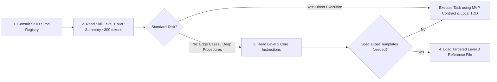

# SKILLS.md — Central Skill Registry & Selection Guide
# Universal Markdown Skills Framework (UMSF)

> Version: 2.0.0  
> Total Skills Cataloged: 77 Core Domain Skills Across 16 Canonical Engineering Domains  
> Authority: Central Discovery Registry (Precedence Level 6)  

---

## 1. Skill Discovery & Progressive Loading Protocol

To maximize token efficiency and prevent context window exhaustion, agents MUST NOT load full skill files indiscriminately. Instead, follow the **4-Step Progressive Loading Protocol**:

### Core Progressive Loading Invariants
1. **Dynamic Context-Aware Skill Loading**: Load all relevant domain skills required by a task, guided by active context window economy rather than an arbitrary fixed limit.
2. **Level 1 MVP First**: Always read the top ~50 lines of `SKILL.md` (Level 1 MVP Summary) first. Only load Level 2 core instructions if edge cases, deep workflows, or comprehensive failure recovery procedures are required.
3. **Level 3 On-Demand Only**: Never load Level 3 reference files (e.g. `styles-and-palettes.md`, `n-plus-one-patterns-and-orm-recipes.md`, `contract-and-data-consistency-checklist.md`) into context unless the prompt specifically demands that specialized asset.
4. **Agent Role Alignment**:
   - **Agent A (Primary Dev Agent)**: Operates under Domain 01 (SDLC), 03 (Architecture), 04 (Requirements), 05 (Implementation), 06 (Backend), 07 (Frontend/UI-UX), 08 (Database Design/Migrations/Query Optimization), 09 (TDD/Testing/Feature Integration), 10 (DevOps), 11 (Reliability), 14 (Project Mgmt/Coordination), 15 (Documentation).
   - **Agent B (Independent Verification Subagent)**: Operates under Domain 08 (Database Verification), 09 (QA/Testing, Feature Integration Verification), 12 (Code Quality, Post-Task Verification), 13 (Performance), 16 (`independent-verification-subagent`, `independent-qa-agent`, `evidence-based-validation`).
   - **Agent C (Independent Security Agent)**: Operates under Domain 02 (Security Engineering, Secrets, Privacy & Pen-Testing), 16 (`independent-security-review-agent`, `adversarial-testing`).

---

## 2. Canonical Engineering Domains Index (77 Skills)

### Domain 01 — Software Development Lifecycle (SDLC) (3 Skills)
**Canonical Directory**: [`skills/01-software-development-lifecycle/`](./skills/01-software-development-lifecycle/)  

| Skill Identifier | Short Description | Activation Triggers | Canonical Path | Level 3 References |
|---|---|---|---|---|
| `git-and-release-management` | Govern version control workflows, branching conventions, semantic versioning, conventional commits, and release tagging. | git, versioning, semver, conventional-commits, changelog, releases | [`git-and-release-management`](./skills/01-software-development-lifecycle/git-and-release-management/SKILL.md) | None (self-contained) |
| `planning` | Actionable guidelines for decomposing complex features into atomic tasks and dependency-ordered execution roadmaps. | planning, task-breakdown, milestones, roadmaps, sequencing | [`planning`](./skills/01-software-development-lifecycle/planning/SKILL.md) | None (self-contained) |
| `repository-bootstrap` | Scaffold and initialize canonical UMSF repository governance structures, files, and templates with zero dependencies. | bootstrap, governance, initialization, templates, local-first | [`repository-bootstrap`](./skills/01-software-development-lifecycle/repository-bootstrap/SKILL.md) | None (self-contained) |

### Domain 02 — Security Engineering (15 Skills)
**Canonical Directory**: [`skills/02-security-engineering/`](./skills/02-security-engineering/)  

| Skill Identifier | Short Description | Activation Triggers | Canonical Path | Level 3 References |
|---|---|---|---|---|
| `api-security-testing` | Audit, testing, and hardening of REST, GraphQL, and gRPC APIs against the OWASP API Security Top 10 including BOLA, BFLA, and mass assignment. | 'security', 'api-security', 'owasp-api', 'bola', 'bfla', 'graphql', 'grpc' | [`api-security-testing`](./skills/02-security-engineering/api-security-testing/SKILL.md) | None (self-contained) |
| `authentication-security` | Implementation, audit, and hardening of authentication mechanisms, password hashing, session tokens, JWTs, and MFA workflows. | 'security', 'authentication', 'passwords', 'jwt', 'sessions', 'mfa', 'owasp' | [`authentication-security`](./skills/02-security-engineering/authentication-security/SKILL.md) | None (self-contained) |
| `authorization-security` | Design, implementation, and testing of robust access control, RBAC/ABAC models, IDOR prevention, and multi-tenant isolation. | 'security', 'authorization', 'access-control', 'rbac', 'abac', 'idor', 'multi-tenant' | [`authorization-security`](./skills/02-security-engineering/authorization-security/SKILL.md) | None (self-contained) |
| `dependency-security-audit` | Software composition analysis (SCA), auditing supply-chain vulnerabilities, lockfile integrity, dependency confusion, and license compliance. | 'security', 'dependencies', 'supply-chain', 'cve', 'sca', 'lockfiles' | [`dependency-security-audit`](./skills/02-security-engineering/dependency-security-audit/SKILL.md) | None (self-contained) |
| `penetration-testing` | Authorized, non-destructive penetration testing methodology, explicit scope verification, controlled proof-of-concept exploitation, and risk reporting. | 'security', 'penetration-testing', 'ethical-hacking', 'poc', 'authorization-boundary', 'owasp' | [`penetration-testing`](./skills/02-security-engineering/penetration-testing/SKILL.md) | None (self-contained) |
| `privacy-and-compliance` | Enforce data minimization, PII/PHI protection, consent boundaries, retention limits, and regulatory compliance (GDPR, CCPA, HIPAA). | privacy, compliance, gdpr, hipaa, ccpa, pii, data-minimization | [`privacy-and-compliance`](./skills/02-security-engineering/privacy-and-compliance/SKILL.md) | None (self-contained) |
| `secrets-management` | Govern lifecycle, injection, isolation, rotation, and leakage prevention of credentials, API keys, tokens, and certificates. | secrets, credentials, security, env-vars, vault, encryption | [`secrets-management`](./skills/02-security-engineering/secrets-management/SKILL.md) | None (self-contained) |
| `security` | Threat modeling, input sanitization, OWASP Top 10 mitigation, secure credential management, authentication, and authorization hardening. | security, owasp, auth, sanitization, encryption, vulnerability, xss, csrf | [`security`](./skills/02-security-engineering/security/SKILL.md) | None (self-contained) |
| `security-code-review` | Static manual and automated code inspection for security anti-patterns, dangerous sinks, unsanitized inputs, and cryptographic misconfigurations. | 'security', 'code-review', 'sast', 'secure-coding', 'anti-patterns', 'audit' | [`security-code-review`](./skills/02-security-engineering/security-code-review/SKILL.md) | None (self-contained) |
| `security-remediation-and-retesting` | Surgical remediation of confirmed vulnerabilities, patch verification, regression security sweeps, and independent retest reporting. | 'security', 'remediation', 'retesting', 'patching', 'regression-testing', 'verification' | [`security-remediation-and-retesting`](./skills/02-security-engineering/security-remediation-and-retesting/SKILL.md) | None (self-contained) |
| `security-testing` | Strategic planning, automation, and execution of comprehensive software security test suites across SAST, DAST, and CI/CD pipelines. | 'security', 'security-testing', 'sast', 'dast', 'ci-cd', 'owasp', 'vulnerability' | [`security-testing`](./skills/02-security-engineering/security-testing/SKILL.md) | None (self-contained) |
| `threat-modeling` | Structured architectural threat modeling using STRIDE / PASTA methodologies, trust boundary mapping, asset identification, and mitigation planning. | 'security', 'threat-modeling', 'stride', 'pasta', 'architecture', 'trust-boundaries' | [`threat-modeling`](./skills/02-security-engineering/threat-modeling/SKILL.md) | None (self-contained) |
| `vulnerability-assessment` | Systematic vulnerability identification, CVE mapping, contextual risk scoring, and evidence collection across application architecture. | 'security', 'vulnerability-assessment', 'cve', 'cvss', 'risk-scoring', 'audit' | [`vulnerability-assessment`](./skills/02-security-engineering/vulnerability-assessment/SKILL.md) | None (self-contained) |
| `vulnerability-management` | End-to-end vulnerability management lifecycle: discovery, triage, contextual risk assessment, remediation tracking, and SLA enforcement. | 'security', 'vulnerability-management', 'tracking', 'sla', 'triage', 'remediation' | [`vulnerability-management`](./skills/02-security-engineering/vulnerability-management/SKILL.md) | None (self-contained) |
| `web-application-security` | Audit, defense, and remediation of OWASP Top 10 web vulnerabilities including XSS, CSRF, SSRF, path traversal, open redirects, and security headers. | 'security', 'web-security', 'owasp', 'xss', 'csrf', 'ssrf', 'security-headers' | [`web-application-security`](./skills/02-security-engineering/web-application-security/SKILL.md) | None (self-contained) |

### Domain 03 — Software Architecture & Design (2 Skills)
**Canonical Directory**: [`skills/03-software-architecture-and-design/`](./skills/03-software-architecture-and-design/)  

| Skill Identifier | Short Description | Activation Triggers | Canonical Path | Level 3 References |
|---|---|---|---|---|
| `architecture-decision-records` | Capture architectural decisions as numbered ADR markdown files in docs/adr/ with context, alternatives considered, consequences, and an index README. Use when the user says 'record this decision' or 'ADR this', chooses between frameworks or databases, discusses trade-offs, or asks why the codebase is shaped this way. | architecture-decision-records | [`architecture-decision-records`](./skills/03-software-architecture-and-design/architecture-decision-records/SKILL.md) | None (self-contained) |
| `software-architecture` | Principles and workflows for high-level system design, layer separation, modularity, and Architectural Decision Records (ADRs). | architecture, system-design, modularity, clean-architecture, adr | [`software-architecture`](./skills/03-software-architecture-and-design/software-architecture/SKILL.md) | None (self-contained) |

### Domain 04 — Requirements & Business Analysis (1 Skills)
**Canonical Directory**: [`skills/04-requirements-and-business-analysis/`](./skills/04-requirements-and-business-analysis/)  

| Skill Identifier | Short Description | Activation Triggers | Canonical Path | Level 3 References |
|---|---|---|---|---|
| `requirements-analysis` | Structured intake, disambiguation, scoping, and acceptance criteria authoring for engineering requests. | requirements, scoping, intake, acceptance-criteria, user-stories | [`requirements-analysis`](./skills/04-requirements-and-business-analysis/requirements-analysis/SKILL.md) | None (self-contained) |

### Domain 05 — Programming & Implementation (2 Skills)
**Canonical Directory**: [`skills/05-programming-and-implementation/`](./skills/05-programming-and-implementation/)  

| Skill Identifier | Short Description | Activation Triggers | Canonical Path | Level 3 References |
|---|---|---|---|---|
| `debugging` | Hypothesis-driven root cause analysis, reproduction scripts, diagnostic tracing, and verified remediation workflows. | debugging, troubleshooting, root-cause, reproduction, logs, stack-trace | [`debugging`](./skills/05-programming-and-implementation/debugging/SKILL.md) | None (self-contained) |
| `refactoring` | Systematic techniques for safely restructuring code to improve readability and maintainability without altering observable external behavior. | refactoring, clean-code, tech-debt, design-patterns, behavioral-invariance | [`refactoring`](./skills/05-programming-and-implementation/refactoring/SKILL.md) | None (self-contained) |

### Domain 06 — Backend Engineering (4 Skills)
**Canonical Directory**: [`skills/06-backend-engineering/`](./skills/06-backend-engineering/)  

| Skill Identifier | Short Description | Activation Triggers | Canonical Path | Level 3 References |
|---|---|---|---|---|
| `api-development` | Contract design, versioning, serialization, status codes, and security standards for REST, GraphQL, and gRPC APIs. | api, rest, graphql, grpc, openapi, contracts, json, serialization | [`api-development`](./skills/06-backend-engineering/api-development/SKILL.md) | None (self-contained) |
| `backend-development` | Guidelines for maintainable, secure, and performant backend services, domain business logic, and data access. | backend, api, business-logic, domain-model, data-access, services | [`backend-development`](./skills/06-backend-engineering/backend-development/SKILL.md) | None (self-contained) |
| `backend-patterns` | Backend architecture patterns, API design, database optimization, and server-side best practices for Node.js, Express, and Next.js API routes. Use when building or reviewing Node.js, Express, or Next.js API routes and their data access. | backend-patterns | [`backend-patterns`](./skills/06-backend-engineering/backend-patterns/SKILL.md) | None (self-contained) |
| `error-handling-and-resilience` | Design robust error taxonomies, graceful degradation, circuit breakers, retry strategies, and fault tolerance across backend services. | error-handling, resilience, circuit-breaker, retries, fault-tolerance, backend | [`error-handling-and-resilience`](./skills/06-backend-engineering/error-handling-and-resilience/SKILL.md) | None (self-contained) |

### Domain 07 — Frontend Engineering (1 Skills)
**Canonical Directory**: [`skills/07-frontend-engineering/`](./skills/07-frontend-engineering/)  

| Skill Identifier | Short Description | Activation Triggers | Canonical Path | Level 3 References |
|---|---|---|---|---|
| `ui-ux-pro-max` | Comprehensive UI/UX design intelligence for web, mobile, and desktop. Use when designing, building, reviewing, or fixing interfaces, design systems, tokens, accessibility, layout, typography, colors, and charts. Self-contained Markdown intelligence with 88 styles, 192 product palettes, 74 font pairings, 119 UX guidelines, and canonical pre-delivery checklists. | ui, ux, design-system, tokens, accessibility, typography, styling, responsive, mobile, web | [`ui-ux-pro-max`](./skills/07-frontend-engineering/ui-ux-pro-max/SKILL.md) | [``references/quick-reference.md``](./skills/07-frontend-engineering/ui-ux-pro-max/references/quick-reference.md), [``references/pro-rules.md``](./skills/07-frontend-engineering/ui-ux-pro-max/references/pro-rules.md), [``references/styles-and-palettes.md``](./skills/07-frontend-engineering/ui-ux-pro-max/references/styles-and-palettes.md) |

### Domain 08 — Database Engineering (3 Skills)
**Canonical Directory**: [`skills/08-database-engineering/`](./skills/08-database-engineering/)  

| Skill Identifier | Short Description | Activation Triggers | Canonical Path | Level 3 References |
|---|---|---|---|---|
| `database-design` | Guidelines for relational and non-relational database schema design, normalization, indexing strategies, migrations, and query optimization. | database, schema, sql, migrations, indexing, postgres, nosql, normalization | [`database-design`](./skills/08-database-engineering/database-design/SKILL.md) | None (self-contained) |
| `database-migrations` | Safe, reversible database migration patterns: forward-only production changes, expand-contract zero-downtime renames, concurrent indexes, batched backfills, and per-tool workflows for PostgreSQL, Prisma, Drizzle, Kysely, Django, and golang-migrate. Use when writing a schema or data migration, adding a column or index to a large table, planning a rollback, or preparing a zero-downtime deploy. | database-migrations | [`database-migrations`](./skills/08-database-engineering/database-migrations/SKILL.md) | [``references/tool-migration-patterns.md``](./skills/08-database-engineering/database-migrations/references/tool-migration-patterns.md) |
| `database-query-optimization` | Analyze and optimize database queries, ORM operations, query plans, and data-access performance. | database, query-optimization, n-plus-one, orm, indexing, performance, sql | [`database-query-optimization`](./skills/08-database-engineering/database-query-optimization/SKILL.md) | [``references/n-plus-one-patterns-and-orm-recipes.md``](./skills/08-database-engineering/database-query-optimization/references/n-plus-one-patterns-and-orm-recipes.md), [``references/execution-plan-and-indexing-guide.md``](./skills/08-database-engineering/database-query-optimization/references/execution-plan-and-indexing-guide.md) |

### Domain 09 — Quality Assurance & Testing (18 Skills)
**Canonical Directory**: [`skills/09-quality-assurance-and-testing/`](./skills/09-quality-assurance-and-testing/)  

| Skill Identifier | Short Description | Activation Triggers | Canonical Path | Level 3 References |
|---|---|---|---|---|
| `acceptance-testing` | Verification of software against business requirements, Given-When-Then / BDD acceptance criteria, and stakeholder definition of done. | 'testing', 'acceptance-testing', 'bdd', 'cucumber', 'definition-of-done' | [`acceptance-testing`](./skills/09-quality-assurance-and-testing/acceptance-testing/SKILL.md) | None (self-contained) |
| `defect-management` | Structured defect logging, reproduction workflows, severity/priority assignment, root cause analysis, and resolution verification. | 'testing', 'defects', 'bug-tracking', 'root-cause', 'triage', 'reproduction' | [`defect-management`](./skills/09-quality-assurance-and-testing/defect-management/SKILL.md) | None (self-contained) |
| `end-to-end-testing` | Automated end-to-end testing of user journeys across web browsers, mobile interfaces, and CLI workflows from start to finish. | 'testing', 'e2e', 'playwright', 'cypress', 'browser-testing', 'user-journeys' | [`end-to-end-testing`](./skills/09-quality-assurance-and-testing/end-to-end-testing/SKILL.md) | None (self-contained) |
| `exploratory-testing` | Structured, time-boxed, charter-driven exploratory testing, unscripted edge-case discovery, heuristic probing, and anomaly reporting. | 'testing', 'exploratory-testing', 'charter', 'heuristics', 'edge-cases' | [`exploratory-testing`](./skills/09-quality-assurance-and-testing/exploratory-testing/SKILL.md) | None (self-contained) |
| `feature-integration-verification` | Re-analyze implemented features and verify that all connected components, modules, services, and layers work together correctly end-to-end. | testing, feature-integration, e2e, cross-tier, api-contracts, data-consistency, verification | [`feature-integration-verification`](./skills/09-quality-assurance-and-testing/feature-integration-verification/SKILL.md) | [``references/contract-and-data-consistency-checklist.md``](./skills/09-quality-assurance-and-testing/feature-integration-verification/references/contract-and-data-consistency-checklist.md), [``references/failure-classification-and-remediation.md``](./skills/09-quality-assurance-and-testing/feature-integration-verification/references/failure-classification-and-remediation.md) |
| `integration-testing` | Verification of interactions across service boundaries, database transactions, API contracts, inter-process messaging, and external adapters. | 'testing', 'integration-testing', 'database', 'api-contracts', 'transactions' | [`integration-testing`](./skills/09-quality-assurance-and-testing/integration-testing/SKILL.md) | None (self-contained) |
| `load-and-stress-testing` | Concurrency testing, load curves, stress thresholds, breaking-point determination, and graceful degradation verification. | 'testing', 'load-testing', 'stress-testing', 'concurrency', 'capacity', 'scalability' | [`load-and-stress-testing`](./skills/09-quality-assurance-and-testing/load-and-stress-testing/SKILL.md) | None (self-contained) |
| `mutation-testing` | Evaluation of test suite efficacy through deliberate fault injection (mutants) to verify assertion rigor and eliminate weak tests. | 'testing', 'mutation-testing', 'fault-injection', 'test-quality', 'mutants' | [`mutation-testing`](./skills/09-quality-assurance-and-testing/mutation-testing/SKILL.md) | None (self-contained) |
| `performance-testing` | Benchmarking, latency profiling, throughput measurement, and bottleneck identification across API endpoints and UI render pipelines. | 'testing', 'performance', 'latency', 'benchmarks', 'throughput', 'cls' | [`performance-testing`](./skills/09-quality-assurance-and-testing/performance-testing/SKILL.md) | None (self-contained) |
| `regression-testing` | Systematic regression test suite design, selective regression execution, impact analysis, and accumulation of bug-reproduction tests. | 'testing', 'regression', 'regression-testing', 'impact-analysis', 'quality-gate' | [`regression-testing`](./skills/09-quality-assurance-and-testing/regression-testing/SKILL.md) | [``references/regression-strategies.md``](./skills/09-quality-assurance-and-testing/regression-testing/references/regression-strategies.md), [``references/test-case-examples.md``](./skills/09-quality-assurance-and-testing/regression-testing/references/test-case-examples.md), [``references/advanced-testing.md``](./skills/09-quality-assurance-and-testing/regression-testing/references/advanced-testing.md) |
| `system-testing` | Holistic verification of the fully assembled application system, verifying end-to-end business workflows, configuration integrity, and environment parity. | 'testing', 'system-testing', 'e2e', 'configuration', 'environment-parity' | [`system-testing`](./skills/09-quality-assurance-and-testing/system-testing/SKILL.md) | None (self-contained) |
| `test-automation` | Architecture, implementation, and maintenance of deterministic, robust test automation frameworks across CI/CD environments. | 'testing', 'test-automation', 'ci-cd', 'frameworks', 'flaky-tests' | [`test-automation`](./skills/09-quality-assurance-and-testing/test-automation/SKILL.md) | None (self-contained) |
| `test-coverage-analysis` | Measurement, analysis, and optimization of code coverage metrics (statement, branch, function, line) to identify untested critical paths. | 'testing', 'code-coverage', 'metrics', 'branch-coverage', 'risk-analysis' | [`test-coverage-analysis`](./skills/09-quality-assurance-and-testing/test-coverage-analysis/SKILL.md) | None (self-contained) |
| `test-data-management` | Deterministic test data synthesis, seeders, factory patterns, sensitive data masking, state cleanup, and test isolation. | 'testing', 'test-data', 'factories', 'fixtures', 'seeding', 'masking', 'isolation' | [`test-data-management`](./skills/09-quality-assurance-and-testing/test-data-management/SKILL.md) | None (self-contained) |
| `test-driven-development` | The canonical Test-Driven Development (TDD) engineering discipline: Red-Green-Refactor, automated test authoring first, edge case coverage, and behavioral invariance. | 'testing', 'tdd', 'red-green-refactor', 'unit-testing', 'quality', 'test-first' | [`test-driven-development`](./skills/09-quality-assurance-and-testing/test-driven-development/SKILL.md) | None (self-contained) |
| `test-strategy-and-planning` | Formulating comprehensive, risk-based test strategies, testing levels matrix, environment prerequisites, quality budgets, and release criteria. | 'testing', 'test-strategy', 'planning', 'risk-management', 'quality-plan' | [`test-strategy-and-planning`](./skills/09-quality-assurance-and-testing/test-strategy-and-planning/SKILL.md) | None (self-contained) |
| `testing` | Comprehensive testing strategies, unit testing, integration boundaries, mock design, coverage expectations, and test reliability standards. | testing, unit-tests, integration-tests, mocks, tdd, regression, coverage | [`testing`](./skills/09-quality-assurance-and-testing/testing/SKILL.md) | None (self-contained) |
| `unit-testing` | Isolation testing of individual functions, methods, and classes using deterministic mocks, clear boundary isolation, and the AAA pattern. | 'testing', 'unit-testing', 'mocks', 'stubs', 'isolation', 'aaa-pattern' | [`unit-testing`](./skills/09-quality-assurance-and-testing/unit-testing/SKILL.md) | None (self-contained) |

### Domain 10 — DevOps & Infrastructure (4 Skills)
**Canonical Directory**: [`skills/10-devops-and-infrastructure/`](./skills/10-devops-and-infrastructure/)  

| Skill Identifier | Short Description | Activation Triggers | Canonical Path | Level 3 References |
|---|---|---|---|---|
| `ci-cd-pipeline-design` | Architect, optimize, and maintain automated Continuous Integration and Continuous Deployment pipelines (GitHub Actions, GitLab CI). | ci-cd, github-actions, gitlab-ci, automation, pipelines, testing-gates | [`ci-cd-pipeline-design`](./skills/10-devops-and-infrastructure/ci-cd-pipeline-design/SKILL.md) | None (self-contained) |
| `docker-patterns` | Docker and Docker Compose patterns for local development, hardened CLI installer harnesses, container security, networking, volumes, and multi-service orchestration. Use when creating or reviewing Dockerfiles and Compose services, testing installers across Linux distributions, or planning accurate native macOS and Windows validation. | docker-patterns | [`docker-patterns`](./skills/10-devops-and-infrastructure/docker-patterns/SKILL.md) | [``references/compose-patterns.md``](./skills/10-devops-and-infrastructure/docker-patterns/references/compose-patterns.md) |
| `infrastructure-as-code` | Define, provision, version, and manage cloud infrastructure using declarative, reproducible code (Terraform, OpenTofu, Pulumi). | iac, terraform, opentofu, pulumi, cloud, infrastructure, provisioning | [`infrastructure-as-code`](./skills/10-devops-and-infrastructure/infrastructure-as-code/SKILL.md) | None (self-contained) |
| `kubernetes-patterns` | Kubernetes workload patterns, resource management, RBAC, probes, autoscaling, ConfigMap/Secret handling, and kubectl debugging for production-grade deployments. Use when writing or reviewing Kubernetes manifests, or debugging probes, RBAC, autoscaling, or resource limits. | kubernetes-patterns | [`kubernetes-patterns`](./skills/10-devops-and-infrastructure/kubernetes-patterns/SKILL.md) | [``references/k8s-manifest-templates.md``](./skills/10-devops-and-infrastructure/kubernetes-patterns/references/k8s-manifest-templates.md) |

### Domain 11 — Reliability & Operations (3 Skills)
**Canonical Directory**: [`skills/11-reliability-and-operations/`](./skills/11-reliability-and-operations/)  

| Skill Identifier | Short Description | Activation Triggers | Canonical Path | Level 3 References |
|---|---|---|---|---|
| `canary-watch` | Use this skill to monitor and verify a deployed URL after releases — checks HTTP endpoints, SSE streams, static assets, console errors, and performance regressions after deploys, merges, or dependency upgrades. Smoke / canary / post-deploy verification. | canary-watch | [`canary-watch`](./skills/11-reliability-and-operations/canary-watch/SKILL.md) | None (self-contained) |
| `incident-response-postmortem` | Manage production incident response, severity classification (SEV-1 to SEV-4), containment, root-cause analysis, and postmortems. | incident-response, postmortem, blameless, root-cause, 5-whys, reliability | [`incident-response-postmortem`](./skills/11-reliability-and-operations/incident-response-postmortem/SKILL.md) | None (self-contained) |
| `observability-and-logging` | Implement structured JSON logging, distributed tracing (OpenTelemetry), metrics instrumentation, and alerting thresholds. | observability, logging, opentelemetry, tracing, metrics, prometheus | [`observability-and-logging`](./skills/11-reliability-and-operations/observability-and-logging/SKILL.md) | None (self-contained) |

### Domain 12 — Code Quality & Maintenance (3 Skills)
**Canonical Directory**: [`skills/12-code-quality-and-maintenance/`](./skills/12-code-quality-and-maintenance/)  

| Skill Identifier | Short Description | Activation Triggers | Canonical Path | Level 3 References |
|---|---|---|---|---|
| `code-review` | Systematic guidelines for evaluating pull requests and code modifications against clean code, security, performance, DRY, and SOLID rubrics. | code-review, clean-code, solid, dry, lint, maintainability, audit | [`code-review`](./skills/12-code-quality-and-maintenance/code-review/SKILL.md) | None (self-contained) |
| `post-task-verification` | Systematic, evidence-based post-implementation audit verifying prompt requirements, diff inspection, test results, security impact, regression avoidance, and documentation consistency before task closure. | verification, qa, audit, diff-inspection, evidence-based, acceptance-criteria, release-gate, regression | [`post-task-verification`](./skills/12-code-quality-and-maintenance/post-task-verification/SKILL.md) | None (self-contained) |
| `static-analysis-and-linting` | Configure and enforce automated AST linters, strict type checkers, cyclomatic complexity limits, and deterministic formatting rules. | static-analysis, linting, type-checking, formatting, complexity, ast | [`static-analysis-and-linting`](./skills/12-code-quality-and-maintenance/static-analysis-and-linting/SKILL.md) | None (self-contained) |

### Domain 13 — Performance Engineering (2 Skills)
**Canonical Directory**: [`skills/13-performance-engineering/`](./skills/13-performance-engineering/)  

| Skill Identifier | Short Description | Activation Triggers | Canonical Path | Level 3 References |
|---|---|---|---|---|
| `benchmark-optimization-loop` | Convert 'make it faster' requests into a bounded measured optimization loop — baseline first, generate one-hypothesis variants, benchmark each against a correctness gate, and promote the fastest safe variant with reproducible commands. Use when asked to speed something up, try many variants, run recursive optimization, benchmark latency/throughput/cost, or pick the best implementation by repeated measured tests. | benchmark-optimization-loop | [`benchmark-optimization-loop`](./skills/13-performance-engineering/benchmark-optimization-loop/SKILL.md) | None (self-contained) |
| `performance` | Profiling methodologies, latency optimization, memory leak mitigation, algorithmic efficiency, and frontend bundle budgets. | performance, profiling, latency, memory, optimization, bundle-size, caching | [`performance`](./skills/13-performance-engineering/performance/SKILL.md) | None (self-contained) |

### Domain 14 — Project & Team Management (2 Skills)
**Canonical Directory**: [`skills/14-project-and-team-management/`](./skills/14-project-and-team-management/)  

| Skill Identifier | Short Description | Activation Triggers | Canonical Path | Level 3 References |
|---|---|---|---|---|
| `counterparty-channel-discipline` | Per-channel strict prompts, mention gating, silent observation, and a communication autonomy policy for agents that sit in shared channels with external counterparties. Use when an agent joins group chats, shared channels, or DMs where outsiders can read every message and you need it to speak only when addressed, never leak internal context, and route risky content to draft-only approval. | counterparty-channel-discipline | [`counterparty-channel-discipline`](./skills/14-project-and-team-management/counterparty-channel-discipline/SKILL.md) | None (self-contained) |
| `human-in-the-loop-coordination` | Standardize structured agent-to-human communication, decision checkpoints, escalation triggers, and handoff briefings. | human-in-the-loop, coordination, escalation, handoff, decisions, approvals | [`human-in-the-loop-coordination`](./skills/14-project-and-team-management/human-in-the-loop-coordination/SKILL.md) | None (self-contained) |

### Domain 15 — Documentation & Technical Communication (2 Skills)
**Canonical Directory**: [`skills/15-documentation-and-technical-communication/`](./skills/15-documentation-and-technical-communication/)  

| Skill Identifier | Short Description | Activation Triggers | Canonical Path | Level 3 References |
|---|---|---|---|---|
| `article-writing` | Write articles, guides, blog posts, tutorials, newsletter issues, and other long-form content in a distinctive voice derived from supplied examples or brand guidance. Use when the user wants polished written content longer than a paragraph, especially when voice consistency, structure, and credibility matter. | article-writing | [`article-writing`](./skills/15-documentation-and-technical-communication/article-writing/SKILL.md) | None (self-contained) |
| `documentation` | Standards for authoring technical specifications, runbooks, architecture decision records, API documentation, and Markdown maintenance. | documentation, technical-writing, markdown, runbooks, specs, api-docs | [`documentation`](./skills/15-documentation-and-technical-communication/documentation/SKILL.md) | None (self-contained) |

### Domain 16 — AI Agent Engineering (12 Skills)
**Canonical Directory**: [`skills/16-ai-agent-engineering/`](./skills/16-ai-agent-engineering/)  

| Skill Identifier | Short Description | Activation Triggers | Canonical Path | Level 3 References |
|---|---|---|---|---|
| `adversarial-testing` | Adversarial testing methodologies, fuzzing inputs, race conditions, edge-case abuse, and prompt injection hardening for AI and software systems. | 'agentic', 'adversarial-testing', 'fuzzing', 'race-conditions', 'prompt-injection', 'robustness' | [`adversarial-testing`](./skills/16-ai-agent-engineering/adversarial-testing/SKILL.md) | None (self-contained) |
| `agent-handoff-and-review` | Structured context handoff protocols, verification checklists, state persistence, and loss-free continuity across agent boundaries and sessions. | 'agentic', 'handoff', 'continuity', 'state-persistence', 'session-log' | [`agent-handoff-and-review`](./skills/16-ai-agent-engineering/agent-handoff-and-review/SKILL.md) | None (self-contained) |
| `agent-role-separation` | Single-agent fallback protocols for clean role-switching passes, cognitive context wiping, distinct checklists, and bias elimination. | 'agentic', 'role-separation', 'single-agent', 'bias-elimination', 'checklists' | [`agent-role-separation`](./skills/16-ai-agent-engineering/agent-role-separation/SKILL.md) | None (self-contained) |
| `agentic-engineering` | Operate as an agentic engineer using eval-first execution, decomposition, and cost-aware model routing. Use when planning or executing engineering work that agents will carry out end to end. | agentic-engineering | [`agentic-engineering`](./skills/16-ai-agent-engineering/agentic-engineering/SKILL.md) | None (self-contained) |
| `autonomous-loops` | Patterns and architectures for autonomous Claude Code loops — from simple sequential pipelines to RFC-driven multi-agent DAG systems. Retained for compatibility only: when new autonomous loop guidance is needed, use continuous-agent-loop instead. | autonomous-loops | [`autonomous-loops`](./skills/16-ai-agent-engineering/autonomous-loops/SKILL.md) | None (self-contained) |
| `evidence-based-validation` | Verification protocol requiring empirical proof (test execution logs, exit codes, diffs) before accepting completion claims. | 'agentic', 'validation', 'empirical-evidence', 'verification', 'quality-gate' | [`evidence-based-validation`](./skills/16-ai-agent-engineering/evidence-based-validation/SKILL.md) | None (self-contained) |
| `independent-qa-agent` | Operational persona and protocols for an Independent AI Quality Assurance Agent: autonomous test execution, challenging Dev assumptions, coverage gap detection, and regression sign-off. | 'agentic', 'qa-agent', 'verification', 'independent-review', 'quality-gate' | [`independent-qa-agent`](./skills/16-ai-agent-engineering/independent-qa-agent/SKILL.md) | None (self-contained) |
| `independent-security-review-agent` | Operational persona and protocols for an Independent AI Security Testing Agent: adversarial threat analysis, authorized vulnerability probing, and fix verification. | 'agentic', 'security-agent', 'adversarial', 'threat-analysis', 'security-gate' | [`independent-security-review-agent`](./skills/16-ai-agent-engineering/independent-security-review-agent/SKILL.md) | None (self-contained) |
| `independent-verification-subagent` | Autonomous independent verification subagent protocol evaluating implementation against user prompts, diffs, architecture, code quality, independent testing, security coordination, and defect remediation loops. | agentic, verification-subagent, independent-audit, qa, security-coordination, defect-management, remediation-loop, release-gate | [`independent-verification-subagent`](./skills/16-ai-agent-engineering/independent-verification-subagent/SKILL.md) | [``references/verification-checklists.md``](./skills/16-ai-agent-engineering/independent-verification-subagent/references/verification-checklists.md) |
| `mcp-server-patterns` | Build MCP servers with Node/TypeScript SDK — tools, resources, prompts, Zod validation, stdio vs Streamable HTTP. Use Context7 or official MCP docs for latest API. Use when building or debugging an MCP server — tools, resources, prompts, validation, or transport choice. | mcp-server-patterns | [`mcp-server-patterns`](./skills/16-ai-agent-engineering/mcp-server-patterns/SKILL.md) | None (self-contained) |
| `multi-agent-verification` | Orchestration patterns for concurrent multi-agent collaboration: Dev -> QA -> Security handoff loops, consensus protocols, and dispute resolution. | 'agentic', 'multi-agent', 'orchestration', 'consensus', 'handoff', 'verification' | [`multi-agent-verification`](./skills/16-ai-agent-engineering/multi-agent-verification/SKILL.md) | None (self-contained) |
| `prompt-optimizer` | Analyze draft prompts, detect intent and missing context, match ECC commands, skills, and agents, and output a ready-to-paste optimized prompt with diagnosis and rationale — advisory only, never executes the task. Use when the user says 'optimize prompt', 'improve my prompt', 'rewrite this prompt', 'help me prompt', 优化prompt, 改进prompt, 怎么写prompt, or 帮我优化这个指令; not for requests to optimize code or performance. | prompt-optimizer | [`prompt-optimizer`](./skills/16-ai-agent-engineering/prompt-optimizer/SKILL.md) | None (self-contained) |
