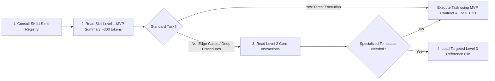

# SKILLS.md — Central Skill Registry & Selection Guide
# Universal Markdown Skills Framework (UMSF)

> Version: 1.9.0  
> Total Skills Cataloged: 66 Core Domain Skills Across 16 Canonical Engineering Domains  
> Authority: Central Discovery Registry (Precedence Level 6)  

---

## 1. Skill Discovery & Progressive Loading Protocol

To maximize token efficiency and prevent context window exhaustion, agents MUST NOT load full skill files indiscriminately. Instead, follow the **4-Step Progressive Loading Protocol**:

### Core Progressive Loading Invariants
1. **Dynamic Context-Aware Skill Loading**: Load all relevant domain skills required by a task, guided by active context window economy rather than an arbitrary fixed limit.
2. **Level 1 MVP First**: Always read the top ~40 lines of `SKILL.md` (Level 1 MVP Summary) first. Only load Level 2 core instructions if edge cases, deep workflows, or comprehensive failure recovery procedures are required.
3. **Level 3 On-Demand Only**: Never load Level 3 reference files (e.g. `styles-and-palettes.md`, `n-plus-one-patterns-and-orm-recipes.md`, `contract-and-data-consistency-checklist.md`) into context unless the prompt specifically demands that specialized asset.
4. **Agent Role Alignment**:
   - **Agent A (Dev)**: Operates under Domain 01 (SDLC), 03 (Architecture), 04 (Requirements), 05 (Implementation), 06 (Backend), 07 (Frontend/UI-UX), 08 (Database Design/Migrations/Query Optimization), 09 (TDD/Testing/Feature Integration), 10 (DevOps), 11 (Reliability), 14 (Project Mgmt), 15 (Documentation).
   - **Agent B (Independent Verification Subagent)**: Operates under Domain 08 (Database Verification), 09 (QA/Testing, Feature Integration Verification), 12 (Code Quality, Post-Task Verification), 13 (Performance), 16 (`independent-verification-subagent`, `independent-qa-agent`, `evidence-based-validation`).
   - **Agent C (Independent Security Agent)**: Operates under Domain 02 (Security Engineering & Pen-Testing), 16 (`independent-security-review-agent`, `adversarial-testing`).

---

## 2. Canonical Engineering Domains Index (66 Skills)

### Domain 01 — Software Development Lifecycle (1 Skills)
**Canonical Directory**: [`skills/01-software-development-lifecycle/`](./skills/01-software-development-lifecycle/)  

| Skill Identifier | Short Description | Activation Triggers | Canonical Path | Level 3 References |
|---|---|---|---|---|
| `planning` | Decompose complex engineering initiatives into granular, dependency-ordered, non-conflicting tasks with verifiable completion criteria. | Initiating multi-stage features, cross-module refactoring, or clarifying vague tasks in TASKS.md. | [`planning`](./skills/01-software-development-lifecycle/planning/SKILL.md) | None (self-contained) |

### Domain 02 — Security Engineering (13 Skills)
**Canonical Directory**: [`skills/02-security-engineering/`](./skills/02-security-engineering/)  

| Skill Identifier | Short Description | Activation Triggers | Canonical Path | Level 3 References |
|---|---|---|---|---|
| `api-security-testing` | Validate API endpoints against BOLA/IDOR, broken authentication, excessive data exposure, and rate limiting bypasses. | Authoring or modifying REST, GraphQL, or gRPC endpoints, webhooks, or public API gateways. | [`api-security-testing`](./skills/02-security-engineering/api-security-testing/SKILL.md) | None (self-contained) |
| `authentication-security` | Implement robust, attack-resistant user authentication, credential storage, MFA, and session lifecycle management. | Building or modifying login, registration, password reset, token issuance, or session validation flows. | [`authentication-security`](./skills/02-security-engineering/authentication-security/SKILL.md) | None (self-contained) |
| `authorization-security` | Design, implement, and verify fine-grained Role-Based (RBAC) and Attribute-Based (ABAC) access control systems. | Enforcing permissions, multi-tenant isolation, administrative roles, or resource ownership checks. | [`authorization-security`](./skills/02-security-engineering/authorization-security/SKILL.md) | None (self-contained) |
| `dependency-security-audit` | Audit, manage, and remediate vulnerabilities in direct and transitive open-source dependencies. | Adding new libraries, performing package upgrades, or running scheduled supply-chain audits. | [`dependency-security-audit`](./skills/02-security-engineering/dependency-security-audit/SKILL.md) | None (self-contained) |
| `penetration-testing` | Conduct authorized, non-destructive adversarial testing to identify and exploit vulnerabilities before attackers do. | Pre-release security audits, verifying authentication/authorization hardening, or compliance assessments. | [`penetration-testing`](./skills/02-security-engineering/penetration-testing/SKILL.md) | None (self-contained) |
| `security` | Enforce baseline repository and application security invariants across the entire software development lifecycle. | Conducting baseline security audits, initializing new projects, or reviewing core security boundaries. | [`security`](./skills/02-security-engineering/security/SKILL.md) | None (self-contained) |
| `security-code-review` | Conduct line-by-line manual and automated security code audits focusing on auth logic, crypto, and data sanitization. | Reviewing pull requests touching authentication, authorization, cryptographic routines, or financial/PII data. | [`security-code-review`](./skills/02-security-engineering/security-code-review/SKILL.md) | None (self-contained) |
| `security-remediation-and-retesting` | Develop minimal, effective security patches and execute rigorous retesting to prove vulnerability elimination. | Remediating confirmed vulnerabilities, patching CVEs, or conducting post-exploit verification. | [`security-remediation-and-retesting`](./skills/02-security-engineering/security-remediation-and-retesting/SKILL.md) | None (self-contained) |
| `security-testing` | Plan, automate, and execute comprehensive software security test suites across SAST, DAST, and CI/CD security gates. | Integrating automated security scanners, establishing pull request security gates, or verifying release builds. | [`security-testing`](./skills/02-security-engineering/security-testing/SKILL.md) | None (self-contained) |
| `threat-modeling` | Systematically analyze software architecture to identify threat actors, attack vectors, and required mitigations using STRIDE. | Architecting new systems, designing significant feature changes, or evaluating third-party integrations. | [`threat-modeling`](./skills/02-security-engineering/threat-modeling/SKILL.md) | None (self-contained) |
| `vulnerability-assessment` | Systematically identify, catalog, and evaluate security weaknesses across infrastructure, dependencies, and codebases. | Routine security audits, dependency updates, infrastructure configuration changes, or architectural reviews. | [`vulnerability-assessment`](./skills/02-security-engineering/vulnerability-assessment/SKILL.md) | None (self-contained) |
| `vulnerability-management` | Track, prioritize, assign, and verify remediation of security vulnerabilities across their entire lifecycle. | Triaging incoming security reports, managing security backlogs, or tracking patch compliance SLAs. | [`vulnerability-management`](./skills/02-security-engineering/vulnerability-management/SKILL.md) | None (self-contained) |
| `web-application-security` | Harden web application frontends and backends against XSS, CSRF, SSRF, SQLi, clickjacking, and session hijacking. | Authoring web interfaces, handling user session tokens, configuring HTTP security headers, or processing forms. | [`web-application-security`](./skills/02-security-engineering/web-application-security/SKILL.md) | None (self-contained) |

### Domain 03 — Software Architecture & Design (2 Skills)
**Canonical Directory**: [`skills/03-software-architecture-and-design/`](./skills/03-software-architecture-and-design/)  

| Skill Identifier | Short Description | Activation Triggers | Canonical Path | Level 3 References |
|---|---|---|---|---|
| `architecture-decision-records` | Capture immutable architectural decisions, rationale, evaluated alternatives, and consequences in structured Markdown records. | Choosing between frameworks, changing system boundaries, altering database engines, or setting technical precedents. | [`architecture-decision-records`](./skills/03-software-architecture-and-design/architecture-decision-records/SKILL.md) | None (self-contained) |
| `software-architecture` | Design scalable, maintainable, loosely coupled software architectures adhering to clean boundaries and SOLID principles. | Structuring new services, establishing module boundaries, decomposing monoliths, or designing distributed systems. | [`software-architecture`](./skills/03-software-architecture-and-design/software-architecture/SKILL.md) | None (self-contained) |

### Domain 04 — Requirements & Business Analysis (1 Skills)
**Canonical Directory**: [`skills/04-requirements-and-business-analysis/`](./skills/04-requirements-and-business-analysis/)  

| Skill Identifier | Short Description | Activation Triggers | Canonical Path | Level 3 References |
|---|---|---|---|---|
| `requirements-analysis` | Analyze user prompts, extract ambiguous constraints, and translate product goals into deterministic acceptance criteria. | Parsing raw feature requests, clarifying edge cases before development, or drafting user story criteria. | [`requirements-analysis`](./skills/04-requirements-and-business-analysis/requirements-analysis/SKILL.md) | None (self-contained) |

### Domain 05 — Programming & Implementation (2 Skills)
**Canonical Directory**: [`skills/05-programming-and-implementation/`](./skills/05-programming-and-implementation/)  

| Skill Identifier | Short Description | Activation Triggers | Canonical Path | Level 3 References |
|---|---|---|---|---|
| `debugging` | Isolate, diagnose, and resolve runtime errors, performance bottlenecks, and logic defects using scientific root-cause analysis. | Investigating failing tests, stack traces, unhandled exceptions, memory leaks, or erratic system behavior. | [`debugging`](./skills/05-programming-and-implementation/debugging/SKILL.md) | None (self-contained) |
| `refactoring` | Improve internal code structure, maintainability, and readability without altering external observable behavior. | Eliminating technical debt, modularizing large functions, improving naming, or preparing code for new features. | [`refactoring`](./skills/05-programming-and-implementation/refactoring/SKILL.md) | None (self-contained) |

### Domain 06 — Backend Engineering (3 Skills)
**Canonical Directory**: [`skills/06-backend-engineering/`](./skills/06-backend-engineering/)  

| Skill Identifier | Short Description | Activation Triggers | Canonical Path | Level 3 References |
|---|---|---|---|---|
| `api-development` | Design, implement, and document deterministic RESTful, GraphQL, and RPC APIs with strict schema contracts. | Building new API endpoints, evolving existing web services, or authoring OpenAPI/Swagger specifications. | [`api-development`](./skills/06-backend-engineering/api-development/SKILL.md) | None (self-contained) |
| `backend-development` | Build robust, scalable backend services, business logic engines, data access layers, and background workers. | Implementing server-side business logic, background processing, middleware, or service integrations. | [`backend-development`](./skills/06-backend-engineering/backend-development/SKILL.md) | None (self-contained) |
| `backend-patterns` | Apply production-tested backend design patterns: Repository, Unit of Work, CQRS, Caching, and Event Sourcing. | Designing data access layers, optimizing backend performance, implementing multi-tier caching, or decoupling services. | [`backend-patterns`](./skills/06-backend-engineering/backend-patterns/SKILL.md) | None (self-contained) |

### Domain 07 — Frontend Engineering (1 Skills)
**Canonical Directory**: [`skills/07-frontend-engineering/`](./skills/07-frontend-engineering/)  

| Skill Identifier | Short Description | Activation Triggers | Canonical Path | Level 3 References |
|---|---|---|---|---|
| `ui-ux-pro-max` | Provide comprehensive UI/UX design intelligence, design systems, accessibility (WCAG AA), responsive styling, and visual QA. | Designing views, components, styling, typography, colors, animations, responsive layouts, or accessibility audits. | [`ui-ux-pro-max`](./skills/07-frontend-engineering/ui-ux-pro-max/SKILL.md) | [`references/quick-reference.md`](./skills/07-frontend-engineering/ui-ux-pro-max/references/quick-reference.md) [`references/pro-rules.md`](./skills/07-frontend-engineering/ui-ux-pro-max/references/pro-rules.md) [`references/styles-and-palettes.md`](./skills/07-frontend-engineering/ui-ux-pro-max/references/styles-and-palettes.md) |

### Domain 08 — Database Engineering (3 Skills)
**Canonical Directory**: [`skills/08-database-engineering/`](./skills/08-database-engineering/)  

| Skill Identifier | Short Description | Activation Triggers | Canonical Path | Level 3 References |
|---|---|---|---|---|
| `database-design` | Design normalized relational schemas, NoSQL document models, and indexing strategies for data integrity and performance. | Creating new data models, establishing foreign key relationships, designing document schemas, or indexing queries. | [`database-design`](./skills/08-database-engineering/database-design/SKILL.md) | None (self-contained) |
| `database-migrations` | Execute safe, reversible database migrations: forward-only production changes, expand-contract zero-downtime deploys. | Altering tables, adding columns, renaming fields, creating indexes, or backfilling data in production databases. | [`database-migrations`](./skills/08-database-engineering/database-migrations/SKILL.md) | [`references/tool-migration-patterns.md`](./skills/08-database-engineering/database-migrations/references/tool-migration-patterns.md) |
| `database-query-optimization` | Analyze and optimize database queries, ORM operations, execution plans, and data-access patterns to eliminate N+1 round trips, reduce latency, and prevent over-fetching while strictly preserving data correctness. | Reviewing or writing database queries, optimizing slow API endpoints, diagnosing N+1 query patterns, tuning indexes, or refactoring ORM relationship loading. | [`database-query-optimization`](./skills/08-database-engineering/database-query-optimization/SKILL.md) | [`references/n-plus-one-patterns-and-orm-recipes.md`](./skills/08-database-engineering/database-query-optimization/references/n-plus-one-patterns-and-orm-recipes.md) [`references/execution-plan-and-indexing-guide.md`](./skills/08-database-engineering/database-query-optimization/references/execution-plan-and-indexing-guide.md) |

### Domain 09 — Quality Assurance & Testing (18 Skills)
**Canonical Directory**: [`skills/09-quality-assurance-and-testing/`](./skills/09-quality-assurance-and-testing/)  

| Skill Identifier | Short Description | Activation Triggers | Canonical Path | Level 3 References |
|---|---|---|---|---|
| `acceptance-testing` | Verify software behavior against business requirements, acceptance criteria, and stakeholder expectations. | Delivering feature milestones, validating user stories, or preparing client release handoffs. | [`acceptance-testing`](./skills/09-quality-assurance-and-testing/acceptance-testing/SKILL.md) | None (self-contained) |
| `defect-management` | Triage, classify, prioritize, track, and verify resolution of software bugs across their complete lifecycle. | Logging newly discovered bugs, conducting bug triage meetings, or managing the defect resolution lifecycle. | [`defect-management`](./skills/09-quality-assurance-and-testing/defect-management/SKILL.md) | None (self-contained) |
| `end-to-end-testing` | Automate complete user journey workflows through actual browsers or client interfaces (Playwright, Cypress). | Validating critical user flows (signup, checkout, authentication) through real browser engines. | [`end-to-end-testing`](./skills/09-quality-assurance-and-testing/end-to-end-testing/SKILL.md) | None (self-contained) |
| `exploratory-testing` | Simultaneously learn, design, and execute tests to discover unscripted defects, boundary failures, and usability traps. | Testing complex new workflows, evaluating UI responsiveness, or hunting elusive edge cases. | [`exploratory-testing`](./skills/09-quality-assurance-and-testing/exploratory-testing/SKILL.md) | None (self-contained) |
| `feature-integration-verification` | Re-analyze implemented features as unified systems to verify that all connected components, modules, services, and architectural layers work together correctly end-to-end. | After implementing or modifying features spanning multiple architectural tiers (UI, API, service, database, external dependencies), before closing integration milestones, or when diagnosing cross-tier synchronization defects. | [`feature-integration-verification`](./skills/09-quality-assurance-and-testing/feature-integration-verification/SKILL.md) | [`references/contract-and-data-consistency-checklist.md`](./skills/09-quality-assurance-and-testing/feature-integration-verification/references/contract-and-data-consistency-checklist.md) [`references/failure-classification-and-remediation.md`](./skills/09-quality-assurance-and-testing/feature-integration-verification/references/failure-classification-and-remediation.md) |
| `integration-testing` | Verify communication, data contracts, and error handling across integrated modules, databases, and external APIs. | Testing database repositories, HTTP service clients, middleware stacks, or multi-module workflows. | [`integration-testing`](./skills/09-quality-assurance-and-testing/integration-testing/SKILL.md) | None (self-contained) |
| `load-and-stress-testing` | Evaluate system stability, graceful degradation, and recovery under extreme traffic spikes and resource exhaustion. | Preparing for major traffic events, tuning auto-scaling policies, or finding system breaking points (k6, Locust). | [`load-and-stress-testing`](./skills/09-quality-assurance-and-testing/load-and-stress-testing/SKILL.md) | None (self-contained) |
| `mutation-testing` | Evaluate the true fault-detection capability of test suites by injecting synthetic bugs (mutants) into production code. | Auditing test effectiveness, verifying critical algorithms, or strengthening financial/security test suites. | [`mutation-testing`](./skills/09-quality-assurance-and-testing/mutation-testing/SKILL.md) | None (self-contained) |
| `performance-testing` | Measure, benchmark, and evaluate application response times, throughput, and resource utilization under load. | Validating SLA/SLO performance targets, optimizing slow endpoints, or qualifying release builds. | [`performance-testing`](./skills/09-quality-assurance-and-testing/performance-testing/SKILL.md) | None (self-contained) |
| `regression-testing` | Guarantee that new changes, fixes, and refactoring do not break pre-existing application functionality. | Before merging pull requests, releasing builds, following dependency upgrades, or refactoring. | [`regression-testing`](./skills/09-quality-assurance-and-testing/regression-testing/SKILL.md) | [`references/regression-strategies.md`](./skills/09-quality-assurance-and-testing/regression-testing/references/regression-strategies.md) [`references/test-case-examples.md`](./skills/09-quality-assurance-and-testing/regression-testing/references/test-case-examples.md) [`references/advanced-testing.md`](./skills/09-quality-assurance-and-testing/regression-testing/references/advanced-testing.md) |
| `system-testing` | Validate the completely integrated software system against original functional and non-functional specifications. | Pre-release validation, staging environment qualification, or major system integration milestones. | [`system-testing`](./skills/09-quality-assurance-and-testing/system-testing/SKILL.md) | None (self-contained) |
| `test-automation` | Design, implement, and maintain scalable, robust test automation frameworks, harnesses, and CI/CD pipelines. | Creating test harnesses, establishing Page Object or Screenplay models, or optimizing test execution speed. | [`test-automation`](./skills/09-quality-assurance-and-testing/test-automation/SKILL.md) | None (self-contained) |
| `test-coverage-analysis` | Measure and evaluate code and requirement test coverage, identifying untested edge cases and dead code. | Auditing test suites, establishing PR coverage thresholds, or identifying risk areas in legacy codebases. | [`test-coverage-analysis`](./skills/09-quality-assurance-and-testing/test-coverage-analysis/SKILL.md) | None (self-contained) |
| `test-data-management` | Generate, isolate, sanitize, and manage realistic test data fixtures for deterministic automated testing. | Creating database seeds, managing complex test fixtures, or sanitizing production data for staging environments. | [`test-data-management`](./skills/09-quality-assurance-and-testing/test-data-management/SKILL.md) | None (self-contained) |
| `test-driven-development` | Author minimal failing tests before writing production code, implementing features via Red-Green-Refactor cycles. | Authoring any new feature logic, fixing bugs, or implementing algorithmic service components. | [`test-driven-development`](./skills/09-quality-assurance-and-testing/test-driven-development/SKILL.md) | None (self-contained) |
| `test-strategy-and-planning` | Define comprehensive quality engineering strategies, testing scopes, tooling selections, and risk-based test plans. | Initiating major projects, overhauling quality engineering practices, or preparing compliance test plans. | [`test-strategy-and-planning`](./skills/09-quality-assurance-and-testing/test-strategy-and-planning/SKILL.md) | None (self-contained) |
| `testing` | Establish testing pyramids, quality gates, and automated test orchestration across all architectural tiers. | Setting up test infrastructure, defining repository testing standards, or conducting test suite audits. | [`testing`](./skills/09-quality-assurance-and-testing/testing/SKILL.md) | None (self-contained) |
| `unit-testing` | Author fast, isolated unit tests verifying individual functions, classes, and components in isolation from external systems. | Verifying pure business logic, utility functions, algorithms, and isolated UI components. | [`unit-testing`](./skills/09-quality-assurance-and-testing/unit-testing/SKILL.md) | None (self-contained) |

### Domain 10 — DevOps & Infrastructure (2 Skills)
**Canonical Directory**: [`skills/10-devops-and-infrastructure/`](./skills/10-devops-and-infrastructure/)  

| Skill Identifier | Short Description | Activation Triggers | Canonical Path | Level 3 References |
|---|---|---|---|---|
| `docker-patterns` | Author production-grade Dockerfiles, multi-stage builds, Docker Compose local stacks, and hardened test harnesses. | Creating or reviewing Dockerfiles, orchestrating multi-container local environments, or packaging apps for deployment. | [`docker-patterns`](./skills/10-devops-and-infrastructure/docker-patterns/SKILL.md) | [`references/compose-patterns.md`](./skills/10-devops-and-infrastructure/docker-patterns/references/compose-patterns.md) |
| `kubernetes-patterns` | Design, author, and validate production Kubernetes workload manifests, security contexts, probes, and autoscaling. | Writing or reviewing Kubernetes manifests (Deployments, Services, HPA, RBAC, NetworkPolicies). | [`kubernetes-patterns`](./skills/10-devops-and-infrastructure/kubernetes-patterns/SKILL.md) | [`references/k8s-manifest-templates.md`](./skills/10-devops-and-infrastructure/kubernetes-patterns/references/k8s-manifest-templates.md) |

### Domain 11 — Reliability & Operations (1 Skills)
**Canonical Directory**: [`skills/11-reliability-and-operations/`](./skills/11-reliability-and-operations/)  

| Skill Identifier | Short Description | Activation Triggers | Canonical Path | Level 3 References |
|---|---|---|---|---|
| `canary-watch` | Monitor and verify deployed URLs, HTTP endpoints, SSE streams, and static assets after releases, merges, or upgrades. | Smoke testing post-deployment environments, verifying production releases, or validating canary traffic. | [`canary-watch`](./skills/11-reliability-and-operations/canary-watch/SKILL.md) | None (self-contained) |

### Domain 12 — Code Quality & Maintenance (2 Skills)
**Canonical Directory**: [`skills/12-code-quality-and-maintenance/`](./skills/12-code-quality-and-maintenance/)  

| Skill Identifier | Short Description | Activation Triggers | Canonical Path | Level 3 References |
|---|---|---|---|---|
| `code-review` | Conduct systematic, constructive code reviews verifying correctness, maintainability, architectural invariants, and tests. | Reviewing pull requests, evaluating peer contributions, or pre-merge code inspection. | [`code-review`](./skills/12-code-quality-and-maintenance/code-review/SKILL.md) | None (self-contained) |
| `post-task-verification` | Conduct mandatory, evidence-based post-implementation audits verifying requirements, git diff, and test exit codes. | At the conclusion of every engineering task before declaring completion or marking TASKS.md done. | [`post-task-verification`](./skills/12-code-quality-and-maintenance/post-task-verification/SKILL.md) | None (self-contained) |

### Domain 13 — Performance Engineering (2 Skills)
**Canonical Directory**: [`skills/13-performance-engineering/`](./skills/13-performance-engineering/)  

| Skill Identifier | Short Description | Activation Triggers | Canonical Path | Level 3 References |
|---|---|---|---|---|
| `benchmark-optimization-loop` | Execute bounded, measured optimization loops: establish baseline, generate variants, benchmark, and promote the fastest safe code. | Optimizing critical algorithmic routines, mathematical kernels, parsers, or serialization loops. | [`benchmark-optimization-loop`](./skills/13-performance-engineering/benchmark-optimization-loop/SKILL.md) | None (self-contained) |
| `performance` | Profile, analyze, and optimize application CPU usage, memory allocation, database queries, and I/O bottlenecks. | Investigating slow endpoints, reducing memory footprint, eliminating N+1 queries, or tuning event loops. | [`performance`](./skills/13-performance-engineering/performance/SKILL.md) | None (self-contained) |

### Domain 14 — Project & Team Management (1 Skills)
**Canonical Directory**: [`skills/14-project-and-team-management/`](./skills/14-project-and-team-management/)  

| Skill Identifier | Short Description | Activation Triggers | Canonical Path | Level 3 References |
|---|---|---|---|---|
| `counterparty-channel-discipline` | Enforce strict mention gating, silent observation, and communication autonomy policies in shared counterparty channels. | Deploying agents into shared Slack/Discord channels, client group chats, or customer-facing channels. | [`counterparty-channel-discipline`](./skills/14-project-and-team-management/counterparty-channel-discipline/SKILL.md) | None (self-contained) |

### Domain 15 — Documentation & Technical Communication (2 Skills)
**Canonical Directory**: [`skills/15-documentation-and-technical-communication/`](./skills/15-documentation-and-technical-communication/)  

| Skill Identifier | Short Description | Activation Triggers | Canonical Path | Level 3 References |
|---|---|---|---|---|
| `article-writing` | Author compelling, polished technical articles, tutorials, blog posts, and whitepapers in a distinctive, authoritative voice. | Writing technical blog posts, engineering deep dives, architectural case studies, or release announcements. | [`article-writing`](./skills/15-documentation-and-technical-communication/article-writing/SKILL.md) | None (self-contained) |
| `documentation` | Author, organize, and maintain accurate technical documentation, architecture blueprints, API specs, and runbooks. | Documenting features, updating project architectural state, writing guides, or authoring READMEs. | [`documentation`](./skills/15-documentation-and-technical-communication/documentation/SKILL.md) | None (self-contained) |

### Domain 16 — AI Agent Engineering (12 Skills)
**Canonical Directory**: [`skills/16-ai-agent-engineering/`](./skills/16-ai-agent-engineering/)  

| Skill Identifier | Short Description | Activation Triggers | Canonical Path | Level 3 References |
|---|---|---|---|---|
| `adversarial-testing` | Subject agent implementations and system interfaces to adversarial prompts, boundary fuzzing, and malicious inputs. | Testing AI agent input parsers, prompt injection defenses, LLM tool boundaries, or security filters. | [`adversarial-testing`](./skills/16-ai-agent-engineering/adversarial-testing/SKILL.md) | None (self-contained) |
| `agent-handoff-and-review` | Structure context handoffs and review briefings between sequential or concurrent AI agents to prevent context loss. | Passing work from Agent A to Agent B, handing off tasks across sessions, or escalating blockers. | [`agent-handoff-and-review`](./skills/16-ai-agent-engineering/agent-handoff-and-review/SKILL.md) | None (self-contained) |
| `agent-role-separation` | Enforce cognitive isolation and boundary separation between Development, QA, and Security agent personas. | Configuring subagent harnesses, defining agent system prompts, or orchestrating multi-agent teams. | [`agent-role-separation`](./skills/16-ai-agent-engineering/agent-role-separation/SKILL.md) | None (self-contained) |
| `agentic-engineering` | Operate as an autonomous agentic engineer using eval-first execution, task decomposition, and cost-aware model routing. | Orchestrating autonomous end-to-end engineering workflows, multi-step code generation, or agent loops. | [`agentic-engineering`](./skills/16-ai-agent-engineering/agentic-engineering/SKILL.md) | None (self-contained) |
| `autonomous-loops` | Design, deploy, and govern autonomous agent loops (continuous development, pipeline execution, DAG systems). | Setting up autonomous background agents, automated issue fixers, or continuous improvement loops. | [`autonomous-loops`](./skills/16-ai-agent-engineering/autonomous-loops/SKILL.md) | None (self-contained) |
| `evidence-based-validation` | Require empirical, reproducible proof (raw command outputs, exit codes, diffs) for all verification assertions. | Validating task completion, evaluating test results, verifying bug fixes, or signing off release gates. | [`evidence-based-validation`](./skills/16-ai-agent-engineering/evidence-based-validation/SKILL.md) | None (self-contained) |
| `independent-qa-agent` | Deploy an independent QA agent dedicated solely to authoring regression, edge-case, and boundary test suites. | Developing comprehensive test suites independently from implementation code to prevent confirmation bias. | [`independent-qa-agent`](./skills/16-ai-agent-engineering/independent-qa-agent/SKILL.md) | None (self-contained) |
| `independent-security-review-agent` | Deploy an adversarial security agent (Agent C) to challenge architecture, authentication, authorization, and data flow. | Reviewing security-sensitive code, authentication/authorization modules, cryptographic changes, or secret handling. | [`independent-security-review-agent`](./skills/16-ai-agent-engineering/independent-security-review-agent/SKILL.md) | None (self-contained) |
| `independent-verification-subagent` | Deploy an isolated subagent (Agent B) to independently audit requirements, code diffs, test exit codes, and architecture. | Mandatory after Agent A completes any engineering task before declaring completion or marking TASKS.md done. | [`independent-verification-subagent`](./skills/16-ai-agent-engineering/independent-verification-subagent/SKILL.md) | [`references/verification-checklists.md`](./skills/16-ai-agent-engineering/independent-verification-subagent/references/verification-checklists.md) |
| `mcp-server-patterns` | Build, harden, and validate MCP servers, tools, resources, and prompts using official Node/TypeScript and Python SDKs. | Building custom MCP servers, exposing tools to AI agents, integrating local APIs, or debugging MCP transports. | [`mcp-server-patterns`](./skills/16-ai-agent-engineering/mcp-server-patterns/SKILL.md) | None (self-contained) |
| `multi-agent-verification` | Orchestrate multi-agent collaborative verification loops between Development (A), Verification (B), and Security (C). | Executing high-complexity features, architectural migrations, or enterprise releases requiring multi-role consensus. | [`multi-agent-verification`](./skills/16-ai-agent-engineering/multi-agent-verification/SKILL.md) | None (self-contained) |
| `prompt-optimizer` | Analyze draft prompts, detect missing context and ambiguities, and synthesize high-efficiency optimized prompts. | Refining system prompts, optimizing user instructions, reducing prompt tokens, or debugging prompt drift. | [`prompt-optimizer`](./skills/16-ai-agent-engineering/prompt-optimizer/SKILL.md) | None (self-contained) |
