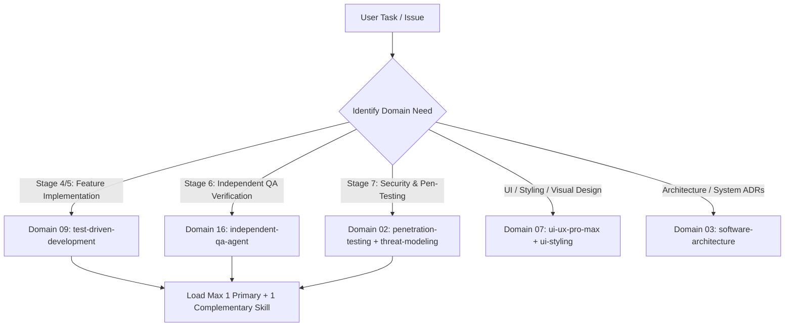

# SKILLS.md — Central Skill Registry & Selection Guide
# Universal Markdown Skills Framework (UMSF)

> Version: 1.3.0  
> Total Skills Cataloged: 371 Across 16 Canonical Engineering Domains & Specialized Disciplines  
> Authority: Precedence Level 6 Discovery  

---

## 1. Skill Discovery & Selection Guidelines

When an AI coding agent receives a task, it must determine which specialized domain skill applies. Rather than loading the entire skills directory into context, agents consult this registry to select **only the primary skill** directly aligned with the active lifecycle stage, and at most **one complementary skill**.

### Skill Loading & Role Assignment Rules
1. **Dynamic Context-Aware Skill Loading**: Load all relevant domain skills required by a task, guided by active context window economy rather than an arbitrary fixed limit.
2. **Context Window Stewardship**: Avoid indiscriminately loading dozens of unneeded skills; unload skills when moving past their lifecycle stage.
3. **Agent Role Alignment**:
   - **Agent A (Dev)**: Operates under Domain 01, 04, 05, 06, 07, 08, 09 (`test-driven-development`), 15.
   - **Agent B (Independent QA)**: Operates under Domain 09 (QA/Testing), Domain 12 (Code Review, Post-Task Verification), Domain 13 (Performance), Domain 16 (`independent-qa-agent`).
   - **Agent C (Independent Security)**: Operates under Domain 02 (Security Engineering & Pen-Testing), Domain 16 (`independent-security-review-agent`).
4. **100% Self-Contained Markdown Intelligence**: All 371 skills are pure Markdown. Zero interactive search CLI or external installations required. For UI/UX design intelligence, agents directly consult [`skills/ui-ux-pro-max/references/styles-and-palettes.md`](./skills/ui-ux-pro-max/references/styles-and-palettes.md) (88 visual styles, 192 product palettes, 74 font pairings) and [`skills/ui-ux-pro-max/references/quick-reference.md`](./skills/ui-ux-pro-max/references/quick-reference.md) (119 UX guidelines). Zero interactive search CLI or external installations required. For UI/UX design intelligence, agents and users directly consult the curated catalogs in [`skills/ui-ux-pro-max/references/styles-and-palettes.md`](./skills/ui-ux-pro-max/references/styles-and-palettes.md) (88 visual styles, 192 product palettes, 74 font pairings) and [`skills/ui-ux-pro-max/references/quick-reference.md`](./skills/ui-ux-pro-max/references/quick-reference.md) (119 UX guidelines).

---

## 2. The 16 Canonical Engineering Domains

### Domain 01 — Software Development Lifecycle (SDLC)
**Primary Agent Role**: `Agent A (Dev) & Team Lead`  
**Canonical Domain Directory**: [`skills/01-software-development-lifecycle/`](./skills/01-software-development-lifecycle/)  

| Skill Identifier | Direct Link | Primary Responsibility & Technical Focus |
|---|---|---|
| `planning` | [`skills/01-software-development-lifecycle/planning/SKILL.md`](./skills/01-software-development-lifecycle/planning/SKILL.md) | Actionable guidelines for decomposing complex features into atomic tasks and dependency-ordered execution roadmaps.  |

### Domain 02 — Security Engineering & Penetration Testing
**Primary Agent Role**: `Agent C (Independent Security Agent)`  
**Canonical Domain Directory**: [`skills/02-security-engineering/`](./skills/02-security-engineering/)  

| Skill Identifier | Direct Link | Primary Responsibility & Technical Focus |
|---|---|---|
| `security` | [`skills/02-security-engineering/security/SKILL.md`](./skills/02-security-engineering/security/SKILL.md) | Threat modeling, input sanitization, OWASP Top 10 mitigation, secure credential management, authentication, and authorization h... |
| `security-testing` | [`skills/02-security-engineering/security-testing/SKILL.md`](./skills/02-security-engineering/security-testing/SKILL.md) | Strategic planning, automation, and execution of comprehensive software security test suites across SAST, DAST, and CI/CD pipel... |
| `penetration-testing` | [`skills/02-security-engineering/penetration-testing/SKILL.md`](./skills/02-security-engineering/penetration-testing/SKILL.md) | Authorized, non-destructive penetration testing methodology, explicit scope verification, controlled proof-of-concept exploitat... |
| `web-application-security` | [`skills/02-security-engineering/web-application-security/SKILL.md`](./skills/02-security-engineering/web-application-security/SKILL.md) | Audit, defense, and remediation of OWASP Top 10 web vulnerabilities including XSS, CSRF, SSRF, path traversal, open redirects, ... |
| `api-security-testing` | [`skills/02-security-engineering/api-security-testing/SKILL.md`](./skills/02-security-engineering/api-security-testing/SKILL.md) | Audit, testing, and hardening of REST, GraphQL, and gRPC APIs against the OWASP API Security Top 10 including BOLA, BFLA, and m... |
| `vulnerability-assessment` | [`skills/02-security-engineering/vulnerability-assessment/SKILL.md`](./skills/02-security-engineering/vulnerability-assessment/SKILL.md) | Systematic vulnerability identification, CVE mapping, contextual risk scoring, and evidence collection across application archi... |
| `security-code-review` | [`skills/02-security-engineering/security-code-review/SKILL.md`](./skills/02-security-engineering/security-code-review/SKILL.md) | Static manual and automated code inspection for security anti-patterns, dangerous sinks, unsanitized inputs, and cryptographic ... |
| `threat-modeling` | [`skills/02-security-engineering/threat-modeling/SKILL.md`](./skills/02-security-engineering/threat-modeling/SKILL.md) | Structured architectural threat modeling using STRIDE / PASTA methodologies, trust boundary mapping, asset identification, and ... |
| `dependency-security-audit` | [`skills/02-security-engineering/dependency-security-audit/SKILL.md`](./skills/02-security-engineering/dependency-security-audit/SKILL.md) | Software composition analysis (SCA), auditing supply-chain vulnerabilities, lockfile integrity, dependency confusion, and licen... |
| `authentication-security` | [`skills/02-security-engineering/authentication-security/SKILL.md`](./skills/02-security-engineering/authentication-security/SKILL.md) | Implementation, audit, and hardening of authentication mechanisms, password hashing, session tokens, JWTs, and MFA workflows."  |
| `authorization-security` | [`skills/02-security-engineering/authorization-security/SKILL.md`](./skills/02-security-engineering/authorization-security/SKILL.md) | Design, implementation, and testing of robust access control, RBAC/ABAC models, IDOR prevention, and multi-tenant isolation."  |
| `vulnerability-management` | [`skills/02-security-engineering/vulnerability-management/SKILL.md`](./skills/02-security-engineering/vulnerability-management/SKILL.md) | End-to-end vulnerability management lifecycle: discovery, triage, contextual risk assessment, remediation tracking, and SLA enf... |
| `security-remediation-and-retesting` | [`skills/02-security-engineering/security-remediation-and-retesting/SKILL.md`](./skills/02-security-engineering/security-remediation-and-retesting/SKILL.md) | Surgical remediation of confirmed vulnerabilities, patch verification, regression security sweeps, and independent retest repor... |

### Domain 03 — Software Architecture & System Design
**Primary Agent Role**: `Principal Architect & Agent A`  
**Canonical Domain Directory**: [`skills/03-software-architecture-and-design/`](./skills/03-software-architecture-and-design/)  

| Skill Identifier | Direct Link | Primary Responsibility & Technical Focus |
|---|---|---|
| `software-architecture` | [`skills/03-software-architecture-and-design/software-architecture/SKILL.md`](./skills/03-software-architecture-and-design/software-architecture/SKILL.md) | Principles and workflows for high-level system design, layer separation, modularity, and Architectural Decision Records (ADRs).  |
| `architecture-decision-records` | [`skills/03-software-architecture-and-design/architecture-decision-records/SKILL.md`](./skills/03-software-architecture-and-design/architecture-decision-records/SKILL.md) | Capture architectural decisions as numbered ADR markdown files in docs/adr/ with context, alternatives considered, consequences... |

### Domain 04 — Requirements & Business Analysis
**Primary Agent Role**: `Agent A (Dev) & Product Analyst`  
**Canonical Domain Directory**: [`skills/04-requirements-and-business-analysis/`](./skills/04-requirements-and-business-analysis/)  

| Skill Identifier | Direct Link | Primary Responsibility & Technical Focus |
|---|---|---|
| `requirements-analysis` | [`skills/04-requirements-and-business-analysis/requirements-analysis/SKILL.md`](./skills/04-requirements-and-business-analysis/requirements-analysis/SKILL.md) | Structured intake, disambiguation, scoping, and acceptance criteria authoring for engineering requests.  |

### Domain 05 — Programming & Implementation
**Primary Agent Role**: `Agent A (Development Agent)`  
**Canonical Domain Directory**: [`skills/05-programming-and-implementation/`](./skills/05-programming-and-implementation/)  

| Skill Identifier | Direct Link | Primary Responsibility & Technical Focus |
|---|---|---|
| `debugging` | [`skills/05-programming-and-implementation/debugging/SKILL.md`](./skills/05-programming-and-implementation/debugging/SKILL.md) | Hypothesis-driven root cause analysis, reproduction scripts, diagnostic tracing, and verified remediation workflows.  |
| `refactoring` | [`skills/05-programming-and-implementation/refactoring/SKILL.md`](./skills/05-programming-and-implementation/refactoring/SKILL.md) | Systematic techniques for safely restructuring code to improve readability and maintainability without altering observable exte... |

### Domain 06 — Backend Engineering & Distributed Systems
**Primary Agent Role**: `Agent A (Backend Engineer)`  
**Canonical Domain Directory**: [`skills/06-backend-engineering/`](./skills/06-backend-engineering/)  

| Skill Identifier | Direct Link | Primary Responsibility & Technical Focus |
|---|---|---|
| `backend-development` | [`skills/06-backend-engineering/backend-development/SKILL.md`](./skills/06-backend-engineering/backend-development/SKILL.md) | Guidelines for maintainable, secure, and performant backend services, domain business logic, and data access.  |
| `api-development` | [`skills/06-backend-engineering/api-development/SKILL.md`](./skills/06-backend-engineering/api-development/SKILL.md) | Contract design, versioning, serialization, status codes, and security standards for REST, GraphQL, and gRPC APIs.  |
| `backend-patterns` | [`skills/06-backend-engineering/backend-patterns/SKILL.md`](./skills/06-backend-engineering/backend-patterns/SKILL.md) | Backend architecture patterns, API design, database optimization, and server-side best practices for Node.js, Express, and Next... |

### Domain 07 — Frontend Engineering & UI/UX Pro Max
**Primary Agent Role**: `Agent A (Frontend Engineer) & UI Designer`  
**Canonical Domain Directory**: [`skills/07-frontend-engineering/`](./skills/07-frontend-engineering/)  

| Skill Identifier | Direct Link | Primary Responsibility & Technical Focus |
|---|---|---|
| `frontend-development` | [`skills/07-frontend-engineering/frontend-development/SKILL.md`](./skills/07-frontend-engineering/frontend-development/SKILL.md) | Standards and actionable workflows for building accessible, responsive, high-performance UI components and client state archite... |
| `ui-ux-design` | [`skills/07-frontend-engineering/ui-ux-design/SKILL.md`](./skills/07-frontend-engineering/ui-ux-design/SKILL.md) | UI/UX design intelligence, design system token authoring, Swiss & Minimalism visual standards, accessibility compliance, and in... |
| `ui-ux-pro-max` | [`skills/07-frontend-engineering/ui-ux-pro-max/SKILL.md`](./skills/07-frontend-engineering/ui-ux-pro-max/SKILL.md) | UI/UX design intelligence for web, mobile, and desktop. This skill should be used when designing, building, reviewing, or fixin... |
| `design-system` | [`skills/07-frontend-engineering/design-system/SKILL.md`](./skills/07-frontend-engineering/design-system/SKILL.md) | Token architecture, component specifications, and slide generation. Three-layer tokens (primitive→semantic→component), CSS vari... |
| `ui-styling` | [`skills/07-frontend-engineering/ui-styling/SKILL.md`](./skills/07-frontend-engineering/ui-styling/SKILL.md) | Create beautiful, accessible user interfaces with shadcn/ui components (built on Radix UI + Tailwind), Tailwind CSS utility-fir... |
| `brand` | [`skills/07-frontend-engineering/brand/SKILL.md`](./skills/07-frontend-engineering/brand/SKILL.md) | Brand voice, visual identity, messaging frameworks, asset management, brand consistency. Activate for branded content, tone of ... |
| `banner-design` | [`skills/07-frontend-engineering/banner-design/SKILL.md`](./skills/07-frontend-engineering/banner-design/SKILL.md) | Design banners for social media, ads, website heroes, creative assets, and print. Multiple art direction options with optional ... |
| `slides` | [`skills/07-frontend-engineering/slides/SKILL.md`](./skills/07-frontend-engineering/slides/SKILL.md) | Create strategic HTML presentations with Chart.js, design tokens, responsive layouts, copywriting formulas, and contextual slid... |
| `design` | [`skills/07-frontend-engineering/design/SKILL.md`](./skills/07-frontend-engineering/design/SKILL.md) | Comprehensive design skill: brand identity, design tokens, UI styling, logo generation (55 styles, Gemini, Atlas Cloud, or MuAP... |

### Domain 08 — Database Engineering & Storage
**Primary Agent Role**: `Agent A & Data Architect`  
**Canonical Domain Directory**: [`skills/08-database-engineering/`](./skills/08-database-engineering/)  

| Skill Identifier | Direct Link | Primary Responsibility & Technical Focus |
|---|---|---|
| `database-design` | [`skills/08-database-engineering/database-design/SKILL.md`](./skills/08-database-engineering/database-design/SKILL.md) | Guidelines for relational and non-relational database schema design, normalization, indexing strategies, migrations, and query ... |
| `database-migrations` | [`skills/08-database-engineering/database-migrations/SKILL.md`](./skills/08-database-engineering/database-migrations/SKILL.md) | Database schema migrations, versioning, zero-downtime deployments, rollback strategies, and migration verification. |

### Domain 09 — Quality Assurance & Software Testing
**Primary Agent Role**: `Agent B (Independent QA Agent) & Agent A (TDD)`  
**Canonical Domain Directory**: [`skills/09-quality-assurance-and-testing/`](./skills/09-quality-assurance-and-testing/)  

| Skill Identifier | Direct Link | Primary Responsibility & Technical Focus |
|---|---|---|
| `testing` | [`skills/09-quality-assurance-and-testing/testing/SKILL.md`](./skills/09-quality-assurance-and-testing/testing/SKILL.md) | Comprehensive testing strategies, unit testing, integration boundaries, mock design, coverage expectations, and test reliabilit... |
| `test-driven-development` | [`skills/09-quality-assurance-and-testing/test-driven-development/SKILL.md`](./skills/09-quality-assurance-and-testing/test-driven-development/SKILL.md) | The canonical Test-Driven Development (TDD) engineering discipline: Red-Green-Refactor, automated test authoring first, edge ca... |
| `unit-testing` | [`skills/09-quality-assurance-and-testing/unit-testing/SKILL.md`](./skills/09-quality-assurance-and-testing/unit-testing/SKILL.md) | Isolation testing of individual functions, methods, and classes using deterministic mocks, clear boundary isolation, and the AA... |
| `integration-testing` | [`skills/09-quality-assurance-and-testing/integration-testing/SKILL.md`](./skills/09-quality-assurance-and-testing/integration-testing/SKILL.md) | Verification of interactions across service boundaries, database transactions, API contracts, inter-process messaging, and exte... |
| `system-testing` | [`skills/09-quality-assurance-and-testing/system-testing/SKILL.md`](./skills/09-quality-assurance-and-testing/system-testing/SKILL.md) | Holistic verification of the fully assembled application system, verifying end-to-end business workflows, configuration integri... |
| `end-to-end-testing` | [`skills/09-quality-assurance-and-testing/end-to-end-testing/SKILL.md`](./skills/09-quality-assurance-and-testing/end-to-end-testing/SKILL.md) | Automated end-to-end testing of user journeys across web browsers, mobile interfaces, and CLI workflows from start to finish."  |
| `regression-testing` | [`skills/09-quality-assurance-and-testing/regression-testing/SKILL.md`](./skills/09-quality-assurance-and-testing/regression-testing/SKILL.md) | Systematic regression test suite design, selective regression execution, impact analysis, and accumulation of bug-reproduction ... |
| `acceptance-testing` | [`skills/09-quality-assurance-and-testing/acceptance-testing/SKILL.md`](./skills/09-quality-assurance-and-testing/acceptance-testing/SKILL.md) | Verification of software against business requirements, Given-When-Then / BDD acceptance criteria, and stakeholder definition o... |
| `exploratory-testing` | [`skills/09-quality-assurance-and-testing/exploratory-testing/SKILL.md`](./skills/09-quality-assurance-and-testing/exploratory-testing/SKILL.md) | Structured, time-boxed, charter-driven exploratory testing, unscripted edge-case discovery, heuristic probing, and anomaly repo... |
| `test-automation` | [`skills/09-quality-assurance-and-testing/test-automation/SKILL.md`](./skills/09-quality-assurance-and-testing/test-automation/SKILL.md) | Architecture, implementation, and maintenance of deterministic, robust test automation frameworks across CI/CD environments."  |
| `test-coverage-analysis` | [`skills/09-quality-assurance-and-testing/test-coverage-analysis/SKILL.md`](./skills/09-quality-assurance-and-testing/test-coverage-analysis/SKILL.md) | Measurement, analysis, and optimization of code coverage metrics (statement, branch, function, line) to identify untested criti... |
| `mutation-testing` | [`skills/09-quality-assurance-and-testing/mutation-testing/SKILL.md`](./skills/09-quality-assurance-and-testing/mutation-testing/SKILL.md) | Evaluation of test suite efficacy through deliberate fault injection (mutants) to verify assertion rigor and eliminate weak tes... |
| `performance-testing` | [`skills/09-quality-assurance-and-testing/performance-testing/SKILL.md`](./skills/09-quality-assurance-and-testing/performance-testing/SKILL.md) | Benchmarking, latency profiling, throughput measurement, and bottleneck identification across API endpoints and UI render pipel... |
| `load-and-stress-testing` | [`skills/09-quality-assurance-and-testing/load-and-stress-testing/SKILL.md`](./skills/09-quality-assurance-and-testing/load-and-stress-testing/SKILL.md) | Concurrency testing, load curves, stress thresholds, breaking-point determination, and graceful degradation verification."  |
| `test-strategy-and-planning` | [`skills/09-quality-assurance-and-testing/test-strategy-and-planning/SKILL.md`](./skills/09-quality-assurance-and-testing/test-strategy-and-planning/SKILL.md) | Formulating comprehensive, risk-based test strategies, testing levels matrix, environment prerequisites, quality budgets, and r... |
| `test-data-management` | [`skills/09-quality-assurance-and-testing/test-data-management/SKILL.md`](./skills/09-quality-assurance-and-testing/test-data-management/SKILL.md) | Deterministic test data synthesis, seeders, factory patterns, sensitive data masking, state cleanup, and test isolation."  |
| `defect-management` | [`skills/09-quality-assurance-and-testing/defect-management/SKILL.md`](./skills/09-quality-assurance-and-testing/defect-management/SKILL.md) | Structured defect logging, reproduction workflows, severity/priority assignment, root cause analysis, and resolution verificati... |

### Domain 10 — DevOps, Containers & Infrastructure
**Primary Agent Role**: `DevOps / Platform Engineer`  
**Canonical Domain Directory**: [`skills/10-devops-and-infrastructure/`](./skills/10-devops-and-infrastructure/)  

| Skill Identifier | Direct Link | Primary Responsibility & Technical Focus |
|---|---|---|
| `docker-patterns` | [`skills/10-devops-and-infrastructure/docker-patterns/SKILL.md`](./skills/10-devops-and-infrastructure/docker-patterns/SKILL.md) | Docker and Docker Compose patterns for local development, hardened CLI installer harnesses, container security, networking, vol... |
| `kubernetes-patterns` | [`skills/10-devops-and-infrastructure/kubernetes-patterns/SKILL.md`](./skills/10-devops-and-infrastructure/kubernetes-patterns/SKILL.md) | Kubernetes workload patterns, resource management, RBAC, probes, autoscaling, ConfigMap/Secret handling, and kubectl debugging ... |

### Domain 11 — Reliability & Production Operations
**Primary Agent Role**: `SRE & Operations Lead`  
**Canonical Domain Directory**: [`skills/11-reliability-and-operations/`](./skills/11-reliability-and-operations/)  

| Skill Identifier | Direct Link | Primary Responsibility & Technical Focus |
|---|---|---|
| `canary-watch` | [`skills/11-reliability-and-operations/canary-watch/SKILL.md`](./skills/11-reliability-and-operations/canary-watch/SKILL.md) | Use this skill to monitor and verify a deployed URL after releases — checks HTTP endpoints, SSE streams, static assets, console... |

### Domain 12 — Code Quality, Review & Maintenance
**Primary Agent Role**: `Senior Reviewer & Agent B`  
**Canonical Domain Directory**: [`skills/12-code-quality-and-maintenance/`](./skills/12-code-quality-and-maintenance/)  

| Skill Identifier | Direct Link | Primary Responsibility & Technical Focus |
|---|---|---|
| `code-review` | [`skills/12-code-quality-and-maintenance/code-review/SKILL.md`](./skills/12-code-quality-and-maintenance/code-review/SKILL.md) | Systematic guidelines for evaluating pull requests and code modifications against clean code, security, performance, DRY, and S... |
| `post-task-verification` | [`skills/12-code-quality-and-maintenance/post-task-verification/SKILL.md`](./skills/12-code-quality-and-maintenance/post-task-verification/SKILL.md) | Systematic, evidence-based post-implementation audit verifying prompt requirements, diff inspection, test results, security impact, regression avoidance, and documentation consistency before task closure. |

### Domain 13 — Performance Engineering & Profiling
**Primary Agent Role**: `Performance Engineer & Agent B`  
**Canonical Domain Directory**: [`skills/13-performance-engineering/`](./skills/13-performance-engineering/)  

| Skill Identifier | Direct Link | Primary Responsibility & Technical Focus |
|---|---|---|
| `performance` | [`skills/13-performance-engineering/performance/SKILL.md`](./skills/13-performance-engineering/performance/SKILL.md) | Profiling methodologies, latency optimization, memory leak mitigation, algorithmic efficiency, and frontend bundle budgets.  |
| `benchmark-optimization-loop` | [`skills/13-performance-engineering/benchmark-optimization-loop/SKILL.md`](./skills/13-performance-engineering/benchmark-optimization-loop/SKILL.md) | Structured benchmarking loops, profile-guided optimization, latency measurements, and regression prevention. |

### Domain 14 — Project & Team Delivery Management
**Primary Agent Role**: `Delivery Manager`  
**Canonical Domain Directory**: [`skills/14-project-and-team-management/`](./skills/14-project-and-team-management/)  

| Skill Identifier | Direct Link | Primary Responsibility & Technical Focus |
|---|---|---|
| `counterparty-channel-discipline` | [`skills/14-project-and-team-management/counterparty-channel-discipline/SKILL.md`](./skills/14-project-and-team-management/counterparty-channel-discipline/SKILL.md) | Per-channel strict prompts, mention gating, silent observation, and a communication autonomy policy for agents that sit in shar... |

### Domain 15 — Documentation & Technical Writing
**Primary Agent Role**: `Technical Documentation Engineer`  
**Canonical Domain Directory**: [`skills/15-documentation-and-technical-communication/`](./skills/15-documentation-and-technical-communication/)  

| Skill Identifier | Direct Link | Primary Responsibility & Technical Focus |
|---|---|---|
| `documentation` | [`skills/15-documentation-and-technical-communication/documentation/SKILL.md`](./skills/15-documentation-and-technical-communication/documentation/SKILL.md) | Standards for authoring technical specifications, runbooks, architecture decision records, API documentation, and Markdown main... |
| `article-writing` | [`skills/15-documentation-and-technical-communication/article-writing/SKILL.md`](./skills/15-documentation-and-technical-communication/article-writing/SKILL.md) | Write articles, guides, blog posts, tutorials, newsletter issues, and other long-form content in a distinctive voice derived fr... |

### Domain 16 — AI Agent Engineering & Multi-Agent Systems
**Primary Agent Role**: `AI Agent Systems Architect & Coordinator`  
**Canonical Domain Directory**: [`skills/16-ai-agent-engineering/`](./skills/16-ai-agent-engineering/)  

| Skill Identifier | Direct Link | Primary Responsibility & Technical Focus |
|---|---|---|
| `agentic-engineering` | [`skills/16-ai-agent-engineering/agentic-engineering/SKILL.md`](./skills/16-ai-agent-engineering/agentic-engineering/SKILL.md) | Operate as an agentic engineer using eval-first execution, decomposition, and cost-aware model routing. Use when planning or ex... |
| `independent-qa-agent` | [`skills/16-ai-agent-engineering/independent-qa-agent/SKILL.md`](./skills/16-ai-agent-engineering/independent-qa-agent/SKILL.md) | Operational persona and protocols for an Independent AI Quality Assurance Agent: autonomous test execution, challenging Dev ass... |
| `independent-security-review-agent` | [`skills/16-ai-agent-engineering/independent-security-review-agent/SKILL.md`](./skills/16-ai-agent-engineering/independent-security-review-agent/SKILL.md) | Operational persona and protocols for an Independent AI Security Testing Agent: adversarial threat analysis, authorized vulnera... |
| `multi-agent-verification` | [`skills/16-ai-agent-engineering/multi-agent-verification/SKILL.md`](./skills/16-ai-agent-engineering/multi-agent-verification/SKILL.md) | Orchestration patterns for concurrent multi-agent collaboration: Dev -> QA -> Security handoff loops, consensus protocols, and ... |
| `adversarial-testing` | [`skills/16-ai-agent-engineering/adversarial-testing/SKILL.md`](./skills/16-ai-agent-engineering/adversarial-testing/SKILL.md) | Adversarial testing methodologies, fuzzing inputs, race conditions, edge-case abuse, and prompt injection hardening for AI and ... |
| `agent-handoff-and-review` | [`skills/16-ai-agent-engineering/agent-handoff-and-review/SKILL.md`](./skills/16-ai-agent-engineering/agent-handoff-and-review/SKILL.md) | Structured context handoff protocols, verification checklists, state persistence, and loss-free continuity across agent boundar... |
| `evidence-based-validation` | [`skills/16-ai-agent-engineering/evidence-based-validation/SKILL.md`](./skills/16-ai-agent-engineering/evidence-based-validation/SKILL.md) | Verification protocol requiring empirical proof (test execution logs, exit codes, diffs) before accepting completion claims."  |
| `agent-role-separation` | [`skills/16-ai-agent-engineering/agent-role-separation/SKILL.md`](./skills/16-ai-agent-engineering/agent-role-separation/SKILL.md) | Single-agent fallback protocols for clean role-switching passes, cognitive context wiping, distinct checklists, and bias elimin... |
| `autonomous-loops` | [`skills/16-ai-agent-engineering/autonomous-loops/SKILL.md`](./skills/16-ai-agent-engineering/autonomous-loops/SKILL.md) | Patterns and architectures for autonomous Claude Code loops — from simple sequential pipelines to RFC-driven multi-agent DAG sy... |
| `prompt-optimizer` | [`skills/16-ai-agent-engineering/prompt-optimizer/SKILL.md`](./skills/16-ai-agent-engineering/prompt-optimizer/SKILL.md) | Systematic prompt optimization, meta-prompting, few-shot tuning, structured output schemas, and prompt regression prevention. |
| `mcp-server-patterns` | [`skills/16-ai-agent-engineering/mcp-server-patterns/SKILL.md`](./skills/16-ai-agent-engineering/mcp-server-patterns/SKILL.md) | Model Context Protocol server design, tools, resources, prompt templates, transports, schema contracts, and test fixtures. |

---

## 3. Complete Specialized Technology & Domain Skills Catalog (300 Skills)

The framework provides specialized engineering modules covering specific frameworks, cloud providers, databases, and domain patterns. Load dynamically based on project technology stack:

| Skill Identifier | Direct Link | Technical Focus & Capabilities |
|---|---|---|
| `accessibility` | [`skills/accessibility/SKILL.md`](./skills/accessibility/SKILL.md) | Design, implement, and audit accessible UI to WCAG 2.2 Level AA across Web, iOS, and Android — semantic ARIA roles and labels, ... |
| `agent-architecture-audit` | [`skills/agent-architecture-audit/SKILL.md`](./skills/agent-architecture-audit/SKILL.md) | Full-stack diagnostic for agent and LLM applications. Audits the 12-layer agent stack for wrapper regression, memory pollution,... |
| `agent-eval` | [`skills/agent-eval/SKILL.md`](./skills/agent-eval/SKILL.md) | Head-to-head comparison of coding agents (Claude Code, Aider, Codex, etc.) on custom tasks with pass rate, cost, time, and cons... |
| `agent-harness-construction` | [`skills/agent-harness-construction/SKILL.md`](./skills/agent-harness-construction/SKILL.md) | Design and optimize AI agent action spaces, tool definitions, and observation formatting for higher completion rates. Use when ... |
| `agent-introspection-debugging` | [`skills/agent-introspection-debugging/SKILL.md`](./skills/agent-introspection-debugging/SKILL.md) | Structured self-debugging workflow for AI agent failures using capture, diagnosis, contained recovery, and introspection report... |
| `agent-payment-x402` | [`skills/agent-payment-x402/SKILL.md`](./skills/agent-payment-x402/SKILL.md) | Add x402 payment execution to AI agents with per-task budgets, spending controls, and non-custodial wallets. Supports Base thro... |
| `agent-runtime-gateway-smoke-test` | [`skills/agent-runtime-gateway-smoke-test/SKILL.md`](./skills/agent-runtime-gateway-smoke-test/SKILL.md) | Verify a local agent API, temporary gateway tunnel, and remote sandbox callback with a tool-free task, then restore the origina... |
| `agent-security-hardening` | [`skills/agent-security-hardening/SKILL.md`](./skills/agent-security-hardening/SKILL.md) | Security hardening guidance for AI agent frameworks that process untrusted content, invoke tools, write workspace files, manage... |
| `agent-self-evaluation` | [`skills/agent-self-evaluation/SKILL.md`](./skills/agent-self-evaluation/SKILL.md) | Use after completing any non-trivial task. The agent self-rates its output on 5 axes — accuracy, completeness, clarity, actiona... |
| `agent-sort` | [`skills/agent-sort/SKILL.md`](./skills/agent-sort/SKILL.md) | Build an evidence-backed ECC install plan for a specific repo by sorting skills, commands, rules, hooks, and extras into DAILY ... |
| `agentic-os` | [`skills/agentic-os/SKILL.md`](./skills/agentic-os/SKILL.md) | Build persistent multi-agent operating systems on Claude Code. Covers kernel architecture, specialist agents, slash commands, f... |
| `ai-first-engineering` | [`skills/ai-first-engineering/SKILL.md`](./skills/ai-first-engineering/SKILL.md) | Engineering operating model for teams where AI agents generate a large share of implementation output. Use when setting team pr... |
| `ai-regression-testing` | [`skills/ai-regression-testing/SKILL.md`](./skills/ai-regression-testing/SKILL.md) | Regression testing strategies for AI-assisted development. Sandbox-mode API testing without database dependencies, automated bu... |
| `android-clean-architecture` | [`skills/android-clean-architecture/SKILL.md`](./skills/android-clean-architecture/SKILL.md) | Clean Architecture patterns for Android and Kotlin Multiplatform projects — module structure, dependency rules, UseCases, Repos... |
| `angular-developer` | [`skills/angular-developer/SKILL.md`](./skills/angular-developer/SKILL.md) | Generates Angular code and provides architectural guidance. Trigger when creating projects, components, or services, or for bes... |
| `api-connector-builder` | [`skills/api-connector-builder/SKILL.md`](./skills/api-connector-builder/SKILL.md) | Build a new API connector or provider by matching the target repo's existing integration pattern exactly. Use when adding one m... |
| `api-design` | [`skills/api-design/SKILL.md`](./skills/api-design/SKILL.md) | REST API design patterns including resource naming, status codes, pagination, filtering, error responses, versioning, and rate ... |
| `automation-audit-ops` | [`skills/automation-audit-ops/SKILL.md`](./skills/automation-audit-ops/SKILL.md) | Evidence-first automation inventory and overlap audit workflow for ECC. Use when the user wants to know which jobs, hooks, conn... |
| `autonomous-agent-harness` | [`skills/autonomous-agent-harness/SKILL.md`](./skills/autonomous-agent-harness/SKILL.md) | Transform Claude Code into a fully autonomous agent system with persistent memory, scheduled operations, computer use, and task... |
| `benchmark` | [`skills/benchmark/SKILL.md`](./skills/benchmark/SKILL.md) | Measure performance baselines and detect regressions across browser Core Web Vitals (LCP, INP, CLS, page weight), API endpoint ... |
| `benchmark-methodology` | [`skills/benchmark-methodology/SKILL.md`](./skills/benchmark-methodology/SKILL.md) | "Score a scoped competitor set into comparable profile cards: nine weighted dimensions (positioning, voice, visual craft, offer... |
| `bengali-nlp` | [`skills/bengali-nlp/SKILL.md`](./skills/bengali-nlp/SKILL.md) | Bengali (Bangla) text processing patterns including Unicode normalization, script detection, tokenization, conjunct handling, a... |
| `blender-motion-state-inspection` | [`skills/blender-motion-state-inspection/SKILL.md`](./skills/blender-motion-state-inspection/SKILL.md) | Use this skill when inspecting Blender characters, rigs, poses, animation retargeting, ground contact, facing direction, or mod... |
| `blueprint` | [`skills/blueprint/SKILL.md`](./skills/blueprint/SKILL.md) | "Turn a one-line objective into a step-by-step construction plan for multi-session, multi-agent engineering projects: one-PR-si... |
| `brand-discovery` | [`skills/brand-discovery/SKILL.md`](./skills/brand-discovery/SKILL.md) | Run a structured, resumable multi-session brand identity interview across 8 modules (purpose, positioning, audience, personalit... |
| `brand-voice` | [`skills/brand-voice/SKILL.md`](./skills/brand-voice/SKILL.md) | Build a source-derived writing style profile from real posts, essays, launch notes, docs, or site copy, then reuse that profile... |
| `brownfield-retrospective` | [`skills/brownfield-retrospective/SKILL.md`](./skills/brownfield-retrospective/SKILL.md) | Run the ECC engineering process retroactively against an existing project slice. Audit current state, reconstruct past decision... |
| `browser-qa` | [`skills/browser-qa/SKILL.md`](./skills/browser-qa/SKILL.md) | "Run automated post-deploy UI verification with a browser automation MCP (claude-in-chrome, Playwright, or Puppeteer): console-... |
| `bun-runtime` | [`skills/bun-runtime/SKILL.md`](./skills/bun-runtime/SKILL.md) | Bun as runtime, package manager, bundler, and test runner. When to choose Bun vs Node, migration notes, and Vercel support. |
| `carrier-relationship-management` | [`skills/carrier-relationship-management/SKILL.md`](./skills/carrier-relationship-management/SKILL.md) | "Manage truckload, LTL, and intermodal carrier portfolios: sourcing and FMCSA vetting, freight rate and fuel-surcharge negotiat... |
| `change-impact` | [`skills/change-impact/SKILL.md`](./skills/change-impact/SKILL.md) | >- |
| `cisco-ios-patterns` | [`skills/cisco-ios-patterns/SKILL.md`](./skills/cisco-ios-patterns/SKILL.md) | Cisco IOS and IOS-XE review patterns for show commands, config hierarchy, wildcard masks, ACL placement, interface hygiene, and... |
| `ck` | [`skills/ck/SKILL.md`](./skills/ck/SKILL.md) | "Persistent per-project memory for Claude Code (Context Keeper) driven by deterministic Node.js /ck commands: init, save, resum... |
| `claude-devfleet` | [`skills/claude-devfleet/SKILL.md`](./skills/claude-devfleet/SKILL.md) | Orchestrate multi-agent coding tasks via Claude DevFleet — plan projects, dispatch parallel agents in isolated worktrees, monit... |
| `click-path-audit` | [`skills/click-path-audit/SKILL.md`](./skills/click-path-audit/SKILL.md) | "Trace every user-facing button/touchpoint through its full state change sequence to find bugs where functions individually wor... |
| `clickhouse-io` | [`skills/clickhouse-io/SKILL.md`](./skills/clickhouse-io/SKILL.md) | ClickHouse database patterns, query optimization, analytics, and data engineering best practices for high-performance analytica... |
| `code-tour` | [`skills/code-tour/SKILL.md`](./skills/code-tour/SKILL.md) | Create CodeTour `.tour` files — persona-targeted, step-by-step walkthroughs with real file and line anchors. Use for onboarding... |
| `codebase-onboarding` | [`skills/codebase-onboarding/SKILL.md`](./skills/codebase-onboarding/SKILL.md) | Analyze an unfamiliar codebase and generate a structured onboarding guide with architecture map, key entry points, conventions,... |
| `codehealth-mcp` | [`skills/codehealth-mcp/SKILL.md`](./skills/codehealth-mcp/SKILL.md) | Real-time structural Code Health via CodeScene MCP — review before edits, verify score deltas after changes, gate commits and P... |
| `coding-standards` | [`skills/coding-standards/SKILL.md`](./skills/coding-standards/SKILL.md) | Baseline cross-project coding conventions for naming, readability, immutability, and code-quality review. Use detailed frontend... |
| `competitive-platform-analysis` | [`skills/competitive-platform-analysis/SKILL.md`](./skills/competitive-platform-analysis/SKILL.md) | Use when scoping a competitive landscape — identifying, categorising, and score-filtering a competitor set before any benchmark... |
| `competitive-report-structure` | [`skills/competitive-report-structure/SKILL.md`](./skills/competitive-report-structure/SKILL.md) | Assemble scored competitor profile cards (from benchmark-methodology) into a decision-grade competitive report with landscape m... |
| `compose-multiplatform-patterns` | [`skills/compose-multiplatform-patterns/SKILL.md`](./skills/compose-multiplatform-patterns/SKILL.md) | Compose Multiplatform and Jetpack Compose patterns for KMP projects — state management, navigation, theming, performance, and p... |
| `config-gc` | [`skills/config-gc/SKILL.md`](./skills/config-gc/SKILL.md) | Garbage collection for your Claude Code configuration. Periodically scans ~/.claude (skills, memory, hooks, permissions, MCP se... |
| `configure-ecc` | [`skills/configure-ecc/SKILL.md`](./skills/configure-ecc/SKILL.md) | "Run the conversational ECC setup wizard inside the current harness: inventory the install, collect scope (user/project/local) ... |
| `connections-optimizer` | [`skills/connections-optimizer/SKILL.md`](./skills/connections-optimizer/SKILL.md) | Reorganize the user's X and LinkedIn network with review-first pruning, add/follow recommendations, and channel-specific warm o... |
| `content-engine` | [`skills/content-engine/SKILL.md`](./skills/content-engine/SKILL.md) | Create platform-native content systems for X, LinkedIn, TikTok, YouTube, newsletters, and repurposed multi-platform campaigns. ... |
| `content-hash-cache-pattern` | [`skills/content-hash-cache-pattern/SKILL.md`](./skills/content-hash-cache-pattern/SKILL.md) | Cache expensive file processing results using SHA-256 content hashes — path-independent, auto-invalidating, with service layer ... |
| `context-and-decisions` | [`skills/context-and-decisions/SKILL.md`](./skills/context-and-decisions/SKILL.md) | >- |
| `context-budget` | [`skills/context-budget/SKILL.md`](./skills/context-budget/SKILL.md) | Routes live context checks to the native Codex or Claude Code meter without scanning files, and performs a bounded static compo... |
| `continuous-agent-loop` | [`skills/continuous-agent-loop/SKILL.md`](./skills/continuous-agent-loop/SKILL.md) | Patterns for continuous autonomous agent loops with quality gates, evals, and recovery controls. Use when running an agent loop... |
| `continuous-learning` | [`skills/continuous-learning/SKILL.md`](./skills/continuous-learning/SKILL.md) | "[DEPRECATED - use continuous-learning-v2] Legacy v1 stop-hook skill extractor. v2 is a strict superset with instinct-based, pr... |
| `continuous-learning-v2` | [`skills/continuous-learning-v2/SKILL.md`](./skills/continuous-learning-v2/SKILL.md) | Instinct-based learning system that observes sessions via hooks, creates atomic instincts with confidence scoring, and evolves ... |
| `contract-first` | [`skills/contract-first/SKILL.md`](./skills/contract-first/SKILL.md) | Coordinate frontend/backend or service-to-service work through one authoritative machine-checkable contract (OpenAPI, AsyncAPI,... |
| `conventional-commit-review` | [`skills/conventional-commit-review/SKILL.md`](./skills/conventional-commit-review/SKILL.md) | Reviews staged changes and drafts a Conventional Commits-compliant commit message with the right type, scope, and length. Use b... |
| `cost-aware-llm-pipeline` | [`skills/cost-aware-llm-pipeline/SKILL.md`](./skills/cost-aware-llm-pipeline/SKILL.md) | Cost optimization patterns for LLM API usage — model routing by task complexity, budget tracking, retry logic, and prompt cachi... |
| `cost-tracking` | [`skills/cost-tracking/SKILL.md`](./skills/cost-tracking/SKILL.md) | Track and report Claude Code token usage, spending, and budgets from the local ECC cost-tracker metrics log. Use when the user ... |
| `council` | [`skills/council/SKILL.md`](./skills/council/SKILL.md) | Convene a four-voice council for ambiguous decisions, tradeoffs, and go/no-go calls. Use when multiple valid paths exist and yo... |
| `council-multi-model` | [`skills/council-multi-model/SKILL.md`](./skills/council-multi-model/SKILL.md) | Add one optional external Codex critique after the existing council has produced a decision draft. Use when an ambiguous, high-... |
| `cpp-coding-standards` | [`skills/cpp-coding-standards/SKILL.md`](./skills/cpp-coding-standards/SKILL.md) | C++ coding standards based on the C++ Core Guidelines (isocpp.github.io). Use when writing, reviewing, or refactoring C++ code ... |
| `cpp-testing` | [`skills/cpp-testing/SKILL.md`](./skills/cpp-testing/SKILL.md) | Use only when writing/updating/fixing C++ tests, configuring GoogleTest/CTest, diagnosing failing or flaky tests, or adding cov... |
| `crosspost` | [`skills/crosspost/SKILL.md`](./skills/crosspost/SKILL.md) | Multi-platform content distribution across X, LinkedIn, Threads, and Bluesky. Adapts content per platform using content-engine ... |
| `csharp-testing` | [`skills/csharp-testing/SKILL.md`](./skills/csharp-testing/SKILL.md) | C# and .NET testing patterns with xUnit, FluentAssertions, mocking, integration tests, and test organization best practices. Us... |
| `customer-billing-ops` | [`skills/customer-billing-ops/SKILL.md`](./skills/customer-billing-ops/SKILL.md) | Operate customer billing workflows such as subscriptions, refunds, churn triage, billing-portal recovery, and plan analysis usi... |
| `customs-trade-compliance` | [`skills/customs-trade-compliance/SKILL.md`](./skills/customs-trade-compliance/SKILL.md) | Codified customs and trade compliance expertise — HS/HTS tariff classification with GRI rules, commercial invoices and entry do... |
| `dart-flutter-patterns` | [`skills/dart-flutter-patterns/SKILL.md`](./skills/dart-flutter-patterns/SKILL.md) | Production-ready Dart and Flutter patterns covering null safety, immutable state with Freezed, async composition, widget archit... |
| `dashboard-builder` | [`skills/dashboard-builder/SKILL.md`](./skills/dashboard-builder/SKILL.md) | Build monitoring dashboards that answer real operator questions for Grafana, SigNoz, and similar platforms. Use when turning me... |
| `data-scraper-agent` | [`skills/data-scraper-agent/SKILL.md`](./skills/data-scraper-agent/SKILL.md) | Build a fully automated AI-powered data collection agent for any public source — job boards, prices, news, GitHub, sports, anyt... |
| `data-throughput-accelerator` | [`skills/data-throughput-accelerator/SKILL.md`](./skills/data-throughput-accelerator/SKILL.md) | Diagnose and accelerate large data movement — ingestion, backfill, export, ETL, warehouse loading, manifest catch-up, and table... |
| `deep-research` | [`skills/deep-research/SKILL.md`](./skills/deep-research/SKILL.md) | Produce cited research reports from multiple web sources using firecrawl and exa MCP tools — plan sub-questions, search and dee... |
| `deepseek-harness-setup` | [`skills/deepseek-harness-setup/SKILL.md`](./skills/deepseek-harness-setup/SKILL.md) | "Install and operate Everything Claude Code (ECC) on the DeepSeek Harness (DSH): native skill roots (~/.dsh/skills, .agents/ski... |
| `defi-amm-security` | [`skills/defi-amm-security/SKILL.md`](./skills/defi-amm-security/SKILL.md) | Security checklist for Solidity AMM contracts, liquidity pools, and swap flows. Covers reentrancy, CEI ordering, donation or in... |
| `delivery-gate` | [`skills/delivery-gate/SKILL.md`](./skills/delivery-gate/SKILL.md) | Stop hook that blocks Claude from finishing until quality checks pass. Detects rationalization patterns (surface text heuristic... |
| `deployment-patterns` | [`skills/deployment-patterns/SKILL.md`](./skills/deployment-patterns/SKILL.md) | Deployment workflows, CI/CD pipeline patterns, Docker containerization, health checks, rollback strategies, and production read... |
| `dev-team` | [`skills/dev-team/SKILL.md`](./skills/dev-team/SKILL.md) | Simulate a collaborative dev team session where multiple role-based personas (PM, Architect, Developer, QA) respond to the same... |
| `django-celery` | [`skills/django-celery/SKILL.md`](./skills/django-celery/SKILL.md) | Django + Celery async task patterns — configuration, task design, beat scheduling, retries, canvas workflows, monitoring, and t... |
| `django-patterns` | [`skills/django-patterns/SKILL.md`](./skills/django-patterns/SKILL.md) | Django architecture patterns, REST API design with DRF, ORM best practices, caching, signals, middleware, and production-grade ... |
| `django-security` | [`skills/django-security/SKILL.md`](./skills/django-security/SKILL.md) | Django security best practices, authentication, authorization, CSRF protection, SQL injection prevention, XSS prevention, and s... |
| `django-tdd` | [`skills/django-tdd/SKILL.md`](./skills/django-tdd/SKILL.md) | Django testing strategies with pytest-django, TDD methodology, factory_boy, mocking, coverage, and testing Django REST Framewor... |
| `django-verification` | [`skills/django-verification/SKILL.md`](./skills/django-verification/SKILL.md) | Run the full Django verification loop — environment check, mypy/ruff/black linting, migration safety, pytest with coverage targ... |
| `dmux-workflows` | [`skills/dmux-workflows/SKILL.md`](./skills/dmux-workflows/SKILL.md) | Multi-agent orchestration using dmux (tmux pane manager for AI agents). Patterns for parallel agent workflows across Claude Cod... |
| `docs-governance` | [`skills/docs-governance/SKILL.md`](./skills/docs-governance/SKILL.md) | Route broad documentation-governance requests to existing ECC skills and run an opt-in, read-only audit of mapped documentation... |
| `documentation-lookup` | [`skills/documentation-lookup/SKILL.md`](./skills/documentation-lookup/SKILL.md) | Use up-to-date library and framework docs via Context7 MCP instead of training data. Activates for setup questions, API referen... |
| `dotnet-patterns` | [`skills/dotnet-patterns/SKILL.md`](./skills/dotnet-patterns/SKILL.md) | Idiomatic C# and .NET patterns, conventions, dependency injection, async/await, and best practices for building robust, maintai... |
| `dynamic-workflow-mode` | [`skills/dynamic-workflow-mode/SKILL.md`](./skills/dynamic-workflow-mode/SKILL.md) | "Design task-local harnesses, eval gates, and reusable skill extraction for Claude dynamic workflow mode and other adaptive age... |
| `e2e-testing` | [`skills/e2e-testing/SKILL.md`](./skills/e2e-testing/SKILL.md) | Playwright E2E testing patterns, Page Object Model, configuration, CI/CD integration, artifact management, and flaky test strat... |
| `ecc-guide` | [`skills/ecc-guide/SKILL.md`](./skills/ecc-guide/SKILL.md) | Answer questions about ECC by reading the live repo surface — agents, skills, commands, hooks, rules, install profiles, and doc... |
| `ecc-recipes` | [`skills/ecc-recipes/SKILL.md`](./skills/ecc-recipes/SKILL.md) | Map a described workflow to the right ECC command group with run-order and stop condition, or browse all command-group recipe f... |
| `ecc-tools-cost-audit` | [`skills/ecc-tools-cost-audit/SKILL.md`](./skills/ecc-tools-cost-audit/SKILL.md) | Evidence-first ECC Tools burn and billing audit workflow. Use when investigating runaway PR creation, quota bypass, premium-mod... |
| `email-ops` | [`skills/email-ops/SKILL.md`](./skills/email-ops/SKILL.md) | Evidence-first mailbox triage, drafting, send verification, and sent-mail-safe follow-up workflow for ECC. Use when the user wa... |
| `energy-procurement` | [`skills/energy-procurement/SKILL.md`](./skills/energy-procurement/SKILL.md) | "Procure electricity and natural gas for commercial and industrial facilities: tariff and rate-schedule optimization, demand-ch... |
| `enterprise-agent-ops` | [`skills/enterprise-agent-ops/SKILL.md`](./skills/enterprise-agent-ops/SKILL.md) | Operational controls for long-lived or cloud-hosted agent systems — runtime lifecycle (start, pause, stop, restart), observabil... |
| `error-handling` | [`skills/error-handling/SKILL.md`](./skills/error-handling/SKILL.md) | Patterns for robust error handling across TypeScript, Python, and Go. Covers typed errors, error boundaries, retries, circuit b... |
| `esign-field-placement` | [`skills/esign-field-placement/SKILL.md`](./skills/esign-field-placement/SKILL.md) | Deterministic method for placing signature, date, and text fields in a web e-signature composer through a browser automation se... |
| `eval-harness` | [`skills/eval-harness/SKILL.md`](./skills/eval-harness/SKILL.md) | Eval-driven development (EDD) framework for AI coding sessions — define capability and regression evals before coding, grade wi... |
| `evm-token-decimals` | [`skills/evm-token-decimals/SKILL.md`](./skills/evm-token-decimals/SKILL.md) | Prevent silent decimal mismatch bugs across EVM chains. Covers runtime decimal lookup, chain-aware caching, bridged-token preci... |
| `exa-search` | [`skills/exa-search/SKILL.md`](./skills/exa-search/SKILL.md) | Neural search via Exa MCP for web, code, and company research. Use when the user needs web search, code examples, company intel... |
| `fal-ai-media` | [`skills/fal-ai-media/SKILL.md`](./skills/fal-ai-media/SKILL.md) | Unified media generation via fal.ai MCP — image, video, and audio. Covers text-to-image (Nano Banana), text/image-to-video (See... |
| `fastapi-patterns` | [`skills/fastapi-patterns/SKILL.md`](./skills/fastapi-patterns/SKILL.md) | FastAPI best practices covering project structure, Pydantic v2 schemas, dependency injection, async handlers, authentication, a... |
| `finance-billing-ops` | [`skills/finance-billing-ops/SKILL.md`](./skills/finance-billing-ops/SKILL.md) | Evidence-first revenue, pricing, refunds, team-billing, and billing-model truth workflow for ECC. Use when the user wants a sal... |
| `flox-environments` | [`skills/flox-environments/SKILL.md`](./skills/flox-environments/SKILL.md) | "Create reproducible, cross-platform (macOS/Linux) development environments with Flox, a declarative Nix-based environment mana... |
| `flutter-dart-code-review` | [`skills/flutter-dart-code-review/SKILL.md`](./skills/flutter-dart-code-review/SKILL.md) | Library-agnostic Flutter/Dart code review checklist covering widget best practices, state management patterns (BLoC, Riverpod, ... |
| `foundation-models-on-device` | [`skills/foundation-models-on-device/SKILL.md`](./skills/foundation-models-on-device/SKILL.md) | Apple FoundationModels framework for on-device LLM — text generation, guided generation with @Generable, tool calling, and snap... |
| `frontend-a11y` | [`skills/frontend-a11y/SKILL.md`](./skills/frontend-a11y/SKILL.md) | Accessibility patterns for React and Next.js — semantic HTML, ARIA attributes, form labeling, keyboard navigation, focus manage... |
| `frontend-design-direction` | [`skills/frontend-design-direction/SKILL.md`](./skills/frontend-design-direction/SKILL.md) | Set an ECC-specific frontend design direction for production UI work. Use when building or improving websites, dashboards, appl... |
| `frontend-patterns` | [`skills/frontend-patterns/SKILL.md`](./skills/frontend-patterns/SKILL.md) | Frontend development patterns for React, Next.js, state management, performance optimization, and UI best practices. Use when b... |
| `frontend-slides` | [`skills/frontend-slides/SKILL.md`](./skills/frontend-slides/SKILL.md) | Create stunning, animation-rich HTML presentations from scratch or by converting PowerPoint files. Use when the user wants to b... |
| `fsharp-testing` | [`skills/fsharp-testing/SKILL.md`](./skills/fsharp-testing/SKILL.md) | F# testing patterns with xUnit, FsUnit, Unquote, FsCheck property-based testing, integration tests, and test organization best ... |
| `gan-style-harness` | [`skills/gan-style-harness/SKILL.md`](./skills/gan-style-harness/SKILL.md) | "GAN-inspired Generator-Evaluator agent harness for building high-quality applications autonomously. Based on Anthropic's March... |
| `gateguard` | [`skills/gateguard/SKILL.md`](./skills/gateguard/SKILL.md) | "PreToolUse fact-forcing gate that denies the first Edit/Write/Bash (including MultiEdit and NotebookEdit) attempt until the ag... |
| `generating-python-installer` | [`skills/generating-python-installer/SKILL.md`](./skills/generating-python-installer/SKILL.md) | "Commercial-grade Python installer expert for Windows: Nuitka extreme compilation, dist slimming, DLL footprint analysis, and I... |
| `git-workflow` | [`skills/git-workflow/SKILL.md`](./skills/git-workflow/SKILL.md) | Git workflow patterns including branching strategies, commit conventions, keeping history clean and readable, tidying local com... |
| `github-ops` | [`skills/github-ops/SKILL.md`](./skills/github-ops/SKILL.md) | GitHub repository operations, automation, and management. Issue triage, PR management, CI/CD operations, release management, an... |
| `golang-patterns` | [`skills/golang-patterns/SKILL.md`](./skills/golang-patterns/SKILL.md) | Idiomatic Go patterns, best practices, and conventions for building robust, efficient, and maintainable Go applications. Use wh... |
| `golang-testing` | [`skills/golang-testing/SKILL.md`](./skills/golang-testing/SKILL.md) | Go testing patterns including table-driven tests, subtests, benchmarks, fuzzing, and test coverage. Follows TDD methodology wit... |
| `google-workspace-ops` | [`skills/google-workspace-ops/SKILL.md`](./skills/google-workspace-ops/SKILL.md) | Operate across Google Drive, Docs, Sheets, and Slides as one workflow surface for plans, trackers, decks, and shared documents.... |
| `growth-log` | [`skills/growth-log/SKILL.md`](./skills/growth-log/SKILL.md) | Write growth log entries that extract reusable patterns from completed work — root cause, transferable rule, and a recognizable... |
| `healthcare-cdss-patterns` | [`skills/healthcare-cdss-patterns/SKILL.md`](./skills/healthcare-cdss-patterns/SKILL.md) | Clinical Decision Support System (CDSS) development patterns. Drug interaction checking, dose validation, clinical scoring (NEW... |
| `healthcare-emr-patterns` | [`skills/healthcare-emr-patterns/SKILL.md`](./skills/healthcare-emr-patterns/SKILL.md) | EMR/EHR development patterns for healthcare applications. Clinical safety, encounter workflows, prescription generation, clinic... |
| `healthcare-eval-harness` | [`skills/healthcare-eval-harness/SKILL.md`](./skills/healthcare-eval-harness/SKILL.md) | Patient safety evaluation harness for healthcare application deployments. Automated test suites for CDSS accuracy, PHI exposure... |
| `healthcare-phi-compliance` | [`skills/healthcare-phi-compliance/SKILL.md`](./skills/healthcare-phi-compliance/SKILL.md) | "Protected Health Information (PHI) and PII compliance patterns for healthcare applications: data classification, row-level acc... |
| `hermes-imports` | [`skills/hermes-imports/SKILL.md`](./skills/hermes-imports/SKILL.md) | Convert local Hermes operator workflows into sanitized ECC skills and release-pack artifacts. Use when preparing a Hermes workf... |
| `hexagonal-architecture` | [`skills/hexagonal-architecture/SKILL.md`](./skills/hexagonal-architecture/SKILL.md) | Design, implement, and refactor Ports & Adapters systems with clear domain boundaries, dependency inversion, and testable use-c... |
| `hipaa-compliance` | [`skills/hipaa-compliance/SKILL.md`](./skills/hipaa-compliance/SKILL.md) | HIPAA-specific entrypoint for healthcare privacy and security work. Use when a task is explicitly framed around HIPAA, PHI hand... |
| `homelab-network-readiness` | [`skills/homelab-network-readiness/SKILL.md`](./skills/homelab-network-readiness/SKILL.md) | Readiness checklist for homelab VLAN segmentation, local DNS filtering (Pi-hole, AdGuard Home), and WireGuard-style remote acce... |
| `homelab-network-setup` | [`skills/homelab-network-setup/SKILL.md`](./skills/homelab-network-setup/SKILL.md) | Practical home and homelab network planning for gateways, switches, access points, IP ranges, DHCP reservations, DNS, cabling, ... |
| `homelab-pihole-dns` | [`skills/homelab-pihole-dns/SKILL.md`](./skills/homelab-pihole-dns/SKILL.md) | Pi-hole installation, blocklist management, DNS-over-HTTPS setup, DHCP integration, local DNS records, and troubleshooting brok... |
| `homelab-vlan-segmentation` | [`skills/homelab-vlan-segmentation/SKILL.md`](./skills/homelab-vlan-segmentation/SKILL.md) | Segmenting home networks into VLANs for IoT, guest, trusted, and server traffic using UniFi, pfSense/OPNsense, and MikroTik — i... |
| `homelab-wireguard-vpn` | [`skills/homelab-wireguard-vpn/SKILL.md`](./skills/homelab-wireguard-vpn/SKILL.md) | WireGuard VPN server setup, peer configuration, key generation, split tunneling vs full tunnel routing, and remote access to a ... |
| `hookify-rules` | [`skills/hookify-rules/SKILL.md`](./skills/hookify-rules/SKILL.md) | Create and configure hookify rules — markdown files with YAML frontmatter that match bash, file, prompt, or stop events by rege... |
| `i18n-sync` | [`skills/i18n-sync/SKILL.md`](./skills/i18n-sync/SKILL.md) | "Translate and synchronize application JSON locale files using source-key usage, project terminology, and focused validation. U... |
| `inherit-legacy-style` | [`skills/inherit-legacy-style/SKILL.md`](./skills/inherit-legacy-style/SKILL.md) | Prevent AI style drift on legacy projects by scanning the codebase for implicit conventions, resolving conflicts with the opera... |
| `intent-driven-development` | [`skills/intent-driven-development/SKILL.md`](./skills/intent-driven-development/SKILL.md) | Turn ambiguous or high-impact product and engineering changes into scoped, verifiable acceptance criteria before or alongside i... |
| `inventory-demand-planning` | [`skills/inventory-demand-planning/SKILL.md`](./skills/inventory-demand-planning/SKILL.md) | "Codified demand planning expertise for multi-location retailers: demand forecasting method selection, ABC/XYZ segmentation, sa... |
| `investor-materials` | [`skills/investor-materials/SKILL.md`](./skills/investor-materials/SKILL.md) | Create and update pitch decks, one-pagers, investor memos, accelerator applications, financial models, and fundraising material... |
| `investor-outreach` | [`skills/investor-outreach/SKILL.md`](./skills/investor-outreach/SKILL.md) | Draft cold emails, warm intro blurbs, follow-ups, update emails, and investor communications for fundraising. Use when the user... |
| `ios-icon-gen` | [`skills/ios-icon-gen/SKILL.md`](./skills/ios-icon-gen/SKILL.md) | Generate iOS app icons as PNG imagesets for Xcode asset catalogs from SF Symbols (5000+ Apple-native) or Iconify API (275k+ ope... |
| `issue-review` | [`skills/issue-review/SKILL.md`](./skills/issue-review/SKILL.md) | Review a GitHub issue the way /code-review reviews a PR. Fetches the issue with the gh CLI, checks the report against the curre... |
| `iterative-retrieval` | [`skills/iterative-retrieval/SKILL.md`](./skills/iterative-retrieval/SKILL.md) | Pattern for progressively refining context retrieval to solve the subagent context problem. Use when a subagent lacks the conte... |
| `ito-baskets` | [`skills/ito-baskets/SKILL.md`](./skills/ito-baskets/SKILL.md) | Read-only Itô basket and prediction-market data skill. Index the live basket catalog, compare a basket against user-supplied re... |
| `ito-compute` | [`skills/ito-compute/SKILL.md`](./skills/ito-compute/SKILL.md) | Query live GPU inventory, submit an authenticated Itô fixed-rate RFQ, inspect RFQ or procurement status, revoke device credenti... |
| `ito-inference` | [`skills/ito-inference/SKILL.md`](./skills/ito-inference/SKILL.md) | Inspect the availability of model serving on a completed Itô compute booking and, when the canonical backend becomes available,... |
| `ito-training` | [`skills/ito-training/SKILL.md`](./skills/ito-training/SKILL.md) | Inspect the availability of ML training on a completed Itô compute booking and, when the canonical backend becomes available, h... |
| `java-coding-standards` | [`skills/java-coding-standards/SKILL.md`](./skills/java-coding-standards/SKILL.md) | "Java coding standards for Spring Boot and Quarkus services: naming, immutability, Optional usage, streams, exceptions, generic... |
| `jira-integration` | [`skills/jira-integration/SKILL.md`](./skills/jira-integration/SKILL.md) | Use this skill when retrieving Jira tickets, analyzing requirements, updating ticket status, adding comments, or transitioning ... |
| `jpa-patterns` | [`skills/jpa-patterns/SKILL.md`](./skills/jpa-patterns/SKILL.md) | JPA/Hibernate patterns for entity design, relationships, query optimization, transactions, auditing, indexing, pagination, and ... |
| `knowledge-ops` | [`skills/knowledge-ops/SKILL.md`](./skills/knowledge-ops/SKILL.md) | Knowledge base management, ingestion, sync, and retrieval across multiple storage layers (local files, MCP memory, vector store... |
| `kotlin-coroutines-flows` | [`skills/kotlin-coroutines-flows/SKILL.md`](./skills/kotlin-coroutines-flows/SKILL.md) | Kotlin Coroutines and Flow patterns for Android and KMP — structured concurrency, Flow operators, StateFlow, error handling, an... |
| `kotlin-exposed-patterns` | [`skills/kotlin-exposed-patterns/SKILL.md`](./skills/kotlin-exposed-patterns/SKILL.md) | JetBrains Exposed ORM patterns including DSL queries, DAO pattern, transactions, HikariCP connection pooling, Flyway migrations... |
| `kotlin-ktor-patterns` | [`skills/kotlin-ktor-patterns/SKILL.md`](./skills/kotlin-ktor-patterns/SKILL.md) | Ktor server patterns including routing DSL, plugins, authentication, Koin DI, kotlinx.serialization, WebSockets, and testApplic... |
| `kotlin-patterns` | [`skills/kotlin-patterns/SKILL.md`](./skills/kotlin-patterns/SKILL.md) | Idiomatic Kotlin patterns, best practices, and conventions for building robust, efficient, and maintainable Kotlin applications... |
| `kotlin-testing` | [`skills/kotlin-testing/SKILL.md`](./skills/kotlin-testing/SKILL.md) | Kotlin testing patterns with Kotest, MockK, coroutine testing, property-based testing, and Kover coverage. Follows TDD methodol... |
| `laravel-patterns` | [`skills/laravel-patterns/SKILL.md`](./skills/laravel-patterns/SKILL.md) | Laravel architecture patterns, routing/controllers, Eloquent ORM, service layers, queues, events, caching, and API resources fo... |
| `laravel-plugin-discovery` | [`skills/laravel-plugin-discovery/SKILL.md`](./skills/laravel-plugin-discovery/SKILL.md) | Discover and evaluate Laravel packages via LaraPlugins.io MCP. Use when the user wants to find plugins, check package health, o... |
| `laravel-security` | [`skills/laravel-security/SKILL.md`](./skills/laravel-security/SKILL.md) | Laravel security best practices — authentication, authorization, Eloquent safety, CSRF, XSS prevention, API security, and secur... |
| `laravel-tdd` | [`skills/laravel-tdd/SKILL.md`](./skills/laravel-tdd/SKILL.md) | Laravel testing strategies with PHPUnit, Pest, model factories, HTTP tests, Sanctum authentication testing, mocking, and covera... |
| `laravel-verification` | [`skills/laravel-verification/SKILL.md`](./skills/laravel-verification/SKILL.md) | "Verification loop for Laravel projects: env checks, linting, static analysis, tests with coverage, security scans, and deploym... |
| `latency-critical-systems` | [`skills/latency-critical-systems/SKILL.md`](./skills/latency-critical-systems/SKILL.md) | Optimize and verify latency-sensitive systems — realtime dashboards, market data feeds, streaming agents, execution gateways, q... |
| `lead-intelligence` | [`skills/lead-intelligence/SKILL.md`](./skills/lead-intelligence/SKILL.md) | AI-native lead intelligence and outreach pipeline. Replaces Apollo, Clay, and ZoomInfo with agent-powered signal scoring, mutua... |
| `liquid-glass-design` | [`skills/liquid-glass-design/SKILL.md`](./skills/liquid-glass-design/SKILL.md) | iOS 26 Liquid Glass design system — dynamic glass material with blur, reflection, and interactive morphing for SwiftUI, UIKit, ... |
| `living-docs-governance` | [`skills/living-docs-governance/SKILL.md`](./skills/living-docs-governance/SKILL.md) | "Keep a long-lived project's documentation from rotting by assigning existing project docs clear constitution, map, status, and... |
| `llm-trading-agent-security` | [`skills/llm-trading-agent-security/SKILL.md`](./skills/llm-trading-agent-security/SKILL.md) | Security patterns for autonomous trading agents with wallet or transaction authority. Covers prompt injection, spend limits, pr... |
| `logistics-exception-management` | [`skills/logistics-exception-management/SKILL.md`](./skills/logistics-exception-management/SKILL.md) | Codified freight-exception handling expertise for shipment delays, damages, losses, shortages, and carrier disputes, with escal... |
| `loop-design-check` | [`skills/loop-design-check/SKILL.md`](./skills/loop-design-check/SKILL.md) | "Design a goal-oriented agent loop or review one for failure modes: spinning, Goodhart-gaming the verifier, or running a wrong ... |
| `mailtrap-email-integration` | [`skills/mailtrap-email-integration/SKILL.md`](./skills/mailtrap-email-integration/SKILL.md) | Guides agents through integrating transactional email sending via Mailtrap's Email API, including sandbox testing, domain verif... |
| `make-interfaces-feel-better` | [`skills/make-interfaces-feel-better/SKILL.md`](./skills/make-interfaces-feel-better/SKILL.md) | Apply concrete design-engineering details that make interfaces feel polished. Use when reviewing or improving UI spacing, typog... |
| `manim-video` | [`skills/manim-video/SKILL.md`](./skills/manim-video/SKILL.md) | Build reusable Manim explainers for technical concepts, graphs, system diagrams, and product walkthroughs, then hand off to the... |
| `market-research` | [`skills/market-research/SKILL.md`](./skills/market-research/SKILL.md) | Conduct market research, competitive analysis, investor due diligence, and industry intelligence with source attribution and de... |
| `marketing-campaign` | [`skills/marketing-campaign/SKILL.md`](./skills/marketing-campaign/SKILL.md) | End-to-end marketing campaign planning and execution. Covers audience research, positioning, campaign angle definition, landing... |
| `master-agreement-generator` | [`skills/master-agreement-generator/SKILL.md`](./skills/master-agreement-generator/SKILL.md) | Generate review drafts of counterparty master agreements from one template plus a JSON spec, with role-selected clauses and a S... |
| `mcp-dependency-review` | [`skills/mcp-dependency-review/SKILL.md`](./skills/mcp-dependency-review/SKILL.md) | Statically review MCP configuration for mutable package references before approval or CI, without executing discovered MCP serv... |
| `messages-ops` | [`skills/messages-ops/SKILL.md`](./skills/messages-ops/SKILL.md) | Evidence-first live messaging workflow for ECC. Use when the user wants to read texts or DMs, recover a recent one-time code, i... |
| `ml-adoption-playbook` | [`skills/ml-adoption-playbook/SKILL.md`](./skills/ml-adoption-playbook/SKILL.md) | End-to-end methodology for AI agents and software engineers to add machine learning algorithms to existing non-ML codebases. Co... |
| `mle-workflow` | [`skills/mle-workflow/SKILL.md`](./skills/mle-workflow/SKILL.md) | Production machine-learning engineering workflow for data contracts, reproducible training, model evaluation, deployment, monit... |
| `module-governance` | [`skills/module-governance/SKILL.md`](./skills/module-governance/SKILL.md) | >- |
| `module-regression` | [`skills/module-regression/SKILL.md`](./skills/module-regression/SKILL.md) | >- |
| `motion-advanced` | [`skills/motion-advanced/SKILL.md`](./skills/motion-advanced/SKILL.md) | Advanced motion patterns for React / Next.js — drag & drop, gestures, text animations, SVG path drawing, custom hooks, imperati... |
| `motion-foundations` | [`skills/motion-foundations/SKILL.md`](./skills/motion-foundations/SKILL.md) | Motion tokens, spring presets, performance rules, device adaptation, accessibility enforcement, and SSR safety for React / Next... |
| `motion-patterns` | [`skills/motion-patterns/SKILL.md`](./skills/motion-patterns/SKILL.md) | Production-ready animation patterns for React / Next.js — button, modal, toast, stagger, page transitions, exit animations, scr... |
| `mybatis-patterns` | [`skills/mybatis-patterns/SKILL.md`](./skills/mybatis-patterns/SKILL.md) | MyBatis and MyBatis-Spring patterns for mapper design, XML and annotation SQL, result mapping, dynamic SQL safety, transactions... |
| `mysql-patterns` | [`skills/mysql-patterns/SKILL.md`](./skills/mysql-patterns/SKILL.md) | MySQL and MariaDB schema, query, indexing, transaction, replication, and connection-pool patterns for production backends. Use ... |
| `nanoclaw-repl` | [`skills/nanoclaw-repl/SKILL.md`](./skills/nanoclaw-repl/SKILL.md) | Operate and extend NanoClaw, ECC's zero-dependency session-aware REPL, with persistent markdown-backed sessions and slash comma... |
| `nasiko-control-plane` | [`skills/nasiko-control-plane/SKILL.md`](./skills/nasiko-control-plane/SKILL.md) | Manage the experimental Nasiko CLI lifecycle through ECC — read-only status checks, consent-gated install of the pinned qualifi... |
| `nestjs-patterns` | [`skills/nestjs-patterns/SKILL.md`](./skills/nestjs-patterns/SKILL.md) | NestJS architecture patterns for modules, controllers, providers, DTO validation, guards, interceptors, config, and production-... |
| `netmiko-ssh-automation` | [`skills/netmiko-ssh-automation/SKILL.md`](./skills/netmiko-ssh-automation/SKILL.md) | Safe Python Netmiko patterns for read-only collection, bounded batch SSH, TextFSM parsing, guarded config changes, timeouts, an... |
| `network-bgp-diagnostics` | [`skills/network-bgp-diagnostics/SKILL.md`](./skills/network-bgp-diagnostics/SKILL.md) | Diagnostics-only BGP troubleshooting patterns for neighbor state, route exchange, prefix policy, AS path inspection, and safe e... |
| `network-config-validation` | [`skills/network-config-validation/SKILL.md`](./skills/network-config-validation/SKILL.md) | Pre-deployment checks for router and switch configuration, including dangerous commands, duplicate addresses, subnet overlaps, ... |
| `network-interface-health` | [`skills/network-interface-health/SKILL.md`](./skills/network-interface-health/SKILL.md) | Diagnose interface errors, drops, CRCs, duplex mismatches, flapping, speed negotiation issues, and counter trends on routers, s... |
| `nextjs-turbopack` | [`skills/nextjs-turbopack/SKILL.md`](./skills/nextjs-turbopack/SKILL.md) | Next.js 16+ and Turbopack guidance — incremental Rust bundling, file-system caching, faster dev startup and HMR, Turbopack vs w... |
| `nodejs-keccak256` | [`skills/nodejs-keccak256/SKILL.md`](./skills/nodejs-keccak256/SKILL.md) | Prevent Ethereum hashing bugs in JavaScript and TypeScript. Node's sha3-256 is NIST SHA3, not Ethereum Keccak-256, and silently... |
| `nutrient-document-processing` | [`skills/nutrient-document-processing/SKILL.md`](./skills/nutrient-document-processing/SKILL.md) | Process, convert, OCR, extract, redact, sign, and fill documents using the Nutrient DWS API. Works with PDFs, DOCX, XLSX, PPTX,... |
| `nuxt4-patterns` | [`skills/nuxt4-patterns/SKILL.md`](./skills/nuxt4-patterns/SKILL.md) | Nuxt 4 app patterns for hydration safety, performance, route rules, lazy loading, and SSR-safe data fetching with useFetch and ... |
| `openclaw-persona-forge` | [`skills/openclaw-persona-forge/SKILL.md`](./skills/openclaw-persona-forge/SKILL.md) | "为 OpenClaw AI Agent 锻造完整的龙虾灵魂方案。根据用户偏好或随机抽卡， 输出身份定位、灵魂描述(SOUL.md)、角色化底线规则、名字和头像生图提示词。 如当前环境提供已审核的生图 skill，可自动生成统一风格头像图片。 当用户需要... |
| `opensource-pipeline` | [`skills/opensource-pipeline/SKILL.md`](./skills/opensource-pipeline/SKILL.md) | "Open-source pipeline: fork, sanitize, and package private projects for safe public release. Chains 3 agents (forker, sanitizer... |
| `operator-approval-loop` | [`skills/operator-approval-loop/SKILL.md`](./skills/operator-approval-loop/SKILL.md) | Operator approval contract with internal filing notices for agent-drafted outbound messages, hashed drafts, epoch-keyed decisio... |
| `orch-add-feature` | [`skills/orch-add-feature/SKILL.md`](./skills/orch-add-feature/SKILL.md) | Orchestrate building a brand-new feature end to end — research, plan, TDD implementation, review, and gated commit — by delegat... |
| `orch-build-mvp` | [`skills/orch-build-mvp/SKILL.md`](./skills/orch-build-mvp/SKILL.md) | Orchestrate bootstrapping a working MVP from a design or spec document — ingest the SDD/PRD, plan thin vertical slices, scaffol... |
| `orch-change-feature` | [`skills/orch-change-feature/SKILL.md`](./skills/orch-change-feature/SKILL.md) | Orchestrate altering an existing, working feature to new desired behavior — update its tests to the new spec, change the implem... |
| `orch-fix-defect` | [`skills/orch-fix-defect/SKILL.md`](./skills/orch-fix-defect/SKILL.md) | Orchestrate fixing a bug — reproduce it as a failing regression test, fix to green, review, and gated commit — by delegating ea... |
| `orch-pipeline` | [`skills/orch-pipeline/SKILL.md`](./skills/orch-pipeline/SKILL.md) | Shared orchestration engine behind the orch-* skill family — the gated Research-Plan-TDD-Review-Commit pipeline, size classifie... |
| `orch-refine-code` | [`skills/orch-refine-code/SKILL.md`](./skills/orch-refine-code/SKILL.md) | Orchestrate a behavior-preserving refactor — confirm tests are green, restructure without changing behavior, keep tests green, ... |
| `osint-investigation` | [`skills/osint-investigation/SKILL.md`](./skills/osint-investigation/SKILL.md) | Sparse-clue OSINT investigation methodology for extracting overlooked leads, connecting fragmented evidence, and testing explan... |
| `parallel-execution-optimizer` | [`skills/parallel-execution-optimizer/SKILL.md`](./skills/parallel-execution-optimizer/SKILL.md) | Speed up a task by turning it into a dependency graph of parallel lanes with a lane matrix, batched reads and checks, write sur... |
| `perl-patterns` | [`skills/perl-patterns/SKILL.md`](./skills/perl-patterns/SKILL.md) | Modern Perl 5.36+ idioms, best practices, and conventions for building robust, maintainable Perl applications. Use when writing... |
| `perl-security` | [`skills/perl-security/SKILL.md`](./skills/perl-security/SKILL.md) | Comprehensive Perl security covering taint mode, input validation, safe process execution, DBI parameterized queries, web secur... |
| `perl-testing` | [`skills/perl-testing/SKILL.md`](./skills/perl-testing/SKILL.md) | Perl testing patterns using Test2::V0, Test::More, prove runner, mocking, coverage with Devel::Cover, and TDD methodology. Use ... |
| `plan-canvas` | [`skills/plan-canvas/SKILL.md`](./skills/plan-canvas/SKILL.md) | Open plans and HTML artifacts in a local browser canvas where the human annotates elements, chats, and approves or requests cha... |
| `plan-orchestrate` | [`skills/plan-orchestrate/SKILL.md`](./skills/plan-orchestrate/SKILL.md) | Read a plan document, decompose it into steps, classify each step, and emit the ready-to-paste ECC slash command for that step,... |
| `plankton-code-quality` | [`skills/plankton-code-quality/SKILL.md`](./skills/plankton-code-quality/SKILL.md) | "Write-time code quality enforcement using Plankton — auto-formatting, linting, and Claude-powered fixes on every file edit via... |
| `postgres-patterns` | [`skills/postgres-patterns/SKILL.md`](./skills/postgres-patterns/SKILL.md) | PostgreSQL database patterns for query optimization, schema design, indexing, and security. Based on Supabase best practices. U... |
| `prediction-market-oracle-research` | [`skills/prediction-market-oracle-research/SKILL.md`](./skills/prediction-market-oracle-research/SKILL.md) | Research prediction markets as data sources or oracle signals for products, agents, dashboards, and corporate decision intellig... |
| `prediction-market-risk-review` | [`skills/prediction-market-risk-review/SKILL.md`](./skills/prediction-market-risk-review/SKILL.md) | Review prediction-market, basket, oracle, and trading-agent workflows for compliance, safety, data-quality, privacy, and execut... |
| `prisma-patterns` | [`skills/prisma-patterns/SKILL.md`](./skills/prisma-patterns/SKILL.md) | Prisma ORM patterns for TypeScript backends — schema design, query optimization, transactions, pagination, and critical traps l... |
| `product-capability` | [`skills/product-capability/SKILL.md`](./skills/product-capability/SKILL.md) | Translate PRD intent, roadmap asks, or product discussions into an implementation-ready capability plan that exposes constraint... |
| `product-lens` | [`skills/product-lens/SKILL.md`](./skills/product-lens/SKILL.md) | Validate the why before building through four product diagnostics — a YC-style product diagnostic that produces PRODUCT-BRIEF.m... |
| `production-audit` | [`skills/production-audit/SKILL.md`](./skills/production-audit/SKILL.md) | Local-evidence production readiness audit for shipped apps, pre-launch reviews, post-merge checks, and "what breaks in prod?" q... |
| `production-scheduling` | [`skills/production-scheduling/SKILL.md`](./skills/production-scheduling/SKILL.md) | Codified expertise for production scheduling, job sequencing, line balancing, changeover optimization, and bottleneck resolutio... |
| `project-flow-ops` | [`skills/project-flow-ops/SKILL.md`](./skills/project-flow-ops/SKILL.md) | Operate execution flow across GitHub and Linear by triaging issues and pull requests, linking active work, and keeping GitHub p... |
| `prompt-caching-strategy` | [`skills/prompt-caching-strategy/SKILL.md`](./skills/prompt-caching-strategy/SKILL.md) | >- |
| `python-patterns` | [`skills/python-patterns/SKILL.md`](./skills/python-patterns/SKILL.md) | Pythonic idioms, PEP 8 standards, type hints, and best practices for building robust, efficient, and maintainable Python applic... |
| `python-testing` | [`skills/python-testing/SKILL.md`](./skills/python-testing/SKILL.md) | Python testing strategies using pytest, TDD methodology, fixtures, mocking, parametrization, and coverage requirements. Use whe... |
| `pytorch-patterns` | [`skills/pytorch-patterns/SKILL.md`](./skills/pytorch-patterns/SKILL.md) | PyTorch deep learning patterns and best practices for building robust, efficient, and reproducible training pipelines, model ar... |
| `quality-nonconformance` | [`skills/quality-nonconformance/SKILL.md`](./skills/quality-nonconformance/SKILL.md) | "Quality control and non-conformance management for regulated manufacturing (FDA 21 CFR 820, IATF 16949, AS9100): NCR lifecycle... |
| `quarkus-patterns` | [`skills/quarkus-patterns/SKILL.md`](./skills/quarkus-patterns/SKILL.md) | Quarkus 3.x LTS architecture patterns with Camel for messaging, RESTful API design, CDI services, data access with Panache, and... |
| `quarkus-security` | [`skills/quarkus-security/SKILL.md`](./skills/quarkus-security/SKILL.md) | "Quarkus security implementation patterns: JWT and OIDC authentication, @RolesAllowed RBAC and SecurityIdentity checks, Bean Va... |
| `quarkus-tdd` | [`skills/quarkus-tdd/SKILL.md`](./skills/quarkus-tdd/SKILL.md) | Test-driven development for Quarkus 3.x LTS using JUnit 5, Mockito, REST Assured, Camel testing, and JaCoCo. Use when adding fe... |
| `quarkus-verification` | [`skills/quarkus-verification/SKILL.md`](./skills/quarkus-verification/SKILL.md) | "Verification loop for Quarkus projects: build, static analysis (Checkstyle, PMD, SpotBugs), tests with JaCoCo coverage, OWASP ... |
| `rails-patterns` | [`skills/rails-patterns/SKILL.md`](./skills/rails-patterns/SKILL.md) | Ruby on Rails framework patterns for Rails 7.1+ and 8.x apps. Covers the directory contract, skinny controllers with service ob... |
| `ralphinho-rfc-pipeline` | [`skills/ralphinho-rfc-pipeline/SKILL.md`](./skills/ralphinho-rfc-pipeline/SKILL.md) | Split an RFC into a multi-agent execution DAG — decompose into work units with dependencies and acceptance tests, run research,... |
| `react-native-patterns` | [`skills/react-native-patterns/SKILL.md`](./skills/react-native-patterns/SKILL.md) | React Native and Expo app patterns — Expo Router navigation, state separation (server/client/route/form), TanStack Query data f... |
| `react-patterns` | [`skills/react-patterns/SKILL.md`](./skills/react-patterns/SKILL.md) | React 18/19 patterns including hooks discipline, server/client component boundaries, Suspense + error boundaries, form actions,... |
| `react-performance` | [`skills/react-performance/SKILL.md`](./skills/react-performance/SKILL.md) | React and Next.js performance optimization patterns adapted from Vercel Engineering's React Best Practices (https://github.com/... |
| `react-testing` | [`skills/react-testing/SKILL.md`](./skills/react-testing/SKILL.md) | React component testing with React Testing Library, Vitest/Jest, MSW for network mocking, accessibility assertions with axe, an... |
| `recsys-pipeline-architect` | [`skills/recsys-pipeline-architect/SKILL.md`](./skills/recsys-pipeline-architect/SKILL.md) | Design composable recommendation, ranking, and feed pipelines using the six-stage Source→Hydrator→Filter→Scorer→Selector→SideEf... |
| `recursive-decision-ledger` | [`skills/recursive-decision-ledger/SKILL.md`](./skills/recursive-decision-ledger/SKILL.md) | Run repeated rollouts ("Prime Gauss" style recursive prompting) while keeping an append-only decision ledger of trials, marks, ... |
| `redis-patterns` | [`skills/redis-patterns/SKILL.md`](./skills/redis-patterns/SKILL.md) | Redis data structure patterns, caching strategies, distributed locks, rate limiting, pub/sub, and connection management for pro... |
| `regex-vs-llm-structured-text` | [`skills/regex-vs-llm-structured-text/SKILL.md`](./skills/regex-vs-llm-structured-text/SKILL.md) | Decision framework for parsing structured text (quizzes, forms, invoices, receipts, tables) with a hybrid regex-first pipeline ... |
| `remotion-video-creation` | [`skills/remotion-video-creation/SKILL.md`](./skills/remotion-video-creation/SKILL.md) | Best practices for Remotion - Video creation in React. 29 domain-specific rules covering 3D, animations, audio, captions, chart... |
| `repo-scan` | [`skills/repo-scan/SKILL.md`](./skills/repo-scan/SKILL.md) | Bootstrap pointer that installs the external repo-scan skill from a pinned, reviewable commit. Use when repo-scan must be insta... |
| `research-ops` | [`skills/research-ops/SKILL.md`](./skills/research-ops/SKILL.md) | Evidence-first current-state research workflow for ECC. Use when the user wants fresh facts, comparisons, enrichment, or a reco... |
| `returns-reverse-logistics` | [`skills/returns-reverse-logistics/SKILL.md`](./skills/returns-reverse-logistics/SKILL.md) | Codified expertise for returns authorization, receipt and inspection, disposition decisions, refund processing, fraud detection... |
| `rules-distill` | [`skills/rules-distill/SKILL.md`](./skills/rules-distill/SKILL.md) | "Scan skills to extract cross-cutting principles and distill them into rules — append, revise, or create new rule files. Use wh... |
| `rust-patterns` | [`skills/rust-patterns/SKILL.md`](./skills/rust-patterns/SKILL.md) | Idiomatic Rust patterns, ownership, error handling, traits, concurrency, and best practices for building safe, performant appli... |
| `rust-testing` | [`skills/rust-testing/SKILL.md`](./skills/rust-testing/SKILL.md) | Rust testing patterns including unit tests, integration tests, async testing, property-based testing, mocking, and coverage. Fo... |
| `safety-guard` | [`skills/safety-guard/SKILL.md`](./skills/safety-guard/SKILL.md) | "Guard against destructive operations with three modes: Careful intercepts dangerous commands (rm -rf, git push --force, DROP T... |
| `santa-method` | [`skills/santa-method/SKILL.md`](./skills/santa-method/SKILL.md) | "Multi-agent adversarial verification: two independent reviewers with the same rubric must both pass before output ships, with ... |
| `scientific-db-pubmed-database` | [`skills/scientific-db-pubmed-database/SKILL.md`](./skills/scientific-db-pubmed-database/SKILL.md) | Direct PubMed and NCBI E-utilities search workflows for biomedical literature, MeSH queries, PMID lookup, citation retrieval, a... |
| `scientific-db-uspto-database` | [`skills/scientific-db-uspto-database/SKILL.md`](./skills/scientific-db-uspto-database/SKILL.md) | USPTO patent and trademark data workflow for official record lookup, PatentSearch queries, TSDR checks, assignment data, and re... |
| `scientific-pkg-gget` | [`skills/scientific-pkg-gget/SKILL.md`](./skills/scientific-pkg-gget/SKILL.md) | gget CLI and Python workflow for quick genomic database queries, sequence lookup, BLAST-style searches, enrichment checks, and ... |
| `scientific-thinking-literature-review` | [`skills/scientific-thinking-literature-review/SKILL.md`](./skills/scientific-thinking-literature-review/SKILL.md) | Systematic literature-review workflow for academic, biomedical, technical, and scientific topics, including search planning, so... |
| `scientific-thinking-scholar-evaluation` | [`skills/scientific-thinking-scholar-evaluation/SKILL.md`](./skills/scientific-thinking-scholar-evaluation/SKILL.md) | Structured scholarly-work evaluation for papers, proposals, literature reviews, methods sections, evidence quality, citation su... |
| `search-first` | [`skills/search-first/SKILL.md`](./skills/search-first/SKILL.md) | "Research-before-coding workflow: search npm/PyPI, MCP servers, skills, and GitHub for existing tools before writing custom cod... |
| `security-bounty-hunter` | [`skills/security-bounty-hunter/SKILL.md`](./skills/security-bounty-hunter/SKILL.md) | Hunt for exploitable, bounty-worthy security issues in repositories. Focuses on remotely reachable vulnerabilities that qualify... |
| `security-review` | [`skills/security-review/SKILL.md`](./skills/security-review/SKILL.md) | Use this skill when adding authentication, handling user input, working with secrets, creating API endpoints, or implementing p... |
| `security-scan` | [`skills/security-scan/SKILL.md`](./skills/security-scan/SKILL.md) | Scan your Claude Code configuration (.claude/ directory) for security vulnerabilities, misconfigurations, and injection risks u... |
| `seo` | [`skills/seo/SKILL.md`](./skills/seo/SKILL.md) | Audit, plan, and implement SEO improvements across technical SEO, on-page optimization, structured data, Core Web Vitals, and c... |
| `skill-comply` | [`skills/skill-comply/SKILL.md`](./skills/skill-comply/SKILL.md) | Visualize whether skills, rules, and agent definitions are actually followed — auto-generates scenarios at 3 prompt strictness ... |
| `skill-host-compat` | [`skills/skill-host-compat/SKILL.md`](./skills/skill-host-compat/SKILL.md) | Lint ECC skills for Codex/Cursor-safe frontmatter and Claude-only substitutions before a skill PR. |
| `skill-scout` | [`skills/skill-scout/SKILL.md`](./skills/skill-scout/SKILL.md) | Search existing local, marketplace, GitHub, and web skill sources before creating a new skill. Use when the user wants to creat... |
| `skill-stocktake` | [`skills/skill-stocktake/SKILL.md`](./skills/skill-stocktake/SKILL.md) | "Use when auditing Claude skills and commands for quality. Supports Quick Scan (changed skills only) and Full Stocktake modes w... |
| `social-graph-ranker` | [`skills/social-graph-ranker/SKILL.md`](./skills/social-graph-ranker/SKILL.md) | Weighted social-graph ranking for warm intro discovery, bridge scoring, and network gap analysis across X and LinkedIn. Use whe... |
| `social-publisher` | [`skills/social-publisher/SKILL.md`](./skills/social-publisher/SKILL.md) | Agent-driven scheduling and publishing of social media posts across 13 platforms via SocialClaw. Use when the user wants to pub... |
| `springboot-patterns` | [`skills/springboot-patterns/SKILL.md`](./skills/springboot-patterns/SKILL.md) | Spring Boot architecture patterns, REST API design, layered services, data access, caching, async processing, and logging. Use ... |
| `springboot-security` | [`skills/springboot-security/SKILL.md`](./skills/springboot-security/SKILL.md) | Spring Security best practices for authn/authz, validation, CSRF, secrets, headers, rate limiting, and dependency security in J... |
| `springboot-tdd` | [`skills/springboot-tdd/SKILL.md`](./skills/springboot-tdd/SKILL.md) | Test-driven development for Spring Boot using JUnit 5, Mockito, MockMvc, Testcontainers, and JaCoCo. Use when adding features, ... |
| `springboot-verification` | [`skills/springboot-verification/SKILL.md`](./skills/springboot-verification/SKILL.md) | Run the full Spring Boot verification loop — Maven or Gradle build, SpotBugs, PMD, and Checkstyle static analysis, unit and Tes... |
| `story-lifecycle` | [`skills/story-lifecycle/SKILL.md`](./skills/story-lifecycle/SKILL.md) | Manage a file-based epic → story → sprint development loop without requiring an external project management tool. Creates and t... |
| `strategic-compact` | [`skills/strategic-compact/SKILL.md`](./skills/strategic-compact/SKILL.md) | Suggests manual context compaction at logical intervals to preserve context through task phases rather than arbitrary auto-comp... |
| `swift-actor-persistence` | [`skills/swift-actor-persistence/SKILL.md`](./skills/swift-actor-persistence/SKILL.md) | Thread-safe data persistence in Swift using actors — in-memory cache with file-backed storage, eliminating data races by design... |
| `swift-concurrency-6-2` | [`skills/swift-concurrency-6-2/SKILL.md`](./skills/swift-concurrency-6-2/SKILL.md) | Swift 6.2 Approachable Concurrency — single-threaded by default, @concurrent for explicit background offloading, isolated confo... |
| `swift-protocol-di-testing` | [`skills/swift-protocol-di-testing/SKILL.md`](./skills/swift-protocol-di-testing/SKILL.md) | Protocol-based dependency injection for testable Swift code — mock file system, network, and external APIs using focused protoc... |
| `swiftui-patterns` | [`skills/swiftui-patterns/SKILL.md`](./skills/swiftui-patterns/SKILL.md) | SwiftUI architecture patterns, state management with @Observable, view composition, navigation, performance optimization, and m... |
| `taste` | [`skills/taste/SKILL.md`](./skills/taste/SKILL.md) | Creative-direction layer for music videos and short-form edits in the angelcore / cloud-trance / hyperpop family — a named-genr... |
| `taste-application` | [`skills/taste-application/SKILL.md`](./skills/taste-application/SKILL.md) | Generate new video against a distilled style pack and cut it into a finished piece - plan takes from the reference's cut rhythm... |
| `taste-distillation` | [`skills/taste-distillation/SKILL.md`](./skills/taste-distillation/SKILL.md) | Measure a set of reference videos into a reusable style pack - colour grade as a 3D LUT, cut rhythm as a shot-length distributi... |
| `tasteforge-video` | [`skills/tasteforge-video/SKILL.md`](./skills/tasteforge-video/SKILL.md) | Use for file-driven multimodal image, video, and 3D-asset discovery; taste interviews; distill or apply workflows; style-pack v... |
| `tdd-workflow` | [`skills/tdd-workflow/SKILL.md`](./skills/tdd-workflow/SKILL.md) | "Test-driven development workflow: write a failing test first, watch it fail, implement the smallest change to green, then refa... |
| `team-agent-orchestration` | [`skills/team-agent-orchestration/SKILL.md`](./skills/team-agent-orchestration/SKILL.md) | "Run team-based orchestration for agent squads: work items with owners and scope, agent Kanban state, branch isolation, control... |
| `team-builder` | [`skills/team-builder/SKILL.md`](./skills/team-builder/SKILL.md) | Interactive picker that discovers available agent personas via the claude agents command and agents/ markdown globs, groups the... |
| `terminal-opener` | [`skills/terminal-opener/SKILL.md`](./skills/terminal-opener/SKILL.md) | Open an executable and its argument array in a visible terminal window through a reusable, shell-free launch plan with dry-run,... |
| `terminal-ops` | [`skills/terminal-ops/SKILL.md`](./skills/terminal-ops/SKILL.md) | Evidence-first repo execution workflow for ECC. Use when the user wants a command run, a repo checked, a CI failure debugged, o... |
| `test-collaboration` | [`skills/test-collaboration/SKILL.md`](./skills/test-collaboration/SKILL.md) | "Inventory and govern a project's test assets. Connect requirements, business rules, risks, bugs, and cross-boundary contracts ... |
| `tinystruct-patterns` | [`skills/tinystruct-patterns/SKILL.md`](./skills/tinystruct-patterns/SKILL.md) | Expert guidance for developing with the tinystruct Java framework. Use when working on the tinystruct codebase or any project b... |
| `token-budget-advisor` | [`skills/token-budget-advisor/SKILL.md`](./skills/token-budget-advisor/SKILL.md) | Offer a choice of response depth (25%/50%/75%/100%) with token estimates before answering, then answer at that level. Use when ... |
| `token-card` | [`skills/token-card/SKILL.md`](./skills/token-card/SKILL.md) | Render a token-usage stat card from local Claude Code, Codex, Gemini CLI, and OpenCode session logs and commit it into the repo... |
| `typescript-patterns` | [`skills/typescript-patterns/SKILL.md`](./skills/typescript-patterns/SKILL.md) | TypeScript patterns for strict, type-safe, maintainable code in modern TypeScript and JavaScript applications. Covers strict co... |
| `ui-demo` | [`skills/ui-demo/SKILL.md`](./skills/ui-demo/SKILL.md) | Record polished UI demo videos using Playwright. Use when the user asks to create a demo, walkthrough, screen recording, or tut... |
| `ui-to-vue` | [`skills/ui-to-vue/SKILL.md`](./skills/ui-to-vue/SKILL.md) | Use when the user has UI screenshots or design exports that need batch conversion into Vue 3 components, especially with Vant, ... |
| `uncloud` | [`skills/uncloud/SKILL.md`](./skills/uncloud/SKILL.md) | Use when managing an Uncloud cluster — deploying services, configuring Caddy ingress, adding static proxy routes for non-cluste... |
| `unified-memory` | [`skills/unified-memory/SKILL.md`](./skills/unified-memory/SKILL.md) | Share durable, inspectable context and handoffs between Claude, Codex, Hermes, Cursor, OpenCode, and other agents through the l... |
| `unified-notifications-ops` | [`skills/unified-notifications-ops/SKILL.md`](./skills/unified-notifications-ops/SKILL.md) | Operate notifications as one ECC-native workflow across GitHub, Linear, desktop alerts, hooks, and connected communication surf... |
| `verification-loop` | [`skills/verification-loop/SKILL.md`](./skills/verification-loop/SKILL.md) | Run a six-phase verification of a Claude Code session's work — build, type check, lint, tests with coverage, security grep, and... |
| `video-editing` | [`skills/video-editing/SKILL.md`](./skills/video-editing/SKILL.md) | AI-assisted video editing workflows for cutting, structuring, and augmenting real footage. Covers the full pipeline from raw ca... |
| `videodb` | [`skills/videodb/SKILL.md`](./skills/videodb/SKILL.md) | Ingest, index, search, edit, and monitor video and audio with the VideoDB Python SDK — upload from files, URLs, or RTSP feeds, ... |
| `visa-doc-translate` | [`skills/visa-doc-translate/SKILL.md`](./skills/visa-doc-translate/SKILL.md) | Translate visa document images (bank deposit, employment, income, and retirement certificates; HEIC, PNG, or JPG) into English ... |
| `vite-patterns` | [`skills/vite-patterns/SKILL.md`](./skills/vite-patterns/SKILL.md) | Vite build tool patterns including config, plugins, HMR, env variables, proxy setup, SSR, library mode, dependency pre-bundling... |
| `vue-patterns` | [`skills/vue-patterns/SKILL.md`](./skills/vue-patterns/SKILL.md) | Vue.js 3 Composition API patterns, component architecture, reactivity best practices, Pinia state management, Vue Router naviga... |
| `windows-desktop-e2e` | [`skills/windows-desktop-e2e/SKILL.md`](./skills/windows-desktop-e2e/SKILL.md) | E2E testing for Windows native desktop apps (WPF, WinForms, Win32/MFC, Qt) using pywinauto and Windows UI Automation. Use when ... |
| `workspace-surface-audit` | [`skills/workspace-surface-audit/SKILL.md`](./skills/workspace-surface-audit/SKILL.md) | Audit the active repo, MCP servers, plugins, connectors, env surfaces, and harness setup, then recommend the highest-value ECC-... |
| `x-api` | [`skills/x-api/SKILL.md`](./skills/x-api/SKILL.md) | X/Twitter API integration for posting tweets, threads, reading timelines, search, and analytics. Covers OAuth auth patterns, ra... |

---

## 4. Recommended Multi-Agent Skill Combinations

| Lifecycle Phase | Active Agent Role | Primary Skill | Complementary Skill (Max 1) | Expected Deliverables |
|---|---|---|---|---|
| **Feature Implementation** | Agent A (Dev) | `test-driven-development` | `backend-development` / `frontend-development` | RED tests, minimal code, green test suite |
| **UI / Design Craftsmanship** | Agent A (Dev) | `frontend-development` | `ui-ux-pro-max` | Swiss tokens, WCAG AA, 44px hit targets |
| **Independent QA Audit** | Agent B (QA) | `independent-qa-agent` | `regression-testing` | `QA_ASSESSMENT.md`, regression sweep pass |
| **Threat Modeling** | Agent C (Security)| `threat-modeling` | `software-architecture` | `THREAT_MODEL.md` (STRIDE analysis) |
| **Penetration Testing** | Agent C (Security)| `penetration-testing` | `vulnerability-assessment` | `PENETRATION_TEST_REPORT.md` (non-destructive) |
| **Security Patching** | Agent A & C | `security-remediation-and-retesting` | `test-driven-development` | `RETEST_REPORT.md`, vulnerability closed |
| **Final Release Gate** | All Roles | `evidence-based-validation` | `acceptance-testing` | Four release gates verified |

---

## 5. Instructions for Creating New Skills
1. Choose the appropriate numbered engineering domain (`skills/01-...` through `skills/16-...`).
2. Create `skills/<domain>/<skill-name>/SKILL.md` using [`templates/SKILL.template.md`](./templates/SKILL.template.md).
3. Complete all **15 standard sections**. Do not omit sections.
4. Register in this registry (`SKILLS.md`) and in [`skills/README.md`](./skills/README.md).