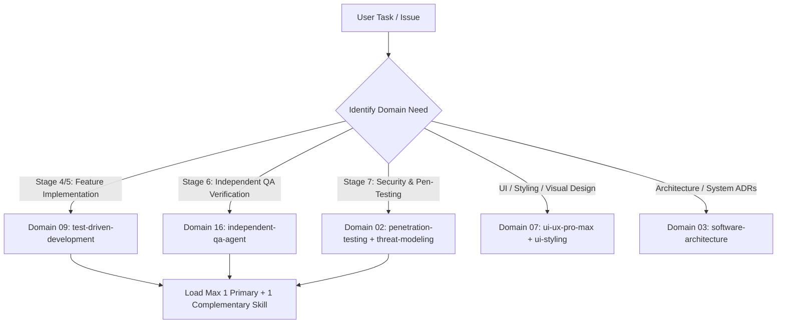

# SKILLS.md — Central Skill Registry & Selection Guide
# Universal Markdown Skills Framework (UMSF)

> Version: 1.2.0-enhanced  
> Total Skills Cataloged: 370 Across 16 Canonical Engineering Domains  
> Authority: Precedence Level 6 Discovery  

---

## 1. Skill Discovery & Selection Guidelines

When an AI coding agent receives a task, it must determine which specialized domain skill applies. Rather than loading the entire skills directory into context, agents consult this registry to select **only the primary skill** directly aligned with the active lifecycle stage, and at most **one complementary skill**.

### Skill Loading & Role Assignment Rules
1. **Single Primary Skill Default**: Load strictly 1 skill matching the immediate task goal.
2. **Two-Skill Maximum Limit**: Never load more than 2 skills simultaneously into working context (e.g. `test-driven-development` + `frontend-development`).
3. **Agent Role Alignment**:
   - **Agent A (Dev)**: Operates under Domain 01, 04, 05, 06, 07, 08, 09 (`test-driven-development`), 15.
   - **Agent B (Independent QA)**: Operates under Domain 09 (QA/Testing), Domain 12 (Code Review), Domain 13 (Performance), Domain 16 (`independent-qa-agent`).
   - **Agent C (Independent Security)**: Operates under Domain 02 (Security Engineering & Pen-Testing), Domain 16 (`independent-security-review-agent`).
4. **100% Self-Contained Markdown Intelligence**: All 370 skills are pure Markdown. Zero interactive search CLI or external installations required. For UI/UX design intelligence, agents and users directly consult the curated catalogs in [`skills/ui-ux-pro-max/references/styles-and-palettes.md`](./skills/ui-ux-pro-max/references/styles-and-palettes.md) (88 visual styles, 192 product palettes, 74 font pairings) and [`skills/ui-ux-pro-max/references/quick-reference.md`](./skills/ui-ux-pro-max/references/quick-reference.md) (119 UX guidelines).

---

## 2. The 16 Canonical Engineering Domains

### Domain 01 — Software Development Lifecycle (SDLC)
**Primary Agent Role**: `Agent A (Dev) & Team Lead`  
**Canonical Domain Directory**: [`skills/01-software-development-lifecycle/`](./skills/01-software-development-lifecycle/)  

| Skill Identifier | Direct Link | Primary Responsibility & Technical Focus |
|---|---|---|
| `planning` | [`skills/01-software-development-lifecycle/planning/SKILL.md`](./skills/01-software-development-lifecycle/planning/SKILL.md) | Actionable guidelines for decomposing complex features into atomic tasks and dependency-ordered execution roadmaps.  |

### Domain 02 — Security Engineering & Penetration Testing
**Primary Agent Role**: `Agent C (Independent Security Agent)`  
**Canonical Domain Directory**: [`skills/02-security-engineering/`](./skills/02-security-engineering/)  

| Skill Identifier | Direct Link | Primary Responsibility & Technical Focus |
|---|---|---|
| `security` | [`skills/02-security-engineering/security/SKILL.md`](./skills/02-security-engineering/security/SKILL.md) | Threat modeling, input sanitization, OWASP Top 10 mitigation, secure credential management, authentication, and authorization h... |
| `security-testing` | [`skills/02-security-engineering/security-testing/SKILL.md`](./skills/02-security-engineering/security-testing/SKILL.md) | Strategic planning, automation, and execution of comprehensive software security test suites across SAST, DAST, and CI/CD pipel... |
| `penetration-testing` | [`skills/02-security-engineering/penetration-testing/SKILL.md`](./skills/02-security-engineering/penetration-testing/SKILL.md) | Authorized, non-destructive penetration testing methodology, explicit scope verification, controlled proof-of-concept exploitat... |
| `web-application-security` | [`skills/02-security-engineering/web-application-security/SKILL.md`](./skills/02-security-engineering/web-application-security/SKILL.md) | Audit, defense, and remediation of OWASP Top 10 web vulnerabilities including XSS, CSRF, SSRF, path traversal, open redirects, ... |
| `api-security-testing` | [`skills/02-security-engineering/api-security-testing/SKILL.md`](./skills/02-security-engineering/api-security-testing/SKILL.md) | Audit, testing, and hardening of REST, GraphQL, and gRPC APIs against the OWASP API Security Top 10 including BOLA, BFLA, and m... |
| `vulnerability-assessment` | [`skills/02-security-engineering/vulnerability-assessment/SKILL.md`](./skills/02-security-engineering/vulnerability-assessment/SKILL.md) | Systematic vulnerability identification, CVE mapping, contextual risk scoring, and evidence collection across application archi... |
| `security-code-review` | [`skills/02-security-engineering/security-code-review/SKILL.md`](./skills/02-security-engineering/security-code-review/SKILL.md) | Static manual and automated code inspection for security anti-patterns, dangerous sinks, unsanitized inputs, and cryptographic ... |
| `threat-modeling` | [`skills/02-security-engineering/threat-modeling/SKILL.md`](./skills/02-security-engineering/threat-modeling/SKILL.md) | Structured architectural threat modeling using STRIDE / PASTA methodologies, trust boundary mapping, asset identification, and ... |
| `dependency-security-audit` | [`skills/02-security-engineering/dependency-security-audit/SKILL.md`](./skills/02-security-engineering/dependency-security-audit/SKILL.md) | Software composition analysis (SCA), auditing supply-chain vulnerabilities, lockfile integrity, dependency confusion, and licen... |
| `authentication-security` | [`skills/02-security-engineering/authentication-security/SKILL.md`](./skills/02-security-engineering/authentication-security/SKILL.md) | Implementation, audit, and hardening of authentication mechanisms, password hashing, session tokens, JWTs, and MFA workflows."  |
| `authorization-security` | [`skills/02-security-engineering/authorization-security/SKILL.md`](./skills/02-security-engineering/authorization-security/SKILL.md) | Design, implementation, and testing of robust access control, RBAC/ABAC models, IDOR prevention, and multi-tenant isolation."  |
| `vulnerability-management` | [`skills/02-security-engineering/vulnerability-management/SKILL.md`](./skills/02-security-engineering/vulnerability-management/SKILL.md) | End-to-end vulnerability management lifecycle: discovery, triage, contextual risk assessment, remediation tracking, and SLA enf... |
| `security-remediation-and-retesting` | [`skills/02-security-engineering/security-remediation-and-retesting/SKILL.md`](./skills/02-security-engineering/security-remediation-and-retesting/SKILL.md) | Surgical remediation of confirmed vulnerabilities, patch verification, regression security sweeps, and independent retest repor... |

### Domain 03 — Software Architecture & System Design
**Primary Agent Role**: `Principal Architect & Agent A`  
**Canonical Domain Directory**: [`skills/03-software-architecture-and-design/`](./skills/03-software-architecture-and-design/)  

| Skill Identifier | Direct Link | Primary Responsibility & Technical Focus |
|---|---|---|
| `software-architecture` | [`skills/03-software-architecture-and-design/software-architecture/SKILL.md`](./skills/03-software-architecture-and-design/software-architecture/SKILL.md) | Principles and workflows for high-level system design, layer separation, modularity, and Architectural Decision Records (ADRs).  |
| `architecture-decision-records` | [`skills/03-software-architecture-and-design/architecture-decision-records/SKILL.md`](./skills/03-software-architecture-and-design/architecture-decision-records/SKILL.md) | Capture architectural decisions as numbered ADR markdown files in docs/adr/ with context, alternatives considered, consequences... |

### Domain 04 — Requirements & Business Analysis
**Primary Agent Role**: `Agent A (Dev) & Product Analyst`  
**Canonical Domain Directory**: [`skills/04-requirements-and-business-analysis/`](./skills/04-requirements-and-business-analysis/)  

| Skill Identifier | Direct Link | Primary Responsibility & Technical Focus |
|---|---|---|
| `requirements-analysis` | [`skills/04-requirements-and-business-analysis/requirements-analysis/SKILL.md`](./skills/04-requirements-and-business-analysis/requirements-analysis/SKILL.md) | Structured intake, disambiguation, scoping, and acceptance criteria authoring for engineering requests.  |

### Domain 05 — Programming & Implementation
**Primary Agent Role**: `Agent A (Development Agent)`  
**Canonical Domain Directory**: [`skills/05-programming-and-implementation/`](./skills/05-programming-and-implementation/)  

| Skill Identifier | Direct Link | Primary Responsibility & Technical Focus |
|---|---|---|
| `debugging` | [`skills/05-programming-and-implementation/debugging/SKILL.md`](./skills/05-programming-and-implementation/debugging/SKILL.md) | Hypothesis-driven root cause analysis, reproduction scripts, diagnostic tracing, and verified remediation workflows.  |
| `refactoring` | [`skills/05-programming-and-implementation/refactoring/SKILL.md`](./skills/05-programming-and-implementation/refactoring/SKILL.md) | Systematic techniques for safely restructuring code to improve readability and maintainability without altering observable exte... |

### Domain 06 — Backend Engineering & Distributed Systems
**Primary Agent Role**: `Agent A (Backend Engineer)`  
**Canonical Domain Directory**: [`skills/06-backend-engineering/`](./skills/06-backend-engineering/)  

| Skill Identifier | Direct Link | Primary Responsibility & Technical Focus |
|---|---|---|
| `backend-development` | [`skills/06-backend-engineering/backend-development/SKILL.md`](./skills/06-backend-engineering/backend-development/SKILL.md) | Guidelines for maintainable, secure, and performant backend services, domain business logic, and data access.  |
| `api-development` | [`skills/06-backend-engineering/api-development/SKILL.md`](./skills/06-backend-engineering/api-development/SKILL.md) | Contract design, versioning, serialization, status codes, and security standards for REST, GraphQL, and gRPC APIs.  |
| `backend-patterns` | [`skills/06-backend-engineering/backend-patterns/SKILL.md`](./skills/06-backend-engineering/backend-patterns/SKILL.md) | Backend architecture patterns, API design, database optimization, and server-side best practices for Node.js, Express, and Next... |

### Domain 07 — Frontend Engineering & UI/UX Pro Max
**Primary Agent Role**: `Agent A (Frontend Engineer) & UI Designer`  
**Canonical Domain Directory**: [`skills/07-frontend-engineering/`](./skills/07-frontend-engineering/)  

| Skill Identifier | Direct Link | Primary Responsibility & Technical Focus |
|---|---|---|
| `frontend-development` | [`skills/07-frontend-engineering/frontend-development/SKILL.md`](./skills/07-frontend-engineering/frontend-development/SKILL.md) | Standards and actionable workflows for building accessible, responsive, high-performance UI components and client state archite... |
| `ui-ux-design` | [`skills/07-frontend-engineering/ui-ux-design/SKILL.md`](./skills/07-frontend-engineering/ui-ux-design/SKILL.md) | UI/UX design intelligence, design system token authoring, Swiss & Minimalism visual standards, accessibility compliance, and in... |
| `ui-ux-pro-max` | [`skills/07-frontend-engineering/ui-ux-pro-max/SKILL.md`](./skills/07-frontend-engineering/ui-ux-pro-max/SKILL.md) | UI/UX design intelligence for web, mobile, and desktop. This skill should be used when designing, building, reviewing, or fixin... |
| `design-system` | [`skills/07-frontend-engineering/design-system/SKILL.md`](./skills/07-frontend-engineering/design-system/SKILL.md) | Token architecture, component specifications, and slide generation. Three-layer tokens (primitive→semantic→component), CSS vari... |
| `ui-styling` | [`skills/07-frontend-engineering/ui-styling/SKILL.md`](./skills/07-frontend-engineering/ui-styling/SKILL.md) | Create beautiful, accessible user interfaces with shadcn/ui components (built on Radix UI + Tailwind), Tailwind CSS utility-fir... |
| `brand` | [`skills/07-frontend-engineering/brand/SKILL.md`](./skills/07-frontend-engineering/brand/SKILL.md) | Brand voice, visual identity, messaging frameworks, asset management, brand consistency. Activate for branded content, tone of ... |
| `banner-design` | [`skills/07-frontend-engineering/banner-design/SKILL.md`](./skills/07-frontend-engineering/banner-design/SKILL.md) | Design banners for social media, ads, website heroes, creative assets, and print. Multiple art direction options with optional ... |
| `slides` | [`skills/07-frontend-engineering/slides/SKILL.md`](./skills/07-frontend-engineering/slides/SKILL.md) | Create strategic HTML presentations with Chart.js, design tokens, responsive layouts, copywriting formulas, and contextual slid... |
| `design` | [`skills/07-frontend-engineering/design/SKILL.md`](./skills/07-frontend-engineering/design/SKILL.md) | Comprehensive design skill: brand identity, design tokens, UI styling, logo generation (55 styles, Gemini, Atlas Cloud, or MuAP... |

### Domain 08 — Database Engineering & Storage
**Primary Agent Role**: `Agent A & Data Architect`  
**Canonical Domain Directory**: [`skills/08-database-engineering/`](./skills/08-database-engineering/)  

| Skill Identifier | Direct Link | Primary Responsibility & Technical Focus |
|---|---|---|
| `database-design` | [`skills/08-database-engineering/database-design/SKILL.md`](./skills/08-database-engineering/database-design/SKILL.md) | Guidelines for relational and non-relational database schema design, normalization, indexing strategies, migrations, and query ... |
| `database-migrations` | [`skills/08-database-engineering/database-migrations/SKILL.md`](./skills/08-database-engineering/database-migrations/SKILL.md) | Database schema migrations, versioning, zero-downtime deployments, rollback strategies, and migration verification. |

### Domain 09 — Quality Assurance & Software Testing
**Primary Agent Role**: `Agent B (Independent QA Agent) & Agent A (TDD)`  
**Canonical Domain Directory**: [`skills/09-quality-assurance-and-testing/`](./skills/09-quality-assurance-and-testing/)  

| Skill Identifier | Direct Link | Primary Responsibility & Technical Focus |
|---|---|---|
| `testing` | [`skills/09-quality-assurance-and-testing/testing/SKILL.md`](./skills/09-quality-assurance-and-testing/testing/SKILL.md) | Comprehensive testing strategies, unit testing, integration boundaries, mock design, coverage expectations, and test reliabilit... |
| `test-driven-development` | [`skills/09-quality-assurance-and-testing/test-driven-development/SKILL.md`](./skills/09-quality-assurance-and-testing/test-driven-development/SKILL.md) | The canonical Test-Driven Development (TDD) engineering discipline: Red-Green-Refactor, automated test authoring first, edge ca... |
| `unit-testing` | [`skills/09-quality-assurance-and-testing/unit-testing/SKILL.md`](./skills/09-quality-assurance-and-testing/unit-testing/SKILL.md) | Isolation testing of individual functions, methods, and classes using deterministic mocks, clear boundary isolation, and the AA... |
| `integration-testing` | [`skills/09-quality-assurance-and-testing/integration-testing/SKILL.md`](./skills/09-quality-assurance-and-testing/integration-testing/SKILL.md) | Verification of interactions across service boundaries, database transactions, API contracts, inter-process messaging, and exte... |
| `system-testing` | [`skills/09-quality-assurance-and-testing/system-testing/SKILL.md`](./skills/09-quality-assurance-and-testing/system-testing/SKILL.md) | Holistic verification of the fully assembled application system, verifying end-to-end business workflows, configuration integri... |
| `end-to-end-testing` | [`skills/09-quality-assurance-and-testing/end-to-end-testing/SKILL.md`](./skills/09-quality-assurance-and-testing/end-to-end-testing/SKILL.md) | Automated end-to-end testing of user journeys across web browsers, mobile interfaces, and CLI workflows from start to finish."  |
| `regression-testing` | [`skills/09-quality-assurance-and-testing/regression-testing/SKILL.md`](./skills/09-quality-assurance-and-testing/regression-testing/SKILL.md) | Systematic regression test suite design, selective regression execution, impact analysis, and accumulation of bug-reproduction ... |
| `acceptance-testing` | [`skills/09-quality-assurance-and-testing/acceptance-testing/SKILL.md`](./skills/09-quality-assurance-and-testing/acceptance-testing/SKILL.md) | Verification of software against business requirements, Given-When-Then / BDD acceptance criteria, and stakeholder definition o... |
| `exploratory-testing` | [`skills/09-quality-assurance-and-testing/exploratory-testing/SKILL.md`](./skills/09-quality-assurance-and-testing/exploratory-testing/SKILL.md) | Structured, time-boxed, charter-driven exploratory testing, unscripted edge-case discovery, heuristic probing, and anomaly repo... |
| `test-automation` | [`skills/09-quality-assurance-and-testing/test-automation/SKILL.md`](./skills/09-quality-assurance-and-testing/test-automation/SKILL.md) | Architecture, implementation, and maintenance of deterministic, robust test automation frameworks across CI/CD environments."  |
| `test-coverage-analysis` | [`skills/09-quality-assurance-and-testing/test-coverage-analysis/SKILL.md`](./skills/09-quality-assurance-and-testing/test-coverage-analysis/SKILL.md) | Measurement, analysis, and optimization of code coverage metrics (statement, branch, function, line) to identify untested criti... |
| `mutation-testing` | [`skills/09-quality-assurance-and-testing/mutation-testing/SKILL.md`](./skills/09-quality-assurance-and-testing/mutation-testing/SKILL.md) | Evaluation of test suite efficacy through deliberate fault injection (mutants) to verify assertion rigor and eliminate weak tes... |
| `performance-testing` | [`skills/09-quality-assurance-and-testing/performance-testing/SKILL.md`](./skills/09-quality-assurance-and-testing/performance-testing/SKILL.md) | Benchmarking, latency profiling, throughput measurement, and bottleneck identification across API endpoints and UI render pipel... |
| `load-and-stress-testing` | [`skills/09-quality-assurance-and-testing/load-and-stress-testing/SKILL.md`](./skills/09-quality-assurance-and-testing/load-and-stress-testing/SKILL.md) | Concurrency testing, load curves, stress thresholds, breaking-point determination, and graceful degradation verification."  |
| `test-strategy-and-planning` | [`skills/09-quality-assurance-and-testing/test-strategy-and-planning/SKILL.md`](./skills/09-quality-assurance-and-testing/test-strategy-and-planning/SKILL.md) | Formulating comprehensive, risk-based test strategies, testing levels matrix, environment prerequisites, quality budgets, and r... |
| `test-data-management` | [`skills/09-quality-assurance-and-testing/test-data-management/SKILL.md`](./skills/09-quality-assurance-and-testing/test-data-management/SKILL.md) | Deterministic test data synthesis, seeders, factory patterns, sensitive data masking, state cleanup, and test isolation."  |
| `defect-management` | [`skills/09-quality-assurance-and-testing/defect-management/SKILL.md`](./skills/09-quality-assurance-and-testing/defect-management/SKILL.md) | Structured defect logging, reproduction workflows, severity/priority assignment, root cause analysis, and resolution verificati... |

### Domain 10 — DevOps, Containers & Infrastructure
**Primary Agent Role**: `DevOps / Platform Engineer`  
**Canonical Domain Directory**: [`skills/10-devops-and-infrastructure/`](./skills/10-devops-and-infrastructure/)  

| Skill Identifier | Direct Link | Primary Responsibility & Technical Focus |
|---|---|---|
| `docker-patterns` | [`skills/10-devops-and-infrastructure/docker-patterns/SKILL.md`](./skills/10-devops-and-infrastructure/docker-patterns/SKILL.md) | Docker and Docker Compose patterns for local development, hardened CLI installer harnesses, container security, networking, vol... |
| `kubernetes-patterns` | [`skills/10-devops-and-infrastructure/kubernetes-patterns/SKILL.md`](./skills/10-devops-and-infrastructure/kubernetes-patterns/SKILL.md) | Kubernetes workload patterns, resource management, RBAC, probes, autoscaling, ConfigMap/Secret handling, and kubectl debugging ... |

### Domain 11 — Reliability & Production Operations
**Primary Agent Role**: `SRE & Operations Lead`  
**Canonical Domain Directory**: [`skills/11-reliability-and-operations/`](./skills/11-reliability-and-operations/)  

| Skill Identifier | Direct Link | Primary Responsibility & Technical Focus |
|---|---|---|
| `canary-watch` | [`skills/11-reliability-and-operations/canary-watch/SKILL.md`](./skills/11-reliability-and-operations/canary-watch/SKILL.md) | Use this skill to monitor and verify a deployed URL after releases — checks HTTP endpoints, SSE streams, static assets, console... |

### Domain 12 — Code Quality, Review & Maintenance
**Primary Agent Role**: `Senior Reviewer & Agent B`  
**Canonical Domain Directory**: [`skills/12-code-quality-and-maintenance/`](./skills/12-code-quality-and-maintenance/)  

| Skill Identifier | Direct Link | Primary Responsibility & Technical Focus |
|---|---|---|
| `code-review` | [`skills/12-code-quality-and-maintenance/code-review/SKILL.md`](./skills/12-code-quality-and-maintenance/code-review/SKILL.md) | Systematic guidelines for evaluating pull requests and code modifications against clean code, security, performance, DRY, and S... |

### Domain 13 — Performance Engineering & Profiling
**Primary Agent Role**: `Performance Engineer & Agent B`  
**Canonical Domain Directory**: [`skills/13-performance-engineering/`](./skills/13-performance-engineering/)  

| Skill Identifier | Direct Link | Primary Responsibility & Technical Focus |
|---|---|---|
| `performance` | [`skills/13-performance-engineering/performance/SKILL.md`](./skills/13-performance-engineering/performance/SKILL.md) | Profiling methodologies, latency optimization, memory leak mitigation, algorithmic efficiency, and frontend bundle budgets.  |
| `benchmark-optimization-loop` | [`skills/13-performance-engineering/benchmark-optimization-loop/SKILL.md`](./skills/13-performance-engineering/benchmark-optimization-loop/SKILL.md) | Structured benchmarking loops, profile-guided optimization, latency measurements, and regression prevention. |

### Domain 14 — Project & Team Delivery Management
**Primary Agent Role**: `Delivery Manager`  
**Canonical Domain Directory**: [`skills/14-project-and-team-management/`](./skills/14-project-and-team-management/)  

| Skill Identifier | Direct Link | Primary Responsibility & Technical Focus |
|---|---|---|
| `counterparty-channel-discipline` | [`skills/14-project-and-team-management/counterparty-channel-discipline/SKILL.md`](./skills/14-project-and-team-management/counterparty-channel-discipline/SKILL.md) | Per-channel strict prompts, mention gating, silent observation, and a communication autonomy policy for agents that sit in shar... |

### Domain 15 — Documentation & Technical Writing
**Primary Agent Role**: `Technical Documentation Engineer`  
**Canonical Domain Directory**: [`skills/15-documentation-and-technical-communication/`](./skills/15-documentation-and-technical-communication/)  

| Skill Identifier | Direct Link | Primary Responsibility & Technical Focus |
|---|---|---|
| `documentation` | [`skills/15-documentation-and-technical-communication/documentation/SKILL.md`](./skills/15-documentation-and-technical-communication/documentation/SKILL.md) | Standards for authoring technical specifications, runbooks, architecture decision records, API documentation, and Markdown main... |
| `article-writing` | [`skills/15-documentation-and-technical-communication/article-writing/SKILL.md`](./skills/15-documentation-and-technical-communication/article-writing/SKILL.md) | Write articles, guides, blog posts, tutorials, newsletter issues, and other long-form content in a distinctive voice derived fr... |

### Domain 16 — AI Agent Engineering & Multi-Agent Systems
**Primary Agent Role**: `AI Agent Systems Architect & Coordinator`  
**Canonical Domain Directory**: [`skills/16-ai-agent-engineering/`](./skills/16-ai-agent-engineering/)  

| Skill Identifier | Direct Link | Primary Responsibility & Technical Focus |
|---|---|---|
| `agentic-engineering` | [`skills/16-ai-agent-engineering/agentic-engineering/SKILL.md`](./skills/16-ai-agent-engineering/agentic-engineering/SKILL.md) | Operate as an agentic engineer using eval-first execution, decomposition, and cost-aware model routing. Use when planning or ex... |
| `independent-qa-agent` | [`skills/16-ai-agent-engineering/independent-qa-agent/SKILL.md`](./skills/16-ai-agent-engineering/independent-qa-agent/SKILL.md) | Operational persona and protocols for an Independent AI Quality Assurance Agent: autonomous test execution, challenging Dev ass... |
| `independent-security-review-agent` | [`skills/16-ai-agent-engineering/independent-security-review-agent/SKILL.md`](./skills/16-ai-agent-engineering/independent-security-review-agent/SKILL.md) | Operational persona and protocols for an Independent AI Security Testing Agent: adversarial threat analysis, authorized vulnera... |
| `multi-agent-verification` | [`skills/16-ai-agent-engineering/multi-agent-verification/SKILL.md`](./skills/16-ai-agent-engineering/multi-agent-verification/SKILL.md) | Orchestration patterns for concurrent multi-agent collaboration: Dev -> QA -> Security handoff loops, consensus protocols, and ... |
| `adversarial-testing` | [`skills/16-ai-agent-engineering/adversarial-testing/SKILL.md`](./skills/16-ai-agent-engineering/adversarial-testing/SKILL.md) | Adversarial testing methodologies, fuzzing inputs, race conditions, edge-case abuse, and prompt injection hardening for AI and ... |
| `agent-handoff-and-review` | [`skills/16-ai-agent-engineering/agent-handoff-and-review/SKILL.md`](./skills/16-ai-agent-engineering/agent-handoff-and-review/SKILL.md) | Structured context handoff protocols, verification checklists, state persistence, and loss-free continuity across agent boundar... |
| `evidence-based-validation` | [`skills/16-ai-agent-engineering/evidence-based-validation/SKILL.md`](./skills/16-ai-agent-engineering/evidence-based-validation/SKILL.md) | Verification protocol requiring empirical proof (test execution logs, exit codes, diffs) before accepting completion claims."  |
| `agent-role-separation` | [`skills/16-ai-agent-engineering/agent-role-separation/SKILL.md`](./skills/16-ai-agent-engineering/agent-role-separation/SKILL.md) | Single-agent fallback protocols for clean role-switching passes, cognitive context wiping, distinct checklists, and bias elimin... |
| `autonomous-loops` | [`skills/16-ai-agent-engineering/autonomous-loops/SKILL.md`](./skills/16-ai-agent-engineering/autonomous-loops/SKILL.md) | Patterns and architectures for autonomous Claude Code loops — from simple sequential pipelines to RFC-driven multi-agent DAG sy... |
| `prompt-optimizer` | [`skills/16-ai-agent-engineering/prompt-optimizer/SKILL.md`](./skills/16-ai-agent-engineering/prompt-optimizer/SKILL.md) | Systematic prompt optimization, meta-prompting, few-shot tuning, structured output schemas, and prompt regression prevention. |
| `mcp-server-patterns` | [`skills/16-ai-agent-engineering/mcp-server-patterns/SKILL.md`](./skills/16-ai-agent-engineering/mcp-server-patterns/SKILL.md) | Model Context Protocol server design, tools, resources, prompt templates, transports, schema contracts, and test fixtures. |

---

## 3. Specialized Technology & Pattern Modules (ECC & Extensions)

The framework provides specialized domain modules for modern languages, cloud platforms, and distributed runtimes. Load selectively as technical stacks require:

- **Frontend Frameworks**: `react-patterns`, `nextjs-patterns`, `vue-patterns`, `svelte-patterns`, `angular-developer`, `tailwind-patterns`, `astro-patterns`
- **Backend Stacks**: `fastapi-patterns`, `graphql-patterns`, `grpc-patterns`, `django-patterns`, `spring-boot-patterns`, `microservices-patterns`
- **Database Engines**: `postgresql-patterns`, `mongodb-patterns`, `redis-patterns`, `vector-database-patterns`, `clickhouse-patterns`
- **Cloud & Infrastructure**: `terraform-patterns`, `aws-patterns`, `gcp-patterns`, `azure-patterns`, `serverless-patterns`
- **Languages & Runtimes**: `typescript-patterns`, `python-patterns`, `golang-patterns`, `rust-patterns`, `bun-runtime`

---

## 4. Recommended Multi-Agent Skill Combinations

| Lifecycle Phase | Active Agent Role | Primary Skill | Complementary Skill (Max 1) | Expected Deliverables |
|---|---|---|---|---|
| **Feature Implementation** | Agent A (Dev) | `test-driven-development` | `backend-development` / `frontend-development` | RED tests, minimal code, green test suite |
| **UI / Design Craftsmanship** | Agent A (Dev) | `frontend-development` | `ui-ux-pro-max` | Swiss tokens, WCAG AA, 44px hit targets |
| **Independent QA Audit** | Agent B (QA) | `independent-qa-agent` | `regression-testing` | `QA_ASSESSMENT.md`, regression sweep pass |
| **Threat Modeling** | Agent C (Security)| `threat-modeling` | `software-architecture` | `THREAT_MODEL.md` (STRIDE analysis) |
| **Penetration Testing** | Agent C (Security)| `penetration-testing` | `vulnerability-assessment` | `PENETRATION_TEST_REPORT.md` (non-destructive) |
| **Security Patching** | Agent A & C | `security-remediation-and-retesting` | `test-driven-development` | `RETEST_REPORT.md`, vulnerability closed |
| **Final Release Gate** | All Roles | `evidence-based-validation` | `acceptance-testing` | Four release gates verified |

---

## 5. Instructions for Creating New Skills
1. Choose the appropriate numbered engineering domain (`skills/01-...` through `skills/16-...`).
2. Create `skills/<domain>/<skill-name>/SKILL.md` using [`templates/SKILL.template.md`](./templates/SKILL.template.md).
3. Complete all **15 standard sections**. Do not omit sections.
4. Register in this registry (`SKILLS.md`) and in [`skills/README.md`](./skills/README.md).