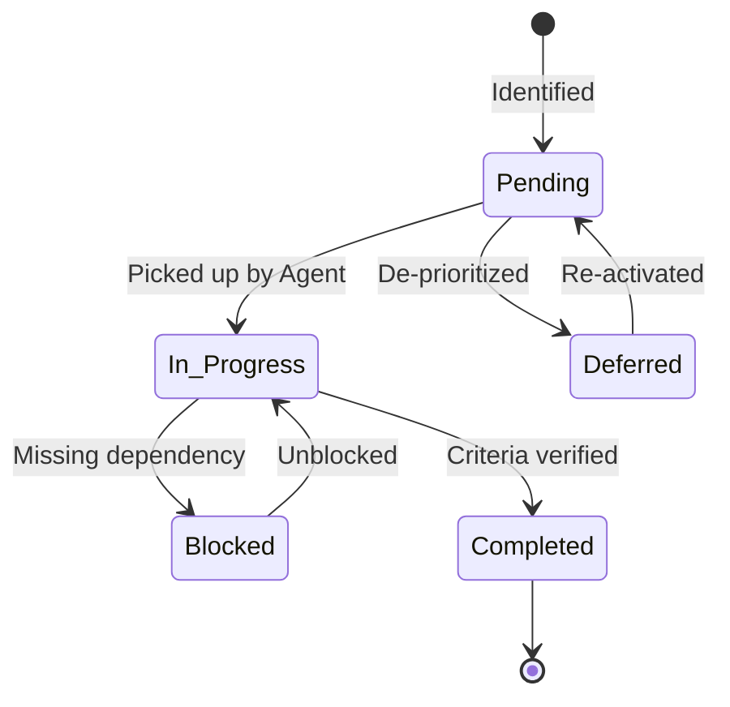

# TASKS.md — Project Task State Machine
# Universal Markdown Skills Framework (UMSF)

> Active Task Management, Prioritization, and State Tracking  
> Current Status: v1.4.0 Released (372 Skills Across 16 Domains)  
> Authority: Operational State (Precedence Level: Operational State Machine)  

---

## 1. Task State Machine & Transition Rules

---

## 2. Active Tasks by State

### In Progress
*(No tasks currently in progress. Independent Verification Subagent Architecture implemented and verified.)*

---

### Pending
*(No pending foundation tasks. Framework is at v1.4.0 Release state.)*

---

### Blocked
*(No tasks currently blocked.)*

---

### Deferred
- [ ] **TASK-DEF-001: Optional Provider-Specific Symlink Generators**
  - **Category**: Tooling (Optional)
  - **Description**: Optional scripts for automatically generating `.cursorrules` or `.windsurfrules` pointers to `AGENTS.md` for developers requesting automated symlinking.
  - **Rationale**: Postponed to preserve strict zero-dependency core; manual pointers documented in `AGENTS.md` Section 8 and `README.md` Section 6 are sufficient.
  - **Target Milestone**: v1.4.x

---

## 3. Completed Archive

- [x] **TASK-013: Independent Verification Subagent Architecture Implementation & Framework Integration**
  - **Completed Date**: 2026-11-03
  - **Deliverables**:
    - Authored canonical 15-section domain skill `skills/16-ai-agent-engineering/independent-verification-subagent/SKILL.md` (and dual-path root symlink `skills/independent-verification-subagent`).
    - Expanded physical skill library count to **372 unique skills** across 16 domains.
    - Formalized Agent A (Primary Development Agent) vs Agent B (Independent Verification Subagent) vs Agent C (Independent Security Agent) tripartite delegation.
    - Standardized 7-dimensional independent audit protocol: Requirements, Diff Sweep, Architecture, Code Quality, Independent Test Execution, Security Coordination, and Documentation.
    - Standardized 11-field defect finding schema across 7 severity tiers (Critical to Informational, False Positive, Not Tested).
    - Established bounded remediation lifecycle with `MAX_VERIFICATION_ITERATIONS = 3` to prevent infinite loops.
    - Codified Compilation Inadequacy Invariant (compilation alone is strictly insufficient for `VERIFIED`).
    - Formalized Mode 1 (concurrent isolated subagents) and Mode 2 (sequential single-agent role-switch) with mandatory honest attribution.
    - Defined tri-state final acceptance decisions: `VERIFIED`, `NEEDS REMEDIATION`, `BLOCKED / NOT VERIFIED`.
    - Ratified Architectural Decision Record `ADR-012` in `DECISIONS.md`.
    - Synchronized `AGENTS.md`, `RULES.md`, `WORKFLOW.md`, `SKILLS.md`, `skills/README.md`, `README.md`, `CONTEXT.md`, `CONTRIBUTING.md`, `CHANGELOG.md`, `MEMORY.md`, and `docs_agent/SESSION_LOG.md`.
    - Verified all 12 validation criteria with empirical testing proof (0 broken links, 0 machine-specific paths, 0 external dependencies).

- [x] **TASK-012: Comprehensive Framework Audit, Contradiction Resolution & Post-Task Verification Integration**
  - **Completed Date**: 2026-11-03
  - **Deliverables**:
    - Complete repository audit of all 371 skills, 16 domains, root files, and templates.
    - Resolved framework contradictions: replaced rigid two-skill limit with Dynamic Context-Aware Skill Loading; scoped release gates and testing proportionally to change risk.
    - Defined clear authority boundary triad in `RULES.md` (Platform Safety vs. Mandatory Framework Invariants vs. User Project Decisions).
    - Authored canonical 15-section domain skill `skills/12-code-quality-and-maintenance/post-task-verification/SKILL.md` (and dual-path root symlink `skills/post-task-verification`).
    - Expanded `WORKFLOW.md` to the 12-Stage Canonical Engineering Lifecycle with mandatory diff sweeps, requirement completeness audits, and revalidation.
    - Updated `AGENTS.md`, `RULES.md`, `SKILLS.md`, `CONTEXT.md`, and `README.md` to index all 371 skills with zero broken links.
    - Ratified ADR-011 in `DECISIONS.md`.
  - **Validation Evidence**: 371 unique physical skills verified; 393 links in `SKILLS.md` verified with 0 broken links; 100% relative paths; zero external dependencies.

- [x] **TASK-011: Strict Relative Link Portability & Elimination of Machine-Specific Absolute Paths**
  - **Completed Date**: 2026-11-03
  - **Deliverables**:
    - Eliminated all machine-specific absolute paths across all 82 files in the repository.
    - Converted 1,150+ internal file links across core governance files, 370 skills, templates, and documentation to exact POSIX relative paths.
    - Validated line 134 in `AGENTS.md` (`./TASKS.md`) and line 21 in `skills/ui-ux-pro-max/SKILL.md` (`./references/quick-reference.md`).
    - Codified Invariant 6 (Repository Portability & Relative Links Invariant) and anti-pattern entry in `RULES.md`.
    - Ratified ADR-010 in `DECISIONS.md`.
  - **Validation Evidence**: 0 occurrences of host-specific paths remain in repository files; 0 broken links in core framework files; 100% relative link resolution.

- [x] **TASK-010: Pure Markdown Skills Decoupling & Elimination of Interactive Search Dependency**
  - **Completed Date**: 2026-11-03
  - **Deliverables**:
    - Decoupled all 370 skills in `skills/` from external tools, plugins, and interactive search CLIs.
    - Compiled comprehensive, pure Markdown design intelligence reference catalog (`skills/ui-ux-pro-max/references/styles-and-palettes.md`) covering 88 visual styles, 192 product palettes, 74 font pairings, and 25 chart types.
    - Rewrote `skills/ui-ux-pro-max/SKILL.md` to be a 100% self-contained Markdown skill adhering to the UMSF schema, eliminating all `${CLAUDE_PLUGIN_ROOT}` and mandatory CLI execution calls.
    - Updated `skills/ui-ux-design/SKILL.md`, `skills/design/SKILL.md`, and `skills/frontend-development/SKILL.md` to reference pure Markdown catalogs.
    - Cleaned up ECC skills (`tdd-workflow`, `autonomous-loops`, `dmux-workflows`, `configure-ecc`, `plan-canvas`) to remove assumptions of external ECC checkouts or plugin roots.
    - Updated `RULES.md`, `WORKFLOW.md`, `SKILLS.md`, `CONTEXT.md`, `README.md`, and `MEMORY.md`.
    - Ratified ADR-009 in `DECISIONS.md`.
  - **Validation Evidence**: 100% of skills verified as self-contained Markdown; 0 broken links; zero external installations required for full skill operation.

- [x] **TASK-009: Advanced Testing, TDD & AI Security Engineering Enhancement**
  - **Completed Date**: 2026-11-03
  - **Deliverables**:
    - Scaffolding of 16 Canonical Engineering Domains under `skills/` with dual-path backward compatibility links.
    - Authored 35 new advanced skills across Category 02 (Security Engineering, 12 skills), Category 09 (QA & Testing, 16 skills), and Category 16 (AI Agent Engineering, 7 skills) in full 15-section UMSF schema.
    - Expanded skill library to 370 total skills indexed in `SKILLS.md`.
    - Mandatory TDD Red-Green-Refactor protocol codified in `RULES.md` and `WORKFLOW.md`.
    - Tripartite Agent Architecture (Dev, Independent QA, Independent Security) and Single-Agent Fallback (Mode 2) codified in `AGENTS.md` and `RULES.md`.
    - Authorized penetration testing boundaries and 10-stage vulnerability lifecycle codified.
    - Four-Tier Release Gates (Functional, Regression, Security, Documentation) codified in `RULES.md` and `WORKFLOW.md`.
    - Created 11 project testing and security templates in `templates/` (18 templates total).
    - Ratified ADR-008 in `DECISIONS.md`.
    - Updated `CONTEXT.md`, `CHANGELOG.md`, `MEMORY.md`, and authored `docs_agent/phases/ENHANCEMENT_REPORT.md` validating all 18 criteria.
  - **Validation Evidence**: 18/18 Acceptance Criteria evaluated and verified as PASS; 0 broken links; 100% standard library / zero external dependencies.

- [x] **TASK-008: Skills Expansion & UI/UX Pro Max System Integration**
  - **Completed Date**: 2026-11-03
  - **Deliverables**: Integrated complete UI/UX Pro Max design intelligence system (`skills/ui-ux-pro-max/`, `search.py` CLI, 20+ datasets in `data/`, 24 platform configs in `templates/`, references, plus 6 companion UI skills) and 313 specialized domain skills from ECC into `skills/`. Upgraded `SKILLS.md` registry with 3-tier catalog and search quickstarts. Enhanced foundational skills `ui-ux-design` and `frontend-development`. Ratified ADR-007.
  - **Validation Evidence**: 335 valid skills verified with 100% `SKILL.md` presence; local zero-dependency BM25 search CLI execution validated; zero broken internal links across the repository.

- [x] **TASK-007: Phase 7 — Release and Final Documentation**
  - **Completed Date**: 2026-11-03
  - **Deliverables**: Root `README.md` final release edition, `CONTRIBUTING.md`, `docs_agent/phases/PHASE_07_RELEASE.md`.
  - **Validation Evidence**: All 7 phases verified and documented; zero-dependency adoption verified for new and existing projects.

- [x] **TASK-006: Phase 6 — Compatibility and Cross-Agent Validation**
  - **Completed Date**: 2026-11-03
  - **Deliverables**: `docs_agent/COMPATIBILITY.md`, link integrity audit (489/489 links verified), edge-case recovery protocols, `docs_agent/phases/PHASE_06_COMPATIBILITY.md`.
  - **Validation Evidence**: Zero broken links across 46 files; non-intrusive adapter architecture verified.

- [x] **TASK-005: Phase 5 — Development Continuity System**
  - **Completed Date**: 2026-11-03
  - **Deliverables**: `TASKS.md`, `CHANGELOG.md`, `templates/TASKS.template.md`, `templates/SESSION.template.md`, `templates/DEVELOPMENT_REPORT.template.md`, `docs_agent/phases/PHASE_05_CONTINUITY.md`.
  - **Validation Evidence**: 5 explicit task states operational; chronological changelog published; complete 7-template suite verified.

- [x] **TASK-004: Phase 4 — Context and Memory System**
  - **Completed Date**: 2026-11-03
  - **Deliverables**: `CONTEXT.md`, `MEMORY.md`, `DECISIONS.md` (ADRs 001-006), `templates/CONTEXT.template.md`, `templates/MEMORY.template.md`, `templates/DECISIONS.template.md`, `docs_agent/phases/PHASE_04_CONTEXT_MEMORY.md`.
  - **Validation Evidence**: Tripartite separation verified; zero fabricated facts in `CONTEXT.md`; immutable ADR ledger ratified.

- [x] **TASK-003: Phase 3 — Reusable Skills System**
  - **Completed Date**: 2026-11-03
  - **Deliverables**: `SKILLS.md`, `skills/README.md`, `templates/SKILL.template.md`, 15 canonical domain skills in `skills/*/SKILL.md`, `docs_agent/phases/PHASE_03_SKILLS.md`.
  - **Validation Evidence**: 100% of skills validated against 15-section schema and YAML frontmatter; UI/UX Pro Max intelligence codified in `ui-ux-design` and `frontend-development`.

- [x] **TASK-002: Phase 2 — Universal Instruction System**
  - **Completed Date**: 2026-11-02
  - **Deliverables**: `RULES.md`, `WORKFLOW.md`, `AGENTS.md` (upgraded to 1.0.0-phase2), `docs_agent/phases/PHASE_02_INSTRUCTIONS.md`.
  - **Validation Evidence**: 7-tier precedence hierarchy and Conflict Resolution Matrix codified; UI/UX Pro Max invariants elevated to Precedence Level 2.

- [x] **TASK-001: Phase 1 — Foundation and Architecture**
  - **Completed Date**: 2026-11-02
  - **Deliverables**: `LICENSE`, `README.md`, `AGENTS.md` (initial), `docs_agent/ARCHITECTURE.md`, 15 skill directory trees, `docs_agent/phases/PHASE_01_FOUNDATION.md`.
  - **Validation Evidence**: 18 directories scaffolded; zero executable dependencies; Swiss/Minimalist design architecture codified.
