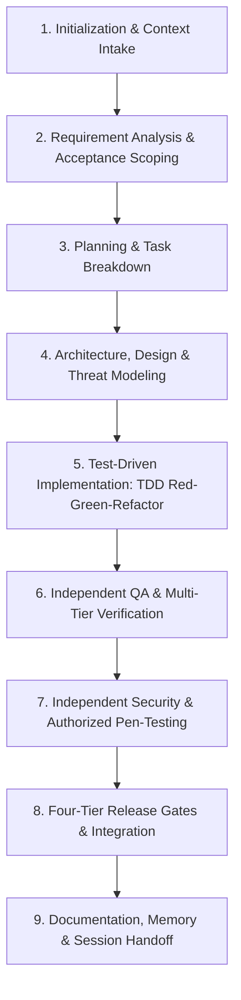

# WORKFLOW.md — Standard Development Lifecycle
# Universal Markdown Skills Framework (UMSF)

> Version: 1.0.0  
> Scope: Universal / All Agents & Contributors  
> Authority: Operational Lifecycle Standard (Precedence Level 5)  

---

## 1. Overview & Principles

This document defines the canonical 9-stage engineering lifecycle governing all tasks executed under the Universal Markdown Skills Framework. Every feature, bug fix, refactoring effort, or architectural modification must advance through these structured gates.

---

## 2. The Nine Lifecycle Stages

### Stage 1: Project Initialization & Context Intake
- **Goal**: Align the AI agent with the verified reality of the repository before executing commands or modifying code.
- **Protocol**:
  1. Follow the 10-step initialization procedure in [`AGENTS.md`](./AGENTS.md).
  2. Inspect [`RULES.md`](./RULES.md) for mandatory safety, TDD, and security boundaries.
  3. Read [`CONTEXT.md`](./CONTEXT.md) to understand current architecture, available test runners, and active technology stacks.
  4. Consult [`TASKS.md`](./TASKS.md) to locate pending or assigned tasks.
- **Exit Gate**: The agent can cite verified codebase facts and active constraints without making assumptions.

---

### Stage 2: Requirement Analysis & Acceptance Scoping
- **Goal**: Deconstruct user requests into unambiguous technical objectives, acceptance criteria, and explicit non-goals.
- **Protocol**:
  1. Load domain skill: [`skills/requirements-analysis/SKILL.md`](./skills/requirements-analysis/SKILL.md).
  2. For frontend/UI features, identify:
     - Target audience and device contexts (mobile, desktop, hybrid).
     - Interaction model (forms, dashboards, real-time widgets, data tables).
     - Accessibility criteria (WCAG AA 4.5:1, screen reader flows, keyboard shortcuts).
  3. Formulate positive, negative, boundary, and edge test scenarios.
  4. If core requirements are ambiguous, clarify with the user before writing code.
- **Exit Gate**: A clearly scoped problem definition with verifiable acceptance criteria.

---

### Stage 3: Planning & Task Breakdown
- **Goal**: Transform requirements into an atomic, dependency-ordered execution plan incorporating TDD cycles.
- **Protocol**:
  1. Load domain skill: [`skills/planning/SKILL.md`](./skills/planning/SKILL.md).
  2. Update [`TASKS.md`](./TASKS.md):
     - Transition selected tasks from `Pending` to `In Progress`.
     - Decompose large tasks into subtasks with verifiable milestones.
     - Schedule automated test creation ahead of feature implementation.
  3. Determine file dependencies to ensure edits are isolated and non-conflicting.
- **Exit Gate**: Documented task sequence in `TASKS.md` with explicit TDD completion indicators.

---

### Stage 4: Architecture, Design & Threat Modeling
- **Goal**: Ensure changes preserve system modularity, prevent technical debt, conform to UI standards, and identify security threats early.
- **Protocol**:
  1. Check [`DECISIONS.md`](./DECISIONS.md) to verify alignment with settled Architectural Decision Records.
  2. For backend/services, verify layer separation (transport, business domain, persistence).
  3. **Threat Modeling & Security Review**:
     - Load [`skills/threat-modeling/SKILL.md`](./skills/threat-modeling/SKILL.md).
     - Analyze data flows, trust boundaries, authentication, authorization, and sensitive assets.
  4. **For UI / Frontend Development (UI/UX Pro Max Integration)**:
     - Load [`skills/ui-ux-design/SKILL.md`](./skills/ui-ux-design/SKILL.md) or [`skills/frontend-development/SKILL.md`](./skills/frontend-development/SKILL.md).
     - Consult Markdown design catalogs: [`skills/ui-ux-pro-max/references/styles-and-palettes.md`](./skills/ui-ux-pro-max/references/styles-and-palettes.md) and [`skills/ui-ux-pro-max/references/quick-reference.md`](./skills/ui-ux-pro-max/references/quick-reference.md) (100% self-contained; zero interactive CLI or external installations required).
     - Review design token alignments:
       - Style: Minimalism & Swiss Style.
       - Colors: Primary `#0F172A`, Accent `#22C55E`, Canvas `#020617`, Cards `#0E1223`, Borders `#334155`.
       - Typography: IBM Plex Sans + JetBrains Mono.
       - Layout: Mobile-first responsive hierarchy (`375px`, `768px`, `1024px`, `1440px`).
- **Exit Gate**: Architecture, threat model, and UI design system validated against repository rules.

---

### Stage 5: Test-Driven Implementation (TDD Red-Green-Refactor)
- **Goal**: Implement features strictly following the Red-Green-Refactor discipline.
- **Protocol**:
  1. Load domain skills: [`skills/test-driven-development/SKILL.md`](./skills/test-driven-development/SKILL.md) plus relevant implementation skills (e.g. `skills/backend-development/`, `skills/frontend-development/`).
  2. **RED Phase**:
     - Write automated unit and integration tests capturing positive, negative, and edge scenarios.
     - Execute test runner: confirm tests fail specifically because feature code is absent (not syntax or environment failure).
  3. **GREEN Phase**:
     - Author the minimal implementation code necessary to satisfy failing tests.
     - Execute test runner: confirm tests pass with zero regressions.
  4. **REFACTOR Phase**:
     - Clean code, remove duplication, and optimize architecture while maintaining test suite green.
- **Exit Gate**: Feature implemented with passing automated tests and zero compiler/linter warnings.

---

### Stage 6: Independent QA Verification & Multi-Tier Testing
- **Goal**: Rigorous, independent verification by the QA Agent across all testing levels.
- **Protocol**:
  1. In multi-agent mode, assign **Agent B (Independent QA Agent)**; in single-agent mode, switch role to QA pass.
  2. Load domain skills: [`skills/independent-qa-agent/SKILL.md`](./skills/independent-qa-agent/SKILL.md), [`skills/regression-testing/SKILL.md`](./skills/regression-testing/SKILL.md), [`skills/system-testing/SKILL.md`](./skills/system-testing/SKILL.md).
  3. Verify test coverage, challenge Dev Agent assumptions, and run full test suites independently.
  4. Perform functional, integration, system, and regression runs.
  5. **UI & Accessibility Audit**:
     - Validate text contrast ≥ 4.5:1.
     - Validate interactive targets ≥ 44×44px.
     - Check focus rings and keyboard-only navigation.
     - Verify zero horizontal scrolling across 375px, 768px, 1024px, 1440px.
- **Exit Gate**: Independent QA verification signed off; Functional and Regression release gates satisfied.

---

### Stage 7: Independent Security Engineering & Authorized Penetration Testing
- **Goal**: Adversarial security evaluation, vulnerability discovery, and remediation verification.
- **Protocol**:
  1. In multi-agent mode, assign **Agent C (Independent Security Agent)**; in single-agent mode, switch role to Security pass.
  2. Load domain skills: [`skills/independent-security-review-agent/SKILL.md`](./skills/independent-security-review-agent/SKILL.md), [`skills/penetration-testing/SKILL.md`](./skills/penetration-testing/SKILL.md), [`skills/vulnerability-assessment/SKILL.md`](./skills/vulnerability-assessment/SKILL.md).
  3. Verify explicit penetration testing authorization boundaries (target scope, permitted endpoints, non-destructive tools).
  4. Conduct OWASP-oriented security testing: Authentication, Authorization (IDOR/BOLA), Injection, SSRF, XSS, API security, and Dependency supply-chain.
  5. Log confirmed vulnerabilities in `docs_agent/security/VULNERABILITY_REGISTER.md`.
  6. Remediate findings and execute mandatory independent retests.
- **Exit Gate**: Zero unresolved Critical or High vulnerabilities; Security release gate satisfied.

---

### Stage 8: Four-Tier Release Gates & Integration Verification
- **Goal**: Final evidence-backed check against all mandatory release gates before marking release-ready.
- **Protocol**:
  1. Check **Functional Gate**: All acceptance criteria validated with passing tests.
  2. Check **Regression Gate**: Existing test suites pass with zero regressions.
  3. Check **Security Gate**: Threat model complete, vulnerability retests passed, zero open Critical/High items.
  4. Check **Documentation Gate**: Status, test logs, and ADRs recorded.
- **Exit Gate**: All four release gates verified with verifiable evidence.

---

### Stage 9: Documentation, Memory & Session Handoff
- **Goal**: Persist technical discoveries, architectural lessons, updated project context, and produce an actionable handoff to guarantee multi-agent continuity.
- **Protocol**:
  1. If codebase architecture or dependencies changed, update [`CONTEXT.md`](./CONTEXT.md).
  2. If new lessons, recurring pitfalls, or non-obvious integration patterns were discovered, append to [`MEMORY.md`](./MEMORY.md).
  3. If an architectural decision was finalized or superseded, append a formal record to [`DECISIONS.md`](./DECISIONS.md).
  4. Log meaningful changes in [`CHANGELOG.md`](./CHANGELOG.md).
  5. Update [`TASKS.md`](./TASKS.md), moving finished items from `In Progress` to `Completed`.
  6. Update [`docs_agent/SESSION_LOG.md`](./docs_agent/SESSION_LOG.md) summarizing:
     - Requested objectives and tasks.
     - Inspected files and verification points.
     - Implemented changes and fixes.
     - Files modified or created.
     - Tests and checks executed.
     - Remaining work or recommended next steps.
  7. Present a clear, concise summary to the user.
- **Exit Gate**: Project documentation, memory, tasks, and session handoffs updated with verifiable evidence.

---

## 3. Workflow Adaptation by Task Category

| Task Category | Accelerated Workflow Path | Mandatory Stages |
|---------------|---------------------------|------------------|
| **Major Feature** | Full 9-Stage Lifecycle | Stages 1 through 9 |
| **UI / Frontend Page** | UI Design Lifecycle Focus | Stages 1, 2, 4 (Design System), 5 (Craftsmanship), 6 (A11y/Responsive), 7, 8, 9 |
| **Bug Fix / Patch** | Rapid Diagnostic Lifecycle | Stages 1, 2, 5 (Fix), 6 (Regression Test), 8, 9 |
| **Refactoring** | Safe Transformation Lifecycle | Stages 1, 3, 4, 5, 6 (Test Invariance), 7, 8, 9 |
| **Documentation Only** | Lightweight Intake | Stages 1, 5 (Doc Edit), 8, 9 |

