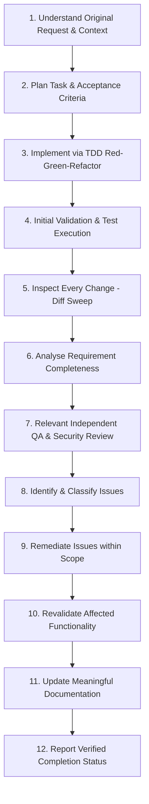

# WORKFLOW.md — Standard Development Lifecycle
# Universal Markdown Skills Framework (UMSF)

> Version: 1.3.0  
> Scope: Universal / All Agents & Contributors  
> Authority: Operational Lifecycle Standard (Precedence Level 5)  

---

## 1. Overview & Principles

This document defines the canonical **12-stage engineering lifecycle** governing all tasks executed under the Universal Markdown Skills Framework. Every feature, bug fix, refactoring effort, or architectural modification must advance through these structured gates.

### Core Principles
1. **Evidence-Based Delivery**: A task must never be marked `Completed` unless its applicable acceptance criteria have been verified with empirical proof (diff inspection, test results, exit code 0).
2. **Risk-Proportionate Rigor**: Verification depth must match change risk. Do not impose unnecessary dynamic penetration tests or full system regressions on unrelated low-risk changes (e.g. documentation typos or standalone CSS tweaks).
3. **Honest Status Reporting**: If a defect or blocker cannot be resolved within authorized scope, report it transparently and retain an incomplete or blocked state (`In Progress` or `Blocked`). Never claim unverified success.
4. **Dynamic Context-Aware Skill Loading**: Load all relevant domain skills required to complete a task effectively, guided by working context budgets rather than arbitrary fixed limits.

---

## 2. The Twelve Lifecycle Stages

### Stage 1: Understand the Original Request & Context Intake
- **Goal**: Align the AI agent with the verified reality of the prompt and codebase before modifying files or executing state-altering commands.
- **Protocol**:
  1. Follow the 10-step initialization procedure in [`AGENTS.md`](./AGENTS.md).
  2. Inspect [`RULES.md`](./RULES.md) for mandatory safety, coding standards, and security boundaries.
  3. Read [`CONTEXT.md`](./CONTEXT.md) to understand current architecture, dependencies, and available tooling.
  4. Consult [`TASKS.md`](./TASKS.md) to verify existing roadmap state.
- **Exit Gate**: The agent can cite verified codebase reality and user acceptance criteria without unverified assumptions.

---

### Stage 2: Plan the Task & Acceptance Criteria Breakdown
- **Goal**: Decompose user requests into atomic, dependency-ordered technical subtasks with verifiable acceptance criteria.
- **Protocol**:
  1. Load relevant planning skills: [`skills/01-software-development-lifecycle/planning/SKILL.md`](./skills/01-software-development-lifecycle/planning/SKILL.md) and [`skills/04-requirements-and-business-analysis/requirements-analysis/SKILL.md`](./skills/04-requirements-and-business-analysis/requirements-analysis/SKILL.md).
  2. Update [`TASKS.md`](./TASKS.md): Transition selected task to `In Progress`.
  3. Formulate positive, negative, boundary, and edge-case acceptance scenarios.
  4. For UI/UX tasks, define Swiss/Minimalist design tokens, WCAG AA contrast targets, and responsive breakpoints (`375px`, `768px`, `1024px`, `1440px`).
  5. If core requirements are ambiguous, clarify with the user before implementing.
- **Exit Gate**: Documented task sequence in `TASKS.md` with verifiable acceptance criteria.

---

### Stage 3: Implement via Test-Driven Development (TDD)
- **Goal**: Author minimal, high-quality implementation code satisfying requirements through Red-Green-Refactor discipline.
- **Protocol**:
  1. Load applicable implementation skills: [`skills/09-quality-assurance-and-testing/test-driven-development/SKILL.md`](./skills/09-quality-assurance-and-testing/test-driven-development/SKILL.md) plus domain skills (e.g. backend, frontend, database).
  2. **RED Phase**: Write failing unit or integration tests covering acceptance criteria. Execute test runner and confirm tests fail for expected behavioral reasons.
  3. **GREEN Phase**: Write minimal code necessary to make failing tests pass.
  4. **REFACTOR Phase**: Clean code structure, eliminate redundancy, and verify maintainability while keeping tests green.
- **Exit Gate**: Feature implemented with passing automated tests and zero compiler/linter warnings.

---

### Stage 4: Perform Initial Validation & Local Test Execution
- **Goal**: Execute the local test suite, linter, and build pipeline to verify primary code correctness.
- **Protocol**:
  1. Run project-specific test runners (`pytest`, `npm test`, `go test`, `cargo test`).
  2. Inspect test output directly; confirm exit code 0.
  3. Verify that test assertions are substantive and not mocked into trivial pass-throughs.
- **Exit Gate**: Direct execution evidence confirming passing tests on new implementation code.

---

### Stage 5: Inspect Every Change (Diff & Inventory Sweep)
- **Goal**: Review all working tree modifications at line-level granularity before proceeding to review.
- **Protocol**:
  1. Load [`skills/12-code-quality-and-maintenance/post-task-verification/SKILL.md`](./skills/12-code-quality-and-maintenance/post-task-verification/SKILL.md).
  2. Run `git status -s` to inspect all tracked, untracked, and modified paths.
  3. Run `git diff` and audit every added, modified, renamed, or deleted line.
  4. Ensure no unwanted temporary files, scratch scripts, or debug print statements remain.
- **Exit Gate**: Complete inventory of touched files audited line-by-line.

---

### Stage 6: Analyse Requirement Completeness
- **Goal**: Map every item in the original user prompt to implemented lines of code and tests.
- **Protocol**:
  1. Cross-reference prompt requirements against inspected diffs.
  2. Verify that edge cases, boundary conditions, and non-functional requirements are fulfilled.
  3. Confirm that no explicit user constraint was relaxed or omitted.
- **Exit Gate**: 100% of applicable user acceptance criteria verified as satisfied.

---

### Stage 7: Perform Relevant Independent QA & Security Review
- **Goal**: Conduct risk-proportionate quality assurance and security reviews to eliminate developer confirmation bias.
- **Protocol**:
  1. **Mode 1 (Multi-Agent)**: Engage dedicated **Agent B (Independent QA)** and **Agent C (Independent Security)** subagents.
  2. **Mode 2 (Single-Agent Fallback)**: Execute distinct sequential role-switching passes with fresh checklists.
  3. **Risk-Proportionate Review Scope**:
     - **Low Risk** (Docs, comments, isolated UI styling): Static linting, link verification, visual QA.
     - **Medium Risk** (Business logic, state handling, migrations): Integration review, regression sweep, static security audit.
     - **High Risk** (Auth, crypto, payments, public APIs, core framework): Threat modeling ([`threat-modeling`](./skills/02-security-engineering/threat-modeling/SKILL.md)), authorized non-destructive penetration testing ([`penetration-testing`](./skills/02-security-engineering/penetration-testing/SKILL.md)), OWASP checks.
- **Exit Gate**: Independent QA and Security assessments completed proportionally to risk.

---

### Stage 8: Identify and Classify Issues
- **Goal**: Triage any defects, security weaknesses, regression risks, or broken links discovered during review.
- **Protocol**:
  1. Classify discovered issues by severity: **Critical** (blocker), **Major** (functional defect), **Minor** (edge case / style), or **Informational**.
  2. Document root causes and affected files.
- **Exit Gate**: Issues triaged with explicit severity ratings and actionable reproduction steps.

---

### Stage 9: Remediate Issues Within Authorized Scope
- **Goal**: Apply targeted, surgical corrections to resolve identified issues.
- **Protocol**:
  1. Author failing regression tests reproducing the defect.
  2. Implement surgical code or documentation fixes.
  3. Strictly avoid unrequested scope creep or architectural churn during remediation.
- **Exit Gate**: Remediation implemented and ready for revalidation.

---

### Stage 10: Revalidate Affected Functionality & Regression Sweep
- **Goal**: Prove that remediated code resolves the defect without introducing secondary regressions.
- **Protocol**:
  1. Rerun test suite for remediated components.
  2. Execute regression suites across adjacent modules.
  3. If security weaknesses were remediated, execute mandatory security retests ([`security-remediation-and-retesting`](./skills/02-security-engineering/security-remediation-and-retesting/SKILL.md)).
- **Exit Gate**: Passing retest evidence with zero regressions confirmed.

---

### Stage 11: Update Meaningful Documentation
- **Goal**: Synchronize all documentation with verified codebase reality using portable relative paths.
- **Protocol**:
  1. Update [`CONTEXT.md`](./CONTEXT.md) if system architecture, dependencies, or modules changed.
  2. Update [`CHANGELOG.md`](./CHANGELOG.md) recording chronological release entries under standard SemVer.
  3. Record newly discovered pitfalls, edge cases, or testing conventions in [`MEMORY.md`](./MEMORY.md).
  4. If an architectural decision was reached or superseded, record an immutable ADR in [`DECISIONS.md`](./DECISIONS.md).
  5. Verify that all internal links are strictly relative (POSIX `./...` or `../...`) with zero broken references.
- **Exit Gate**: Project documentation and memory updated with zero broken links.

---

### Stage 12: Report Verified Completion Status
- **Goal**: Provide transparent, evidence-based reporting and update task state machine.
- **Protocol**:
  1. Evaluate release criteria against verified evidence:
     - If all acceptance criteria pass: Mark task `Completed` in [`TASKS.md`](./TASKS.md).
     - If any unresolved defect, dependency blocker, or incomplete criterion remains: Retain `In Progress` or move to `Blocked` in [`TASKS.md`](./TASKS.md). Report the blocker honestly to the user.
  2. Update [`docs_agent/SESSION_LOG.md`](./docs_agent/SESSION_LOG.md) summarizing objectives, inspected files, changes made, test results, and next steps.
  3. Present a clear, concise summary citing actual executed commands and evidence.
- **Exit Gate**: Accurate task state recorded in `TASKS.md` with transparent, verifiable reporting.

---

## 3. Risk-Proportionate Workflow Adaptation

| Risk Tier | Typical Scope | Applicable Lifecycle Stages | Required Reviews |
|---|---|---|---|
| **Low Risk** | Documentation updates, typo corrections, comments, isolated CSS design token tweaks | Stages 1, 2, 3 (or direct doc edit), 4 (linter), 5, 6, 11, 12 | Developer self-audit + linter/link verification |
| **Medium Risk** | New feature implementation, UI component logic, schema migrations, non-auth backend endpoints | Stages 1 through 6, 7 (QA Review + Static Security), 8, 9, 10, 11, 12 | Independent QA verification + regression sweep |
| **High Risk** | Authentication, authorization, payments, cryptography, public API endpoints, core framework invariants | Full 12-Stage Lifecycle (Stages 1 through 12 mandatory) | Dedicated QA verification + adversarial penetration test + security retest |

---

## 4. Task Completion Invariants

1. **No Evidence, No Completion**: A task must never be transitioned to `Completed` without inspectable verification evidence (test execution output, git diff verification, exit code 0).
2. **Transparent Incompletion**: If an issue cannot be resolved within the current scope or requires user authorization, the task must remain `In Progress` or `Blocked`.
3. **Preservation of User Isolation**: In user projects adopting UMSF, test reports and execution artifacts are stored in the user's project `/docs_agent/` directory, keeping framework templates clean.
