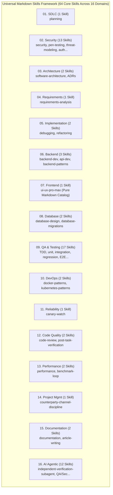

# ECC (Everything Claude Code) Integration Registry & Capability Mapping
# Universal Markdown Skills Framework (UMSF)

> Version: 1.6.0  
> Date of Inspection: 2026-11-07  
> Upstream Repository: [affaan-m/everything-claude-code](https://github.com/affaan-m/everything-claude-code)  
> Upstream Revision (SHA): `b38be6a7f6350964d59328b52f0624e1d1d552d1` (Commit Date: 2026-10-29)  
> Upstream License: MIT License (Copyright (c) 2026 Affaan Mustafa)  
> Governance Authority: `enhancement.md` (ECC Skill Research, Analysis & Integration Specification)  

---

## 1. Executive Summary

This document serves as the canonical integration registry and evaluation ledger for the selective research, analysis, and adaptation of capabilities from the **Everything Claude Code (ECC)** ecosystem into the **Universal Markdown Skills Framework (UMSF)**.

### Architectural Policy
Per Section 1 and Section 4 of `enhancement.md`:
- **Selective Adaptation, Not Wholesale Import**: Wholesale copying of 300+ fragmented skills, CLI daemons, shell scripts, and vendor plugins into UMSF was evaluated and rejected. UMSF maintains a streamlined catalog of **64 high-cohesion domain skills** across 16 Canonical Engineering Domains, plus the canonical `ui-ux-pro-max` suite.
- **Strict Zero-Dependency, Pure Markdown Architecture**: All mandatory Node.js packages, Python execution daemons, SQLite databases, hooks, and MCP servers were excluded from runtime dependencies. Reusable engineering principles were extracted into provider-independent, CommonMark-compliant Markdown documentation.
- **Provider Independence**: Capabilities originally designed for Claude-specific configurations (`.claude/`, `${CLAUDE_PLUGIN_ROOT}`, Claude hooks) were adapted into universal specifications compatible with any AI coding agent (Claude Code, Cursor, Antigravity, OpenAI Codex, Windsurf, Gemini CLI, Copilot).

---

## 2. High-Value ECC Capabilities Evaluation (Categories A–F)

### Category A: Agent Engineering & Orchestration
| Capability | ECC Source Path | UMSF Destination / Action | Classification | Technical Rationale & Adaptation |
|---|---|---|:---:|---|
| **Independent Verification Subagent** | `agents/verifier.md`, `skills/verification-loop` | `skills/16-ai-agent-engineering/independent-verification-subagent/` | **ADAPT** | Adapted into full 7-dimensional independent audit protocol (Requirements, Diff Sweep, Architecture, Code Quality, Test Execution, Security Coordination, Documentation). |
| **Agent Role Separation** | `agents/code-reviewer.md`, `agents/architect.md` | `skills/16-ai-agent-engineering/agent-role-separation/` | **ADAPT** | Codified Tripartite Logical Roles (Agent A Dev, Agent B Verification, Agent C Security) with mandatory honest attribution in single-agent fallback mode. |
| **Agent Handoff & Review** | `agents/` workflow transitions | `skills/16-ai-agent-engineering/agent-handoff-and-review/` | **ADAPT** | Codified structured briefing contracts between development and verification passes. |
| **Autonomous Multi-Agent Loops** | `skills/autonomous-loops/` | `skills/16-ai-agent-engineering/autonomous-loops/` | **ADAPT** | Converted loop execution schemas and DAG orchestration patterns into pure Markdown instructions with bounded iteration limits (`MAX_ITERATIONS = 3`). |
| **Subagent Team Daemons** | `plugins/team-builder/`, shell scripts | Excluded from runtime | **REJECT** | Required background node daemons and platform-specific IPC; replaced by harness-agnostic subagent delegation instructions. |

### Category B: Development Engineering & Lifecycle
| Capability | ECC Source Path | UMSF Destination / Action | Classification | Technical Rationale & Adaptation |
|---|---|---|:---:|---|
| **Research-First Development** | `skills/research/`, `workflows/research-plan.md` | `skills/01-software-development-lifecycle/planning/` | **MERGE** | Integrated mandatory research phase into Stage 1 of `WORKFLOW.md` and `planning` skill before authoring code or tests. |
| **Test-Driven Development (TDD)** | `skills/tdd-workflow/` | `skills/09-quality-assurance-and-testing/test-driven-development/` | **MERGE** | Codified mandatory RED-GREEN-REFACTOR protocol across all 16 domains as Precedence Level 2 repository invariant in `RULES.md`. |
| **Refactoring & Code Smells** | `skills/refactor/` | `skills/05-programming-and-implementation/refactoring/` | **MERGE** | Enhanced existing UMSF `refactoring` skill with Martin Fowler catalog of smell-elimination patterns. |
| **Debugging & Root-Cause Analysis** | `skills/systematic-debugging/` | `skills/05-programming-and-implementation/debugging/` | **MERGE** | Embedded 4-stage root cause hypothesis testing and minimal failing reproduction requirement. |
| **Regression Prevention** | `skills/ai-regression-testing/` | `skills/09-quality-assurance-and-testing/regression-testing/` | **MERGE** | Codified persistent retention of defect regression tests and diff-sweep verification. |

### Category C: Context, Memory & Continuous Learning
| Capability | ECC Source Path | UMSF Destination / Action | Classification | Technical Rationale & Adaptation |
|---|---|---|:---:|---|
| **Session Summaries & Handoffs** | `contexts/session-summaries.md` | `docs_agent/SESSION_LOG.md`, `TASKS.md` | **ADAPT** | Formalized multi-session state persistence in `docs_agent/SESSION_LOG.md` without external cloud storage. |
| **Persistent Memory Extraction** | `skills/unified-memory/`, `rules/memory.md` | `MEMORY.md`, `DECISIONS.md` | **ADAPT** | Tripartite separation of verified system reality (`CONTEXT.md`), lessons learned (`MEMORY.md`), and immutable architectural decisions (`DECISIONS.md`). |
| **Continuous Learning from Mistakes** | `skills/continuous-learning-v2/` | `MEMORY.md` Known Pitfalls Table | **ADAPT** | Extracted pitfall catalog and error-prevention heuristics into pure Markdown tables; excluded SQLite database daemons. |
| **Context Window Economy** | `skills/strategic-compact/` | `AGENTS.md` Dynamic Skill Loading | **ADAPT** | Replaced indiscriminate skill loading with Dynamic Context-Aware Skill Loading guided by lifecycle stage. |

### Category D: Quality Assurance, Testing & Delivery Gates
| Capability | ECC Source Path | UMSF Destination / Action | Classification | Technical Rationale & Adaptation |
|---|---|---|:---:|---|
| **Post-Task Verification Gate** | `commands/verify.md`, `workflows/verification.md` | `skills/12-code-quality-and-maintenance/post-task-verification/` | **ADAPT** | Codified 15-dimensional delivery checklist and mandatory git diff review before closing tasks. |
| **Evidence-Based Validation** | `skills/evidence-based-validation/` | `skills/16-ai-agent-engineering/evidence-based-validation/` | **ADAPT** | Codified Compilation Inadequacy Invariant: compilation is strictly insufficient; terminal test outputs and exit code 0 are mandatory. |
| **Multi-Tier Release Gates** | `rules/release-gates.md` | `RULES.md` Section 9, `WORKFLOW.md` Stage 12 | **ADAPT** | Enforced 4-tier release gates (Functional, Regression, Security, Documentation) scoped proportionally to change risk. |
| **Automated Test Matrix** | Specialized test runners | `skills/09-quality-assurance-and-testing/` (17 skills) | **MERGE** | Integrated unit, integration, system, E2E, mutation, load, and exploratory testing into Domain 09. |

### Category E: Security Engineering & Penetration Testing
| Capability | ECC Source Path | UMSF Destination / Action | Classification | Technical Rationale & Adaptation |
|---|---|---|:---:|---|
| **Independent Security Review Agent** | `agents/security-reviewer.md` | `skills/16-ai-agent-engineering/independent-security-review-agent/` | **ADAPT** | Established adversarial persona for Agent C, threat modeling, and authorized penetration testing. |
| **Authorized Penetration Testing** | `skills/penetration-testing/` | `skills/02-security-engineering/penetration-testing/` | **MERGE** | Codified strict authorization boundaries, non-destructive proof-of-concept tests, zero credential exfiltration. |
| **Secret Detection & Boundary Defense** | `rules/security.md` | `RULES.md` Section 3, Section 14 | **ADAPT** | Codified mandatory pre-commit secret scans, environment variable isolation, and `.env` protection. |
| **Prompt Injection Defense** | `the-security-guide.md` | `skills/02-security-engineering/security/` | **MERGE** | Embedded prompt injection taxonomy, indirect prompt injection risks, and untrusted tool observation sanitization. |

### Category F: Performance Engineering & Optimization
| Capability | ECC Source Path | UMSF Destination / Action | Classification | Technical Rationale & Adaptation |
|---|---|---|:---:|---|
| **Performance Profiling & Latency** | `skills/performance/` | `skills/13-performance-engineering/performance/` | **MERGE** | Integrated latency budgeting, CPU/memory profiling heuristics, and algorithmic complexity checks. |
| **Benchmark Optimization Loops** | `skills/benchmark-optimization-loop/` | `skills/13-performance-engineering/benchmark-optimization-loop/` | **ADAPT** | Standardized iterative baseline benchmarking and regression comparison loops. |
| **Token Sizing Optimization** | `skills/token-budget-advisor/` | `SKILLS.md` Selection Guidelines | **ADAPT** | Formulated context window stewardship guidelines to prevent token exhaustion during multi-agent workflows. |

---

## 3. Classification of All Evaluated Components

### A. Adopted Capabilities (Adapted directly to UMSF schema)
- `independent-verification-subagent` (Domain 16)
- `post-task-verification` (Domain 12)
- `evidence-based-validation` (Domain 16)
- `agent-role-separation` (Domain 16)
- `multi-agent-verification` (Domain 16)
- `adversarial-testing` (Domain 16)
- `agent-handoff-and-review` (Domain 16)
- `autonomous-loops` (Domain 16)
- `prompt-optimizer` (Domain 16)
- `mcp-server-patterns` (Domain 16)
- `benchmark-optimization-loop` (Domain 13)
- `counterparty-channel-discipline` (Domain 14)
- `article-writing` (Domain 15)
- `canary-watch` (Domain 11)
- `docker-patterns` (Domain 10)
- `kubernetes-patterns` (Domain 10)

### B. Adapted Capabilities (Architecturally transformed to provider-independence)
- Claude-specific hook automation -> Transformed into universal Markdown lifecycle gates in `WORKFLOW.md`.
- Claude-specific agent definitions (`.claude/agents/*.md`) -> Transformed into Tripartite Agent Roles in `AGENTS.md` and Domain 16 skills.
- Custom Claude commands (`/verify`, `/test`, `/review`) -> Transformed into standard Markdown checklists and test execution protocols.
- Plugin manifests and platform configurations -> Transformed into UMSF 1-line adapter pointers in `AGENTS.md` Section 9.

### C. Merged Capabilities (Enriched pre-existing UMSF foundational skills)
- `skills/planning`: Enriched with Research-First development workflows from ECC.
- `skills/security`: Enriched with prompt injection defenses, secret detection, and adversarial threat modeling.
- `skills/testing`: Enriched with mandatory TDD Red-Green-Refactor, automated test runners, and coverage analysis.
- `skills/software-architecture`: Enriched with ADR templates and clean architecture boundaries.
- `skills/debugging`: Enriched with systematic 4-phase root-cause isolation.
- `skills/refactoring`: Enriched with incremental code transformation and smell elimination catalogs.
- `skills/performance`: Enriched with latency budgets and benchmark optimization loops.

### D. Referenced Capabilities (Kept as documentation patterns, not copied)
- Upstream ECC documentation guides (`the-longform-guide.md`, `the-security-guide.md`, `the-shortform-guide.md`): Used as conceptual reference for architectural best practices.

### E. Rejected Capabilities (Intentionally excluded from UMSF)
- **287 Specialized Technology Modules**: (e.g. `angular-developer`, `django-patterns`, `fastapi-templates`, `solana-program-development`, `x-api`, `bengali-nlp`, `blender-motion-state-inspection`, etc.).
  - *Reason for Rejection*: Bulk-importing hundreds of framework-specific or domain-niche skills created severe context window bloat, maintenance fragility, and contradicted UMSF's focus on high-cohesion core engineering disciplines. Technology-specific coding is natively handled by LLM foundation models when governed by UMSF's core architectural, testing, and security skills.
- **Node.js, npm & Bun Dependencies**:
  - `package.json`, `node_modules`, `yarn.lock`, npm build scripts across ECC root and subdirectories.
  - *Reason for Rejection*: Violates UMSF Invariant 1 (Zero External Dependencies, Markdown-Only Core Architecture).
- **Python Runtime Daemons & SQLite Databases**:
  - `ecc_dashboard.py`, SQLite databases in `continuous-learning-v2`, background watchers.
  - *Reason for Rejection*: Violates local-first, zero-runtime daemon invariant.
- **Harness-Specific Claude Desktop Hooks & Binary Scripts**:
  - Shell scripts (`install.sh`, `install.ps1`, hooks).
  - *Reason for Rejection*: Violates cross-agent universal portability.

---

## 4. License, Attribution & Third-Party Notice

### MIT License Attribution
The adaptations documented herein derive in part from the **Everything Claude Code (ECC)** project:
- **Project**: Everything Claude Code (ECC)
- **Repository**: [https://github.com/affaan-m/everything-claude-code](https://github.com/affaan-m/everything-claude-code)
- **Author/Copyright**: Copyright (c) 2026 Affaan Mustafa
- **License**: MIT License
- **Source Revision**: `b38be6a7f6350964d59328b52f0624e1d1d552d1` (2026-10-29)

### UMSF Intellectual Attribution Statement
In strict adherence to Section 5 of `enhancement.md`:
1. UMSF does not present adapted ECC concepts as entirely original authoring.
2. All adapted skills preserve upstream attribution headers and reference paths in their respective `## Attribution` sections.
3. Upstream copyright notices are fully recognized and respected.
4. UMSF's unique contribution is the provider-independent, zero-dependency, Markdown-only unification of these capabilities into a standardized 15-section schema and 16 Canonical Engineering Domains.

---

## 5. UMSF 16-Domain Streamlined Architecture

Following this integration and cleanup, UMSF operates with exactly **64 Core Domain Skills across 16 Domains**, plus the canonical `ui-ux-pro-max` suite:

---

## 6. Recommendations for Future Review
1. **Periodic Upstream Monitoring**: Inspect upstream ECC releases quarterly for novel prompting patterns, tool definitions, or agent coordination techniques.
2. **Selective Extraction Only**: Continue enforcing the ban on bulk skill imports; only adapt high-leverage architectural patterns into the existing 16 domains.
3. **Preserve Zero-Dependency Invariant**: Never adopt upstream components that require background runtimes, databases, or build chains.

