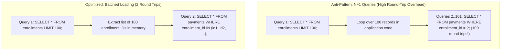

# Skill: Database Query Optimization & Performance Engineering

> Canonical UMSF Domain Skill Specification adhering to the standard schema.  
> Category: Domain 08 — Database Engineering  
> Status: Level 1 MVP-First Active Specification  

---

## 1. Metadata
- **Identifier**: `database-query-optimization`
- **Category**: Database Engineering (Domain 08)
- **Authority**: UMSF Canonical Skill Library (Precedence Level 6)
- **Maintainer**: Universal Markdown Skills Framework
- **Level 3 References**:
  - [`references/n-plus-one-patterns-and-orm-recipes.md`](./references/n-plus-one-patterns-and-orm-recipes.md)
  - [`references/execution-plan-and-indexing-guide.md`](./references/execution-plan-and-indexing-guide.md)

---

## 2. MVP Summary (Level 1 Execution Contract)

- **Purpose**: Analyze and optimize database queries, ORM operations, execution plans, and data-access patterns to eliminate N+1 round trips, reduce latency, and prevent over-fetching while strictly preserving data correctness.
- **When to Use**: Reviewing or writing database queries, optimizing slow API endpoints, diagnosing N+1 query patterns, tuning indexes, or refactoring ORM relationship loading.
- **Essential Invariants**:
  1. Optimization must NEVER compromise query correctness, transaction boundaries, or tenant isolation.
  2. Detect and eliminate N+1 queries using batch loading (`IN (...)`), SQL joins, or ORM eager loading (`selectinload` / `joinedload`).
  3. Avoid `SELECT *` on wide tables; project only required columns and enforce bounded pagination (keyset/cursor or indexed limit/offset).
- **Minimal Workflow**:
  1. Profile application data access to capture executed queries, query counts, and execution durations.
  2. Identify N+1 queries, queries inside loops, sequential table scans, or unindexed filters.
  3. Apply targeted optimization: batch fetching, relationship eager loading, index creation, or projection pruning.
  4. Inspect execution plan (`EXPLAIN ANALYZE`) where supported to verify index utilization and scan cost reduction.
  5. Re-run functional and regression test suites to prove 100% behavioral preservation (exit code 0).
- **Expected Deliverables**: Verified database query optimizations, before-and-after query count/latency measurements, and passing regression test suites.
- **Critical Restrictions**: Never add indexes without verifying query predicates and write overhead; never substitute bulk operations that bypass essential model-level validation hooks without authorization; never execute unparameterized dynamic SQL.

> ℹ️ **Progressive Context Loading**:
> For standard engineering tasks, this **Level 1 MVP Summary** provides the complete operational contract.
> If deep procedures, ORM-specific recipes, or execution plan diagnostics are required, proceed to **Level 2 — Core Instructions** below.

---

## Level 2 — Core Instructions & Deep Procedures

### 3. Detailed Purpose & Data-Access Scope
Data-access layers frequently become the primary performance bottleneck in software applications:
- Applications issue hundreds of sequential database queries in loops (the classic N+1 anti-pattern).
- Massive datasets are fetched over the network into application memory merely to compute a count or sum.
- Queries execute full table scans because database columns lack appropriate composite indexes.
- Unbounded `SELECT *` queries retrieve megabytes of unneeded text and binary blobs.
- Transactions remain open across external network calls, causing lock contention and connection starvation.

This skill establishes empirical, scientific methodologies for analyzing, optimizing, and verifying database queries across both raw SQL and modern ORM systems.

---

### 4. N+1 Query Detection & Prevention



#### 4.1 Root Cause & Symptoms
The N+1 problem occurs when an application executes 1 initial query to retrieve $N$ parent records, and then executes an additional query for *each* parent record to fetch its child relationship. For 100 parent records, this causes 101 database round trips.

#### 4.2 Solution Strategies
1. **SQL JOIN (`joinedload`)**: Single query combining parent and child tables via `LEFT JOIN` or `INNER JOIN`. Recommended for 1:1 or 1:Many with low cardinality.
2. **Batched Subquery / IN Loading (`selectinload`)**: Two queries: one for parent records, and one for children matching `WHERE parent_id IN (...)`. Recommended for 1:Many with high cardinality or Many-to-Many relationships to prevent duplicate row multiplication.
3. **Database-Side Aggregation**: Compute metrics directly in SQL using `COUNT()` or `SUM()` with `GROUP BY` when child records are needed solely for summary statistics.

---

### 5. Query Optimization Strategies

#### 5.1 Query Count Reduction
- **No Queries Inside Loops**: Never invoke database queries, ORM lookups, or RPC calls inside loop iterations.
- **Batch Lookups**: Collect all required entity IDs and issue a single batched query with `WHERE id IN (...)`.
- **In-Memory Hash Maps**: Index retrieved child records into a lookup dictionary (`Map<ParentId, List<Child>>`) in application memory to associate records in $O(1)$ time.

#### 5.2 Column Projection (Avoid `SELECT *`)
- Avoid unbounded `SELECT *` on wide tables, especially tables containing `TEXT`, `JSONB`, or `BLOB` columns.
- Use explicit projection: `SELECT id, status, total_amount FROM orders`.
- In ORMs, use partial column loading (e.g. `load_only()` in SQLAlchemy, `select` in Prisma).

#### 5.3 Eager vs Lazy Loading
- **Accidental Lazy Loading Trap**: Accessing un-eagerly-loaded relationship properties inside serialization loops or templates triggers implicit synchronous database queries.
- **Enforce Explicit Loading**: In async applications (FastAPI, Node.js), configure ORMs to raise errors on un-loaded relationships (e.g. SQLAlchemy `raiseload('*')`) to catch N+1 defects during automated testing.

---

### 6. Batch Operations & Bulk Processing

| Operation | Individual Loop (Anti-Pattern) | Batch Equivalent (Optimal) | Performance Gain |
|---|---|---|---|
| **Bulk Insert** | Loop with 1,000 `INSERT INTO ...` | Multi-row `INSERT INTO ... VALUES (...), (...)` | ~10x to 50x faster |
| **Bulk Update** | Loop with 1,000 `UPDATE ... WHERE id = ?` | `UPDATE ... FROM (VALUES ...) AS v` or `CASE` | ~5x to 20x faster |
| **Bulk Upsert** | Check existence then insert/update | `INSERT INTO ... ON CONFLICT (id) DO UPDATE` | Atomic, zero race conditions |

*Caution*: ORM bulk operations (e.g. `bulk_insert_mappings`) bypass standard model lifecycle hooks and validation. Verify that model invariants are enforced manually before executing raw bulk statements.

---

### 7. Pagination & Aggregation Optimization

#### 7.1 The Offset Pagination Bottleneck
- Standard `LIMIT 50 OFFSET 100000` forces the database engine to scan and discard 100,000 rows on disk before returning 50 rows ($O(N)$ degradation).
- Avoid `SELECT COUNT(*)` on multi-million row tables on every paginated request.

#### 7.2 Keyset / Cursor Pagination ($O(1)$)
- Seek directly to the last observed boundary value using an indexed column:
  ```sql
  SELECT id, title, created_at
  FROM items
  WHERE (created_at, id) < (:last_created_at, :last_id)
  ORDER BY created_at DESC, id DESC
  LIMIT 50;
  ```

#### 7.3 Database-Side Aggregation
- Never fetch 50,000 rows into application memory to calculate an average or sum in Python or JavaScript.
- Delegate calculations to the database engine:
  ```sql
  SELECT customer_id, COUNT(*) AS total_orders, SUM(total_amount) AS revenue
  FROM orders
  WHERE status = 'completed'
  GROUP BY customer_id;
  ```

---

### 8. Index Optimization & Selective Index Design
- **Index Selectivity**: An index is effective only when it filters out a large majority of rows. Columns with low cardinality (e.g. a boolean `is_active`) should not be indexed alone.
- **The Equality-First Rule for Composite Indexes**: When queries filter by equality and range/order:
  $$\text{Index Columns} = (\text{Equality Columns}, \text{Range / Order Columns})$$
- **Covering Indexes (`INCLUDE`)**: Add projected columns to the index payload so the query engine never reads heap pages (enabling 100% `Index Only Scan`).
- **Partial Indexes**: Index only active rows (`WHERE status = 'pending'`) to save index storage and eliminate write overhead on completed historical rows.

---

### 9. Query Execution Plan Analysis (`EXPLAIN ANALYZE`)
Where database access is available in testing or staging environments:
1. Run `EXPLAIN (ANALYZE, BUFFERS)` to obtain actual execution times and buffer hits/reads.
2. Check for unexpected **Sequential Scans (`Seq Scan`)** on large tables.
3. Compare planner estimates (`rows=...`) with actual rows (`actual rows=...`). Significant divergences indicate stale optimizer statistics (resolved via `ANALYZE table_name;`).
4. Inspect join algorithms: verify that large table joins use Hash or Merge joins rather than unindexed Nested Loops.

---

### 10. Database Transaction & Concurrency Optimization
- **Minimize Lock Duration**: Never make external HTTP calls, send emails, or execute slow cryptographic operations inside an active database transaction.
- **Deterministic Lock Ordering**: When acquiring locks on multiple resources, always sort resource IDs in ascending order to prevent deadlocks.
- **Connection Pool Tuning**: Configure pool sizes, connection timeouts, and max overflow based on service concurrency limits. Always ensure connections are released in `finally` blocks.

---

### 11. Performance Measurement Protocol
Before and after applying optimizations, record empirical metrics:

| Metric | Measurement Technique | Goal |
|---|---|---|
| **Query Count** | ORM SQL logging or test listener (e.g. `assert_max_queries`) | Drop from $O(N)$ to $O(1)$. |
| **Execution Duration** | Query timing / application profiling | Statistically significant latency reduction. |
| **Database Round Trips** | Network trace or query counter | Minimize network latency penalties. |
| **Rows Fetched vs Processed** | Application memory profiling | 1:1 ratio (zero over-fetching). |

---

### 12. Query Correctness & Regression Verification Gate
A query optimization that alters returned data is a defect, not an optimization:
1. **Result Set Equivalence**: Original and optimized queries must return the exact same rows, ordering, and field values.
2. **Boundary Testing**: Verify behavior with 0 records (empty parent), 1 record, and thousands of records.
3. **Null Handling**: Verify that outer joins handle null children identically to original ORM relationship access.
4. **Tenant Isolation**: Verify that optimized queries preserve `WHERE tenant_id = ?` filters on all joined tables.

---

### 13. The 14-Category Finding Classification Taxonomy
When auditing data-access layers, classify findings using the standard taxonomy:

1. `N_PLUS_ONE_QUERY`: Repeated queries executed inside loops for related child entities.
2. `EXCESSIVE_QUERY_COUNT`: Redundant or duplicated queries executed within a single request context.
3. `INEFFICIENT_JOIN`: Missing join condition, accidental Cartesian product, or unindexed nested loop join.
4. `OVER_FETCHING`: Query retrieves unneeded columns (`SELECT *`) or loads deep relationship graphs unnecessarily.
5. `MISSING_INDEX`: Table scan executed on frequently filtered or joined foreign key column.
6. `UNNECESSARY_INDEX`: Duplicate or unused index degrading table write throughput.
7. `SLOW_QUERY`: Query execution time exceeds latency budget (e.g. > 100ms).
8. `INEFFICIENT_PAGINATION`: High-offset scan forcing full table iteration instead of keyset seek.
9. `INEFFICIENT_AGGREGATION`: In-memory calculation of metrics that should execute database-side.
10. `TRANSACTION_ISSUE`: Long-lived transaction holding locks across external I/O operations.
11. `CONCURRENCY_ISSUE`: Missing optimistic/pessimistic lock resulting in lost updates or deadlocks.
12. `ORM_LOADING_ISSUE`: Accidental lazy loading in async context or unobserved relationship queries.
13. `QUERY_CORRECTNESS_REGRESSION`: Optimization alters returned row count, order, or data values.
14. `UNVERIFIED_PERFORMANCE`: Optimization claims improvement without empirical measurement proof.

---

## Level 3 — Optional References & Supplementary Assets
- [`references/n-plus-one-patterns-and-orm-recipes.md`](./references/n-plus-one-patterns-and-orm-recipes.md) — Concrete recipes for SQLAlchemy 2.x, Prisma, Drizzle, and Django ORM batch relationship loading.
- [`references/execution-plan-and-indexing-guide.md`](./references/execution-plan-and-indexing-guide.md) — In-depth guide to interpreting `EXPLAIN ANALYZE` node types, scan algorithms, composite indexes, and keyset pagination.

