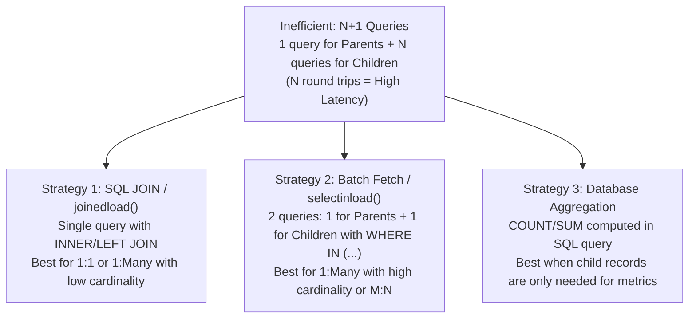

# N+1 Prevention Patterns & ORM Data-Access Recipes (Level 3 Reference)
# Universal Markdown Skills Framework (UMSF)

> Version: 1.8.0  
> Authority: Level 3 Optional Reference Asset for `database-query-optimization`  
> Domain: 08 — Database Engineering  

---

## 1. Overview
This reference asset provides concrete code recipes for preventing N+1 queries, optimizing relationship loading, and implementing high-throughput batch operations across major ORM frameworks: SQLAlchemy 2.x (Python), Prisma (TypeScript), Drizzle (TypeScript), and Django ORM (Python). Load this document when refactoring ORM data-access layers.

---

## 2. N+1 Problem & Solution Matrix



---

## 3. SQLAlchemy 2.x Async Recipes

### 3.1 The N+1 Anti-Pattern (Implicit or Loop Queries)
```python
# ANTI-PATTERN: Generates 1 + N queries
result = await session.execute(select(Author))
authors = result.scalars().all()

for author in authors:
    # Query inside loop!
    books_res = await session.execute(select(Book).where(Book.author_id == author.id))
    author_books = books_res.scalars().all()
```

### 3.2 Recipe: `selectinload` for One-to-Many / Many-to-Many
Executes exactly 2 queries: one for parents, and one using `WHERE author_id IN (...)` for all related children:
```python
from sqlalchemy.orm import selectinload

stmt = select(Author).options(selectinload(Author.books)).order_by(Author.name)
result = await session.execute(stmt)
authors = result.scalars().all()

for author in authors:
    # Zero additional queries; relationship is already populated
    print(f"{author.name}: {len(author.books)} books")
```

### 3.3 Recipe: `joinedload` for Many-to-One / One-to-One
Executes a single SQL query using an outer join:
```python
from sqlalchemy.orm import joinedload

stmt = select(Book).options(joinedload(Book.author)).where(Book.published_year >= 2020)
result = await session.execute(stmt)
books = result.scalars().unique().all()
```

### 3.4 Recipe: Safe Partial Column Loading (`load_only`)
Avoid loading heavy text/JSON columns when only a few fields are needed:
```python
from sqlalchemy.orm import load_only

stmt = select(User).options(load_only(User.id, User.email, User.username))
result = await session.execute(stmt)
users = result.scalars().all()
```

---

## 4. Prisma (TypeScript) Recipes

### 4.1 Recipe: Nested `include` / `select`
```typescript
// Efficient single multi-table join or batched lookup
const authorsWithBooks = await prisma.author.findMany({
  take: 50,
  select: {
    id: true,
    name: true,
    books: {
      select: {
        id: true,
        title: true,
        price: true,
      },
    },
  },
});
```

### 4.2 Recipe: Batch Insertion (`createMany`)
```typescript
// Inserts 1,000 records in a single multi-row SQL INSERT statement
await prisma.auditLog.createMany({
  data: logEntries,
  skipDuplicates: true,
});
```

---

## 5. Drizzle ORM (TypeScript) Recipes

### 5.1 Recipe: Relational Query API with `with`
```typescript
const users = await db.query.users.findMany({
  columns: { id: true, name: true, email: true },
  with: {
    posts: {
      columns: { id: true, title: true },
      limit: 5,
    },
  },
});
```

---

## 6. Django ORM (Python) Recipes

### 6.1 `select_related` vs `prefetch_related`
- **`select_related`**: Uses SQL `JOIN`. Use for single-valued relationships (`ForeignKey`, `OneToOneField`).
  ```python
  orders = Order.objects.select_related('customer', 'shipping_address').filter(status='pending')
  ```
- **`prefetch_related`**: Uses separate batch queries with `IN (...)`. Use for multi-valued relationships (`ManyToManyField`, reverse `ForeignKey`).
  ```python
  authors = Author.objects.prefetch_related('books__categories').all()
  ```

