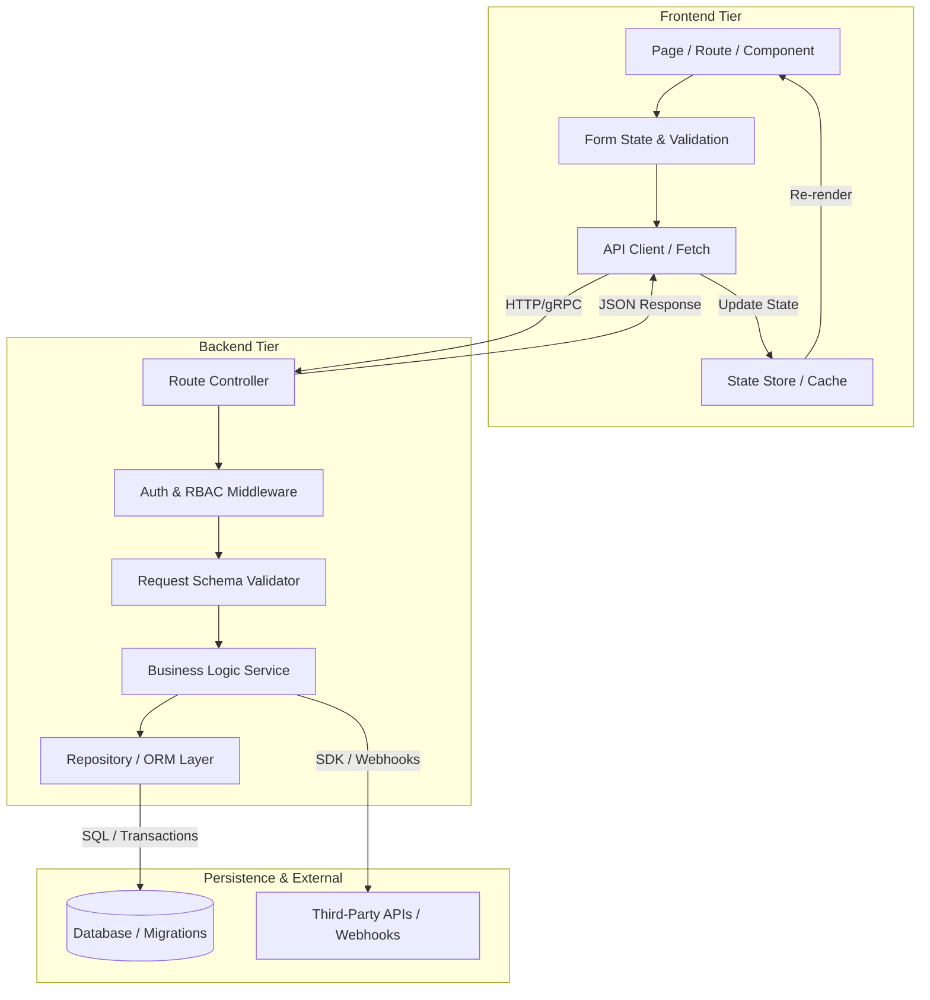

# Skill: Feature Integration & End-to-End Consistency Verification

> Canonical UMSF Domain Skill Specification adhering to the standard schema.  
> Category: Domain 09 — Quality Assurance & Testing  
> Status: Level 1 MVP-First Active Specification  

---

## 1. Metadata
- **Identifier**: `feature-integration-verification`
- **Category**: Quality Assurance & Testing (Domain 09)
- **Authority**: UMSF Canonical Skill Library (Precedence Level 6)
- **Maintainer**: Universal Markdown Skills Framework
- **Level 3 References**:
  - [`references/contract-and-data-consistency-checklist.md`](./references/contract-and-data-consistency-checklist.md)
  - [`references/failure-classification-and-remediation.md`](./references/failure-classification-and-remediation.md)

---

## 2. MVP Summary (Level 1 Execution Contract)

- **Purpose**: Re-analyze implemented features as unified systems to verify that all connected components, modules, services, and architectural layers work together correctly end-to-end.
- **When to Use**: After implementing or modifying features spanning multiple architectural tiers (UI, API, service, database, external dependencies), before closing integration milestones, or when diagnosing cross-tier synchronization defects.
- **Essential Invariants**:
  1. Analyze features as unified systems; never declare verification complete based solely on isolated unit tests.
  2. Strict contract symmetry: verify endpoint paths, request payloads, response schemas, types, nullability, and auth header propagation.
  3. Persistent database state and backend response payloads must match user-visible frontend state.
- **Minimal Workflow**:
  1. Map all participating components, contracts, and communication paths across the feature flow (UI -> API -> Service -> DB -> External).
  2. Verify schema contracts, data types, nullability, and authentication context propagation across interface boundaries.
  3. Execute end-to-end integration test flows covering positive user journeys, edge cases, and failure/error propagation.
  4. Classify any integration defects using the 11 canonical failure categories and trigger surgical remediation.
  5. Render evidence-based verification decision (`FULLY_VERIFIED`, `PARTIALLY_VERIFIED`, `NEEDS_REMEDIATION`, `BLOCKED`, `NOT_VERIFIED`).
- **Expected Deliverables**: Structured Feature Integration Verification Report with empirical contract test logs, end-to-end traces, and definitive verification status.
- **Critical Restrictions**: Never assume matching function/file names guarantee integration correctness; never test only the happy path while ignoring error propagation or state refresh.

> ℹ️ **Progressive Context Loading**:
> For standard engineering tasks, this **Level 1 MVP Summary** provides the complete operational contract.
> If deep procedures, cross-tier contract matrices, or failure remediation guides are required, proceed to **Level 2 — Core Instructions** below.

---

## Level 2 — Core Instructions & Deep Procedures

### 3. Detailed Purpose & Systemic Scope
Software features rarely fail because individual functions are broken in isolation; they fail at the seams between independently authored modules, services, and architectural layers:
- The frontend submits payload shape `A`, but the backend expects shape `B`.
- The backend mutates database records successfully, but the frontend cache fails to invalidate.
- Authentication tokens validate at the gateway, but user tenant scopes fail to propagate to downstream database queries.
- A third-party payment webhook succeeds, but the internal order state transition throws an uncaught exception.

This skill equips agents with a systematic methodology for tracing, verifying, and proving the end-to-end integrity of multi-tier features across their complete lifecycle.

---

### 4. Component Mapping & Architecture Tracing
For every feature under verification, identify and map all participating components:

1. **Frontend Components**: Pages, routes, UI components, forms, client-side validation rules, state stores (Redux, Zustand, Pinia, React Query), API clients, and loading/error view states.
2. **Backend Components**: Route handlers, controllers, request/response schema validators (Zod, Pydantic, Joi), authentication/authorization middleware, domain services, and repository layers.
3. **Database Components**: Tables, foreign key relationships, model entities, database constraints, transactional boundaries, and migration scripts.
4. **External Integrations**: Payment gateways, email services, authentication providers, message queues, and storage buckets.

---

### 5. Connection and Contract Verification Matrix
Inspect each connection point between components. Do not rely on assumptions or matching symbol names:

| Connection Point | Verification Items | Verification Technique |
|---|---|---|
| **Frontend → API** | HTTP method, route path, header parameters, request payload schema. | Inspect network requests / contract tests. |
| **API → Controller** | Path parameters, query strings, body deserialization, type coercion. | Unit/Integration route tests. |
| **Controller → Auth** | Bearer token extraction, session cookie validation, RBAC role checks. | Negative test: 401/403 assertions. |
| **Controller → Service** | Typed parameter passing, domain entity hydration, error propagation. | Service layer integration tests. |
| **Service → Database** | Entity model vs SQL table columns, constraint checks, transaction boundaries. | DB test with rollback assertions. |
| **Service → External API** | Protocol contracts, idempotency keys, timeout & retry handlers. | Mock server contract validation. |
| **Database → Backend** | Query result mapping, nullability handling, foreign key cascade integrity. | Persistence retrieval assertions. |
| **Backend → Frontend** | JSON response envelope, HTTP status code (200, 201, 204, 400, 422). | Schema compatibility tests. |
| **API Client → Store** | Cache invalidation triggers, store updates, reactivity propagation. | Component state lifecycle tests. |
| **Store → UI View** | Re-render on state change, display of updated data, error toast/alerts. | End-to-end UI assertions. |

---

### 6. End-to-End Feature Verification Flow
Trace the full lifecycle of the feature from initial trigger to persistent state and visual confirmation:

1. **User Action / Entry Trigger**: User clicks button, submits form, or CLI/API client emits request.
2. **Client Validation**: Client validates inputs; invalid inputs prevent network transmission and show inline errors.
3. **Network Transmission**: Valid inputs are serialized into payload and transmitted with required auth headers.
4. **Gateway & Auth Evaluation**: Backend authenticates identity and checks resource authorization.
5. **Request Schema Validation**: Backend validates payload; malformed inputs return structured HTTP 400/422.
6. **Domain Logic Execution**: Business rules execute within defined transaction boundaries.
7. **Database Persistence**: State is committed atomically to the database; constraints are enforced.
8. **Response Formulation**: Backend formats response payload matching documented contract.
9. **Client Handling & Cache Update**: Client receives response, deserializes payload, and invalidates stale cache.
10. **UI State Reflection**: UI re-renders displaying updated data without requiring hard browser reload.

---

### 7. Feature Dependency & Change Impact Analysis
Before declaring verification complete, evaluate transitive impacts:
- **Shared Components**: Does this change alter any shared UI buttons, forms, or layout components?
- **Shared Tables / Models**: Does adding or modifying a column affect existing queries or background jobs?
- **Public API Consumers**: Does altering a response field break external clients or mobile applications?
- **Authentication State**: Does modifying session data require user re-authentication?

---

### 8. Testing Strategy & Integration Matrix

| Integration Boundary | Mandatory Verification Tests | Passing Criteria |
|---|---|---|
| **Frontend ↔ Backend** | API contract test / HTTP mock integration test | Request serialized correctly; response parsed without `undefined` fields. |
| **Backend ↔ Database** | Database repository test with real/containerized DB | Records created, updated, and queried; transaction rollback on failure. |
| **Client ↔ Auth System** | Positive & negative authentication test | Protected routes reject unauthorized requests with HTTP 401/403. |
| **Backend ↔ External API** | Mocked webhook / API adapter test | Idempotency verified; network timeouts handled gracefully. |
| **Full User Journey** | End-to-end integration test (Playwright/Vitest/Pytest) | End-to-end user journey completes with expected UI and DB state. |

---

### 9. The 11-Category Failure Classification Taxonomy
When an integration defect is discovered, classify it using the canonical taxonomy:

1. `CONNECTION_FAILURE`: Endpoint unreachable, DNS error, CORS rejection, offline daemon.
2. `API_CONTRACT_MISMATCH`: Field naming discrepancies, wrong casing (`userId` vs `user_id`), unexpected wrapper object.
3. `DATA_INCONSISTENCY`: Database record does not match application domain model or returned UI state.
4. `AUTHENTICATION_FAILURE`: Token missing, unparsed JWT, session cookie dropped due to `SameSite` misconfiguration.
5. `AUTHORIZATION_FAILURE`: Missing permission checks, BOLA/IDOR vulnerability, tenant isolation leak.
6. `BUSINESS_LOGIC_FAILURE`: Erroneous calculation, invalid status transition, unhandled domain constraint.
7. `STATE_SYNCHRONIZATION_FAILURE`: Frontend store fails to invalidate cache; UI displays stale data until refresh.
8. `DEPENDENCY_FAILURE`: Downstream microservice, database table, or environment variable unavailable.
9. `ERROR_HANDLING_FAILURE`: Uncaught exception, unhandled Promise rejection, application crash on invalid input.
10. `REGRESSION`: Modification breaks pre-existing feature or test suite in a connected subsystem.
11. `UNVERIFIED_INTEGRATION`: Feature claims completion without executing cross-component integration tests.

---

### 10. Root-Cause Remediation & Re-Verification Protocol
When an integration issue is identified:
1. **Isolate Root Cause**: Trace data flow to determine whether failure originates in client, transport, server, or database.
2. **Map All Impacted Components**: Identify all components affected by the root-cause fix.
3. **Implement Surgical Fix**: Apply minimal, targeted correction preserving architectural boundaries.
4. **Re-Run Integration Suites**: Re-execute the specific contract and integration tests covering the broken boundary.
5. **Re-Run Full Regression Suites**: Re-run the global test suite to confirm zero side-effect regressions.
6. **Re-Verify Complete Feature Flow**: Re-trace the end-to-end lifecycle from UI action to database persistence.

---

### 11. The 5-State Verification Status Gate
Every feature integration audit concludes with one of five definitive statuses:

- **`FULLY_VERIFIED`**: All acceptance criteria, contracts, persistence, and end-to-end flows passed with empirical evidence (`exit code 0`).
- **`PARTIALLY_VERIFIED`**: Core flow passed, but peripheral edge cases or secondary channels remain unverified.
- **`NEEDS_REMEDIATION`**: Confirmed integration failure exists (contract mismatch, state sync bug, auth failure).
- **`BLOCKED`**: Missing third-party credentials, un-provisioned database, or environment blocker prevents testing.
- **`NOT_VERIFIED`**: Insufficient empirical evidence to prove integration correctness.

---

### 12. Interoperability with Existing UMSF Skills
This skill operates synergistically within UMSF's multi-agent architecture:
- **Agent A (Primary Development)**: Implements feature components using [`test-driven-development`](../../09-quality-assurance-and-testing/test-driven-development/SKILL.md) and [`backend-development`](../../06-backend-engineering/backend-development/SKILL.md).
- **Feature Integration Verification**: Traces cross-component communication, contracts, and data consistency across tiers.
- **Agent B (Independent Verification Subagent)**: Evaluates the complete diff and executes independent verification suites using [`independent-verification-subagent`](../../16-ai-agent-engineering/independent-verification-subagent/SKILL.md).
- **Agent C (Independent Security Agent)**: Probes cross-tier trust boundaries using [`independent-security-review-agent`](../../16-ai-agent-engineering/independent-security-review-agent/SKILL.md).

---

## Level 3 — Optional References & Supplementary Assets
- [`references/contract-and-data-consistency-checklist.md`](./references/contract-and-data-consistency-checklist.md) — Comprehensive field-level inspection checklist for cross-tier contract consistency.
- [`references/failure-classification-and-remediation.md`](./references/failure-classification-and-remediation.md) — The 11 canonical failure categories with concrete code examples, root-cause diagnostics, and surgical remediation guides.

