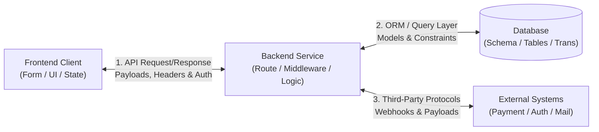

# Contract and Data Consistency Checklist (Level 3 Reference)
# Universal Markdown Skills Framework (UMSF)

> Version: 1.7.0  
> Authority: Level 3 Optional Reference Asset for `feature-integration-verification`  
> Domain: 09 — Quality Assurance & Testing  

---

## 1. Overview
This reference asset provides an exhaustive, field-level inspection checklist for verifying contract and data consistency across frontend, backend, database, and external third-party integration boundaries. Load this document when debugging cross-tier contract mismatches or conducting complex multi-service integration audits.

---

## 2. Cross-Tier Boundary Verification Matrix

---

## 3. Boundary 1: Frontend Client to Backend API

### 3.1 Endpoint & Transport Contract
- [ ] **HTTP Method & Path**: Path string and HTTP method (GET, POST, PUT, PATCH, DELETE) match exactly between frontend API client and backend route definitions.
- [ ] **URL Parameters & Query Strings**: Parameter keys, formatting (e.g. `camelCase` vs `snake_case`), and URL-encoding conform to backend schema parser.
- [ ] **Content-Type & Headers**: `Content-Type: application/json` or `multipart/form-data` matches backend parser expectations.

### 3.2 Request Payload & Schema Alignment
- [ ] **Field Naming & Casing**: Exact match across frontend serializer and backend deserializer (`userId` vs `user_id`).
- [ ] **Data Types & Coercion**: Numbers are numeric (not stringified `"123"`), booleans are boolean, ISO 8601 timestamps are parsed accurately.
- [ ] **Nullability & Optionality**: Optional fields marked nullable on frontend match backend schema; empty strings `""` are not converted to `null` unexpectedly.
- [ ] **Validation Symmetry**: Frontend client-side validation rules (e.g. regex, length limits) are identical to or a strict subset of backend validation schemas (e.g. Zod, Joi, Pydantic).

### 3.3 Response Payload & State Consumption
- [ ] **Envelope & Property Structure**: Frontend state consumes the exact payload shape returned (e.g. `{ data: items, meta: { total } }` vs direct array `items`).
- [ ] **Status Codes & Error Payloads**: HTTP 200, 201, 204 handled appropriately; error structures (`{ error: { code, message, details } }`) parsed without uncaught frontend exceptions.
- [ ] **Pagination & Sorting**: Cursor or page-offset parameters correctly update frontend pagination state and UI navigation controls.
- [ ] **State Invalidation & Refresh**: State management stores (Redux, Zustand, React Query, Vuex, Pinia) invalidate cached queries and trigger re-renders upon mutation completion.

---

## 4. Boundary 2: Backend Service to Database Persistence

### 4.1 Schema & Model Compatibility
- [ ] **Entity Model vs Table Columns**: Application entity definitions or ORM schemas map 1:1 to actual database column names and types.
- [ ] **Constraint Enforcement**: Primary key uniqueness, foreign key cascades, and check constraints match application domain assertions.
- [ ] **Nullability & Default Values**: Required domain attributes correspond to `NOT NULL` columns; default values are applied consistently.

### 4.2 Transaction Boundaries & Isolation
- [ ] **Atomicity**: Multi-step operations (e.g. deduct inventory + create order + insert audit log) execute within an explicit database transaction block (`BEGIN` ... `COMMIT`).
- [ ] **Rollback Integrity**: Exceptions at any point in the transaction block trigger clean rollbacks (`ROLLBACK`), preventing orphaned or partial records.
- [ ] **Concurrency & Locking**: Optimistic concurrency tokens (e.g. `version` column) or row-level locks (`SELECT ... FOR UPDATE`) prevent lost updates under race conditions.

---

## 5. Boundary 3: Authentication & Authorization Propagation

- [ ] **Token / Session Transmission**: Bearer tokens in `Authorization` headers or HttpOnly cookies are attached to all authenticated client requests.
- [ ] **Middleware Extraction & Validation**: Backend authentication middleware extracts, validates signature, checks expiration, and populates the user context object.
- [ ] **Context Propagation**: User identity and tenant/organization ID propagate from middleware down into service layer and database query filters.
- [ ] **Authorization Enforcement**: Non-permitted roles receive HTTP 403 Forbidden with zero data leakage; unauthenticated requests receive HTTP 401 Unauthorized.
- [ ] **Client Auth State Sync**: Session expiration or HTTP 401 triggers clean frontend logout, token purge, and redirect to login page.

---

## 6. Boundary 4: External Integrations & Webhooks

- [ ] **Idempotency Keys**: Critical external operations (e.g. payment charges) pass unique idempotency keys to prevent duplicate transactions upon retry.
- [ ] **Webhook Signature Verification**: Inbound webhooks verify cryptographic signatures (HMAC) before accepting payloads.
- [ ] **Retry & Dead-Letter Handling**: Transient external API failures employ exponential backoff; unrecoverable messages are routed to dead-letter queues.
- [ ] **Data Model Mapping**: External webhook payloads are mapped into internal domain events before database updates are executed.

