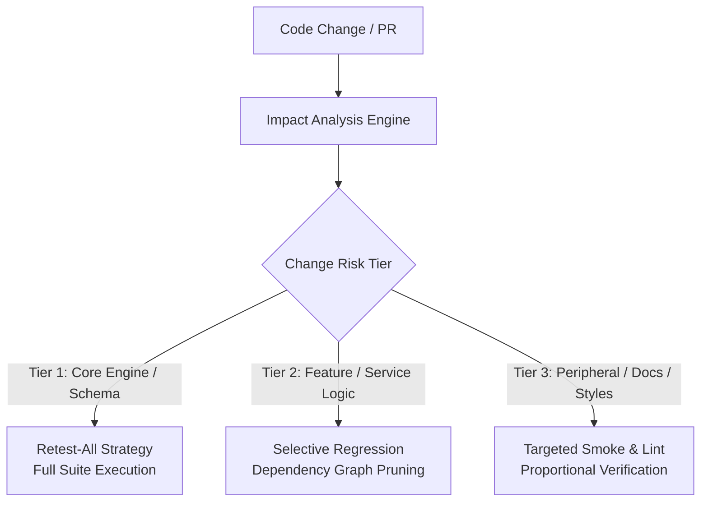

# Regression Testing Strategies (Level 3 Reference)
# Universal Markdown Skills Framework (UMSF)

> Version: 1.7.0  
> Authority: Level 3 Optional Reference Asset for `regression-testing`  
> Domain: 09 — Quality Assurance & Testing  

---

## 1. Overview
This reference asset details advanced regression test selection strategies, impact analysis matrices, and suite optimization algorithms. Load this document only when executing large-scale regression sweeps, triaging regression performance degradation, or optimizing test execution windows in CI/CD.

---

## 2. Regression Selection Methodologies

### 2.1 Strategy Comparison Matrix

| Strategy | Coverage Guarantee | Execution Overhead | Risk Profile | Recommended Trigger |
|---|---|---|---|---|
| **Retest-All** | 100% of defined suites | Very High (\$\$\$ time/tokens) | Near Zero | Release candidates, major version bumps, auth/database engine rewrites. |
| **Selective Regression** | Critical paths + directly affected modules | Medium | Low | Daily active feature development, service refactoring, standard PRs. |
| **Test Minimization** | Minimal test set covering modified AST nodes | Low | Moderate | Pre-commit hooks, local developer fast-feedback loops. |
| **Risk-Based Prioritization** | Highest-risk & historically flaky tests first | Dynamic | Low | Large monolithic suites with strict CI execution timeouts. |

---

## 3. Dependency Impact Analysis Procedure
1. **AST / Dependency Tracing**: Map all modules importing the modified symbol or file.
2. **Call Graph Traversal**: Identify transitive call chains up to public boundary entry points.
3. **Historical Defect Clustering**: Weight tests covering files with high historical bug density.
4. **Pruning Non-Impacted Tests**: Exclude isolated subsystems with zero direct or indirect dependencies.

---

## 4. Flaky Test Mitigation & Quarantine
- **Quarantine Policy**: When a regression test fails non-deterministically without code changes, move to `tests/quarantine/`.
- **Diagnostic Triage**: Inspect async timings, network dependencies, unseeded random generators, and database test isolation.
- **Resolution SLA**: Quarantined tests must be remediated or deleted within 2 development cycles. Never permanently ignore flaky tests.

