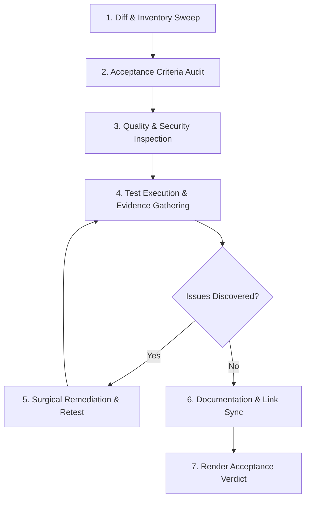

# Skill: Post-Task Verification & Diff Sweep

> Canonical UMSF Domain Skill Specification adhering to the standard schema.  
> Category: Domain 12 — Code Quality & Maintenance  
> Status: Level 1 MVP-First Active Specification  

---

## 1. Metadata
- **Identifier**: `post-task-verification`
- **Category**: Code Quality & Maintenance (Domain 12)
- **Authority**: UMSF Canonical Skill Library (Precedence Level 6)
- **Maintainer**: Universal Markdown Skills Framework
- **Level 3 References**:
  - None (self-contained Level 1 & Level 2 guidance)

---

## 2. MVP Summary (Level 1 Execution Contract)

- **Purpose**: Conduct mandatory, evidence-based post-implementation audits verifying requirements, git diff, and test exit codes.
- **When to Use**: At the conclusion of every engineering task before declaring completion or marking TASKS.md done.
- **Essential Invariants**:
  1. Every touched line in git diff must be audited against original user requirements.
  2. Tests must be executed and exit code 0 verified empirically; never assume success.
  3. Check for unintended changes, leftover debug statements, and missing documentation.
- **Minimal Workflow**:
  1. Run git status -s and git diff to inspect every modified, added, or deleted line.
  2. Map every prompt requirement to verified implementation code.
  3. Execute local test runner and linters, verifying exit code 0.
  4. Update CONTEXT.md and TASKS.md with empirical verification evidence.
- **Expected Deliverables**: Clean git diff sweep and verified test execution evidence supporting task completion.
- **Critical Restrictions**: Never mark a task completed without executing a diff sweep and empirical test verification.

> ℹ️ **Progressive Context Loading**:
> For standard engineering tasks, this **Level 1 MVP Summary** provides the complete operational contract.
> If deep procedures, edge case handling, or comprehensive checklists are required, proceed to **Level 2 — Core Instructions** below.

---

## Level 2 — Core Instructions & Deep Procedures

### Purpose
Purpose
Autonomous AI engineering workflows suffer from premature completion claims, developer confirmation bias, uninspected side effects, and forgotten documentation updates. The `post-task-verification` skill establishes a rigorous, evidence-based post-implementation audit pipeline. It mandates an exhaustive diff inspection, requirement completeness analysis, risk-proportionate QA and security evaluation, defect triage, remediation within authorized boundaries, and revalidation before any task may transition to `Completed`.

---

### Scope
- **In-Scope**:
  - Auditing changes against the original prompt and verifiable acceptance criteria.
  - Full inspection of git status, diffs, created, modified, deleted, and renamed files.
  - Requirement completeness and edge-case fulfillment auditing.
  - Architectural integrity and ADR alignment checks.
  - Static code quality, style consistency, and maintainability review.
  - Security-sensitive change analysis (auth, inputs, credentials, sanitization).
  - Test execution, exit code verification, and empirical proof validation.
  - Regression impact analysis on adjacent and downstream modules.
  - Documentation consistency (README, CONTEXT, TASKS, CHANGELOG, ADRs).
  - Defect triage, surgical remediation, and revalidation loops.
- **Out-of-Scope**:
  - Initial feature design or architecture ideation (delegate to [`skills/03-software-architecture-and-design/software-architecture/SKILL.md`](../../03-software-architecture-and-design/software-architecture/SKILL.md)).
  - Primary TDD code authoring (delegate to [`skills/09-quality-assurance-and-testing/test-driven-development/SKILL.md`](../../09-quality-assurance-and-testing/test-driven-development/SKILL.md)).
  - Deep penetration testing exploitation beyond authorized scope (delegate to [`skills/02-security-engineering/penetration-testing/SKILL.md`](../../02-security-engineering/penetration-testing/SKILL.md)).

---

### When to Use
- **Lifecycle Transition**: Mandatory execution at Stage 8 of the canonical lifecycle before any task is marked `Completed` in [`TASKS.md`](../../../TASKS.md).
- **Post-Implementation Gate**: After implementing code, refactoring, fixing bugs, or updating documentation.
- **Pre-PR / Pre-Delivery Audit**: Before submitting changes, opening a pull request, or declaring deliverables ready for user acceptance.
- **Regression Verification**: Whenever modifications touch shared utilities, core domain models, or cross-cutting configuration.

---

### When Not to Use
- Do NOT use as a substitute for initial requirements gathering (use [`requirements-analysis`](../../requirements-analysis/SKILL.md)).
- Do NOT use during initial exploration spikes before an implementation plan is formulated.
- Do NOT run heavyweight security pen-testing routines for trivial, low-risk documentation-only or styling-only edits; apply verification proportionally to risk.

---

### Prerequisites
- Target code modifications implemented in working directory.
- Local test runner and linter identified and operable.
- Baseline requirements and acceptance criteria documented in prompt or [`TASKS.md`](../../../TASKS.md).

---

### Required Context
Before conducting post-task verification, verify the following project reality:
- Current architecture and active tech stack in [`CONTEXT.md`](../../../CONTEXT.md).
- Mandatory constraints and release gates in [`RULES.md`](../../../RULES.md).
- Settled decisions and trade-offs in [`DECISIONS.md`](../../../DECISIONS.md).
- Active task entry and acceptance criteria in [`TASKS.md`](../../../TASKS.md).

---

### Core Instructions

### 8.1 The 15 Dimensions of Post-Task Verification
Every verification pass must evaluate the 15 canonical dimensions:

1. **Original Prompt & Acceptance Criteria Review**:
   - Re-read the raw user prompt word-for-word.
   - Verify every explicit requirement and implicit expectation against the current state.
2. **Complete Changed-File Inspection**:
   - Run `git status` and inspect every touched file.
   - Verify that no untracked artifacts, temporary scratch scripts, or unintended files remain.
3. **Created, Modified, Deleted & Renamed File Analysis**:
   - Categorize each affected path.
   - Confirm deletions and renames did not break relative imports or documentation links.
4. **Requirement Completeness Analysis**:
   - Score fulfillment: Fully Satisfied, Partially Satisfied, or Unsatisfied.
   - A task cannot pass if any core acceptance criterion is unsatisfied.
5. **Architecture & Decision Consistency**:
   - Verify code conforms to settled ADRs in [`DECISIONS.md`](../../../DECISIONS.md).
   - Ensure boundary isolation between domain logic, transport, and storage.
6. **Code Quality & Maintainability**:
   - Enforce clean code, descriptive naming, type safety, modular function length, and absence of dead code.
   - Zero commented-out code blocks or debugging print statements left behind.
7. **Security-Sensitive Change Analysis**:
   - Audit auth checks, input sanitization, data exposure, and credential isolation.
   - Verify that no secrets or environment variables were exposed.
8. **Test Execution & Result Verification**:
   - Execute the test suite directly; inspect logs and confirm exit code 0.
   - Distinguish real tests from empty assertions or mocks that bypass real logic.
9. **Regression Impact Analysis**:
   - Run full or targeted regression suites for modules adjacent to modified files.
   - Verify that bug fixes do not regress preexisting features.
10. **Documentation Consistency**:
    - Check that documentation reflects code reality (`README.md`, `CONTEXT.md`, `CHANGELOG.md`).
    - Verify that all internal links are relative and resolve without broken targets.
11. **Defect Identification & Classification**:
    - Classify any discovered issue: Critical (blocker), Major, Minor, or Cosmetic.
12. **Remediation Within Authorized Scope**:
    - Apply targeted, surgical fixes for discovered issues.
    - Never expand scope beyond the original request without user alignment.
13. **Revalidation After Remediation**:
    - Re-execute the test and lint suites following any remediation edit.
14. **Final Acceptance Decision**:
    - Render an explicit verdict: `PASS (Ready to Close)`, `CONDITIONAL PASS (Minor Doc Follow-up)`, or `FAIL (Blocked)`.
15. **Evidence-Based Reporting**:
    - Cite actual commands executed, exact exit codes, and diff summaries in the final handoff.

### 8.2 Risk-Proportionate Verification Matrix

| Change Risk Level | Scope Characteristics | Required Verification Depth |
|---|---|---|
| **Low Risk** | Documentation, typo fixes, standalone CSS token tweaks, comments | Steps 1–6, 10, 14, 15. Skip full security pen-testing. Run linter and link check. |
| **Medium Risk** | New feature implementation, UI component logic, schema migration, non-auth endpoints | Steps 1–10, 14, 15. Unit + Integration tests, regression sweep, static security check. |
| **High Risk** | Authentication, authorization, payment flows, cryptography, public API boundaries, framework core | Full 15-step pipeline. Mandatory independent QA & adversarial security review. |

---

### Step-by-Step Workflow

### Step 1: Diff & Inventory Sweep
1. Inspect git status: `git status -s`.
2. Inspect granular changes: `git diff`.
3. Categorize all created, modified, deleted, and renamed files.
4. Ensure no unwanted temporary files or scratch directories are left behind.

### Step 2: Acceptance Criteria Audit
1. Map each requirement from the original prompt to specific file locations and lines of code.
2. Confirm positive, negative, and edge-case handling.
3. Validate that no explicit user constraint was violated.

### Step 3: Quality & Security Inspection
1. Audit modified lines for security anti-patterns (injection sinks, raw SQL, unvalidated params).
2. Verify adherence to coding standards: typing, separation of concerns, zero circular dependencies.
3. For UI changes, verify Swiss/Minimalism tokens, WCAG AA 4.5:1 contrast, and 44px hit targets.

### Step 4: Test Execution & Evidence Gathering
1. Run automated test commands directly in the environment.
2. Verify exit codes: ensure 0 failures and 0 errors.
3. Confirm that tests tested real behavior and were not modified to fit broken code.

### Step 5: Issue Triage & Surgical Remediation
1. If tests fail or defects are found, log root cause.
2. Apply surgical, targeted fixes maintaining TDD Green-Refactor standards.
3. Rerun tests immediately to verify resolution.

### Step 6: Documentation & Link Synchronization
1. Update [`CONTEXT.md`](../../../CONTEXT.md) if architecture or modules changed.
2. Update [`CHANGELOG.md`](../../../CHANGELOG.md) with chronological release entries.
3. Ensure all links are strictly relative (POSIX `./...` or `../...`) with zero broken references.

### Step 7: Render Acceptance Verdict & Record State
1. If all applicable release gates pass, transition task in [`TASKS.md`](../../../TASKS.md) to `Completed`.
2. If issues remain unresolved or blocked by external dependencies, record task state honestly as `Blocked` or `Pending` with descriptive rationale. Never claim completion falsely.

---

### Quality Standards
- **Zero False Completion Claims**: A task cannot be marked Completed without verifiable execution evidence.
- **Zero Uninspected Diffs**: 100% of modified lines must be reviewed by the agent before concluding.
- **Portability Invariant**: 100% of internal links must be relative; zero host-specific paths.
- **Risk Proportionality**: Verification effort matches the risk and impact of the change.

---

### Validation Matrix
| Check | Verification Method | Expected Outcome |
|---|---|---|
| **Inventory Audit** | `git status -s` | Clean working tree; only intentional changes tracked |
| **Acceptance Criteria** | Requirements checklist comparison | 100% of applicable requirements verified |
| **Test Verification** | Direct execution of test runner | Exit code 0, 100% passing tests |
| **Link Integrity** | Programmatic relative link audit | 0 broken markdown links |
| **Portability** | Grep for host-specific paths | 0 occurrences of machine-specific usernames or paths |

---

### Common Mistakes & Anti-Patterns
| Mistake / Anti-Pattern | Why It Fails | Correct Alternative |
|---|---|---|
| **Conversational Self-Approval** | Agent declares "Everything is done!" without inspecting git diffs | Run `git status` and `git diff`; cite actual modified lines |
| **Premature Task Closure** | Marking task `Completed` when edge cases or tests are failing | Keep task in `In Progress` or `Blocked`; fix or report honestly |
| **Disproportionate Overhead** | Running full pen-tests for simple README typo edits | Apply risk-proportionate verification matrix |
| **Blind Doc Rewrites** | Overwriting entire documentation files and losing history | Perform surgical, non-destructive string replacements |
| **Hardcoded Machine Paths** | Using `file:///home/...` links in repository documents | Use POSIX relative links (`./...`, `../...`) |

---

### Restrictions
- Do NOT mark any task `Completed` in [`TASKS.md`](../../../TASKS.md) without verified evidence.
- Do NOT ignore failing tests, linter errors, or broken internal links.
- Do NOT introduce external runtime dependencies or binary executables.
- Do NOT expand scope beyond authorized task boundaries without user approval.

---

### Expected Deliverables
- Verified, clean codebase matching user requirements.
- Passing test suite output with documented exit codes.
- Synchronized, relative documentation in [`CONTEXT.md`](../../../CONTEXT.md), [`CHANGELOG.md`](../../../CHANGELOG.md), and [`TASKS.md`](../../../TASKS.md).
- Evidence-based verification report in chat and [`docs_agent/SESSION_LOG.md`](../../../docs_agent/SESSION_LOG.md).

---

### Documentation Requirements
- Record discovered pitfalls or test conventions in [`MEMORY.md`](../../../MEMORY.md).
- Record architectural trade-offs or decisions in [`DECISIONS.md`](../../../DECISIONS.md).
- Update task state in [`TASKS.md`](../../../TASKS.md).
- Log the session audit in [`docs_agent/SESSION_LOG.md`](../../../docs_agent/SESSION_LOG.md).

---

## Level 3 — Optional References & Supplementary Assets
  - None (self-contained Level 1 & Level 2 guidance)
