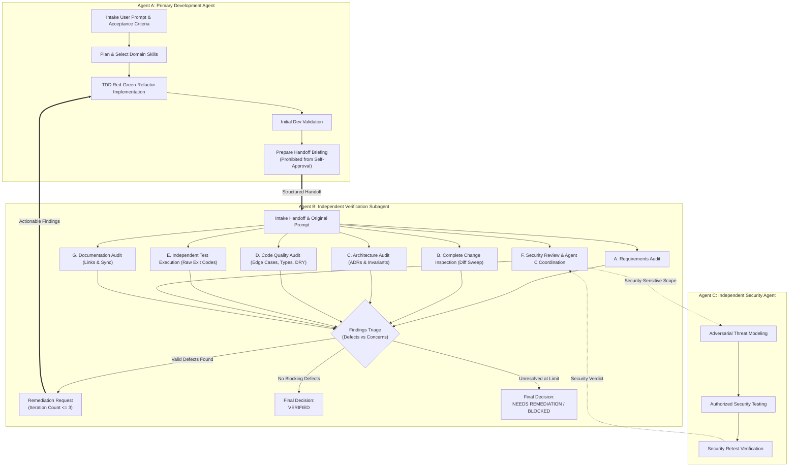
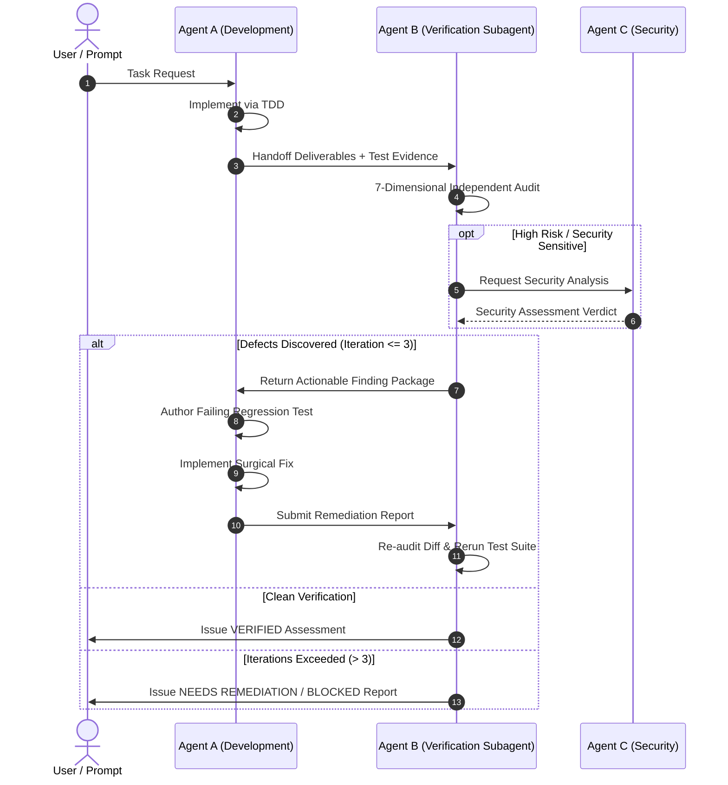

# Skill: Independent Verification Subagent Protocol

> Canonical UMSF Domain Skill Specification adhering to the standard schema.  
> Category: Domain 16 — AI Agent Engineering  
> Status: Level 1 MVP-First Active Specification  

---

## 1. Metadata
- **Identifier**: `independent-verification-subagent`
- **Category**: AI Agent Engineering (Domain 16)
- **Authority**: UMSF Canonical Skill Library (Precedence Level 6)
- **Maintainer**: Universal Markdown Skills Framework
- **Level 3 References**:
  - [`references/verification-checklists.md`](./references/verification-checklists.md)

---

## 2. MVP Summary (Level 1 Execution Contract)

- **Purpose**: Deploy an isolated subagent (Agent B) to independently audit requirements, code diffs, test exit codes, and architecture for T1 Standard and T2 Sensitive implementations. (Disambiguation: Use `independent-verification-subagent` for isolated, fresh-context 7-dimension audits of T1/T2 implementations; use `post-task-verification` for immediate developer self-checks, `multi-agent-verification` for team consensus, or `code-review` for peer readability).
- **When to Use**: Mandatory after Agent A completes any engineering task before declaring completion or marking TASKS.md done.
- **Essential Invariants**:
  1. Verification depth scales by Risk Tier: T0 Trivial changes (typos, formatting) are exempt from subagent invocation; T1 Standard requires independent verification; T2 Sensitive (auth, crypto, schema, payments) mandates both independent verification and security review.
  2. Independently execute test commands and inspect raw exit codes (0 vs non-zero).
  3. Render one of three canonical decisions: VERIFIED, NEEDS REMEDIATION, or BLOCKED.
- **Minimal Workflow**:
  1. Read original user prompt and extract objective acceptance criteria.
  2. Run git status -s and git diff to sweep every modified, created, or deleted line.
  3. Independently discover and execute relevant test suites and linters.
  4. Conduct 7-dimensional audit (Requirements, Diff, Architecture, Code Quality, Tests, Security, Docs).
  5. Render structured acceptance decision (VERIFIED, NEEDS REMEDIATION, BLOCKED).
- **Expected Deliverables**: Independent verification audit report with explicit status decision and empirical test logs.
- **Critical Restrictions**: Never allow the implementing agent to verify its own work; never assume tests passed without raw exit code proof.

> ℹ️ **Progressive Context Loading**:
> For standard engineering tasks, this **Level 1 MVP Summary** provides the complete operational contract.
> If deep procedures, edge case handling, or comprehensive checklists are required, proceed to **Level 2 — Core Instructions** below.

---

## Level 2 — Core Instructions & Deep Procedures

### Purpose
Purpose
Autonomous AI software engineering is inherently prone to developer confirmation bias, unchecked blind spots, conversational self-assurances, and premature task completion claims. The primary development agent (Agent A) cannot impartially judge whether its own implementation is complete, secure, or free from side effects.

The `independent-verification-subagent` skill establishes an **Independent Verification Subagent (Agent B)** architecture. When Agent A finishes a meaningful engineering task, a separate subagent context is dispatched to conduct an adversarial, evidence-based audit of the entire deliverable across requirements, git diffs, architecture, code quality, test execution, security implications, and documentation synchronization before any task may be certified as complete.

---

### Scope
- **In-Scope**:
  - Independent intake and parsing of the original user prompt, acceptance criteria, and Agent A handoff artifacts.
  - Line-by-line inspection of git working tree status, diffs, created, modified, deleted, and moved files.
  - Requirements completeness analysis: identifying missing, incomplete, incorrect, or unrequested functionality.
  - Architectural integrity audit: checking dependency boundaries, interfaces, error handling, ADR compliance, and rule invariants.
  - Code quality review: checking maintainability, DRY, edge cases, type safety, and performance constraints.
  - Independent test execution: autonomously discovering, running, and inspecting test commands and raw exit codes without relying on Agent A claims.
  - Security review coordination: analyzing security-sensitive changes and dispatching or coordinating with the Independent Security Agent (Agent C) for threat modeling and authorized penetration testing.
  - Documentation consistency audit: verifying relative links, system maps, and milestone records against actual filesystem reality.
  - Structured finding classification across seven severity tiers and defect remediation lifecycle management.
  - Multi-agent subagent execution (Mode A) and sequential verification fallback (Mode B) with mandatory honest attribution.
  - Tri-state final acceptance decisions: `VERIFIED`, `NEEDS REMEDIATION`, `BLOCKED / NOT VERIFIED`.
- **Out-of-Scope**:
  - Primary feature code authoring (handled strictly by Agent A — Primary Development Agent).
  - Unauthorized active penetration testing or external network exploitation (governed by [`skills/02-security-engineering/penetration-testing/SKILL.md`](../../02-security-engineering/penetration-testing/SKILL.md) and `RULES.md` Section 9).
  - Unilateral task approval based solely on successful code compilation without empirical test execution.

---

### When to Use
- **Lifecycle Transition**: Mandatory execution at Stages 7 through 10 of the Canonical 12-Stage Engineering Lifecycle (`WORKFLOW.md`).
- **Post-Implementation Handoff**: Immediately after Agent A concludes feature coding, refactoring, or bug fixing and prepares its handoff.
- **Pull Request / Release Gate Evaluation**: Prior to merging code or declaring deliverables ready for user acceptance.
- **Multi-Agent Orchestration**: In platforms supporting concurrent subagents (e.g. Antigravity subagent invocation, Claude Code agent teams).

---

### When Not to Use
- **Greenfield Coding / Mid-TDD Cycles**: Do not invoke while Agent A is actively in the RED or GREEN phases of TDD before a cohesive deliverable is ready.
- **Exploratory Spikes**: Do not run full multi-agent verification on throwaway experimental spikes explicitly designated as non-deliverable prototypes.
- **Exempt Low-Risk Edits**: Low-risk changes (minor documentation typos, non-functional code comments, isolated styling token adjustments) do not require full subagent invocation; they follow risk-proportionate single-pass verification per `RULES.md` Section 10.

---

### Prerequisites
Before invoking the Independent Verification Subagent, ensure the following context is accessible:
1. Universal operating instructions in `AGENTS.md`.
2. Mandatory platform and framework rules in `RULES.md`.
3. Verified codebase reality in `CONTEXT.md`.
4. Active task state in `TASKS.md`.
5. Immutable architectural decisions in `DECISIONS.md`.
6. Agent A Implementation Handoff Payload containing:
   - Original user prompt and explicit acceptance criteria.
   - List of touched files and git diff summary.
   - Executed test commands and recorded results.
   - Known limitations or open questions.

---

### Required Context & Authority Hierarchy
All verification activities must adhere to the 7-tier precedence hierarchy defined in `AGENTS.md`:
1. **Level 1**: Explicit User Prompt (Acceptance Criteria baseline).
2. **Level 2**: `RULES.md` (Platform Safety, TDD, and Verification Invariants).
3. **Level 3**: `DECISIONS.md` (System Invariants & Historical ADRs; see also [`docs_agent/ARCHITECTURE.md`](../../../docs_agent/ARCHITECTURE.md)).
4. **Level 4**: `CONTEXT.md` (Verified Codebase Reality).
5. **Level 5**: `WORKFLOW.md` (12-Stage Engineering Lifecycle).
6. **Level 6**: Loaded Domain Skills (`independent-verification-subagent`, `post-task-verification`).
7. **Level 7**: `AGENTS.md` (Universal Entry Point).

---

### Core Instructions & Architecture



### 8.1 Tripartite Agent Role Definitions
1. **Agent A — Primary Development Agent**:
   - Understands user requests, decomposes work, plans atomic tasks in `TASKS.md`, and selects domain skills.
   - Strictly applies TDD (Red-Green-Refactor) to author minimal, clean implementation code.
   - Executes local developer validation suites.
   - Prepares a structured handoff briefing for Agent B.
   - **Hard Invariant**: Agent A must **never declare its own work independently approved or secure**.
2. **Agent B — Independent Verification Subagent**:
   - Dispatched in an isolated subagent context (or fresh sequential pass) with zero confirmation bias.
   - Evaluates everything Agent A implemented against the raw user prompt and repository reality.
   - Conducts independent test execution and audits raw command outputs.
   - Triages findings, orchestrates remediation loops, and issues the formal verification decision.
3. **Agent C — Independent Security Agent**:
   - Assumes an adversarial attacker persona.
   - Conducts formal threat modeling, reviews sensitive boundaries (auth, crypto, APIs, inputs), and executes authorized non-destructive security tests.
   - Verifies security remediations and conducts regression vulnerability sweeps.

### 8.2 Required Input Contract for Agent B
Agent B must never verify in a vacuum. It must be provided with:
1. **Raw User Prompt**: The unmodified original instructions from the user.
2. **Acceptance Criteria**: The explicit positive, negative, and edge-case criteria.
3. **Initial Project Context**: The state of `CONTEXT.md` and repository before work started.
4. **Actual Repository State**: Direct filesystem access to inspect touched files.
5. **Git Diff / Change Inventory**: Complete output of `git status -s` and `git diff`.
6. **Agent A Implementation Report**: Summary of implemented components and rationale.
7. **Test Instructions**: Commands required to build, lint, and test the project.

### 8.3 Seven-Dimensional Independent Audit Protocol

#### A. Requirements Audit
- Re-read the original user prompt from scratch; do not rely on Agent A's summary.
- Extract every explicit and implicit requirement.
- Perform line-by-line mapping between requirements and actual code modifications.
- Identify missing features, incomplete implementations, misunderstood requirements, or unrequested scope creep.

#### B. Complete Change Inspection (Diff Sweep)
- Inspect every created, modified, deleted, and renamed file in the git working tree.
- Detect inadvertent edits, stray debugging prints (`console.log`, `print()`), temporary scratch files, or commented-out blocks.
- Verify that no secrets, credentials, API keys, or private environment variables were introduced.
- Verify that `.gitignore` patterns were respected.

#### C. Architecture Audit
- Verify alignment with documented Architectural Decision Records in `DECISIONS.md`.
- Inspect dependency boundaries: verify unidirectional dependencies and zero circular imports.
- Check separation of concerns: domain logic decoupled from transport/storage layers.
- Check error handling: fail-fast validations, absence of silent exception swallowing (`catch {}` or `except: pass`).
- Detect unnecessary architectural complexity, premature abstractions, or excessive coupling.

#### D. Code Quality Audit
- Inspect maintainability, readability, and Single Responsibility Principle (SRP).
- Check for code duplication (DRY compliance).
- Audit edge cases: null/undefined checks, empty collections, numerical overflows, rapid user events, network latency.
- Enforce type safety: explicit types, absence of `any` types in TypeScript or untyped parameters in modern Python.
- Evaluate performance impacts: memory leaks, unindexed queries, or unbounded collections.
- For UI components: enforce UI/UX Pro Max standards (Swiss/Minimalist styling, WCAG AA 4.5:1 contrast, 44×44px touch targets, mobile responsiveness at `375px`, zero raw emojis as icons).

#### E. Independent Testing
- Independently determine which test suites are relevant to the change.
- **Execute test commands directly**: Run `pytest`, `npm test`, `go test`, `cargo test`, or specialized test runners.
- Directly inspect raw terminal stdout, stderr, and numeric exit codes (`0` vs non-zero).
- **Prohibition on Blind Trust**: Never accept Agent A's claim that tests pass without executing them.
- Identify missing negative, boundary, or regression test cases.
- Execute regression test sweeps across adjacent modules to detect downstream breakages.

#### F. Security Review & Agent C Coordination
- Analyze security-sensitive code: authentication, authorization, cryptographic operations, input sanitization, SQL/command construction, and file system access.
- For high-risk changes, formally coordinate with or dispatch **Agent C (Independent Security Agent)** to execute:
  - Threat modeling ([`threat-modeling`](../../02-security-engineering/threat-modeling/SKILL.md)).
  - Authorized non-destructive penetration testing ([`penetration-testing`](../../02-security-engineering/penetration-testing/SKILL.md)).
  - Vulnerability assessment against OWASP Top 10.
- **Boundary Restriction**: Agent B must not claim penetration testing was conducted merely because static code review occurred. Active pen-testing belongs strictly to authorized Agent C procedures.

#### G. Documentation Audit
- Audit project documentation against actual filesystem reality: `README.md`, `CONTEXT.md`, `CONTRIBUTING.md`.
- Enforce the **Repository Portability & Relative Links Invariant** (`RULES.md` Section 2): all internal links must use relative POSIX paths (`./` or `../`); zero machine-specific paths (`/home/...`, `file:///...`).
- Verify that `TASKS.md` milestone status reflects empirical reality.

### 8.4 Finding and Defect Management Schema
Every defect or issue identified by Agent B must be recorded using the standardized 11-field schema:

```markdown
### Finding [FINDING-ID]: [Finding Title]
- **Severity**: [Critical | High | Medium | Low | Informational | False Positive | Not Tested]
- **Affected Component**: [File path and line numbers]
- **Description**: [Precise technical explanation of the defect]
- **Evidence**: [Raw command output, log snippet, or diff quotation]
- **Reproduction Steps**: [Deterministic step-by-step instructions to reproduce]
- **Expected Behavior**: [What should occur according to requirements/specifications]
- **Actual Behavior**: [What actually occurs in current implementation]
- **Root Cause**: [Architectural, logic, or validation cause]
- **Recommended Remediation**: [Actionable technical fix guidance for Agent A]
- **Verification Status**: [Open | Remediated | Revalidated | Risk Accepted]
```

#### Finding Severity Tiers
| Severity | Definition | Delivery Impact |
|---|---|---|
| **Critical** | System crash, data loss, security vulnerability, broken build, or total requirement failure. | Immediate Blocker. Must be remediated prior to acceptance. |
| **High** | Major functional defect, broken workflow, missing primary acceptance criterion, or regression. | Blocker. Must be remediated prior to acceptance. |
| **Medium** | Edge-case failure, unhandled boundary condition, UI/UX accessibility flaw, or minor memory leak. | Remediation required within task scope unless formally deferred. |
| **Low** | Code style inconsistency, minor documentation typo, or non-critical formatting discrepancy. | Can be addressed during polish or logged for cleanup. |
| **Informational** | Optimization suggestion, architectural observation, or future refactoring opportunity. | Informational only. Does not block acceptance. |
| **False Positive** | Flagged item determined upon investigation to be intended behavior or invalid concern. | Closed with documented justification. |
| **Not Tested** | Area unverified due to environment constraints or missing tooling. | Explicitly recorded; blocks `VERIFIED` status if in scope. |

### 8.5 Remediation & Retesting Lifecycle
When Agent B identifies actionable findings (Critical, High, or Medium):



1. **Structured Finding Package**: Agent B packages findings with reproduction steps and expected behaviors, returning them to Agent A.
2. **Surgical Remediation**: Agent A writes a failing regression test reproducing each valid finding, authors the fix, and runs local tests.
3. **Remediation Report**: Agent A reports the specific lines modified and the commands used to verify the fix.
4. **Independent Revalidation**: Agent B re-inspects the modified diffs, re-runs affected tests, and conducts a regression scan across adjacent features.
5. **Iteration Limit (`MAX_VERIFICATION_ITERATIONS = 3`)**:
   - To prevent unbounded agent ping-pong loops, the remediation cycle is limited to a maximum of **3 iterations**.
   - If Critical or High findings remain unresolved after 3 iterations, Agent B must **halt the loop** and issue a transparent `NEEDS REMEDIATION` or `BLOCKED` verdict.
   - **Absolute Prohibition**: Never silently approve incomplete or failing work to terminate an iteration loop.

### 8.6 Multi-Agent vs. Single-Agent Fallback Execution Modes

#### Mode A — Independent Subagents (Preferred)
- Operates within platforms supporting concurrent subagents (Antigravity subagents, Claude Code agent teams).
- Agent A finishes implementation and invokes Agent B via subagent harness (e.g. `invoke_subagent`).
- Agent B runs in a **distinct conversation context**, preventing memory leakage and cognitive confirmation bias.
- Agent B performs audits, communicates findings via messages or structured files, and receives remediation reports.

#### Mode B — Sequential Verification Fallback (Single-Agent)
- Operates in environments where concurrent subagents are unavailable (standard single-agent CLI sessions).
- Agent A completes the full development pass using TDD.
- The agent executes an **explicit role-switch**:
  1. Announces the transition: `Switching context from Agent A (Development) to Agent B (Independent Verification)`.
  2. Conceptually resets cognitive state: re-reads the raw user prompt and inspects the actual filesystem from an adversarial perspective.
  3. Executes fresh verification checklists and runs test commands directly.
  4. Records the formal audit assessment.
- **Mandatory Attribution Invariant**: The agent must explicitly record in logs and reports:
  > *"Verification was conducted via sequential self-review role-switch, not independent subagent execution."*  
  **Never pretend that separate passes in a single agent are independent subagents.**

### 8.7 Tri-State Final Acceptance Decision
Agent B concludes verification by rendering one of three definitive decisions:

1. **`VERIFIED`**:
   - 100% of applicable user acceptance criteria empirically validated.
   - All required test suites executed with exit code 0.
   - Zero unresolved Critical or High findings.
   - Documentation synchronized with zero broken relative links.
   - Functional and Regression Release Gates satisfied.
2. **`NEEDS REMEDIATION`**:
   - Valid defects, edge-case failures, or regressions remain uncorrected.
   - Agent A must apply further corrections within authorized scope.
3. **`BLOCKED / NOT VERIFIED`**:
   - Required environment, compilers, test fixtures, or permissions are unavailable.
   - Critical architectural contradictions or unresolved security flaws prevent safe release.
   - Iteration limits reached without resolving blocking defects.

> [!IMPORTANT]
> **Compilation Alone Is Never Sufficient**: A project that builds or compiles without error is NOT verified. Empirical test execution, diff auditing, and requirement mapping are mandatory prerequisites for `VERIFIED` status.

---

### Step-by-Step Workflow
1. **Step 1: Intake Handoff & Establish Baseline**
   - Read raw user prompt, acceptance criteria, and Agent A handoff report.
   - Run `git status -s` to baseline working tree changes.
2. **Step 2: Execute Complete Diff Sweep**
   - Run `git diff` against base commit. Audit every added, deleted, or altered line.
3. **Step 3: Execute Independent Test Suite**
   - Run project test runner directly. Inspect exit codes, test counts, and assertion outputs.
4. **Step 4: Conduct Requirement & Architecture Audits**
   - Map prompt requirements to diff lines. Verify ADR compliance and architectural boundaries.
5. **Step 5: Conduct Security & Documentation Audits**
   - Check sensitive boundaries. Coordinate with Agent C if auth/crypto/APIs modified. Audit relative links.
6. **Step 6: Triage Findings & Manage Remediation Loop**
   - Log findings in 11-field format. If defects exist and iteration count ≤ 3, request remediation from Agent A.
7. **Step 7: Render Final Acceptance Verdict**
   - Issue `VERIFIED`, `NEEDS REMEDIATION`, or `BLOCKED` verdict. Update `TASKS.md` and `docs_agent/SESSION_LOG.md`.

---

### Quality Standards
- **Standard 1 (Cognitive Independence)**: Agent B operates with zero deference to Agent A's narrative claims, verifying only empirical evidence.
- **Standard 2 (Evidence Integrity)**: Every verification verdict must cite exact command invocations, exit codes, diff snippets, and file paths.
- **Standard 3 (Transparent State Reporting)**: If an issue cannot be resolved, report the blocker honestly in `TASKS.md`. Never claim false completion.
- **Standard 4 (Boundaries & Safety)**: Never conduct unauthorized penetration testing or execute destructive commands.

---

### Validation Matrix
| Check | Verification Method | Expected Outcome |
|---|---|---|
| Role Independence | Handoff log inspection | Agent A and Agent B execute distinct, non-overlapping evaluation passes |
| Diff Audit Completeness | `git status -s` & `git diff` review | Every changed file audited; zero stray files or uncommitted artifacts |
| Empirical Test Execution | Terminal command log inspection | Test commands executed directly; exit code 0 verified |
| Finding Classification | Finding schema review | All issues classified across 7 tiers with reproduction steps and evidence |
| Remediation Boundedness | Iteration counter check | Maximum 3 remediation iterations enforced; zero infinite loops |
| Link Portability | Link audit script | Zero broken links; zero absolute host paths (`/home/...`) |

---

### Common Mistakes & Anti-Patterns
| Mistake / Anti-Pattern | Why It Fails | Correct Alternative |
|---|---|---|
| **Developer Self-Approval** | Blind to own assumptions and missed edge cases | Mandate separate Agent B verification pass |
| **Trusting Agent A's Report** | Development agent reports tests passed when they were mocked or unrun | Agent B executes test commands directly in terminal |
| **Pretending Single-Agent is Multi-Agent** | False assurance of multi-agent redundancy | Explicitly document sequential role-switch fallback |
| **Infinite Remediation Loops** | Agent A and B get stuck in endless minor refactoring cycles | Enforce `MAX_VERIFICATION_ITERATIONS = 3`; halt and report honestly |
| **Claiming Pen-Test on Code Review** | Conflates static review with dynamic adversarial penetration testing | Restrict pen-testing claims to authorized Agent C execution |
| **Compilation-Only Signoff** | Code compiles but fails business logic or crashes on runtime input | Require automated unit/integration test execution and assertion checks |

---

### Restrictions
- Do NOT declare deliverables approved without independent verification.
- Do NOT fabricate command outputs, test runs, or security assessment verdicts.
- Do NOT perform unauthorized active penetration testing or destructive attacks.
- Do NOT exceed the maximum verification iteration limit without halting and reporting.
- Do NOT use absolute host file paths in repository documentation or findings.

---

### Expected Deliverables
1. Canonical verification report logged in `docs_agent/testing/` or `docs_agent/SESSION_LOG.md`.
2. Updated `TASKS.md` reflecting verified task state (`Completed`, `In Progress`, or `Blocked`).
3. Formatted finding records for any identified defects.
4. Clean working tree with zero residual scratch files.

---

### Documentation Requirements
- Synchronize framework reality in `CONTEXT.md`.
- Record architectural trade-offs in `DECISIONS.md`.
- Record multi-agent lessons learned in `MEMORY.md`.
- Append session handoff entry in [`docs_agent/SESSION_LOG.md`](../../../docs_agent/SESSION_LOG.md).

---

## Level 3 — Optional References & Supplementary Assets
  - [`references/verification-checklists.md`](./references/verification-checklists.md)
