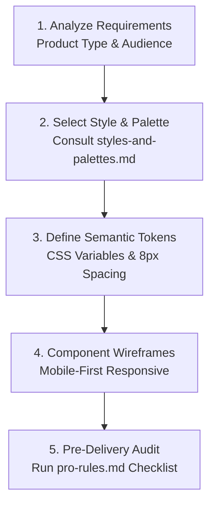

# Skill: UI/UX Pro Max — Design Intelligence

> Canonical UMSF Domain Skill Specification.  
> 100% Self-Contained Markdown Intelligence — Zero external tools, packages, or interactive search required.

---

## 1. Metadata
- **Identifier**: `ui-ux-pro-max`
- **Category**: Frontend & Design Engineering (Domain 07)
- **Authority**: UMSF Canonical Skill Library (Precedence Level 6)
- **Reference Assets**:
  - [`references/quick-reference.md`](./references/quick-reference.md) — All 10 priority categories & 119 UX guidelines with rationale.
  - [`references/pro-rules.md`](./references/pro-rules.md) — Professional UI rules & canonical Pre-Delivery Checklist.
  - [`references/styles-and-palettes.md`](./references/styles-and-palettes.md) — Curated catalog of 88 styles, 192 product palettes, 74 font pairings, and chart types.

---

## 2. Purpose
Equip any AI coding agent (Claude Code, Cursor, Antigravity, OpenAI Codex, Windsurf, Gemini CLI, Copilot) with elite UI/UX design intelligence. This skill governs aesthetic style selection, semantic token architecture, typography hierarchy, accessibility compliance (WCAG AA), interaction timing, mobile safe areas, responsive layout, and visual QA—purely through structured Markdown guidance without requiring interactive search or external installations.

---

## 3. Scope
- **In-Scope**:
  - Selecting coherent visual design styles (Minimalism & Swiss, Bento Grid, Modern Flat, Glassmorphism, Brutalism, Dark Mode OLED, etc.).
  - Generating semantic color token architectures (Primary, Secondary, Accent, Background, Card, Border, Ring, Destructive).
  - Pairing typography hierarchies (Display, Headings, Body, Code/Metrics) with responsive scales.
  - Enforcing the 10 prioritized rule categories and 119 UX guidelines.
  - Mobile/native touch target verification (≥ 44×44px / 48×48dp), 8px spacing rhythms, and safe-area insets.
  - Conducting pre-delivery accessibility and visual consistency audits.
- **Out-of-Scope**:
  - Non-visual backend business logic, database migrations, or infrastructure tasks that do not touch user interface.

---

## 4. When to Use
- Designing new pages, views, dashboards, mobile screens, or design systems.
- Selecting colors, typography, spacing scales, or visual styles for any software project.
- Reviewing UI components for accessibility, contrast (4.5:1 minimum), focus rings, and touch targets.
- Tuning animation timing (150–250ms), micro-interactions, and reduced-motion fallbacks.

---

## 5. When Not to Use
- Pure backend tasks, data pipelines, non-visual scripts, or CI/CD infrastructure with zero interface impact.

---

## 6. Prerequisites
- Target audience, platform (Web, iOS, Android, Desktop), and product domain identified.
- Awareness of mandatory repository UI invariants in [`RULES.md`](../../RULES.md) Section 3.

---

## 7. Required Context
- Mandatory constraints: [`RULES.md`](../../RULES.md) (Swiss style, WCAG AA 4.5:1, 44px hit targets, no raw emoji icons).
- Architecture specs: [`docs_agent/ARCHITECTURE.md`](../../docs_agent/ARCHITECTURE.md).

---

## 8. Core Instructions & The 10 Prioritized Rule Categories

Follow priority 1 to 10 when resolving any interface decision. The full rules are documented in [`references/quick-reference.md`](./references/quick-reference.md):

| Priority | Category | Impact | Direct Reference | Key Checks (Must Have) | Anti-Patterns (Avoid) |
|:---:|---|:---:|---|---|---|
| **1** | **Accessibility** | **CRITICAL** | `quick-reference.md` §1 | Contrast ≥ 4.5:1, visible focus rings, aria-labels, alt text | Suppressing focus rings (`outline: none`), icon buttons without labels |
| **2** | **Touch & Interaction** | **CRITICAL** | `quick-reference.md` §2 | Min target ≥ 44×44px, ≥ 8px spacing, loading feedback | Hover-only interactions, 0ms instant state changes without feedback |
| **3** | **Performance** | **HIGH** | `quick-reference.md` §3 | WebP/AVIF images, reserved space (CLS < 0.1), lazy loading | Layout thrashing, unsized media shifting layout, blocking main thread |
| **4** | **Style Selection** | **HIGH** | `styles-and-palettes.md` §1 | Coherent style matched to product, SVG icons (Heroicons/Lucide) | Random style mixing, raw emojis as UI icons (🔍, ⚙️, ❌) |
| **5** | **Layout & Responsive** | **HIGH** | `quick-reference.md` §5 | Mobile-first (375px, 768px, 1024px, 1440px), no overflow | Horizontal scrollbars on mobile, fixed pixel container widths |
| **6** | **Typography & Color** | **MEDIUM** | `styles-and-palettes.md` §2-3 | Base 16px body, 1.5 line height, semantic CSS tokens | Body text < 12px, gray-on-gray low contrast, hardcoded raw hex in components |
| **7** | **Animation & Motion** | **MEDIUM** | `quick-reference.md` §7 | 150-250ms micro-timing, transform/opacity only, reduced-motion | Uniform animation everywhere, animating width/height, motion sickness |
| **8** | **Forms & Feedback** | **MEDIUM** | `quick-reference.md` §8 | Visible labels, inline errors near fields, progressive disclosure | Placeholder-only labels, errors only at top of page, un-dismissible toasts |
| **9** | **Navigation Patterns** | **HIGH** | `quick-reference.md` §9 | Predictable back behavior, bottom nav ≤ 5 items, deep linking | Overloaded navigation, broken browser history, hidden core navigation |
| **10** | **Charts & Data** | **LOW** | `styles-and-palettes.md` §4 | Color independence, accessible legends, responsive reflow | Relying on color alone to convey metrics, truncated axis labels |

---

## 9. Step-by-Step Design Workflow (Self-Contained Markdown Mode)

No CLI tools or interactive search required. Follow this 5-step engineering sequence:



### Step 1: Analyze Requirements
- **Product Type**: SaaS, Developer Tool, E-Commerce, Fintech, Healthcare, Analytics Dashboard, or Mobile App.
- **Platform**: Web (HTML/React/Next.js/Vue/Svelte), Mobile (React Native/Flutter/SwiftUI), or Desktop.
- **Aesthetic Persona**: Default to **Minimalism & Swiss Style** for high functional clarity, clean typography, and purposeful whitespace.

### Step 2: Select Style, Palette & Typography from Markdown Catalogs
Consult the curated Markdown catalogs directly:
1. **Visual Style**: Open [`references/styles-and-palettes.md`](./references/styles-and-palettes.md) Section 1. Select the style matching your product (e.g. *Minimalism & Swiss Style*, *Data-Dense Dashboard*, *Bento Box Grid*, *Dark Mode OLED*).
2. **Color Palette**: Open [`references/styles-and-palettes.md`](./references/styles-and-palettes.md) Section 2. Select the industry palette matching your domain (e.g. *Fintech*, *SaaS*, *Developer Tool*, *Healthcare*).
3. **Typography**: Open [`references/styles-and-palettes.md`](./references/styles-and-palettes.md) Section 3. Choose a pairing (e.g. *IBM Plex Sans* for UI + *JetBrains Mono* for code/numbers).

### Step 3: Establish Semantic Design Tokens
Define structured CSS variables in `:root` rather than hardcoding colors into components:
```css
:root {
  /* Brand & Core */
  --color-primary: #0F172A;        /* Slate 900 */
  --color-on-primary: #FFFFFF;
  --color-secondary: #1E293B;      /* Slate 800 */
  --color-on-secondary: #FFFFFF;
  --color-accent: #22C55E;         /* Emerald 500 */
  --color-on-accent: #0F172A;

  /* Surfaces & Canvas */
  --color-background: #020617;     /* Slate 950 Canvas */
  --color-foreground: #F8FAFC;     /* Slate 50 Body Text */
  --color-card: #0E1223;           /* Surface Container */
  --color-card-fg: #F8FAFC;
  --color-muted: #1A1E2F;
  --color-muted-fg: #94A3B8;       /* Secondary Text */
  --color-border: #334155;         /* Borders */
  --color-ring: #38BDF8;           /* Focus Ring */
  --color-destructive: #EF4444;    /* Danger/Error */

  /* 8px Spacing Rhythm */
  --space-1: 4px;
  --space-2: 8px;
  --space-3: 12px;
  --space-4: 16px;
  --space-6: 24px;
  --space-8: 32px;
  --space-12: 48px;
}
```

### Step 4: Layout & Mobile-First Wireframing
- Build mobile-first starting at `375px`, expanding to `768px`, `1024px`, and `1440px`.
- Ensure parent containers use `max-width` and flexible margins; zero horizontal scrollbars permitted.
- Enforce interactive touch targets measuring at least **44×44px** with ≥ **8px** gap between adjacent targets.

### Step 5: Execute Pre-Delivery Audit
Before delivering UI code, execute the canonical checklist in [`references/pro-rules.md`](./references/pro-rules.md):
- [ ] **Accessibility**: Contrast ≥ 4.5:1 verified across all normal text; visible focus rings on all interactive elements.
- [ ] **Touch Targets**: All clickable/tappable elements measure at least 44×44px.
- [ ] **Iconography**: Zero raw emojis as icons (🔍, ⚙️, ❌); use vectorized SVGs with `aria-hidden="true"`.
- [ ] **Responsive Reflow**: Zero horizontal scroll at 375px mobile breakpoint.
- [ ] **Motion**: Transitions limited to 150–250ms on GPU-accelerated properties (`transform`, `opacity`); `@media (prefers-reduced-motion)` honored.

---

## 10. Quality Standards
- **Zero Interactive Dependencies**: All intelligence is readable directly from Markdown files.
- **Accessibility Parity**: WCAG AA 4.5:1 contrast strictly maintained in both light and dark themes.
- **Visual Discipline**: High functional hierarchy, predictable 8px spacing rhythm, consistent icon family.

---

## 11. Validation
| Checkpoint | Verification Method | Pass Criteria |
|---|---|---|
| Text Contrast | Contrast measurement against background | ≥ 4.5:1 normal text; ≥ 3.0:1 large text |
| Touch Target | Hit area inspection | Minimum 44×44px interactive bounds |
| Focus Indicator | Keyboard navigation tab pass | Visible `--color-ring` outline on active focus |
| Responsive Layout | Viewport resize check | 0 horizontal overflow at 375px, 768px, 1024px, 1440px |

---

## 12. Common Mistakes & Anti-Patterns
| Anti-Pattern | Consequence | Correct Pattern |
|---|---|---|
| Relying on interactive search CLI | Fails when user does not have tools installed | Read self-contained Markdown catalogs directly |
| Raw emojis as UI icons | Platform inconsistency, missing accessibility labels | Vector SVG icons (Lucide / Heroicons) with aria-labels |
| Suppressing focus rings (`outline: none`) | Completely breaks keyboard accessibility | Visible 2–4px `--color-ring` focus indicator |
| Gray-on-gray low contrast text | Severe readability failure in bright conditions | Maintain minimum 4.5:1 contrast ratio |

---

## 13. Restrictions
- Do NOT require users to install Python search tools, CLIs, or external plugins.
- Do NOT use emojis as structural user interface icons.
- Do NOT use raw hardcoded hex codes directly inside component CSS rules.

---

## 14. Expected Deliverables
- Design system token specifications (`tokens.css` or design system markdown).
- Fully styled, accessible frontend components adhering to UI/UX Pro Max standards.
- Completed Pre-Delivery Checklist audit log.

---

## 15. Documentation Requirements
- Record design decisions and token specifications in [`docs_agent/`](../../docs_agent/) or project design system docs.
- Update [`TASKS.md`](../../TASKS.md) upon completing design milestones.
