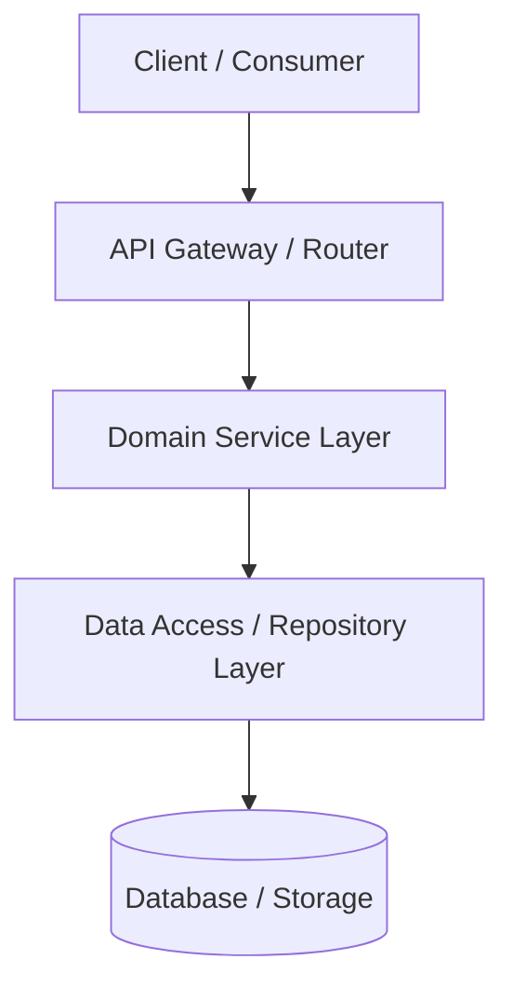

# Project Context
# [Project Name]

> Current Verified System Reality & Architectural State  
> Last Verified: [YYYY-MM-DD]  
> Authority: Precedence Level 4 (Current Verified Project Reality)  

---

## 1. Project Overview & Objectives
- **Name**: [Project Name]
- **Core Mission**: [Single-paragraph summary of what the project does and the problem it solves.]
- **Primary Objectives**:
  1. [Objective 1]
  2. [Objective 2]
  3. [Objective 3]

---

## 2. Technology Stack & Runtime Environment
*(Only document verified, active technologies. Never invent dependencies.)*

| Layer | Technology | Version | Purpose / Notes |
|---|---|---|---|
| **Runtime / Language** | [e.g. Node.js / Python / Go] | [e.g. v20.x] | [Core application runtime] |
| **Framework** | [e.g. Next.js / FastAPI / Gin] | [e.g. 14.x] | [Web framework] |
| **Database / Storage** | [e.g. PostgreSQL / SQLite] | [e.g. 16.x] | [Primary transactional database] |
| **UI / Styling** | [e.g. Tailwind CSS / Shadcn UI] | [e.g. 3.4.x] | [Minimalism & Swiss Style, Semantic Tokens] |
| **Testing** | [e.g. Pytest / Vitest / Jest] | [e.g. 1.x] | [Unit and integration test runner] |

---

## 3. System Architecture & Component Map


### Architectural Patterns
- **Pattern**: [e.g. Clean Architecture / Modular Monolith / Microservices]
- **Layer Separation**: [Describe how transport, domain, and persistence are decoupled]
- **Design System Integration**: [Specify active tokens, typography, and accessibility standard]

---

## 4. Directory Structure & Key Modules
```
.
├── [src/]                             # Source application root
│   ├── [api/]                         # Transport controllers and route handlers
│   ├── [domain/]                      # Core domain entities and business logic
│   └── [infrastructure/]              # Database adapters and external integrations
├── [tests/]                           # Automated test suites
└── [docs/]                            # Project documentation
```

### Module Responsibilities
- `[module_path_1]`: [Concise description of single responsibility]
- `[module_path_2]`: [Concise description of single responsibility]

---

## 5. Data Flow & Integration Points
1. **Inbound Ingestion**: [Describe how requests enter the system]
2. **Domain Processing**: [Describe state transitions and validation]
3. **Outbound / Persistence**: [Describe database interactions and external API calls]

---

## 6. Pre-Existing Dependencies
*(Verified from package manifests; zero speculative entries)*
- `[dep-1]` (`[version]`): [Purpose]
- `[dep-2]` (`[version]`): [Purpose]

---

## 7. Current Implementation Status
- **Active Phase**: [e.g. Phase 1 / MVP / Production]
- **Implemented Modules**:
  - [x] [Completed feature/module 1]
  - [x] [Completed feature/module 2]
- **In-Progress Work**:
  - [ ] [Current active task]
- **Remaining Scope**:
  - [ ] [Upcoming feature]

---

## 8. Known Limitations & Technical Constraints
- [Limitation 1: e.g. SQLite database limits concurrent write throughput]
- [Limitation 2: e.g. Rate-limited to 60 req/min on external provider]

