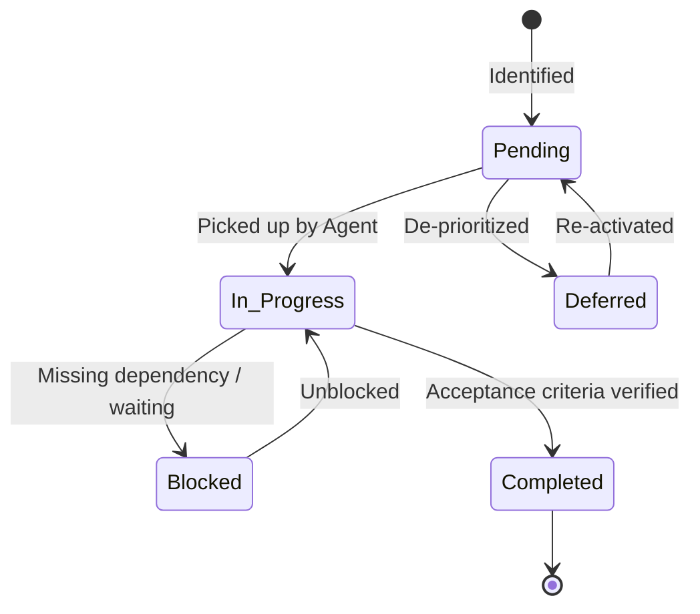

# Task Management State Machine
# [Project Name]

> Active Task Tracking, Prioritization, and State Transitions  
> Authority: Operational State (Precedence Level: Operational State Machine)  

---

## 1. Task State Machine & Transition Rules

### State Definitions
- **`Pending`**: Scoped, dependency-ordered, and ready to be picked up.
- **`In Progress`**: Actively being worked on by an agent or developer.
- **`Blocked`**: Cannot proceed due to missing prerequisite or external dependency.
- **`Completed`**: Implemented, tested, and verified against acceptance criteria.
- **`Deferred`**: Deliberately postponed to a future milestone.

---

## 2. Active Sprints & Tasks

### In Progress
- [ ] **TASK-XXX**: [Task Title]
  - **Category**: [Feature | Bugfix | Architecture | UI/UX | Refactor]
  - **Description**: [Actionable description of the work to be performed.]
  - **Files Involved**: `path/to/file1.ts`, `path/to/file2.ts`
  - **Assigned Skill**: [`skills/relevant-skill/SKILL.md`](../skills/)
  - **Verification Criteria**: [Command or test proving task completion.]

---

### Pending
- [ ] **TASK-XXX**: [Task Title]
  - **Category**: [Feature | Bugfix | Architecture | UI/UX | Refactor]
  - **Description**: [Actionable description of the work to be performed.]
  - **Dependencies**: [TASK-YYY must complete first]
  - **Verification Criteria**: [Command or test proving task completion.]

---

### Blocked
- [ ] **TASK-XXX**: [Task Title]
  - **Blocker Reason**: [Exact description of what is blocking progress]
  - **Resolution Plan**: [Steps needed to unblock]

---

### Deferred
- [ ] **TASK-XXX**: [Task Title]
  - **Rationale**: [Reason for postponement]
  - **Target Milestone**: [Future version or date]

---

## 3. Completed Archive

- [x] **TASK-001**: [Task Title]
  - **Completed Date**: [YYYY-MM-DD]
  - **Deliverables**: `path/to/delivered/file.ts`
  - **Validation Evidence**: [Tests passed, lint clean]

