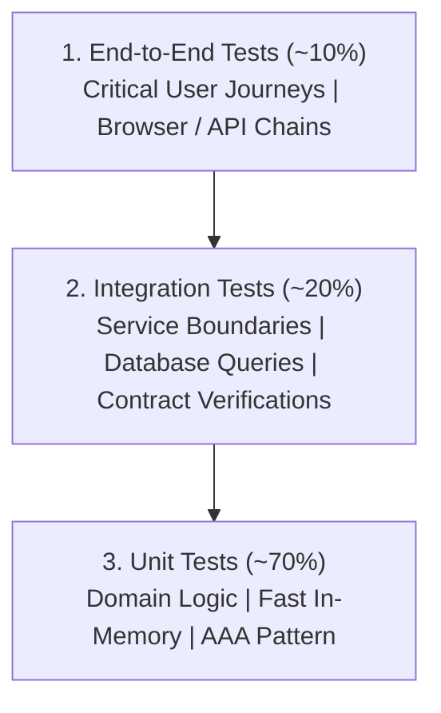

# TEST_STRATEGY.md — Comprehensive Software Test Plan
# [Project Name]

> Version: 1.0.0  
> Status: Active / Approved  
> Target System: [System / Application Name]  

---

## 1. Executive Summary & Quality Goals
- **Objective**: Establish the overarching quality assurance strategy, test levels, and release criteria for [Project Name].
- **Key Quality Invariants**:
  - Test-Driven Development (TDD) mandatory for testable domain logic.
  - Zero unresolved Critical or High defects at release.
  - 100% deterministic test execution with zero flakiness.

---

## 2. Testing Levels & Pyramid Distribution

| Level | Primary Scope | Tooling / Framework | Target Environment | Coverage Target |
|---|---|---|---|---|
| **Unit** | Individual functions, classes, and business logic | [e.g. Vitest / PyTest / Go test] | Local / In-Memory | ≥ 80% Branch |
| **Integration**| Database transactions, API endpoints, serialization | [e.g. Supertest / WebTestClient] | Container / Isolated DB | ≥ 75% API Routes |
| **System / E2E**| Complete user journeys, headless browser UI | [e.g. Playwright / Cypress] | Dedicated Staging | Top 10 Journeys |
| **Performance**| Latency budgets (p95 < 200ms), throughput | [e.g. k6 / Locust] | Staging | p95 < 200ms |
| **Security** | Auth bypass, IDOR, injection, OWASP checks | [e.g. Local scripts / SAST] | Dev / Staging | Zero Critical/High |

---

## 3. Test-Driven Development (TDD) Guidelines
- All new features and bug fixes follow the **Red-Green-Refactor** lifecycle:
  1. **RED**: Write automated tests capturing positive, negative, and edge cases. Verify expected failure.
  2. **GREEN**: Author minimum code to pass failing tests without modifying tests.
  3. **REFACTOR**: Clean code architecture while preserving passing test suite.

---

## 4. Release Gates & Signoff Criteria
1. **Functional Gate**: 100% acceptance criteria verified.
2. **Regression Gate**: Full test suite passes; zero regressions.
3. **Security Gate**: Zero unresolved Critical/High vulnerabilities; retests confirmed.
4. **Documentation Gate**: `/docs_agent/` updated with verified evidence.
