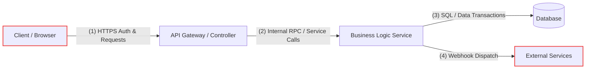

# THREAT_MODEL.md — Architectural Threat Model
# [Project Name]

> Methodology: STRIDE (Spoofing, Tampering, Repudiation, Info Disclosure, DoS, Elevation of Privilege)  
> System: [System / Subsystem Name]  

---

## 1. System Decomposition & Data Flow Diagram (DFD)

### Trust Boundaries
1. **Boundary 1 (Untrusted -> DMZ)**: Internet client to API Gateway.
2. **Boundary 2 (DMZ -> Internal)**: Gateway to core business domain logic.
3. **Boundary 3 (Internal -> Storage)**: Core service to persistent database.
4. **Boundary 4 (Internal -> External Third-Party)**: Service to external payment/notification APIs.

---

## 2. STRIDE Threat Analysis Matrix

| Element | Threat Class | Threat Description | Severity | Mitigation Strategy | Status |
|---|---|---|---|---|---|
| User Login | **S**poofing | Credential stuffing or token forgery | High | Argon2id hashing, rate limiting, RS256 JWT validation | Mitigated |
| Order Data | **T**ampering | Client tampering with price in POST body | High | Price recalculated server-side from catalog DB | Mitigated |
| Transactions | **R**epudiation | User denies authorizing a financial transfer | Medium | Append-only tamper-evident audit logs with timestamps | Mitigated |
| Customer PII | **I**nfo Disclosure | DB dump exposing plain customer details | Critical | AES-256 encryption at rest, field-level masking | Mitigated |
| Public API | **D**oS | High-volume request flood exhausts memory | Medium | Token-bucket rate limiting (100 req/min per IP) | Mitigated |
| Order Detail | **E**levation | User A views User B order via ID alteration (IDOR) | High | Enforce `WHERE id = $1 AND user_id = $current_user` | Mitigated |
